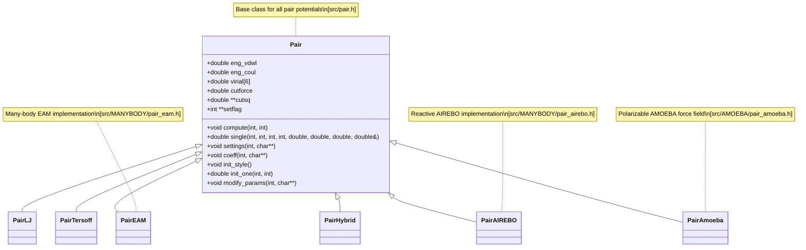
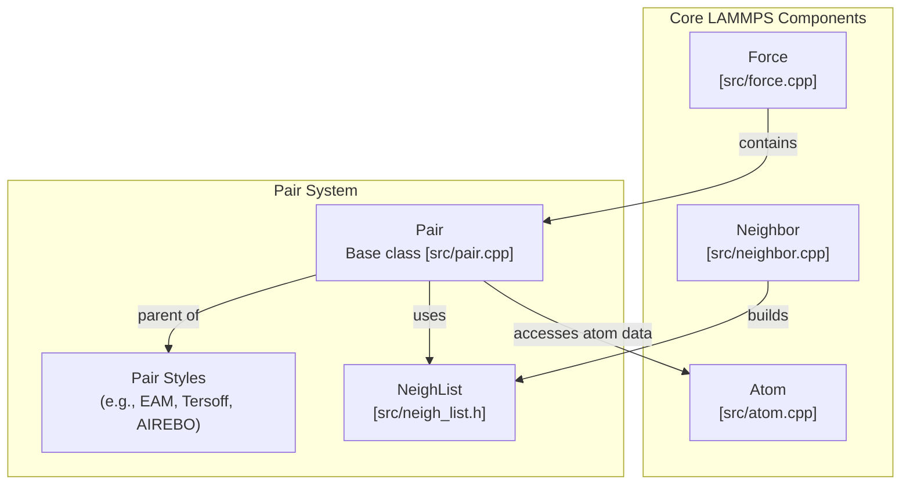
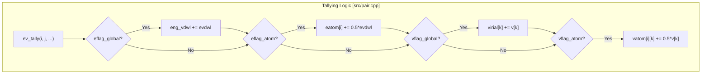

# Pair Potentials

Relevant source files

The following files were used as context for generating this wiki page:

- [doc/src/pair_hybrid.rst](doc/src/pair_hybrid.rst)
- [doc/src/pair_sw.rst](doc/src/pair_sw.rst)
- [examples/amoeba/data.ubiquitin](examples/amoeba/data.ubiquitin)
- [examples/amoeba/in.ubiquitin](examples/amoeba/in.ubiquitin)
- [potentials/CH.rebo](potentials/CH.rebo)
- [src/AMOEBA/amoeba_charge_transfer.cpp](src/AMOEBA/amoeba_charge_transfer.cpp)
- [src/AMOEBA/amoeba_convolution.cpp](src/AMOEBA/amoeba_convolution.cpp)
- [src/AMOEBA/amoeba_convolution.h](src/AMOEBA/amoeba_convolution.h)
- [src/AMOEBA/amoeba_dispersion.cpp](src/AMOEBA/amoeba_dispersion.cpp)
- [src/AMOEBA/amoeba_file.cpp](src/AMOEBA/amoeba_file.cpp)
- [src/AMOEBA/amoeba_hal.cpp](src/AMOEBA/amoeba_hal.cpp)
- [src/AMOEBA/amoeba_induce.cpp](src/AMOEBA/amoeba_induce.cpp)
- [src/AMOEBA/amoeba_kspace.cpp](src/AMOEBA/amoeba_kspace.cpp)
- [src/AMOEBA/amoeba_multipole.cpp](src/AMOEBA/amoeba_multipole.cpp)
- [src/AMOEBA/amoeba_polar.cpp](src/AMOEBA/amoeba_polar.cpp)
- [src/AMOEBA/amoeba_repulsion.cpp](src/AMOEBA/amoeba_repulsion.cpp)
- [src/AMOEBA/amoeba_utils.cpp](src/AMOEBA/amoeba_utils.cpp)
- [src/AMOEBA/angle_amoeba.cpp](src/AMOEBA/angle_amoeba.cpp)
- [src/AMOEBA/angle_amoeba.h](src/AMOEBA/angle_amoeba.h)
- [src/AMOEBA/atom_vec_amoeba.cpp](src/AMOEBA/atom_vec_amoeba.cpp)
- [src/AMOEBA/atom_vec_amoeba.h](src/AMOEBA/atom_vec_amoeba.h)
- [src/AMOEBA/fix_amoeba_bitorsion.cpp](src/AMOEBA/fix_amoeba_bitorsion.cpp)
- [src/AMOEBA/fix_amoeba_bitorsion.h](src/AMOEBA/fix_amoeba_bitorsion.h)
- [src/AMOEBA/fix_amoeba_pitorsion.cpp](src/AMOEBA/fix_amoeba_pitorsion.cpp)
- [src/AMOEBA/fix_amoeba_pitorsion.h](src/AMOEBA/fix_amoeba_pitorsion.h)
- [src/AMOEBA/improper_amoeba.cpp](src/AMOEBA/improper_amoeba.cpp)
- [src/AMOEBA/improper_amoeba.h](src/AMOEBA/improper_amoeba.h)
- [src/AMOEBA/pair_amoeba.cpp](src/AMOEBA/pair_amoeba.cpp)
- [src/AMOEBA/pair_amoeba.h](src/AMOEBA/pair_amoeba.h)
- [src/AMOEBA/pair_hippo.h](src/AMOEBA/pair_hippo.h)
- [src/CLASS2/angle_class2.h](src/CLASS2/angle_class2.h)
- [src/EXTRA-COMPUTE/compute_born_matrix.cpp](src/EXTRA-COMPUTE/compute_born_matrix.cpp)
- [src/EXTRA-DUMP/dump_xtc.cpp](src/EXTRA-DUMP/dump_xtc.cpp)
- [src/EXTRA-DUMP/xdr_compat.cpp](src/EXTRA-DUMP/xdr_compat.cpp)
- [src/EXTRA-DUMP/xdr_compat.h](src/EXTRA-DUMP/xdr_compat.h)
- [src/EXTRA-MOLECULE/dihedral_nharmonic.cpp](src/EXTRA-MOLECULE/dihedral_nharmonic.cpp)
- [src/EXTRA-MOLECULE/dihedral_nharmonic.h](src/EXTRA-MOLECULE/dihedral_nharmonic.h)
- [src/EXTRA-MOLECULE/improper_cossq.cpp](src/EXTRA-MOLECULE/improper_cossq.cpp)
- [src/EXTRA-MOLECULE/improper_distance.cpp](src/EXTRA-MOLECULE/improper_distance.cpp)
- [src/EXTRA-MOLECULE/improper_fourier.cpp](src/EXTRA-MOLECULE/improper_fourier.cpp)
- [src/EXTRA-MOLECULE/improper_ring.cpp](src/EXTRA-MOLECULE/improper_ring.cpp)
- [src/GPU/pair_buck_coul_cut_gpu.h](src/GPU/pair_buck_coul_cut_gpu.h)
- [src/GPU/pair_buck_coul_long_gpu.h](src/GPU/pair_buck_coul_long_gpu.h)
- [src/GPU/pair_buck_gpu.h](src/GPU/pair_buck_gpu.h)
- [src/GPU/pair_eam_alloy_gpu.cpp](src/GPU/pair_eam_alloy_gpu.cpp)
- [src/GPU/pair_eam_alloy_gpu.h](src/GPU/pair_eam_alloy_gpu.h)
- [src/GPU/pair_eam_fs_gpu.cpp](src/GPU/pair_eam_fs_gpu.cpp)
- [src/GPU/pair_eam_fs_gpu.h](src/GPU/pair_eam_fs_gpu.h)
- [src/GPU/pair_eam_gpu.cpp](src/GPU/pair_eam_gpu.cpp)
- [src/GPU/pair_eam_gpu.h](src/GPU/pair_eam_gpu.h)
- [src/GPU/pair_table_gpu.h](src/GPU/pair_table_gpu.h)
- [src/GPU/pair_yukawa_gpu.h](src/GPU/pair_yukawa_gpu.h)
- [src/GPU/pppm_gpu.cpp](src/GPU/pppm_gpu.cpp)
- [src/GPU/pppm_gpu.h](src/GPU/pppm_gpu.h)
- [src/KOKKOS/pair_hybrid_scaled_kokkos.cpp](src/KOKKOS/pair_hybrid_scaled_kokkos.cpp)
- [src/KOKKOS/pair_hybrid_scaled_kokkos.h](src/KOKKOS/pair_hybrid_scaled_kokkos.h)
- [src/KSPACE/ewald.cpp](src/KSPACE/ewald.cpp)
- [src/KSPACE/ewald.h](src/KSPACE/ewald.h)
- [src/KSPACE/ewald_dipole.cpp](src/KSPACE/ewald_dipole.cpp)
- [src/KSPACE/ewald_dipole.h](src/KSPACE/ewald_dipole.h)
- [src/KSPACE/ewald_dipole_spin.cpp](src/KSPACE/ewald_dipole_spin.cpp)
- [src/KSPACE/ewald_dipole_spin.h](src/KSPACE/ewald_dipole_spin.h)
- [src/KSPACE/ewald_disp.cpp](src/KSPACE/ewald_disp.cpp)
- [src/KSPACE/ewald_disp.h](src/KSPACE/ewald_disp.h)
- [src/KSPACE/msm.cpp](src/KSPACE/msm.cpp)
- [src/KSPACE/msm.h](src/KSPACE/msm.h)
- [src/KSPACE/msm_cg.cpp](src/KSPACE/msm_cg.cpp)
- [src/KSPACE/pppm.cpp](src/KSPACE/pppm.cpp)
- [src/KSPACE/pppm.h](src/KSPACE/pppm.h)
- [src/KSPACE/pppm_cg.cpp](src/KSPACE/pppm_cg.cpp)
- [src/KSPACE/pppm_cg.h](src/KSPACE/pppm_cg.h)
- [src/KSPACE/pppm_dipole.cpp](src/KSPACE/pppm_dipole.cpp)
- [src/KSPACE/pppm_dipole.h](src/KSPACE/pppm_dipole.h)
- [src/KSPACE/pppm_dipole_spin.cpp](src/KSPACE/pppm_dipole_spin.cpp)
- [src/KSPACE/pppm_dipole_spin.h](src/KSPACE/pppm_dipole_spin.h)
- [src/KSPACE/pppm_disp.cpp](src/KSPACE/pppm_disp.cpp)
- [src/KSPACE/pppm_disp.h](src/KSPACE/pppm_disp.h)
- [src/KSPACE/pppm_disp_tip4p.cpp](src/KSPACE/pppm_disp_tip4p.cpp)
- [src/KSPACE/pppm_disp_tip4p.h](src/KSPACE/pppm_disp_tip4p.h)
- [src/KSPACE/pppm_stagger.cpp](src/KSPACE/pppm_stagger.cpp)
- [src/KSPACE/pppm_stagger.h](src/KSPACE/pppm_stagger.h)
- [src/KSPACE/pppm_tip4p.cpp](src/KSPACE/pppm_tip4p.cpp)
- [src/KSPACE/pppm_tip4p.h](src/KSPACE/pppm_tip4p.h)
- [src/MANYBODY/fix_qeq_comb.cpp](src/MANYBODY/fix_qeq_comb.cpp)
- [src/MANYBODY/fix_qeq_comb.h](src/MANYBODY/fix_qeq_comb.h)
- [src/MANYBODY/pair_adp.cpp](src/MANYBODY/pair_adp.cpp)
- [src/MANYBODY/pair_adp.h](src/MANYBODY/pair_adp.h)
- [src/MANYBODY/pair_airebo.cpp](src/MANYBODY/pair_airebo.cpp)
- [src/MANYBODY/pair_airebo.h](src/MANYBODY/pair_airebo.h)
- [src/MANYBODY/pair_airebo_morse.cpp](src/MANYBODY/pair_airebo_morse.cpp)
- [src/MANYBODY/pair_airebo_morse.h](src/MANYBODY/pair_airebo_morse.h)
- [src/MANYBODY/pair_comb.cpp](src/MANYBODY/pair_comb.cpp)
- [src/MANYBODY/pair_comb.h](src/MANYBODY/pair_comb.h)
- [src/MANYBODY/pair_comb3.cpp](src/MANYBODY/pair_comb3.cpp)
- [src/MANYBODY/pair_comb3.h](src/MANYBODY/pair_comb3.h)
- [src/MANYBODY/pair_eam.cpp](src/MANYBODY/pair_eam.cpp)
- [src/MANYBODY/pair_eam.h](src/MANYBODY/pair_eam.h)
- [src/MANYBODY/pair_eam_alloy.cpp](src/MANYBODY/pair_eam_alloy.cpp)
- [src/MANYBODY/pair_eam_alloy.h](src/MANYBODY/pair_eam_alloy.h)
- [src/MANYBODY/pair_eam_cd.cpp](src/MANYBODY/pair_eam_cd.cpp)
- [src/MANYBODY/pair_eam_cd.h](src/MANYBODY/pair_eam_cd.h)
- [src/MANYBODY/pair_eam_fs.cpp](src/MANYBODY/pair_eam_fs.cpp)
- [src/MANYBODY/pair_eam_fs.h](src/MANYBODY/pair_eam_fs.h)
- [src/MANYBODY/pair_eam_he.cpp](src/MANYBODY/pair_eam_he.cpp)
- [src/MANYBODY/pair_eam_he.h](src/MANYBODY/pair_eam_he.h)
- [src/MANYBODY/pair_eim.cpp](src/MANYBODY/pair_eim.cpp)
- [src/MANYBODY/pair_extep.h](src/MANYBODY/pair_extep.h)
- [src/MANYBODY/pair_gw.cpp](src/MANYBODY/pair_gw.cpp)
- [src/MANYBODY/pair_gw.h](src/MANYBODY/pair_gw.h)
- [src/MANYBODY/pair_gw_zbl.cpp](src/MANYBODY/pair_gw_zbl.cpp)
- [src/MANYBODY/pair_gw_zbl.h](src/MANYBODY/pair_gw_zbl.h)
- [src/MANYBODY/pair_lcbop.cpp](src/MANYBODY/pair_lcbop.cpp)
- [src/MANYBODY/pair_lcbop.h](src/MANYBODY/pair_lcbop.h)
- [src/MANYBODY/pair_nb3b_harmonic.cpp](src/MANYBODY/pair_nb3b_harmonic.cpp)
- [src/MANYBODY/pair_nb3b_harmonic.h](src/MANYBODY/pair_nb3b_harmonic.h)
- [src/MANYBODY/pair_nb3b_screened.cpp](src/MANYBODY/pair_nb3b_screened.cpp)
- [src/MANYBODY/pair_rebo.cpp](src/MANYBODY/pair_rebo.cpp)
- [src/MANYBODY/pair_rebo.h](src/MANYBODY/pair_rebo.h)
- [src/MANYBODY/pair_sw.cpp](src/MANYBODY/pair_sw.cpp)
- [src/MANYBODY/pair_sw.h](src/MANYBODY/pair_sw.h)
- [src/MANYBODY/pair_sw_mod.cpp](src/MANYBODY/pair_sw_mod.cpp)
- [src/MANYBODY/pair_sw_mod.h](src/MANYBODY/pair_sw_mod.h)
- [src/MANYBODY/pair_tersoff.cpp](src/MANYBODY/pair_tersoff.cpp)
- [src/MANYBODY/pair_tersoff.h](src/MANYBODY/pair_tersoff.h)
- [src/MANYBODY/pair_tersoff_mod.cpp](src/MANYBODY/pair_tersoff_mod.cpp)
- [src/MANYBODY/pair_tersoff_mod.h](src/MANYBODY/pair_tersoff_mod.h)
- [src/MANYBODY/pair_tersoff_mod_c.cpp](src/MANYBODY/pair_tersoff_mod_c.cpp)
- [src/MANYBODY/pair_tersoff_mod_c.h](src/MANYBODY/pair_tersoff_mod_c.h)
- [src/MANYBODY/pair_tersoff_zbl.cpp](src/MANYBODY/pair_tersoff_zbl.cpp)
- [src/MANYBODY/pair_tersoff_zbl.h](src/MANYBODY/pair_tersoff_zbl.h)
- [src/MANYBODY/pair_threebody_table.h](src/MANYBODY/pair_threebody_table.h)
- [src/MANYBODY/pair_vashishta.cpp](src/MANYBODY/pair_vashishta.cpp)
- [src/MANYBODY/pair_vashishta.h](src/MANYBODY/pair_vashishta.h)
- [src/MANYBODY/pair_vashishta_table.cpp](src/MANYBODY/pair_vashishta_table.cpp)
- [src/MANYBODY/pair_vashishta_table.h](src/MANYBODY/pair_vashishta_table.h)
- [src/MOFFF/improper_inversion_harmonic.cpp](src/MOFFF/improper_inversion_harmonic.cpp)
- [src/MOLECULE/angle_charmm.cpp](src/MOLECULE/angle_charmm.cpp)
- [src/MOLECULE/angle_charmm.h](src/MOLECULE/angle_charmm.h)
- [src/MOLECULE/angle_cosine.cpp](src/MOLECULE/angle_cosine.cpp)
- [src/MOLECULE/angle_cosine.h](src/MOLECULE/angle_cosine.h)
- [src/MOLECULE/angle_cosine_squared.cpp](src/MOLECULE/angle_cosine_squared.cpp)
- [src/MOLECULE/angle_cosine_squared.h](src/MOLECULE/angle_cosine_squared.h)
- [src/MOLECULE/angle_harmonic.cpp](src/MOLECULE/angle_harmonic.cpp)
- [src/MOLECULE/angle_harmonic.h](src/MOLECULE/angle_harmonic.h)
- [src/MOLECULE/angle_table.cpp](src/MOLECULE/angle_table.cpp)
- [src/MOLECULE/angle_table.h](src/MOLECULE/angle_table.h)
- [src/MOLECULE/bond_table.cpp](src/MOLECULE/bond_table.cpp)
- [src/MOLECULE/bond_table.h](src/MOLECULE/bond_table.h)
- [src/MOLECULE/dihedral_charmm.cpp](src/MOLECULE/dihedral_charmm.cpp)
- [src/MOLECULE/dihedral_charmmfsw.cpp](src/MOLECULE/dihedral_charmmfsw.cpp)
- [src/MOLECULE/dihedral_charmmfsw.h](src/MOLECULE/dihedral_charmmfsw.h)
- [src/MOLECULE/dihedral_harmonic.cpp](src/MOLECULE/dihedral_harmonic.cpp)
- [src/MOLECULE/dihedral_multi_harmonic.cpp](src/MOLECULE/dihedral_multi_harmonic.cpp)
- [src/MOLECULE/dihedral_opls.cpp](src/MOLECULE/dihedral_opls.cpp)
- [src/MOLECULE/dihedral_table.cpp](src/MOLECULE/dihedral_table.cpp)
- [src/MOLECULE/improper_cvff.cpp](src/MOLECULE/improper_cvff.cpp)
- [src/MOLECULE/improper_harmonic.cpp](src/MOLECULE/improper_harmonic.cpp)
- [src/MOLECULE/improper_umbrella.cpp](src/MOLECULE/improper_umbrella.cpp)
- [src/OPENMP/pair_airebo_morse_omp.cpp](src/OPENMP/pair_airebo_morse_omp.cpp)
- [src/OPENMP/pair_rebo_omp.cpp](src/OPENMP/pair_rebo_omp.cpp)
- [src/OPENMP/pair_sw_mod_omp.cpp](src/OPENMP/pair_sw_mod_omp.cpp)
- [src/OPENMP/pair_sw_mod_omp.h](src/OPENMP/pair_sw_mod_omp.h)
- [src/YAFF/improper_distharm.cpp](src/YAFF/improper_distharm.cpp)
- [src/YAFF/improper_sqdistharm.cpp](src/YAFF/improper_sqdistharm.cpp)
- [src/angle.cpp](src/angle.cpp)
- [src/angle.h](src/angle.h)
- [src/angle_hybrid.cpp](src/angle_hybrid.cpp)
- [src/angle_hybrid.h](src/angle_hybrid.h)
- [src/bond.cpp](src/bond.cpp)
- [src/bond.h](src/bond.h)
- [src/bond_hybrid.cpp](src/bond_hybrid.cpp)
- [src/bond_hybrid.h](src/bond_hybrid.h)
- [src/compute_centroid_stress_atom.cpp](src/compute_centroid_stress_atom.cpp)
- [src/compute_heat_flux.cpp](src/compute_heat_flux.cpp)
- [src/compute_heat_flux.h](src/compute_heat_flux.h)
- [src/compute_pe.cpp](src/compute_pe.cpp)
- [src/compute_pe.h](src/compute_pe.h)
- [src/compute_pe_atom.cpp](src/compute_pe_atom.cpp)
- [src/compute_pe_atom.h](src/compute_pe_atom.h)
- [src/compute_pressure.cpp](src/compute_pressure.cpp)
- [src/compute_pressure.h](src/compute_pressure.h)
- [src/compute_stress_atom.cpp](src/compute_stress_atom.cpp)
- [src/compute_stress_atom.h](src/compute_stress_atom.h)
- [src/dihedral.cpp](src/dihedral.cpp)
- [src/dihedral.h](src/dihedral.h)
- [src/dihedral_hybrid.cpp](src/dihedral_hybrid.cpp)
- [src/dihedral_hybrid.h](src/dihedral_hybrid.h)
- [src/improper.cpp](src/improper.cpp)
- [src/improper.h](src/improper.h)
- [src/improper_hybrid.cpp](src/improper_hybrid.cpp)
- [src/improper_hybrid.h](src/improper_hybrid.h)
- [src/kspace.cpp](src/kspace.cpp)
- [src/kspace.h](src/kspace.h)
- [src/pair.cpp](src/pair.cpp)
- [src/pair.h](src/pair.h)
- [src/pair_hybrid.cpp](src/pair_hybrid.cpp)
- [src/pair_hybrid.h](src/pair_hybrid.h)
- [src/pair_hybrid_overlay.cpp](src/pair_hybrid_overlay.cpp)
- [src/pair_hybrid_overlay.h](src/pair_hybrid_overlay.h)
- [src/pair_hybrid_scaled.cpp](src/pair_hybrid_scaled.cpp)
- [src/pair_hybrid_scaled.h](src/pair_hybrid_scaled.h)
- [src/pair_table.cpp](src/pair_table.cpp)
- [src/pair_table.h](src/pair_table.h)
- [tools/tinker/data.py](tools/tinker/data.py)
- [tools/tinker/tinker2lmp.py](tools/tinker/tinker2lmp.py)
- [unittest/formats/test_image_flags.cpp](unittest/formats/test_image_flags.cpp)
- [unittest/formats/test_pair_unit_convert.cpp](unittest/formats/test_pair_unit_convert.cpp)

This document describes the pair potentials system in LAMMPS, which handles the non-bonded pairwise interactions between atoms. Pair potentials are fundamental to molecular dynamics simulations as they typically represent the most computationally intensive part of force calculations. For long-range Coulombic interactions, see [KSpace Methods](#3.2).

## Overview of Pair Potentials

Pair potentials compute the interaction forces and energies between pairs of atoms based on their separation distance. In LAMMPS, the `Pair` class serves as the base class for all pair styles.

Sources: [src/pair.h:21-165](), [src/MANYBODY/pair_eam.h:32-32](), [src/MANYBODY/pair_airebo.h:54-54](), [src/AMOEBA/pair_amoeba.h:53-53]().

## Pair Class Structure

The `Pair` class is a fundamental component of LAMMPS that manages the calculation of pairwise interactions between atoms. It provides a common interface for all specific pair potential implementations.

Sources: [src/pair.h:21-135](), [src/pair.cpp:59-134]().

### Key Member Variables

The `Pair` class contains several important member variables that track accumulated physical quantities and control execution logic:

| Variable | Type | Description |
|----------|------|-------------|
| `eng_vdwl` | double | Accumulated van der Waals/short-range energy [src/pair.h:41]() |
| `eng_coul` | double | Accumulated Coulombic energy [src/pair.h:41]() |
| `virial[6]` | double | Accumulated global virial (xx,yy,zz,xy,xz,yz) [src/pair.h:42]() |
| `eatom` | double* | Per-atom energy accumulation [src/pair.h:43]() |
| `vatom` | double** | Per-atom virial accumulation [src/pair.h:43]() |
| `cutsq` | double** | Cutoff squared for each atom type pair [src/pair.h:47]() |
| `setflag` | int** | Flag indicating if coefficients for i,j types are set [src/pair.h:48]() |
| `manybody_flag`| int | Set to 1 for EAM, Tersoff, AIREBO, etc. [src/pair.h:62]() |

Sources: [src/pair.h:41-69](), [src/pair.cpp:59-134]().

### Principal Methods

The `Pair` class defines several virtual methods that derived classes must implement:

1. `compute(int eflag, int vflag)`: The main entry point for force calculation during the timestep [src/pair.h:159]().
2. `settings(int narg, char **arg)`: Parses global parameters from the `pair_style` command [src/pair.h:184]().
3. `coeff(int narg, char **arg)`: Parses parameters for specific atom types from the `pair_coeff` command [src/pair.h:188]().
4. `init_style()`: Style-specific initialization, such as requesting neighbor list types [src/pair.h:191]().
5. `single()`: Computes force/energy for a single pair (used by `compute pair/local`) [src/pair.h:165]().

Sources: [src/pair.h:159-200](), [src/pair.cpp:164-212]().

## Energy and Virial Accumulation

LAMMPS uses a standardized tallying system to accumulate global and per-atom energy/virial. The `ev_tally` functions handle the logic of adding contributions based on whether global or per-atom flags are set.

Sources: [src/pair.cpp:1021-1115]().

## Specialized Pair Implementations

### Many-body Potentials (EAM, Tersoff, AIREBO)

Many-body potentials differ from standard pair potentials by including dependencies on the local environment (e.g., local density or bond angles).

*   **EAM (Embedded Atom Method):** Uses a two-step compute. First, it calculates the local electron density at each atom site by summing contributions from neighbors. Then, it performs a forward communication of these densities before calculating the embedding energy derivative and final forces.
    *   *Sources:* [src/MANYBODY/pair_eam.cpp:124-320]().
*   **Tersoff:** A bond-order potential that iterates through neighbors to compute a three-body term $\zeta_{ij}$ based on the angle between bonds $i-j$ and $i-k$.
    *   *Sources:* [src/MANYBODY/pair_tersoff.cpp:113-280]().
*   **AIREBO:** Includes REBO terms, Lennard-Jones interactions, and torsional terms. It requires a full neighbor list including ghost atoms to handle many-body effects across processor boundaries.
    *   *Sources:* [src/MANYBODY/pair_airebo.cpp:112-123]().

### Hybrid Pair Styles

The `PairHybrid` style allows different pair potentials to be assigned to different atom type pairs.

*   It maintains an array of `Pair` pointers called `styles`.
*   The `compute()` method in `PairHybrid` loops through each sub-style and calls its individual `compute()` function.
*   It manages `special_bonds` settings (LJ/Coulomb scaling) which may differ between sub-styles.

Sources: [src/pair_hybrid.h:29-50](), [src/pair_hybrid.cpp:91-195]().

### Tabulated Potentials

The `PairTable` style allows users to provide force and energy values in a file, which LAMMPS then interpolates using cubic splines or linear lookups. This is often used for coarse-grained models or when an analytical form is unavailable.

Sources: [src/pair.h:99-102]().

### AMOEBA and Polarizable Potentials

The `PairAmoeba` style implements the polarizable AMOEBA force field, which involves multipole interactions and induced dipoles. It uses complex communication patterns to handle the iterative convergence of induced dipoles.

Sources: [src/AMOEBA/pair_amoeba.cpp:56-177](), [src/AMOEBA/pair_amoeba.h:53-150]().

## Mixing Rules

When interaction parameters for unlike types (i != j) are not explicitly provided, LAMMPS uses mixing rules:

*   **Geometric:** $\epsilon_{ij} = \sqrt{\epsilon_i \epsilon_j}$, $\sigma_{ij} = \sqrt{\sigma_i \sigma_j}$
*   **Arithmetic:** $\epsilon_{ij} = \sqrt{\epsilon_i \epsilon_j}$, $\sigma_{ij} = \frac{1}{2}(\sigma_i + \sigma_j)$
*   **Sixthpower:** Complex mixing based on $r^6$ dispersion terms.

Sources: [src/pair.cpp:711-740](), [src/pair.h:122-122]().

## KSpace Interaction

Pair styles often interact with long-range solvers. Flags like `ewaldflag`, `pppmflag`, and `dispersionflag` indicate whether a pair style can provide the short-range component of a long-range interaction.

Sources: [src/pair.h:71-78](), [src/kspace.cpp:197-218]().

---