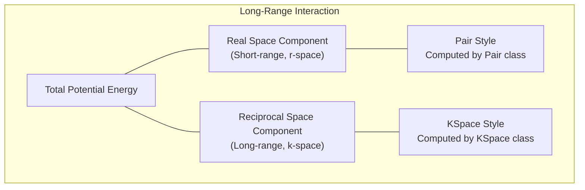
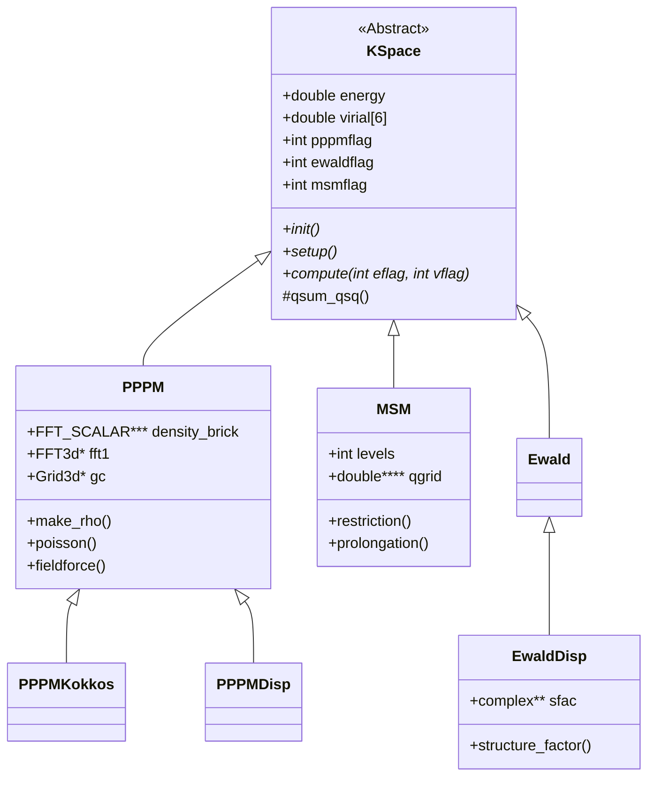
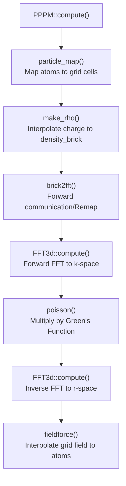

# KSpace Methods

Relevant source files

The following files were used as context for generating this wiki page:

- [cmake/Modules/FindFFTW3.cmake](cmake/Modules/FindFFTW3.cmake)
- [cmake/Modules/FindFFTW3F.cmake](cmake/Modules/FindFFTW3F.cmake)
- [cmake/Modules/Packages/INTEL.cmake](cmake/Modules/Packages/INTEL.cmake)
- [cmake/Modules/Packages/KSPACE.cmake](cmake/Modules/Packages/KSPACE.cmake)
- [src/ELECTRODE/boundary_correction.cpp](src/ELECTRODE/boundary_correction.cpp)
- [src/ELECTRODE/boundary_correction.h](src/ELECTRODE/boundary_correction.h)
- [src/ELECTRODE/electrode_math.h](src/ELECTRODE/electrode_math.h)
- [src/ELECTRODE/electrode_matrix.cpp](src/ELECTRODE/electrode_matrix.cpp)
- [src/ELECTRODE/electrode_matrix.h](src/ELECTRODE/electrode_matrix.h)
- [src/ELECTRODE/electrode_vector.cpp](src/ELECTRODE/electrode_vector.cpp)
- [src/ELECTRODE/electrode_vector.h](src/ELECTRODE/electrode_vector.h)
- [src/ELECTRODE/ewald_electrode.cpp](src/ELECTRODE/ewald_electrode.cpp)
- [src/ELECTRODE/ewald_electrode.h](src/ELECTRODE/ewald_electrode.h)
- [src/ELECTRODE/fix_electrode_conp.cpp](src/ELECTRODE/fix_electrode_conp.cpp)
- [src/ELECTRODE/fix_electrode_conp.h](src/ELECTRODE/fix_electrode_conp.h)
- [src/ELECTRODE/fix_electrode_conq.cpp](src/ELECTRODE/fix_electrode_conq.cpp)
- [src/ELECTRODE/fix_electrode_conq.h](src/ELECTRODE/fix_electrode_conq.h)
- [src/ELECTRODE/fix_electrode_thermo.cpp](src/ELECTRODE/fix_electrode_thermo.cpp)
- [src/ELECTRODE/fix_electrode_thermo.h](src/ELECTRODE/fix_electrode_thermo.h)
- [src/ELECTRODE/pppm_electrode.cpp](src/ELECTRODE/pppm_electrode.cpp)
- [src/ELECTRODE/pppm_electrode.h](src/ELECTRODE/pppm_electrode.h)
- [src/ELECTRODE/slab_2d.cpp](src/ELECTRODE/slab_2d.cpp)
- [src/ELECTRODE/slab_2d.h](src/ELECTRODE/slab_2d.h)
- [src/ELECTRODE/slab_dipole.cpp](src/ELECTRODE/slab_dipole.cpp)
- [src/ELECTRODE/slab_dipole.h](src/ELECTRODE/slab_dipole.h)
- [src/ELECTRODE/wire_dipole.cpp](src/ELECTRODE/wire_dipole.cpp)
- [src/ELECTRODE/wire_dipole.h](src/ELECTRODE/wire_dipole.h)
- [src/GPU/pppm_gpu.cpp](src/GPU/pppm_gpu.cpp)
- [src/GPU/pppm_gpu.h](src/GPU/pppm_gpu.h)
- [src/INTEL/README](src/INTEL/README)
- [src/INTEL/fix_electrode_conp_intel.h](src/INTEL/fix_electrode_conp_intel.h)
- [src/INTEL/fix_electrode_conq_intel.h](src/INTEL/fix_electrode_conq_intel.h)
- [src/INTEL/fix_electrode_thermo_intel.h](src/INTEL/fix_electrode_thermo_intel.h)
- [src/INTEL/nbin_intel.cpp](src/INTEL/nbin_intel.cpp)
- [src/INTEL/pppm_electrode_intel.cpp](src/INTEL/pppm_electrode_intel.cpp)
- [src/INTEL/pppm_electrode_intel.h](src/INTEL/pppm_electrode_intel.h)
- [src/INTEL/pppm_intel.h](src/INTEL/pppm_intel.h)
- [src/INTEL/verlet_lrt_intel.cpp](src/INTEL/verlet_lrt_intel.cpp)
- [src/KOKKOS/fft3d_kokkos.cpp](src/KOKKOS/fft3d_kokkos.cpp)
- [src/KOKKOS/fft3d_kokkos.h](src/KOKKOS/fft3d_kokkos.h)
- [src/KOKKOS/fftdata_kokkos.h](src/KOKKOS/fftdata_kokkos.h)
- [src/KOKKOS/grid3d_kokkos.cpp](src/KOKKOS/grid3d_kokkos.cpp)
- [src/KOKKOS/grid3d_kokkos.h](src/KOKKOS/grid3d_kokkos.h)
- [src/KOKKOS/kissfft_kokkos.h](src/KOKKOS/kissfft_kokkos.h)
- [src/KOKKOS/kokkos_base_fft.h](src/KOKKOS/kokkos_base_fft.h)
- [src/KOKKOS/pack_kokkos.h](src/KOKKOS/pack_kokkos.h)
- [src/KOKKOS/pppm_kokkos.cpp](src/KOKKOS/pppm_kokkos.cpp)
- [src/KOKKOS/pppm_kokkos.h](src/KOKKOS/pppm_kokkos.h)
- [src/KOKKOS/remap_kokkos.cpp](src/KOKKOS/remap_kokkos.cpp)
- [src/KOKKOS/remap_kokkos.h](src/KOKKOS/remap_kokkos.h)
- [src/KSPACE/ewald.cpp](src/KSPACE/ewald.cpp)
- [src/KSPACE/ewald.h](src/KSPACE/ewald.h)
- [src/KSPACE/ewald_dipole.cpp](src/KSPACE/ewald_dipole.cpp)
- [src/KSPACE/ewald_dipole.h](src/KSPACE/ewald_dipole.h)
- [src/KSPACE/ewald_dipole_spin.cpp](src/KSPACE/ewald_dipole_spin.cpp)
- [src/KSPACE/ewald_dipole_spin.h](src/KSPACE/ewald_dipole_spin.h)
- [src/KSPACE/ewald_disp.cpp](src/KSPACE/ewald_disp.cpp)
- [src/KSPACE/ewald_disp.h](src/KSPACE/ewald_disp.h)
- [src/KSPACE/fft3d.cpp](src/KSPACE/fft3d.cpp)
- [src/KSPACE/fft3d.h](src/KSPACE/fft3d.h)
- [src/KSPACE/fft3d_wrap.cpp](src/KSPACE/fft3d_wrap.cpp)
- [src/KSPACE/fft3d_wrap.h](src/KSPACE/fft3d_wrap.h)
- [src/KSPACE/msm.cpp](src/KSPACE/msm.cpp)
- [src/KSPACE/msm.h](src/KSPACE/msm.h)
- [src/KSPACE/msm_cg.cpp](src/KSPACE/msm_cg.cpp)
- [src/KSPACE/pppm.cpp](src/KSPACE/pppm.cpp)
- [src/KSPACE/pppm.h](src/KSPACE/pppm.h)
- [src/KSPACE/pppm_cg.cpp](src/KSPACE/pppm_cg.cpp)
- [src/KSPACE/pppm_cg.h](src/KSPACE/pppm_cg.h)
- [src/KSPACE/pppm_dipole.cpp](src/KSPACE/pppm_dipole.cpp)
- [src/KSPACE/pppm_dipole.h](src/KSPACE/pppm_dipole.h)
- [src/KSPACE/pppm_dipole_spin.cpp](src/KSPACE/pppm_dipole_spin.cpp)
- [src/KSPACE/pppm_dipole_spin.h](src/KSPACE/pppm_dipole_spin.h)
- [src/KSPACE/pppm_disp.cpp](src/KSPACE/pppm_disp.cpp)
- [src/KSPACE/pppm_disp.h](src/KSPACE/pppm_disp.h)
- [src/KSPACE/pppm_disp_tip4p.cpp](src/KSPACE/pppm_disp_tip4p.cpp)
- [src/KSPACE/pppm_disp_tip4p.h](src/KSPACE/pppm_disp_tip4p.h)
- [src/KSPACE/pppm_stagger.cpp](src/KSPACE/pppm_stagger.cpp)
- [src/KSPACE/pppm_stagger.h](src/KSPACE/pppm_stagger.h)
- [src/KSPACE/pppm_tip4p.cpp](src/KSPACE/pppm_tip4p.cpp)
- [src/KSPACE/pppm_tip4p.h](src/KSPACE/pppm_tip4p.h)
- [src/KSPACE/remap.cpp](src/KSPACE/remap.cpp)
- [src/KSPACE/remap.h](src/KSPACE/remap.h)
- [src/KSPACE/remap_wrap.cpp](src/KSPACE/remap_wrap.cpp)
- [src/KSPACE/remap_wrap.h](src/KSPACE/remap_wrap.h)
- [src/MAKE/MACHINES/Makefile.aurora](src/MAKE/MACHINES/Makefile.aurora)
- [src/angle.cpp](src/angle.cpp)
- [src/angle.h](src/angle.h)
- [src/bond.cpp](src/bond.cpp)
- [src/bond.h](src/bond.h)
- [src/dihedral.cpp](src/dihedral.cpp)
- [src/dihedral.h](src/dihedral.h)
- [src/improper.cpp](src/improper.cpp)
- [src/improper.h](src/improper.h)
- [src/kspace.cpp](src/kspace.cpp)
- [src/kspace.h](src/kspace.h)
- [src/lmpfftsettings.h](src/lmpfftsettings.h)
- [src/pair.cpp](src/pair.cpp)
- [src/pair.h](src/pair.h)

KSpace methods in LAMMPS are responsible for computing long-range interactions in molecular dynamics simulations. These methods efficiently handle electrostatic and dispersion forces that extend beyond the typical cutoff distances used in pair potentials (which are covered in [Pair Potentials](3.1)). This page documents the KSpace subsystem architecture, available methods, and their implementation details.

## Overview of Long-Range Interactions

Long-range interactions, particularly electrostatic forces, decay slowly with distance (1/r), making them challenging to compute directly in large systems. KSpace methods solve this problem by splitting the computation into:

1.  **Real space** (short-range) component - computed directly using pair potentials.
2.  **Reciprocal space** (long-range) component - computed using Fourier transform techniques or hierarchical grids.

Sources: [src/kspace.h:21-38](), [src/kspace.cpp:35-152](), [src/pair.h:21-133]()

## Supported KSpace Methods

LAMMPS implements several KSpace methods with different accuracy, performance, and applicable interactions:

| Method | Description | Best Use Case | Key Classes |
| :--- | :--- | :--- | :--- |
| **PPPM** | Particle-Particle Particle-Mesh | General purpose, good balance of speed and accuracy | `PPPM` |
| **Ewald** | Traditional Ewald summation | Highest accuracy, smaller systems | `Ewald` |
| **MSM** | Multilevel Summation Method | Systems with non-periodic boundaries or non-uniform charge | `MSM` |
| **Dispersion** | Long-range dispersion (r^-6) | Systems requiring long-range VdW corrections | `PPPMDisp`, `EwaldDisp` |

Each method has variants for specific interaction types, such as point dipoles, TIP4P water models, or magnetic spins.

Sources: [src/kspace.cpp:45-47](), [src/KSPACE/pppm.cpp:72-82](), [src/KSPACE/ewald_disp.cpp:96-108](), [src/KSPACE/msm.cpp:44-74]()

## Class Hierarchy

The KSpace subsystem is implemented through a class hierarchy starting from the `KSpace` base class.

Sources: [src/kspace.h:21-165](), [src/KSPACE/pppm.h:28-194](), [src/KSPACE/msm.h:26-140](), [src/KOKKOS/pppm_kokkos.h:34-45]()

## Base KSpace Class

The `KSpace` class provides the foundation for all long-range solvers. It manages global energy/virial accumulation and coordinates with the `Force` class.

*   **Initialization**: The `two_charge()` function calculates the force between two unit charges at 1.0 Angstrom to normalize accuracy requirements [src/kspace.cpp:170-175]().
*   **Compatibility**: `pair_check()` ensures the active `Pair` style supports the requested KSpace method (e.g., `pppmflag` must be set in the pair style) [src/kspace.cpp:197-218]().
*   **Charge Management**: `qsum_qsq()` calculates total system charge and squared charge, issuing warnings for non-neutral systems [src/kspace.h:180]().

Sources: [src/kspace.h:69-163](), [src/kspace.cpp:35-152]()

## PPPM (Particle-Particle Particle-Mesh)

PPPM is the standard solver in LAMMPS. It maps atomic charges onto a 3D grid, solves Poisson's equation in reciprocal space using FFTs, and interpolates the resulting electric field back to the atoms.

### Data Flow in PPPM
The computation follows a distinct sequence of grid and FFT operations:

### Implementation Details
*   **Grid Infrastructure**: PPPM uses `Grid3d` for managing the 3D distributed grid and `FFT3d` for the transforms [src/KSPACE/pppm.h:82-84]().
*   **Interpolation**: The `rho1d` and `drho1d` arrays store the 1D interpolation coefficients for the charge assignment and force calculation [src/KSPACE/pppm.h:74]().
*   **Triclinic Support**: PPPM supports non-orthogonal boxes by transforming to lamda (fractional) coordinates [src/KSPACE/pppm.cpp:157-160]().

Sources: [src/KSPACE/pppm.cpp:588-731](), [src/KSPACE/pppm.h:43-143]()

## Specialized Variants

### PPPM Dispersion (PPPMDisp)
Handles long-range $r^{-6}$ interactions. It requires additional grids and FFTs (up to 7 for arithmetic mixing) to handle the geometric or arithmetic mixing of dispersion coefficients [src/KSPACE/pppm_disp.cpp:52-93]().

### MSM (Multilevel Summation Method)
A non-FFT based method that uses a hierarchy of grids. It is particularly useful for systems where FFTs are bottlenecked by communication or for non-periodic systems where Ewald/PPPM slab corrections are insufficient [src/KSPACE/msm.cpp:134-146]().

### Electrode Methods
The `ELECTRODE` package extends KSpace to handle constant potential simulations. `FixElectrodeConp` interacts with the KSpace solver to determine induced charges on electrode atoms [src/ELECTRODE/fix_electrode_conp.cpp:76-81]().

Sources: [src/KSPACE/pppm_disp.h:26-150](), [src/KSPACE/msm.h:26-140](), [src/ELECTRODE/fix_electrode_conp.h:35-100]()

## Acceleration: GPU and Kokkos

### Kokkos PPPM
The `PPPMKokkos` class implements the PPPM algorithm using Kokkos primitives for performance portability.
*   **Data Management**: Uses `DualView` for buffers like `acons` to synchronize between Host and Device [src/KOKKOS/pppm_kokkos.cpp:71-99]().
*   **FFT**: Wraps vendor-specific FFT libraries (cuFFT, hipFFT, MKL) via the `FFT3dKokkos` class [src/KOKKOS/fft3d_kokkos.cpp:43-77]().

### GPU PPPM
The `GPU` package provides a standalone PPPM implementation (`PPPMGPU`) that offloads the charge assignment and force interpolation to the GPU while potentially performing the FFTs on the CPU or GPU depending on configuration.

Sources: [src/KOKKOS/pppm_kokkos.cpp:54-116](), [src/KOKKOS/fft3d_kokkos.h:26-60](), [src/GPU/pppm_gpu.h:27-61]()

## FFT Infrastructure

LAMMPS abstracts 3D FFT operations through the `FFT3d` class. It supports:
*   **Backends**: FFTW3, MKL, KissFFT, and vendor GPU libraries [src/KOKKOS/fft3d_kokkos.cpp:47-65]().
*   **Communication**: The `Remap` class handles the data redistribution required between the r-space "brick" decomposition and the k-space "pencil" decomposition used by most FFT libraries [src/KSPACE/remap.h:24-60]().

Sources: [src/KSPACE/fft3d.h:26-80](), [src/KSPACE/remap.h:24-60]()

---