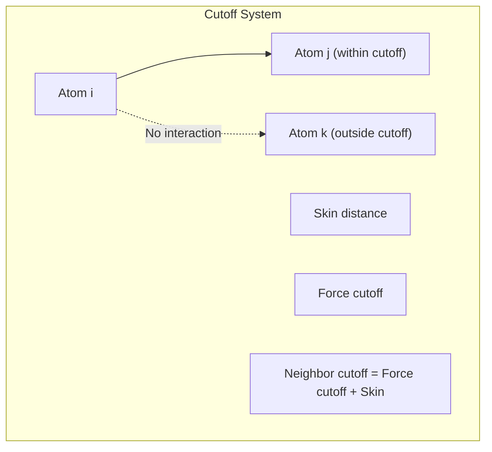
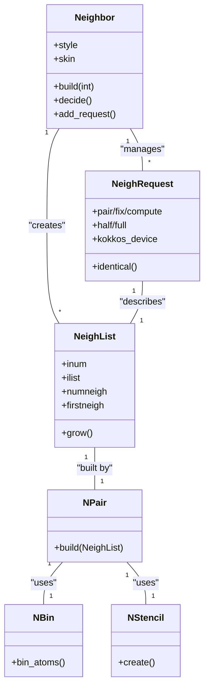
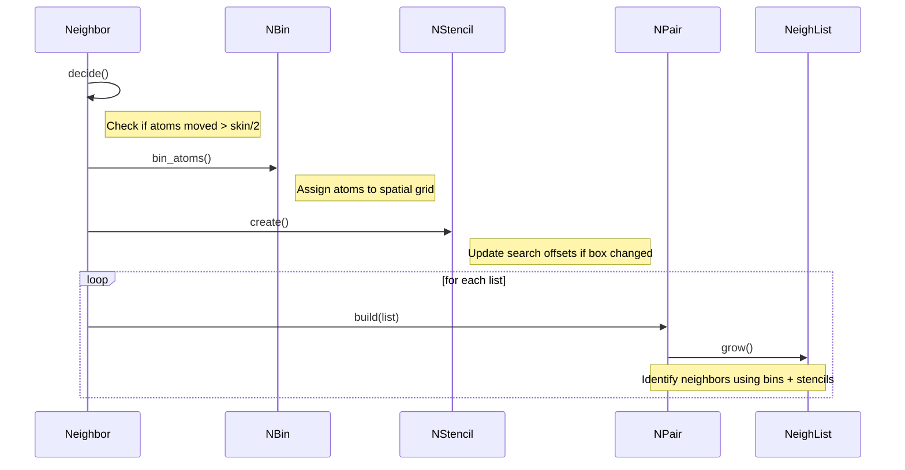

# Neighbor Lists

Relevant source files

The following files were used as context for generating this wiki page:

- [doc/src/Errors_details.rst](doc/src/Errors_details.rst)
- [src/DPD-REACT/nbin_ssa.cpp](src/DPD-REACT/nbin_ssa.cpp)
- [src/DPD-REACT/nbin_ssa.h](src/DPD-REACT/nbin_ssa.h)
- [src/INTEL/nbin_intel.h](src/INTEL/nbin_intel.h)
- [src/INTEL/npair_bin_ghost_intel.cpp](src/INTEL/npair_bin_ghost_intel.cpp)
- [src/INTEL/npair_bin_intel.cpp](src/INTEL/npair_bin_intel.cpp)
- [src/INTEL/npair_full_bin_intel.cpp](src/INTEL/npair_full_bin_intel.cpp)
- [src/KOKKOS/nbin_kokkos.cpp](src/KOKKOS/nbin_kokkos.cpp)
- [src/KOKKOS/nbin_kokkos.h](src/KOKKOS/nbin_kokkos.h)
- [src/KOKKOS/nbin_ssa_kokkos.cpp](src/KOKKOS/nbin_ssa_kokkos.cpp)
- [src/KOKKOS/nbin_ssa_kokkos.h](src/KOKKOS/nbin_ssa_kokkos.h)
- [src/KOKKOS/neigh_list_kokkos.cpp](src/KOKKOS/neigh_list_kokkos.cpp)
- [src/KOKKOS/neigh_list_kokkos.h](src/KOKKOS/neigh_list_kokkos.h)
- [src/KOKKOS/neighbor_kokkos.cpp](src/KOKKOS/neighbor_kokkos.cpp)
- [src/KOKKOS/neighbor_kokkos.h](src/KOKKOS/neighbor_kokkos.h)
- [src/KOKKOS/npair_copy_kokkos.cpp](src/KOKKOS/npair_copy_kokkos.cpp)
- [src/KOKKOS/npair_copy_kokkos.h](src/KOKKOS/npair_copy_kokkos.h)
- [src/KOKKOS/npair_halffull_kokkos.cpp](src/KOKKOS/npair_halffull_kokkos.cpp)
- [src/KOKKOS/npair_halffull_kokkos.h](src/KOKKOS/npair_halffull_kokkos.h)
- [src/KOKKOS/npair_kokkos.cpp](src/KOKKOS/npair_kokkos.cpp)
- [src/KOKKOS/npair_kokkos.h](src/KOKKOS/npair_kokkos.h)
- [src/KOKKOS/npair_skip_kokkos.cpp](src/KOKKOS/npair_skip_kokkos.cpp)
- [src/KOKKOS/npair_skip_kokkos.h](src/KOKKOS/npair_skip_kokkos.h)
- [src/KOKKOS/npair_ssa_kokkos.cpp](src/KOKKOS/npair_ssa_kokkos.cpp)
- [src/KOKKOS/npair_ssa_kokkos.h](src/KOKKOS/npair_ssa_kokkos.h)
- [src/KOKKOS/rand_pool_wrap_kokkos.cpp](src/KOKKOS/rand_pool_wrap_kokkos.cpp)
- [src/KOKKOS/rand_pool_wrap_kokkos.h](src/KOKKOS/rand_pool_wrap_kokkos.h)
- [src/MACHDYN/smd_material_models.cpp](src/MACHDYN/smd_material_models.cpp)
- [src/comm.cpp](src/comm.cpp)
- [src/comm.h](src/comm.h)
- [src/comm_brick.cpp](src/comm_brick.cpp)
- [src/comm_brick.h](src/comm_brick.h)
- [src/comm_tiled.cpp](src/comm_tiled.cpp)
- [src/comm_tiled.h](src/comm_tiled.h)
- [src/irregular.cpp](src/irregular.cpp)
- [src/irregular.h](src/irregular.h)
- [src/nbin.cpp](src/nbin.cpp)
- [src/nbin.h](src/nbin.h)
- [src/nbin_multi.cpp](src/nbin_multi.cpp)
- [src/nbin_multi.h](src/nbin_multi.h)
- [src/nbin_standard.cpp](src/nbin_standard.cpp)
- [src/nbin_standard.h](src/nbin_standard.h)
- [src/neigh_list.cpp](src/neigh_list.cpp)
- [src/neigh_list.h](src/neigh_list.h)
- [src/neigh_request.cpp](src/neigh_request.cpp)
- [src/neigh_request.h](src/neigh_request.h)
- [src/neighbor.cpp](src/neighbor.cpp)
- [src/neighbor.h](src/neighbor.h)
- [src/npair.cpp](src/npair.cpp)
- [src/npair.h](src/npair.h)
- [src/nstencil.cpp](src/nstencil.cpp)
- [src/nstencil.h](src/nstencil.h)
- [src/procmap.cpp](src/procmap.cpp)
- [src/procmap.h](src/procmap.h)
- [src/rcb.cpp](src/rcb.cpp)
- [src/rcb.h](src/rcb.h)
- [src/special.cpp](src/special.cpp)
- [src/special.h](src/special.h)

Neighbor lists are a crucial optimization component in LAMMPS that efficiently track interacting particles. This page explains the neighbor list system architecture, building process, and key components, focusing on how LAMMPS manages particle interactions without checking all possible particle pairs.

For information about Force Calculation which uses neighbor lists, see [Pair Potentials](src/neighbor.cpp:44-45).

## 1. Neighbor List Concept

In molecular dynamics simulations, calculating forces between all possible particle pairs would require $O(N^2)$ operations, which is prohibitively expensive for large systems. Neighbor lists solve this problem by maintaining lists of particles that are within a cutoff distance of each other, significantly reducing the computational cost.

LAMMPS implements neighbor lists with three key components:
- **Neighbor**: Central manager class that creates and maintains lists [src/neighbor.h:25]().
- **NeighRequest**: Request specifications for different list types [src/neigh_request.h:22]().
- **NeighList**: Actual data structure storing neighbor information [src/neigh_list.h:23]().

### Cutoff Distance and Skin

- **Force cutoff**: Maximum distance at which particle interactions are calculated.
- **Skin distance**: Buffer zone beyond the force cutoff [src/neighbor.h:38]().
- **Neighbor cutoff**: Force cutoff + skin distance.

The skin distance ensures that when atoms move between neighbor list rebuilds, they don't move far enough to require interaction with atoms that weren't previously neighbors. LAMMPS uses `check_distance()` to determine if any atom has moved half the skin distance since the last build [src/neighbor.cpp:714-725]().

**Sources:** [src/neighbor.h:38-48](), [src/neighbor.cpp:714-780]()

## 2. Neighbor List Architecture

LAMMPS uses a modular hierarchy to separate the geometry of the simulation (bins/stencils) from the actual neighbor-pair identification logic.

- **Neighbor**: Central class that coordinates creation and updates of all lists [src/neighbor.h:25]().
- **NeighRequest**: Defines properties of a requested list (from Pair, Fix, Compute classes) [src/neigh_request.h:22]().
- **NeighList**: Stores the actual neighbor data (indices, pointers) [src/neigh_list.h:23]().
- **NPair**: Algorithms to build different types of neighbor lists (e.g., half, full, ghost) [src/npair.h:22]().
- **NBin**: Methods for spatially binning atoms to avoid $O(N^2)$ searches [src/nbin.h:22]().
- **NStencil**: Creates stencils defining which relative bins to search for neighbors [src/nstencil.h:22]().

**Sources:** [src/neighbor.h:25-179](), [src/neigh_list.h:23-118](), [src/neigh_request.h:22-155](), [src/npair.h:22-55]()

## 3. Neighbor List Styles

LAMMPS implements several styles of neighbor lists to optimize for different simulation scenarios:

| Style | Description | Code Entity |
|-------|-------------|-------------|
| **NSQ** | Simple $O(N^2)$ approach; checks all pairs. | `Neighbor::NSQ` [src/neighbor.h:27]() |
| **BIN** | Uses spatial binning; default method; scales as $O(N)$. | `Neighbor::BIN` [src/neighbor.h:27]() |
| **MULTI** | Multiple binning based on atom types/collections for polydisperse systems. | `Neighbor::MULTI` [src/neighbor.h:27]() |

**Sources:** [src/neighbor.h:27-28](), [src/neighbor.cpp:120-123]()

## 4. Half vs Full Neighbor Lists

LAMMPS supports both half and full neighbor lists, which differ in how they store pair interactions:

- **Half lists** (default): Each pair $i,j$ appears only once (usually where $i < j$). This is efficient for Newton's 3rd Law calculations where $F_{ij} = -F_{ji}$ [src/neigh_request.h:40]().
- **Full lists**: Each pair $i,j$ appears twice (once in $i$'s list and once in $j$'s list). This is required for certain many-body potentials or when Newton's 3rd Law is disabled for communication efficiency [src/neigh_request.h:41]().

**Sources:** [src/neigh_request.h:40-41](), [src/neigh_request.cpp:37-41]()

## 5. Memory Management: Paged Storage

Neighbor lists use a "paged" memory system to handle the variable number of neighbors per atom without frequent reallocations.

- **inum**: Number of atoms in the list [src/neigh_list.h:55]().
- **ilist**: Array of atom indices that have neighbor lists [src/neigh_list.h:56]().
- **numneigh**: Array storing the number of neighbors for each atom [src/neigh_list.h:57]().
- **firstneigh**: Array of pointers to the start of each atom's neighbors in the paged memory [src/neigh_list.h:58]().
- **MyPage**: A template class (used via `ipage`) that manages chunks of memory for the actual neighbor indices [src/neigh_list.h:112]().

**Sources:** [src/neigh_list.h:51-118](), [src/neigh_list.cpp:210-252]()

## 6. Building Process and Data Flow

The `Neighbor::build()` function is the entry point for reneighboring [src/neighbor.cpp:1020]().

**Sources:** [src/neighbor.cpp:1020-1088](), [src/npair.cpp:80-110]()

## 7. Special Bonds and Exclusions

The neighbor list system is responsible for handling topology-based exclusions (1-2, 1-3, 1-4 neighbors).

- **Special Bonds**: Interaction weights for atoms connected by 1, 2, or 3 bonds are stored in `special_flag` [src/neighbor.h:82]().
- **Exclusions**: Atoms can be excluded from neighbor lists based on:
    - **Type**: `ex_type` 2D array [src/neighbor.h:68]().
    - **Group**: `ex1_group`, `ex2_group` [src/neighbor.h:73]().
    - **Molecule**: Intra- or inter-molecular exclusions [src/neighbor.h:74-78]().

The `Special` class is used to build these connectivity lists [src/special.h:28]().

**Sources:** [src/neighbor.h:62-86](), [src/special.cpp:57-177]()

## 8. Kokkos Acceleration

The `KOKKOS` package provides optimized neighbor list implementations for GPUs and multi-core CPUs.

- **NeighborKokkos**: Inherits from `Neighbor` and manages Kokkos-specific views for cutoffs and exclusions [src/KOKKOS/neighbor_kokkos.h:25]().
- **NPairKokkos**: A templated class that performs the neighbor build on the `DeviceType` (Host or Device) [src/KOKKOS/npair_kokkos.h:137]().
- **DualView**: Used to synchronize data like `cutneighsq` between the host and device [src/KOKKOS/npair_kokkos.cpp:61-78]().

Kokkos lists often use a **Thread-Relative** or **Atomic** approach to build lists in parallel without race conditions.

**Sources:** [src/KOKKOS/neighbor_kokkos.cpp:15-132](), [src/KOKKOS/npair_kokkos.cpp:149-200](), [src/KOKKOS/npair_kokkos.h:137-168]()

## 9. Communication and Ghost Atoms

Neighbor lists often need to include "ghost" atoms (atoms owned by neighboring processors) to calculate interactions across subdomain boundaries.

- **ghost flag**: If set in `NeighRequest`, the build will include neighbors of local atoms that are ghost atoms [src/neigh_request.h:62]().
- **CommBrick/CommTiled**: These classes handle the exchange of ghost atom coordinates, which the neighbor list then bins [src/comm_brick.cpp:172-210](), [src/comm_tiled.cpp:218-250]().

**Sources:** [src/comm.h:23-33](), [src/neigh_request.h:62](), [src/comm_brick.cpp:172-210]()

---