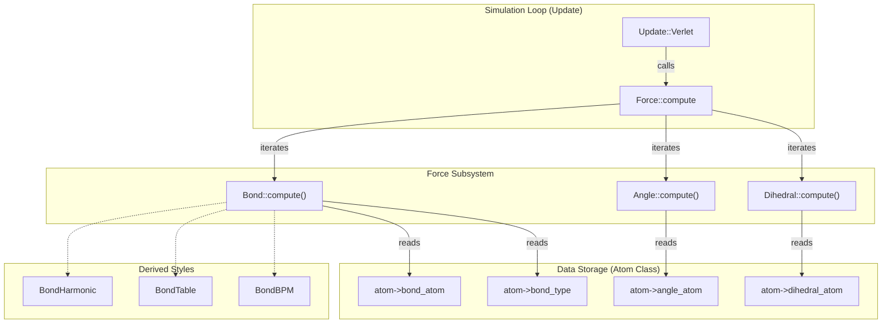

# Bonded Interactions

<details>
<summary>Relevant source files</summary>

The following files were used as context for generating this wiki page:

- [doc/src/Developer_atom.rst](doc/src/Developer_atom.rst)
- [doc/src/Howto_bpm.rst](doc/src/Howto_bpm.rst)
- [doc/src/Howto_broken_bonds.rst](doc/src/Howto_broken_bonds.rst)
- [doc/src/bond_bpm_rotational.rst](doc/src/bond_bpm_rotational.rst)
- [doc/src/bond_bpm_spring.rst](doc/src/bond_bpm_spring.rst)
- [doc/src/bond_bpm_spring_plastic.rst](doc/src/bond_bpm_spring_plastic.rst)
- [doc/src/bond_rheo_shell.rst](doc/src/bond_rheo_shell.rst)
- [doc/src/compute_count_type.rst](doc/src/compute_count_type.rst)
- [doc/src/compute_nbond_atom.rst](doc/src/compute_nbond_atom.rst)
- [doc/src/fix_nve_bpm_sphere.rst](doc/src/fix_nve_bpm_sphere.rst)
- [doc/src/fix_rheo_oxidation.rst](doc/src/fix_rheo_oxidation.rst)
- [doc/src/pair_bpm_spring.rst](doc/src/pair_bpm_spring.rst)
- [src/BPM/atom_vec_bpm_sphere.cpp](src/BPM/atom_vec_bpm_sphere.cpp)
- [src/BPM/bond_bpm.cpp](src/BPM/bond_bpm.cpp)
- [src/BPM/bond_bpm.h](src/BPM/bond_bpm.h)
- [src/BPM/bond_bpm_rotational.cpp](src/BPM/bond_bpm_rotational.cpp)
- [src/BPM/bond_bpm_rotational.h](src/BPM/bond_bpm_rotational.h)
- [src/BPM/bond_bpm_spring.cpp](src/BPM/bond_bpm_spring.cpp)
- [src/BPM/bond_bpm_spring.h](src/BPM/bond_bpm_spring.h)
- [src/BPM/bond_bpm_spring_plastic.cpp](src/BPM/bond_bpm_spring_plastic.cpp)
- [src/BPM/bond_bpm_spring_plastic.h](src/BPM/bond_bpm_spring_plastic.h)
- [src/BPM/compute_nbond_atom.cpp](src/BPM/compute_nbond_atom.cpp)
- [src/BPM/compute_nbond_atom.h](src/BPM/compute_nbond_atom.h)
- [src/BPM/fix_nve_bpm_sphere.cpp](src/BPM/fix_nve_bpm_sphere.cpp)
- [src/BPM/pair_bpm_spring.cpp](src/BPM/pair_bpm_spring.cpp)
- [src/BPM/pair_bpm_spring.h](src/BPM/pair_bpm_spring.h)
- [src/CLASS2/angle_class2.h](src/CLASS2/angle_class2.h)
- [src/EXTRA-COMPUTE/compute_born_matrix.cpp](src/EXTRA-COMPUTE/compute_born_matrix.cpp)
- [src/EXTRA-MOLECULE/dihedral_nharmonic.cpp](src/EXTRA-MOLECULE/dihedral_nharmonic.cpp)
- [src/EXTRA-MOLECULE/dihedral_nharmonic.h](src/EXTRA-MOLECULE/dihedral_nharmonic.h)
- [src/EXTRA-MOLECULE/improper_cossq.cpp](src/EXTRA-MOLECULE/improper_cossq.cpp)
- [src/EXTRA-MOLECULE/improper_distance.cpp](src/EXTRA-MOLECULE/improper_distance.cpp)
- [src/EXTRA-MOLECULE/improper_fourier.cpp](src/EXTRA-MOLECULE/improper_fourier.cpp)
- [src/EXTRA-MOLECULE/improper_ring.cpp](src/EXTRA-MOLECULE/improper_ring.cpp)
- [src/GPU/pppm_gpu.cpp](src/GPU/pppm_gpu.cpp)
- [src/GPU/pppm_gpu.h](src/GPU/pppm_gpu.h)
- [src/KSPACE/ewald.cpp](src/KSPACE/ewald.cpp)
- [src/KSPACE/ewald.h](src/KSPACE/ewald.h)
- [src/KSPACE/ewald_dipole.cpp](src/KSPACE/ewald_dipole.cpp)
- [src/KSPACE/ewald_dipole.h](src/KSPACE/ewald_dipole.h)
- [src/KSPACE/ewald_dipole_spin.cpp](src/KSPACE/ewald_dipole_spin.cpp)
- [src/KSPACE/ewald_dipole_spin.h](src/KSPACE/ewald_dipole_spin.h)
- [src/KSPACE/ewald_disp.cpp](src/KSPACE/ewald_disp.cpp)
- [src/KSPACE/ewald_disp.h](src/KSPACE/ewald_disp.h)
- [src/KSPACE/msm.cpp](src/KSPACE/msm.cpp)
- [src/KSPACE/msm.h](src/KSPACE/msm.h)
- [src/KSPACE/msm_cg.cpp](src/KSPACE/msm_cg.cpp)
- [src/KSPACE/pppm.cpp](src/KSPACE/pppm.cpp)
- [src/KSPACE/pppm.h](src/KSPACE/pppm.h)
- [src/KSPACE/pppm_cg.cpp](src/KSPACE/pppm_cg.cpp)
- [src/KSPACE/pppm_cg.h](src/KSPACE/pppm_cg.h)
- [src/KSPACE/pppm_dipole.cpp](src/KSPACE/pppm_dipole.cpp)
- [src/KSPACE/pppm_dipole.h](src/KSPACE/pppm_dipole.h)
- [src/KSPACE/pppm_dipole_spin.cpp](src/KSPACE/pppm_dipole_spin.cpp)
- [src/KSPACE/pppm_dipole_spin.h](src/KSPACE/pppm_dipole_spin.h)
- [src/KSPACE/pppm_disp.cpp](src/KSPACE/pppm_disp.cpp)
- [src/KSPACE/pppm_disp.h](src/KSPACE/pppm_disp.h)
- [src/KSPACE/pppm_disp_tip4p.cpp](src/KSPACE/pppm_disp_tip4p.cpp)
- [src/KSPACE/pppm_disp_tip4p.h](src/KSPACE/pppm_disp_tip4p.h)
- [src/KSPACE/pppm_stagger.cpp](src/KSPACE/pppm_stagger.cpp)
- [src/KSPACE/pppm_stagger.h](src/KSPACE/pppm_stagger.h)
- [src/KSPACE/pppm_tip4p.cpp](src/KSPACE/pppm_tip4p.cpp)
- [src/KSPACE/pppm_tip4p.h](src/KSPACE/pppm_tip4p.h)
- [src/MOFFF/improper_inversion_harmonic.cpp](src/MOFFF/improper_inversion_harmonic.cpp)
- [src/MOLECULE/angle_charmm.cpp](src/MOLECULE/angle_charmm.cpp)
- [src/MOLECULE/angle_charmm.h](src/MOLECULE/angle_charmm.h)
- [src/MOLECULE/angle_cosine.cpp](src/MOLECULE/angle_cosine.cpp)
- [src/MOLECULE/angle_cosine.h](src/MOLECULE/angle_cosine.h)
- [src/MOLECULE/angle_cosine_squared.cpp](src/MOLECULE/angle_cosine_squared.cpp)
- [src/MOLECULE/angle_cosine_squared.h](src/MOLECULE/angle_cosine_squared.h)
- [src/MOLECULE/angle_harmonic.cpp](src/MOLECULE/angle_harmonic.cpp)
- [src/MOLECULE/angle_harmonic.h](src/MOLECULE/angle_harmonic.h)
- [src/MOLECULE/angle_table.cpp](src/MOLECULE/angle_table.cpp)
- [src/MOLECULE/angle_table.h](src/MOLECULE/angle_table.h)
- [src/MOLECULE/bond_table.cpp](src/MOLECULE/bond_table.cpp)
- [src/MOLECULE/bond_table.h](src/MOLECULE/bond_table.h)
- [src/MOLECULE/dihedral_charmm.cpp](src/MOLECULE/dihedral_charmm.cpp)
- [src/MOLECULE/dihedral_charmmfsw.cpp](src/MOLECULE/dihedral_charmmfsw.cpp)
- [src/MOLECULE/dihedral_charmmfsw.h](src/MOLECULE/dihedral_charmmfsw.h)
- [src/MOLECULE/dihedral_harmonic.cpp](src/MOLECULE/dihedral_harmonic.cpp)
- [src/MOLECULE/dihedral_multi_harmonic.cpp](src/MOLECULE/dihedral_multi_harmonic.cpp)
- [src/MOLECULE/dihedral_opls.cpp](src/MOLECULE/dihedral_opls.cpp)
- [src/MOLECULE/dihedral_table.cpp](src/MOLECULE/dihedral_table.cpp)
- [src/MOLECULE/improper_cvff.cpp](src/MOLECULE/improper_cvff.cpp)
- [src/MOLECULE/improper_harmonic.cpp](src/MOLECULE/improper_harmonic.cpp)
- [src/MOLECULE/improper_umbrella.cpp](src/MOLECULE/improper_umbrella.cpp)
- [src/YAFF/improper_distharm.cpp](src/YAFF/improper_distharm.cpp)
- [src/YAFF/improper_sqdistharm.cpp](src/YAFF/improper_sqdistharm.cpp)
- [src/angle.cpp](src/angle.cpp)
- [src/angle.h](src/angle.h)
- [src/bond.cpp](src/bond.cpp)
- [src/bond.h](src/bond.h)
- [src/compute_count_type.cpp](src/compute_count_type.cpp)
- [src/compute_count_type.h](src/compute_count_type.h)
- [src/dihedral.cpp](src/dihedral.cpp)
- [src/dihedral.h](src/dihedral.h)
- [src/fix_bond_history.cpp](src/fix_bond_history.cpp)
- [src/fix_bond_history.h](src/fix_bond_history.h)
- [src/improper.cpp](src/improper.cpp)
- [src/improper.h](src/improper.h)
- [src/kspace.cpp](src/kspace.cpp)
- [src/kspace.h](src/kspace.h)
- [src/pair.cpp](src/pair.cpp)
- [src/pair.h](src/pair.h)
- [src/pair_table.cpp](src/pair_table.cpp)
- [src/pair_table.h](src/pair_table.h)

</details>


Bonded interactions in LAMMPS represent N-body forces between atoms that are explicitly listed in the molecular topology. These include 2-body **Bonds**, 3-body **Angles**, 4-body **Dihedrals**, and 4-body **Impropers**. Unlike pair potentials, which are calculated based on distance cutoffs and neighbor lists, bonded interactions are computed by iterating over specific lists of atom IDs defined in the input data file or created during the simulation.

## Core Class Hierarchy

Bonded interactions follow a strict inheritance pattern from base classes that define the interface for energy and force accumulation.

| Interaction Type | Base Class | Source File |
| :--- | :--- | :--- |
| **Bond** | `Bond` | [src/bond.h:21-21]() |
| **Angle** | `Angle` | [src/angle.h:21-21]() |
| **Dihedral** | `Dihedral` | [src/dihedral.h:23-23]() |
| **Improper** | `Improper` | [src/improper.h:21-21]() |

### The `Bond` Base Class
The `Bond` class provides the foundation for all 2-body bonded potentials. It manages global energy (`eng_vdwl`) and virial accumulation, and defines the virtual `compute()` method that derived styles must implement [src/bond.h:40-66]().

Key members include:
* `void init()`: Initializes the style and checks for required atom attributes [src/bond.cpp:66-104]().
* `virtual void compute(int eflag, int vflag)`: The primary force calculation loop.
* `void ev_tally(int i, int j, int nlocal, int newton_bond, double ebond, double fbond, double delx, double dely, double delz)`: Accumulates energy and virial contributions into global and per-atom buffers [src/bond.cpp:168-208]().

**Sources:** [src/bond.h:1-70](), [src/bond.cpp:1-210]()

---

## System Architecture: Data Flow

The following diagram illustrates how bonded interactions are integrated into the LAMMPS force calculation pipeline.

### Interaction Logic and Code Entity Mapping

**Sources:** [src/bond.h:40-66](), [src/bond.cpp:66-104](), [src/pair.h:159-163]()

---

## Tabulated Interactions
For complex potentials that lack an analytical form, LAMMPS provides tabulated styles for bonds, angles, and dihedrals.

### `BondTable` Implementation
`BondTable` reads energy and force values from a file and interpolates them during the simulation [src/MOLECULE/bond_table.cpp](). It supports several interpolation methods:
* `LOOKUP`: Direct array indexing.
* `LINEAR`: Linear interpolation between points.
* `SPLINE`: Cubic spline interpolation for smoother forces.
* `BITMAP`: A specialized bit-mapping technique for high-performance lookup.

**Sources:** [src/MOLECULE/bond_table.cpp:1-100](), [src/pair_table.cpp:35-35]()

---

## Specialized Force Fields

### CHARMM, OPLS, and CLASS2
LAMMPS includes specific styles to support standard biomolecular and organic force fields:
* **Dihedral Charmm**: Implements the CHARMM dihedral potential, which often includes a 1-4 Coulombic weighting factor and an optional LJ term [src/MOLECULE/dihedral_charmm.cpp:26-27]().
* **CLASS2 Styles**: These include cross-terms (e.g., Bond-Bond, Bond-Angle) necessary for the COMPASS and PCFF force fields.

### MOLECULE Package
Most standard bonded interactions reside in the `MOLECULE` package. These include `AngleTable` [src/MOLECULE/angle_table.cpp](), `DihedralTable` [src/MOLECULE/dihedral_table.cpp](), and `ImproperUmbrella` [src/MOLECULE/improper_umbrella.cpp]().

---

## Bonded Particle Model (BPM)
The BPM styles are specialized for modeling deformable granular matter and solid-body mechanics through "breakable" bonds that track state history.

### BPM Architecture
Unlike standard bonds, BPM styles often require a `FixBondHistory` to store the reference state (initial distance and orientation) of a bond [src/BPM/bond_bpm.cpp:55-58]().

```mermaid
graph LR
    subgraph "BPM Entities"
        BPM["BondBPM Base"]
        ROT["BondBPMRotational"]
        HIST["FixBondHistory"]
        SPEC["FixUpdateSpecialBonds"]
    end

    BPM -- "manages" --> HIST
    BPM -- "updates" --> SPEC
    ROT -- "inherits" --> BPM
    
    HIST -- "stores" --> "Reference r0, Quaternion q0"
    ROT -- "calculates" --> "Torques & Damping"
```

### `BondBPMRotational`
This style computes forces and torques based on deviations from an initial reference state [doc/src/bond_bpm_rotational.rst:65-70]().
* **State Decomp**: It uses quaternions to decompose rotation into swing and twist components [src/BPM/bond_bpm_rotational.cpp:85-104]().
* **Breaking Criterion**: Bonds break when a combined stress metric (radial, shear, twisting, and bending) exceeds a threshold [doc/src/bond_bpm_rotational.rst:94-110]().
* **Damping**: Includes `DERIVATIVE` and `DEM` damping styles for energy dissipation [src/BPM/bond_bpm_rotational.cpp:39-40]().

**Sources:** [src/BPM/bond_bpm.cpp:1-108](), [src/BPM/bond_bpm_rotational.cpp:1-150](), [doc/src/bond_bpm_rotational.rst:60-140]()

---

## Key Functions for Style Developers

When implementing a new bonded interaction style, the following functions must be defined:

| Function | Role |
| :--- | :--- |
| `coeff()` | Parses the `bond_coeff` (or angle/dihedral/improper) command in the input script. |
| `compute()` | The core numerical loop. Iterates over `atom->nbonds`, calculates $\vec{r}_{ij}$, computes magnitude $F$, and applies $\vec{F}$ to `atom->f`. |
| `init_style()` | Performs one-time setup, such as requesting neighbor lists or checking for Newton's 3rd law settings. |
| `write_restart()` | Serializes coefficients to binary restart files. |
| `read_restart()` | Deserializes coefficients from binary restart files. |

**Sources:** [src/bond.h:40-66](), [src/bond.cpp:66-104]()

---