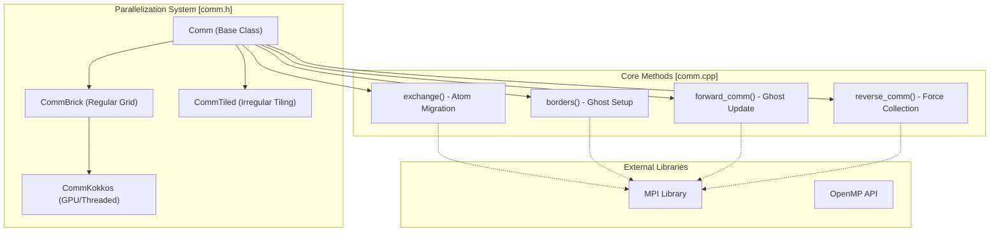
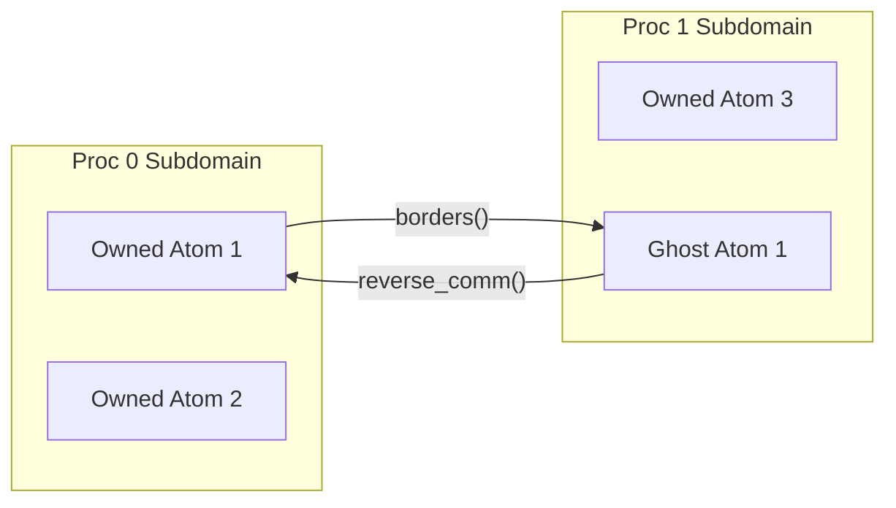

# Parallel Computing

Relevant source files

The following files were used as context for generating this wiki page:

- [doc/src/fix_rigid.rst](doc/src/fix_rigid.rst)
- [src/KOKKOS/atom_kokkos.cpp](src/KOKKOS/atom_kokkos.cpp)
- [src/KOKKOS/atom_kokkos.h](src/KOKKOS/atom_kokkos.h)
- [src/KOKKOS/atom_map_kokkos.cpp](src/KOKKOS/atom_map_kokkos.cpp)
- [src/KOKKOS/domain_kokkos.cpp](src/KOKKOS/domain_kokkos.cpp)
- [src/KOKKOS/domain_kokkos.h](src/KOKKOS/domain_kokkos.h)
- [src/KOKKOS/fix_deform_kokkos.cpp](src/KOKKOS/fix_deform_kokkos.cpp)
- [src/KOKKOS/fix_deform_kokkos.h](src/KOKKOS/fix_deform_kokkos.h)
- [src/KOKKOS/fix_property_atom_kokkos.cpp](src/KOKKOS/fix_property_atom_kokkos.cpp)
- [src/KOKKOS/fix_property_atom_kokkos.h](src/KOKKOS/fix_property_atom_kokkos.h)
- [src/KOKKOS/fix_reaxff_species_kokkos.cpp](src/KOKKOS/fix_reaxff_species_kokkos.cpp)
- [src/KOKKOS/fix_rigid_nh_small_kokkos.cpp](src/KOKKOS/fix_rigid_nh_small_kokkos.cpp)
- [src/KOKKOS/fix_rigid_nph_small_kokkos.cpp](src/KOKKOS/fix_rigid_nph_small_kokkos.cpp)
- [src/KOKKOS/fix_rigid_npt_small_kokkos.cpp](src/KOKKOS/fix_rigid_npt_small_kokkos.cpp)
- [src/KOKKOS/fix_rigid_small_kokkos.cpp](src/KOKKOS/fix_rigid_small_kokkos.cpp)
- [src/KOKKOS/fix_rigid_small_kokkos.h](src/KOKKOS/fix_rigid_small_kokkos.h)
- [src/KOKKOS/kokkos.cpp](src/KOKKOS/kokkos.cpp)
- [src/KOKKOS/kokkos.h](src/KOKKOS/kokkos.h)
- [src/KOKKOS/kokkos_base.h](src/KOKKOS/kokkos_base.h)
- [src/KOKKOS/kokkos_type.h](src/KOKKOS/kokkos_type.h)
- [src/KOKKOS/neigh_list_kokkos.cpp](src/KOKKOS/neigh_list_kokkos.cpp)
- [src/KOKKOS/neigh_list_kokkos.h](src/KOKKOS/neigh_list_kokkos.h)
- [src/KOKKOS/pair_kokkos.h](src/KOKKOS/pair_kokkos.h)
- [src/KSPACE/kissfft.h](src/KSPACE/kissfft.h)
- [src/MACHDYN/smd_material_models.cpp](src/MACHDYN/smd_material_models.cpp)
- [src/accelerator_kokkos.h](src/accelerator_kokkos.h)
- [src/atom_masks.h](src/atom_masks.h)
- [src/comm.cpp](src/comm.cpp)
- [src/comm.h](src/comm.h)
- [src/comm_brick.cpp](src/comm_brick.cpp)
- [src/comm_brick.h](src/comm_brick.h)
- [src/comm_tiled.cpp](src/comm_tiled.cpp)
- [src/comm_tiled.h](src/comm_tiled.h)
- [src/fix_property_atom.cpp](src/fix_property_atom.cpp)
- [src/fix_property_atom.h](src/fix_property_atom.h)
- [src/irregular.cpp](src/irregular.cpp)
- [src/irregular.h](src/irregular.h)
- [src/main.cpp](src/main.cpp)
- [src/neigh_list.cpp](src/neigh_list.cpp)
- [src/neigh_list.h](src/neigh_list.h)
- [src/neigh_request.cpp](src/neigh_request.cpp)
- [src/neigh_request.h](src/neigh_request.h)
- [src/neighbor.cpp](src/neighbor.cpp)
- [src/neighbor.h](src/neighbor.h)
- [src/nstencil.cpp](src/nstencil.cpp)
- [src/nstencil.h](src/nstencil.h)
- [src/procmap.cpp](src/procmap.cpp)
- [src/procmap.h](src/procmap.h)
- [src/rcb.cpp](src/rcb.cpp)
- [src/rcb.h](src/rcb.h)
- [src/special.cpp](src/special.cpp)
- [src/special.h](src/special.h)

This page provides an overview of the parallel computing architecture in LAMMPS, explaining how the code distributes work across multiple processors and manages communication between them. For information about using LAMMPS with specific accelerator packages and GPU devices, see [GPU Package](#4.4).

## 1. Parallel Architecture Overview

LAMMPS uses spatial decomposition as its primary parallelization strategy, dividing the simulation domain into subdomains that are assigned to individual processors. This approach allows the code to scale efficiently from a single processor to thousands of cores on high-performance computing systems.

The parallel architecture in LAMMPS is primarily implemented through the `Comm` class hierarchy, which manages all inter-processor communication. Key components include:

Sources: [src/comm.h:21-101](), [src/comm.cpp:56-116]().

## 2. Domain Decomposition

LAMMPS divides the simulation box into 3D subdomains, with each processor responsible for the particles within its assigned region. The domain decomposition approach supports both regular (brick) and irregular (tiled) partitioning.

### 2.1 Decomposition Types

LAMMPS supports multiple decomposition styles and layouts:

| Style | Layout Type | Description |
| :--- | :--- | :--- |
| **BRICK** | `LAYOUT_UNIFORM` | Equal-sized bricks based on the processor grid. |
| **BRICK** | `LAYOUT_NONUNIFORM` | Logical bricks with varying sizes for load balancing. |
| **TILED** | `LAYOUT_TILED` | General tiling using Recursive Coordinate Bisection (RCB). |

The decomposition type is selected through the `comm_style` command, which instantiates either `CommBrick` [src/comm_brick.cpp:43-65]() or `CommTiled` [src/comm_tiled.cpp:46-63]().

Sources: [src/comm.h:23-34](), [src/comm_brick.cpp:43-97](), [src/comm_tiled.cpp:44-83]().

### 2.2 Processor Grid

For the regular (brick) decomposition, processors are arranged in a 3D grid managed by the `ProcMap` class. The mapping can be customized using `processors` command flags:

- **cart**: Simple Cartesian grid mapping [src/comm.h:145]().
- **numa**: Awareness of NUMA nodes to improve memory locality [src/comm.h:149]().
- **custom**: User-defined mapping from a file [src/comm.h:147]().

Sources: [src/comm.cpp:414-698](), [src/procmap.cpp:25-100]().

## 3. Communication System

Communication in LAMMPS is managed by the `Comm` class, which handles the exchange of particle data between processors via MPI. For details, see [Communication System](#4.1).

### 3.1 Communication Patterns

| Communication Type | Function | Purpose |
| :--- | :--- | :--- |
| **Exchange** | `exchange()` | Migrates atoms that have moved outside their processor's subdomain [src/comm.h:84](). |
| **Borders** | `borders()` | Identifies atoms near boundaries to be sent as "ghosts" [src/comm.h:85](). |
| **Forward** | `forward_comm()` | Updates properties (e.g., coordinates) of ghost atoms from their owners [src/comm.h:82](). |
| **Reverse** | `reverse_comm()` | Collects data (e.g., forces) from ghost atoms back to their owners [src/comm.h:83](). |

Sources: [src/comm.cpp:172-214](), [src/comm_brick.cpp:360-450]().

### 3.2 Communication Modes

LAMMPS supports two primary communication modes:
1. **SINGLE**: Uses a single global cutoff distance for all ghost atom communication [src/comm.h:32]().
2. **MULTI**: Uses separate cutoffs for different atom collections, reducing communication volume for disparate particle sizes [src/comm.h:33]().

Sources: [src/comm.h:31-34](), [src/comm.cpp:284-411]().

## 4. Ghost Atoms

Ghost atoms are local copies of atoms owned by neighboring processors. They are necessary for calculating short-range interactions where particles span subdomain boundaries.

The size of the ghost region is determined by `get_comm_cutoff()`, which considers the maximum pair potential cutoff plus the neighbor skin [src/comm.cpp:79]().

Sources: [src/comm.cpp:176-204](), [src/comm_brick.cpp:451-515]().

## 5. Parallel Implementation Details

### 5.1 Communication Buffers

To minimize the number of MPI messages, LAMMPS packs atom data into contiguous buffers before sending.
- **Pack**: `pack_exchange`, `pack_forward`, `pack_reverse` in `AtomVec` [src/atom_vec.h]().
- **Unpack**: Corresponding unpack functions to restore data into the `Atom` class arrays.

Sources: [src/comm.cpp:267-278](), [src/comm_tiled.cpp:157-167]().

### 5.2 Rigid Body Constraints

Parallel rigid body calculations require special handling because a single rigid body can span multiple processors.
- `fix rigid`: Global communication of body properties [src/RIGID/fix_rigid.cpp:49-127]().
- `fix rigid/small`: Local approach for systems with many small rigid bodies, using `Comm` patterns to migrate bodies as they move [src/RIGID/fix_rigid_small.cpp:56-127]().

For details, see [Rigid Body Constraints](#4.3).

Sources: [src/KOKKOS/fix_rigid_small_kokkos.cpp:52-96]().

## 6. Kokkos and GPU Acceleration

LAMMPS leverages the Kokkos library for performance portability across GPUs (CUDA, HIP, SYCL) and many-core CPUs (OpenMP). For details, see [Kokkos Acceleration](#4.2).

### 6.1 Data Management

Kokkos-enabled styles use `DualView` data structures to manage memory between the host (CPU) and device (GPU). The `AtomKokkos` class manages these views for all per-atom data [src/KOKKOS/atom_kokkos.cpp:36-54]().

### 6.2 Accelerated Communication

`CommKokkos` performs buffer packing and unpacking directly on the GPU to avoid expensive memory transfers between the device and host during the MPI communication cycle.

Sources: [src/KOKKOS/kokkos.cpp:106-187](), [src/KOKKOS/kokkos_type.h:172-186]().

## 7. Performance Considerations

### 7.1 Load Balancing

Simulation performance can suffer from load imbalance if atom density is non-uniform. LAMMPS provides:
- **Dynamic Balancing**: `fix balance` periodically adjusts subdomain boundaries [src/comm.h:62]().
- **RCB**: `rcb.cpp` provides Recursive Coordinate Bisection for `CommTiled` [src/rcb.cpp]().

### 7.2 Threading

LAMMPS supports hybrid MPI+OpenMP parallelization. The number of threads per MPI task is managed in the `Comm` class [src/comm.cpp:95-114](). Kokkos further extends this by allowing fine-grained threading in force kernels via `PairComputeFunctor` [src/KOKKOS/pair_kokkos.h:56-100]().

Sources: [src/comm.cpp:95-114](), [src/neighbor.cpp:115-116]().

## 8. Summary Table of Parallel Components

| Class | Role | Source |
| :--- | :--- | :--- |
| `Comm` | Base manager for all parallel communication. | [src/comm.h:21]() |
| `CommBrick` | Standard 6-way stencil communication for grid domains. | [src/comm_brick.h:21]() |
| `CommTiled` | Irregular decomposition for load-balanced systems. | [src/comm_tiled.h:20]() |
| `Irregular` | Helper for non-stencil atom migration. | [src/irregular.h:21]() |
| `KokkosLMP` | Central manager for Kokkos device initialization. | [src/KOKKOS/kokkos.h:24]() |

Sources: [src/comm.h](), [src/comm_brick.h](), [src/comm_tiled.h](), [src/KOKKOS/kokkos.h]().

---