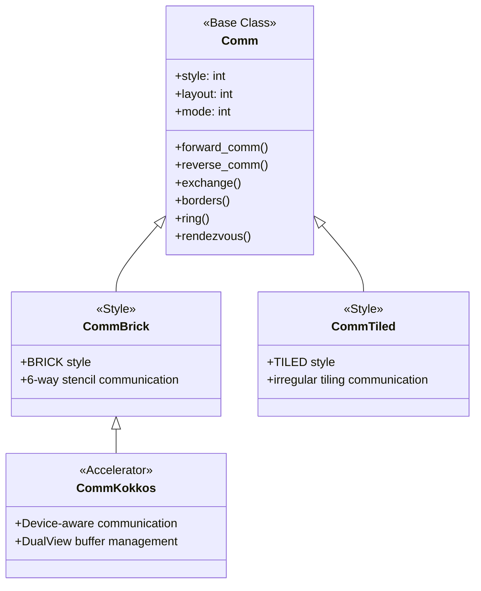
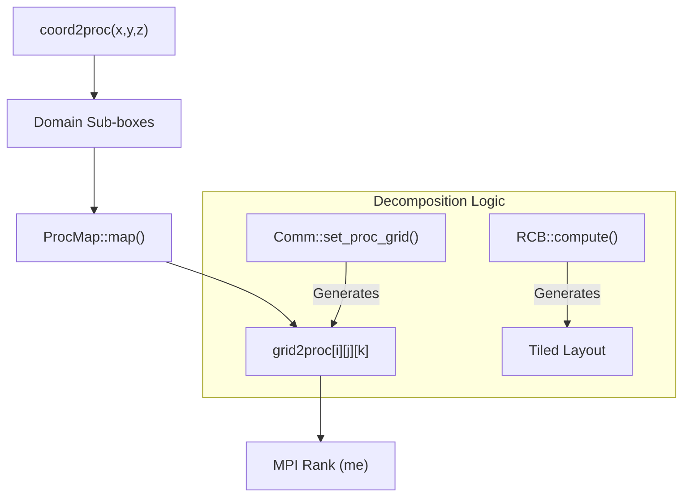

# Communication System

Relevant source files

The following files were used as context for generating this wiki page:

- [src/KOKKOS/atom_vec_angle_kokkos.cpp](src/KOKKOS/atom_vec_angle_kokkos.cpp)
- [src/KOKKOS/atom_vec_angle_kokkos.h](src/KOKKOS/atom_vec_angle_kokkos.h)
- [src/KOKKOS/atom_vec_atomic_kokkos.cpp](src/KOKKOS/atom_vec_atomic_kokkos.cpp)
- [src/KOKKOS/atom_vec_atomic_kokkos.h](src/KOKKOS/atom_vec_atomic_kokkos.h)
- [src/KOKKOS/atom_vec_bond_kokkos.cpp](src/KOKKOS/atom_vec_bond_kokkos.cpp)
- [src/KOKKOS/atom_vec_bond_kokkos.h](src/KOKKOS/atom_vec_bond_kokkos.h)
- [src/KOKKOS/atom_vec_charge_kokkos.cpp](src/KOKKOS/atom_vec_charge_kokkos.cpp)
- [src/KOKKOS/atom_vec_charge_kokkos.h](src/KOKKOS/atom_vec_charge_kokkos.h)
- [src/KOKKOS/atom_vec_dpd_kokkos.cpp](src/KOKKOS/atom_vec_dpd_kokkos.cpp)
- [src/KOKKOS/atom_vec_dpd_kokkos.h](src/KOKKOS/atom_vec_dpd_kokkos.h)
- [src/KOKKOS/atom_vec_ellipsoid_kokkos.cpp](src/KOKKOS/atom_vec_ellipsoid_kokkos.cpp)
- [src/KOKKOS/atom_vec_ellipsoid_kokkos.h](src/KOKKOS/atom_vec_ellipsoid_kokkos.h)
- [src/KOKKOS/atom_vec_full_kokkos.cpp](src/KOKKOS/atom_vec_full_kokkos.cpp)
- [src/KOKKOS/atom_vec_full_kokkos.h](src/KOKKOS/atom_vec_full_kokkos.h)
- [src/KOKKOS/atom_vec_hybrid_kokkos.cpp](src/KOKKOS/atom_vec_hybrid_kokkos.cpp)
- [src/KOKKOS/atom_vec_hybrid_kokkos.h](src/KOKKOS/atom_vec_hybrid_kokkos.h)
- [src/KOKKOS/atom_vec_kokkos.cpp](src/KOKKOS/atom_vec_kokkos.cpp)
- [src/KOKKOS/atom_vec_kokkos.h](src/KOKKOS/atom_vec_kokkos.h)
- [src/KOKKOS/atom_vec_molecular_kokkos.cpp](src/KOKKOS/atom_vec_molecular_kokkos.cpp)
- [src/KOKKOS/atom_vec_molecular_kokkos.h](src/KOKKOS/atom_vec_molecular_kokkos.h)
- [src/KOKKOS/atom_vec_sphere_kokkos.cpp](src/KOKKOS/atom_vec_sphere_kokkos.cpp)
- [src/KOKKOS/atom_vec_sphere_kokkos.h](src/KOKKOS/atom_vec_sphere_kokkos.h)
- [src/KOKKOS/atom_vec_spin_kokkos.cpp](src/KOKKOS/atom_vec_spin_kokkos.cpp)
- [src/KOKKOS/atom_vec_spin_kokkos.h](src/KOKKOS/atom_vec_spin_kokkos.h)
- [src/KOKKOS/comm_kokkos.cpp](src/KOKKOS/comm_kokkos.cpp)
- [src/KOKKOS/comm_kokkos.h](src/KOKKOS/comm_kokkos.h)
- [src/KOKKOS/comm_tiled_kokkos.cpp](src/KOKKOS/comm_tiled_kokkos.cpp)
- [src/KOKKOS/comm_tiled_kokkos.h](src/KOKKOS/comm_tiled_kokkos.h)
- [src/KOKKOS/neigh_list_kokkos.cpp](src/KOKKOS/neigh_list_kokkos.cpp)
- [src/KOKKOS/neigh_list_kokkos.h](src/KOKKOS/neigh_list_kokkos.h)
- [src/MACHDYN/smd_material_models.cpp](src/MACHDYN/smd_material_models.cpp)
- [src/comm.cpp](src/comm.cpp)
- [src/comm.h](src/comm.h)
- [src/comm_brick.cpp](src/comm_brick.cpp)
- [src/comm_brick.h](src/comm_brick.h)
- [src/comm_tiled.cpp](src/comm_tiled.cpp)
- [src/comm_tiled.h](src/comm_tiled.h)
- [src/irregular.cpp](src/irregular.cpp)
- [src/irregular.h](src/irregular.h)
- [src/neigh_list.cpp](src/neigh_list.cpp)
- [src/neigh_list.h](src/neigh_list.h)
- [src/neigh_request.cpp](src/neigh_request.cpp)
- [src/neigh_request.h](src/neigh_request.h)
- [src/neighbor.cpp](src/neighbor.cpp)
- [src/neighbor.h](src/neighbor.h)
- [src/nstencil.cpp](src/nstencil.cpp)
- [src/nstencil.h](src/nstencil.h)
- [src/procmap.cpp](src/procmap.cpp)
- [src/procmap.h](src/procmap.h)
- [src/rcb.cpp](src/rcb.cpp)
- [src/rcb.h](src/rcb.h)
- [src/special.cpp](src/special.cpp)
- [src/special.h](src/special.h)

The LAMMPS Communication System is responsible for managing data exchange between processors during parallel molecular dynamics simulations. It handles the movement of atoms across processor boundaries, creation of ghost atoms, and synchronization of atom properties like positions, velocities, and forces.

## Communication Architecture

The communication system in LAMMPS is organized around a hierarchy of classes that implement different communication patterns and strategies. The base class `Comm` defines the interface and common functionality, while derived classes implement specific communication styles.

### Code Entity Mapping: Communication Classes
The following diagram maps high-level communication concepts to their specific C++ class implementations.

Sources: [src/comm.h:21-123](), [src/comm.cpp:56-116](), [src/comm_brick.h:19-50](), [src/comm_tiled.h:20-63](), [src/KOKKOS/comm_kokkos.h:25-60]()

### Communication Styles and Layouts

LAMMPS supports two main communication styles and three layout strategies to handle various domain decomposition scenarios.

| Style/Layout | Description | Implementation |
| :--- | :--- | :--- |
| **BRICK** | Regular 6-way stencil communication pattern (±x, ±y, ±z). | `CommBrick` [src/comm_brick.cpp:52-53]() |
| **TILED** | General communication for irregular tiling (RCB). | `CommTiled` [src/comm_tiled.cpp:57-58]() |
| **LAYOUT_UNIFORM** | Equal-sized subdomains in a logical 3D grid. | `Comm::LAYOUT_UNIFORM` [src/comm.h:28]() |
| **LAYOUT_NONUNIFORM** | Logical bricks with varying sizes via load balancing. | `Comm::LAYOUT_NONUNIFORM` [src/comm.h:29]() |
| **LAYOUT_TILED** | General tiling resulting from RCB load balancing. | `Comm::LAYOUT_TILED` [src/comm.h:30]() |

Sources: [src/comm.h:23-30](), [src/comm_brick.cpp:52-53](), [src/comm_tiled.cpp:57-58]()

## Core Communication Operations

The communication system performs four fundamental MPI-based operations to maintain the parallel state.

### 1. Atom Migration (Exchange)
The `exchange()` operation transfers atoms between processors when they move across subdomain boundaries. It utilizes the `Irregular` class for non-neighbor migrations.
*   **Key Function**: `Comm::exchange()`
*   **Helper**: `Irregular::migrate_atoms()` [src/irregular.cpp:115-116]()

### 2. Ghost Atom Generation (Borders)
The `borders()` operation identifies atoms near the boundary of a subdomain and sends their data to neighboring processors to create "ghost" atoms.
*   **Key Function**: `Comm::borders()`
*   **Data Flow**: `AtomVec::pack_border` -> MPI Send/Recv -> `AtomVec::unpack_border`.

### 3. Forward Communication
Updates ghost atom properties (e.g., coordinates `x`) from the owning processor.
*   **Logic**: `CommBrick::forward_comm` calls `AtomVec::pack_comm` [src/comm_brick.cpp:442-450]().
*   **Kokkos**: `CommKokkos::forward_comm_device` uses Kokkos kernels to pack data directly on the GPU [src/KOKKOS/comm_kokkos.cpp:165-200]().

### 4. Reverse Communication
Sums computed values (e.g., forces `f`) from ghost atoms back to the owning atoms.
*   **Logic**: `CommBrick::reverse_comm` calls `AtomVec::unpack_reverse` [src/comm_brick.cpp:554-560]().

Sources: [src/comm.h:82-86](), [src/comm_brick.cpp:442-650](), [src/irregular.cpp:115-150](), [src/KOKKOS/comm_kokkos.cpp:165-366]()

## Processor Mapping and Domain Decomposition

LAMMPS uses the `ProcMap` class to map MPI ranks to the 3D physical grid and the `RCB` (Recursive Coordinate Bisection) class for irregular tiling.

### Code Entity Mapping: Decomposition Flow
This diagram illustrates how a physical point is mapped to a processor rank through the domain decomposition infrastructure.

Sources: [src/comm.cpp:555-686](), [src/procmap.cpp:45-100](), [src/rcb.cpp:60-120](), [src/domain.cpp:180-220]()

## Communication Modes

The system supports different granularity for ghost atom cutoffs:
1.  **SINGLE**: A single global cutoff `cutghostuser` is used for all atom types [src/comm.h:39]().
2.  **MULTI**: Collection-based cutoffs. `cutusermulti` stores cutoffs for different atom collections (e.g., in polydisperse systems) [src/comm.h:40]().

Sources: [src/comm.h:31-40](), [src/comm_brick.cpp:191-210]()

## Kokkos Acceleration in Communication

`CommKokkos` extends `CommBrick` to support performance portability. It manages communication buffers using `DualView` (e.g., `k_buf_send`, `k_buf_recv`) to minimize Host-Device transfers.

*   **Fused Kernels**: `pack_comm_self_fused_kokkos` allows for local copying of atoms that cross periodic boundaries within the same processor, bypassing MPI [src/KOKKOS/atom_vec_kokkos.cpp:48-57]().
*   **Device Direct**: If `forward_comm_on_host` is false, data is packed on the GPU and sent via CUDA-aware MPI [src/KOKKOS/comm_kokkos.cpp:127-130]().

Sources: [src/KOKKOS/comm_kokkos.cpp:52-132](), [src/KOKKOS/atom_vec_kokkos.cpp:48-147]()

## Topology and Special Bonds

The `Special` class handles the identification of 1-2, 1-3, and 1-4 neighbors in molecular systems. This often requires complex communication patterns because bonded atoms might reside on different processors.

*   **Rendezvous Communication**: Used by `Special::build()` to find topology neighbors by temporarily re-decomposing atoms based on their global IDs rather than spatial coordinates [src/special.cpp:205-207]().
*   **Functions**: `onetwo_build_newton()`, `onethree_build()`, `onefour_build()` [src/special.cpp:217-250]().

Sources: [src/special.h:25-50](), [src/special.cpp:57-210]()

---