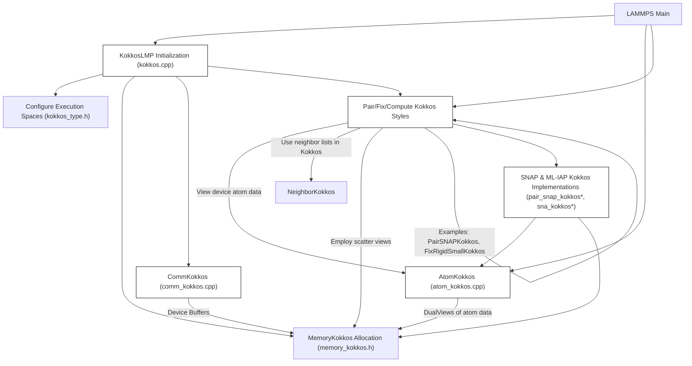

# 4.2 Kokkos Acceleration

Relevant source files

The following files were used as context for generating this wiki page:

- [doc/src/fix_rigid.rst](doc/src/fix_rigid.rst)
- [src/DPD-REACT/nbin_ssa.cpp](src/DPD-REACT/nbin_ssa.cpp)
- [src/DPD-REACT/nbin_ssa.h](src/DPD-REACT/nbin_ssa.h)
- [src/INTEL/nbin_intel.h](src/INTEL/nbin_intel.h)
- [src/KOKKOS/atom_kokkos.cpp](src/KOKKOS/atom_kokkos.cpp)
- [src/KOKKOS/atom_kokkos.h](src/KOKKOS/atom_kokkos.h)
- [src/KOKKOS/atom_map_kokkos.cpp](src/KOKKOS/atom_map_kokkos.cpp)
- [src/KOKKOS/atom_vec_angle_kokkos.cpp](src/KOKKOS/atom_vec_angle_kokkos.cpp)
- [src/KOKKOS/atom_vec_angle_kokkos.h](src/KOKKOS/atom_vec_angle_kokkos.h)
- [src/KOKKOS/atom_vec_atomic_kokkos.cpp](src/KOKKOS/atom_vec_atomic_kokkos.cpp)
- [src/KOKKOS/atom_vec_atomic_kokkos.h](src/KOKKOS/atom_vec_atomic_kokkos.h)
- [src/KOKKOS/atom_vec_bond_kokkos.cpp](src/KOKKOS/atom_vec_bond_kokkos.cpp)
- [src/KOKKOS/atom_vec_bond_kokkos.h](src/KOKKOS/atom_vec_bond_kokkos.h)
- [src/KOKKOS/atom_vec_charge_kokkos.cpp](src/KOKKOS/atom_vec_charge_kokkos.cpp)
- [src/KOKKOS/atom_vec_charge_kokkos.h](src/KOKKOS/atom_vec_charge_kokkos.h)
- [src/KOKKOS/atom_vec_dpd_kokkos.cpp](src/KOKKOS/atom_vec_dpd_kokkos.cpp)
- [src/KOKKOS/atom_vec_dpd_kokkos.h](src/KOKKOS/atom_vec_dpd_kokkos.h)
- [src/KOKKOS/atom_vec_ellipsoid_kokkos.cpp](src/KOKKOS/atom_vec_ellipsoid_kokkos.cpp)
- [src/KOKKOS/atom_vec_ellipsoid_kokkos.h](src/KOKKOS/atom_vec_ellipsoid_kokkos.h)
- [src/KOKKOS/atom_vec_full_kokkos.cpp](src/KOKKOS/atom_vec_full_kokkos.cpp)
- [src/KOKKOS/atom_vec_full_kokkos.h](src/KOKKOS/atom_vec_full_kokkos.h)
- [src/KOKKOS/atom_vec_hybrid_kokkos.cpp](src/KOKKOS/atom_vec_hybrid_kokkos.cpp)
- [src/KOKKOS/atom_vec_hybrid_kokkos.h](src/KOKKOS/atom_vec_hybrid_kokkos.h)
- [src/KOKKOS/atom_vec_kokkos.cpp](src/KOKKOS/atom_vec_kokkos.cpp)
- [src/KOKKOS/atom_vec_kokkos.h](src/KOKKOS/atom_vec_kokkos.h)
- [src/KOKKOS/atom_vec_molecular_kokkos.cpp](src/KOKKOS/atom_vec_molecular_kokkos.cpp)
- [src/KOKKOS/atom_vec_molecular_kokkos.h](src/KOKKOS/atom_vec_molecular_kokkos.h)
- [src/KOKKOS/atom_vec_sphere_kokkos.cpp](src/KOKKOS/atom_vec_sphere_kokkos.cpp)
- [src/KOKKOS/atom_vec_sphere_kokkos.h](src/KOKKOS/atom_vec_sphere_kokkos.h)
- [src/KOKKOS/atom_vec_spin_kokkos.cpp](src/KOKKOS/atom_vec_spin_kokkos.cpp)
- [src/KOKKOS/atom_vec_spin_kokkos.h](src/KOKKOS/atom_vec_spin_kokkos.h)
- [src/KOKKOS/comm_kokkos.cpp](src/KOKKOS/comm_kokkos.cpp)
- [src/KOKKOS/comm_kokkos.h](src/KOKKOS/comm_kokkos.h)
- [src/KOKKOS/comm_tiled_kokkos.cpp](src/KOKKOS/comm_tiled_kokkos.cpp)
- [src/KOKKOS/comm_tiled_kokkos.h](src/KOKKOS/comm_tiled_kokkos.h)
- [src/KOKKOS/compute_gaussian_grid_local_kokkos.cpp](src/KOKKOS/compute_gaussian_grid_local_kokkos.cpp)
- [src/KOKKOS/compute_gaussian_grid_local_kokkos.h](src/KOKKOS/compute_gaussian_grid_local_kokkos.h)
- [src/KOKKOS/compute_sna_grid_kokkos.cpp](src/KOKKOS/compute_sna_grid_kokkos.cpp)
- [src/KOKKOS/compute_sna_grid_kokkos.h](src/KOKKOS/compute_sna_grid_kokkos.h)
- [src/KOKKOS/compute_sna_grid_kokkos_impl.h](src/KOKKOS/compute_sna_grid_kokkos_impl.h)
- [src/KOKKOS/compute_sna_grid_local_kokkos.cpp](src/KOKKOS/compute_sna_grid_local_kokkos.cpp)
- [src/KOKKOS/compute_sna_grid_local_kokkos.h](src/KOKKOS/compute_sna_grid_local_kokkos.h)
- [src/KOKKOS/compute_sna_grid_local_kokkos_impl.h](src/KOKKOS/compute_sna_grid_local_kokkos_impl.h)
- [src/KOKKOS/domain_kokkos.cpp](src/KOKKOS/domain_kokkos.cpp)
- [src/KOKKOS/domain_kokkos.h](src/KOKKOS/domain_kokkos.h)
- [src/KOKKOS/dynamical_matrix_kokkos.cpp](src/KOKKOS/dynamical_matrix_kokkos.cpp)
- [src/KOKKOS/dynamical_matrix_kokkos.h](src/KOKKOS/dynamical_matrix_kokkos.h)
- [src/KOKKOS/fix_deform_kokkos.cpp](src/KOKKOS/fix_deform_kokkos.cpp)
- [src/KOKKOS/fix_deform_kokkos.h](src/KOKKOS/fix_deform_kokkos.h)
- [src/KOKKOS/fix_minimize_kokkos.cpp](src/KOKKOS/fix_minimize_kokkos.cpp)
- [src/KOKKOS/fix_minimize_kokkos.h](src/KOKKOS/fix_minimize_kokkos.h)
- [src/KOKKOS/fix_property_atom_kokkos.cpp](src/KOKKOS/fix_property_atom_kokkos.cpp)
- [src/KOKKOS/fix_property_atom_kokkos.h](src/KOKKOS/fix_property_atom_kokkos.h)
- [src/KOKKOS/fix_reaxff_species_kokkos.cpp](src/KOKKOS/fix_reaxff_species_kokkos.cpp)
- [src/KOKKOS/fix_rigid_nh_small_kokkos.cpp](src/KOKKOS/fix_rigid_nh_small_kokkos.cpp)
- [src/KOKKOS/fix_rigid_nph_small_kokkos.cpp](src/KOKKOS/fix_rigid_nph_small_kokkos.cpp)
- [src/KOKKOS/fix_rigid_npt_small_kokkos.cpp](src/KOKKOS/fix_rigid_npt_small_kokkos.cpp)
- [src/KOKKOS/fix_rigid_small_kokkos.cpp](src/KOKKOS/fix_rigid_small_kokkos.cpp)
- [src/KOKKOS/fix_rigid_small_kokkos.h](src/KOKKOS/fix_rigid_small_kokkos.h)
- [src/KOKKOS/kokkos.cpp](src/KOKKOS/kokkos.cpp)
- [src/KOKKOS/kokkos.h](src/KOKKOS/kokkos.h)
- [src/KOKKOS/kokkos_base.h](src/KOKKOS/kokkos_base.h)
- [src/KOKKOS/kokkos_type.h](src/KOKKOS/kokkos_type.h)
- [src/KOKKOS/memory_kokkos.h](src/KOKKOS/memory_kokkos.h)
- [src/KOKKOS/min_cg_kokkos.cpp](src/KOKKOS/min_cg_kokkos.cpp)
- [src/KOKKOS/min_cg_kokkos.h](src/KOKKOS/min_cg_kokkos.h)
- [src/KOKKOS/min_kokkos.cpp](src/KOKKOS/min_kokkos.cpp)
- [src/KOKKOS/min_kokkos.h](src/KOKKOS/min_kokkos.h)
- [src/KOKKOS/min_linesearch_kokkos.cpp](src/KOKKOS/min_linesearch_kokkos.cpp)
- [src/KOKKOS/min_linesearch_kokkos.h](src/KOKKOS/min_linesearch_kokkos.h)
- [src/KOKKOS/nbin_kokkos.cpp](src/KOKKOS/nbin_kokkos.cpp)
- [src/KOKKOS/nbin_kokkos.h](src/KOKKOS/nbin_kokkos.h)
- [src/KOKKOS/nbin_ssa_kokkos.cpp](src/KOKKOS/nbin_ssa_kokkos.cpp)
- [src/KOKKOS/nbin_ssa_kokkos.h](src/KOKKOS/nbin_ssa_kokkos.h)
- [src/KOKKOS/neighbor_kokkos.cpp](src/KOKKOS/neighbor_kokkos.cpp)
- [src/KOKKOS/neighbor_kokkos.h](src/KOKKOS/neighbor_kokkos.h)
- [src/KOKKOS/npair_copy_kokkos.cpp](src/KOKKOS/npair_copy_kokkos.cpp)
- [src/KOKKOS/npair_copy_kokkos.h](src/KOKKOS/npair_copy_kokkos.h)
- [src/KOKKOS/npair_halffull_kokkos.cpp](src/KOKKOS/npair_halffull_kokkos.cpp)
- [src/KOKKOS/npair_halffull_kokkos.h](src/KOKKOS/npair_halffull_kokkos.h)
- [src/KOKKOS/npair_kokkos.cpp](src/KOKKOS/npair_kokkos.cpp)
- [src/KOKKOS/npair_kokkos.h](src/KOKKOS/npair_kokkos.h)
- [src/KOKKOS/npair_skip_kokkos.cpp](src/KOKKOS/npair_skip_kokkos.cpp)
- [src/KOKKOS/npair_skip_kokkos.h](src/KOKKOS/npair_skip_kokkos.h)
- [src/KOKKOS/npair_ssa_kokkos.cpp](src/KOKKOS/npair_ssa_kokkos.cpp)
- [src/KOKKOS/npair_ssa_kokkos.h](src/KOKKOS/npair_ssa_kokkos.h)
- [src/KOKKOS/pair_hybrid_kokkos.cpp](src/KOKKOS/pair_hybrid_kokkos.cpp)
- [src/KOKKOS/pair_hybrid_kokkos.h](src/KOKKOS/pair_hybrid_kokkos.h)
- [src/KOKKOS/pair_hybrid_overlay_kokkos.cpp](src/KOKKOS/pair_hybrid_overlay_kokkos.cpp)
- [src/KOKKOS/pair_hybrid_overlay_kokkos.h](src/KOKKOS/pair_hybrid_overlay_kokkos.h)
- [src/KOKKOS/pair_kokkos.h](src/KOKKOS/pair_kokkos.h)
- [src/KOKKOS/pair_snap_kokkos.h](src/KOKKOS/pair_snap_kokkos.h)
- [src/KOKKOS/pair_snap_kokkos_impl.h](src/KOKKOS/pair_snap_kokkos_impl.h)
- [src/KOKKOS/pair_zbl_kokkos.cpp](src/KOKKOS/pair_zbl_kokkos.cpp)
- [src/KOKKOS/pair_zbl_kokkos.h](src/KOKKOS/pair_zbl_kokkos.h)
- [src/KOKKOS/rand_pool_wrap_kokkos.cpp](src/KOKKOS/rand_pool_wrap_kokkos.cpp)
- [src/KOKKOS/rand_pool_wrap_kokkos.h](src/KOKKOS/rand_pool_wrap_kokkos.h)
- [src/KOKKOS/sna_kokkos.h](src/KOKKOS/sna_kokkos.h)
- [src/KOKKOS/sna_kokkos_impl.h](src/KOKKOS/sna_kokkos_impl.h)
- [src/KOKKOS/third_order_kokkos.cpp](src/KOKKOS/third_order_kokkos.cpp)
- [src/KOKKOS/third_order_kokkos.h](src/KOKKOS/third_order_kokkos.h)
- [src/KOKKOS/verlet_kokkos.cpp](src/KOKKOS/verlet_kokkos.cpp)
- [src/KSPACE/kissfft.h](src/KSPACE/kissfft.h)
- [src/ML-SNAP/compute_gaussian_grid_local.cpp](src/ML-SNAP/compute_gaussian_grid_local.cpp)
- [src/ML-SNAP/compute_gaussian_grid_local.h](src/ML-SNAP/compute_gaussian_grid_local.h)
- [src/ML-SNAP/compute_grid.cpp](src/ML-SNAP/compute_grid.cpp)
- [src/ML-SNAP/compute_grid_local.cpp](src/ML-SNAP/compute_grid_local.cpp)
- [src/ML-SNAP/compute_sna_grid.cpp](src/ML-SNAP/compute_sna_grid.cpp)
- [src/ML-SNAP/compute_sna_grid.h](src/ML-SNAP/compute_sna_grid.h)
- [src/ML-SNAP/compute_sna_grid_local.cpp](src/ML-SNAP/compute_sna_grid_local.cpp)
- [src/ML-SNAP/compute_sna_grid_local.h](src/ML-SNAP/compute_sna_grid_local.h)
- [src/PHONON/dynamical_matrix.cpp](src/PHONON/dynamical_matrix.cpp)
- [src/PHONON/dynamical_matrix.h](src/PHONON/dynamical_matrix.h)
- [src/PHONON/third_order.cpp](src/PHONON/third_order.cpp)
- [src/PHONON/third_order.h](src/PHONON/third_order.h)
- [src/accelerator_kokkos.h](src/accelerator_kokkos.h)
- [src/atom_masks.h](src/atom_masks.h)
- [src/fix_minimize.cpp](src/fix_minimize.cpp)
- [src/fix_minimize.h](src/fix_minimize.h)
- [src/fix_property_atom.cpp](src/fix_property_atom.cpp)
- [src/fix_property_atom.h](src/fix_property_atom.h)
- [src/main.cpp](src/main.cpp)
- [src/nbin_standard.h](src/nbin_standard.h)

The Kokkos acceleration layer in LAMMPS provides a performance portability abstraction allowing efficient simulation execution on diverse hardware architectures, including multi-core CPUs, NVIDIA CUDA GPUs, HIP GPUs, and SYCL/OpenMP targets. It leverages the Kokkos library for managing memory and parallel execution spaces, enabling LAMMPS force and fix calculations to run efficiently across these platforms with a unified codebase.

This section covers technical details of KokkosLMP initialization, the AtomKokkos data structures, memory management with DualView objects, Kokkos-enabled pair/fix/compute styles, execution environment selection, and specific Kokkos implementations like SNAP and ML-IAP.

---

## 4.2.1 KokkosLMP Initialization and Configuration

The `KokkosLMP` class, defined in `src/KOKKOS/kokkos.cpp` (lines 70-28524), is the core singleton managing Kokkos integration within LAMMPS. It is instantiated during the LAMMPS initialization when the KOKKOS package is enabled.

### Initialization Logic:

- Checks for GPU devices without fully initializing Kokkos to avoid aborts if no compatible device is available. This device probe uses vendor runtime APIs (`cudaGetDeviceCount`, `hipGetDeviceCount`, SYCL device queries) as implemented in `lmp_has_compatible_kokkos_gpu()` (lines 81-102).

- Parses command-line arguments passed to the KOKKOS package to configure runtime options such as:
  - Number of GPUs to use (`ngpus`).
  - GPU device selection per MPI rank with support for SLURM and Flux local IDs.
  - Number of CPU threads for Kokkos.
  - Team sizes and chunk sizes for parallel kernels.
  - Precision mode (single, double, mixed) and view layout (legacy or default).

- Supports options for unified memory when compiled with CUDA/HIP unified memory support (lines 156-160).

- Coordinates MPI communication flags controlling legacy or Kokkos-aware exchanges, as well as whether communication happens on host or device memory.

- Emits logging messages about enabled Kokkos configuration, including Kokkos version, precision, layout, and unified memory usage (lines 130-160).

### Important State Variables

- `kokkos_exists` indicates whether the Kokkos environment is active.
- `init_ngpus` stores the number of GPUs initialized.
- Flags control communication changes (exchange, forward, reverse) and sorting behavior that affect data transfers in Kokkos-enabled runs.

The `KokkosLMP` instance initializes the Kokkos runtime environment and manages device thread-local storage, memory allocation via the `MemoryKokkos` subclass, and performance tuning helpers ([src/KOKKOS/kokkos.cpp:70-907]() ).

---

## 4.2.2 AtomKokkos: Atom Data on Host and Device

The `AtomKokkos` class inherits from `Atom` and manages atom data in Kokkos device memory spaces, providing a bridge between standard LAMMPS atom arrays and Kokkos views for accelerated kernels.

### Key Features:

- Uses `Kokkos::DualView` to maintain atom properties coherently between host and device memory. DualView objects enable lazy synchronization with explicit sync calls.

- Stores core atom properties — coordinates (`k_x`), velocities (`k_v`), forces (`k_f`), types (`k_type`), images (`k_image`), molecular IDs (`k_molecule`), masks (`k_mask`), charges (`k_q`), dipoles (`k_mu`), etc.— all as device-accessible `Kokkos::DualView` arrays.

- Manages anisotropic atom properties such as angular momentum, torques, ellipsoid shape, and rigid body mappings for extended particle types.

- Keeps atom neighbor and bond connectivity information as device data arrays for Kokkos-enabled bond and pair computations.

- Provides synchronization API calls for syncing data from host to device and back, controlled by explicit calls to `sync()` and `modified()` for data states (see methods around line 153, `AtomKokkos::init()` and `update_property_atom()`).

- Integrates with `fix property/atom` through pointers to `FixPropertyAtomKokkos` for user extensions that manage additional per-atom data on the device.

- Handles per-atom min/max tag tracking for efficient atom ID management on device.

The `AtomKokkos` class implementation notably manages device memory lifecycle, synchronization, and mapping atom properties to Kokkos views for kernel usage ([src/KOKKOS/atom_kokkos.cpp:36-181]()).

---

## 4.2.3 Memory Management with DualView and MemoryKokkos

LAMMPS Kokkos acceleration extensively uses `Kokkos::DualView` objects for atom and neighbor data to synchronize across host and device memory spaces.

### DualView Mechanism:

- A `DualView` encapsulates two views:
  - A *host mirror* view residing in CPU memory.
  - A *device* view residing in GPU or other accelerator memory.

- Synchronization between copies is explicit:
  - `sync()` is called to copy data from one memory space to the other as needed.
  - `modified()` flags updates to data in a particular memory space.

This approach ensures consistency but requires careful tracking of which side (host or device) currently owns the valid data.

### MemoryKokkos Class:

- Encapsulates allocation and deallocation of Kokkos views and DualViews, abstracting away low-level management.

- Handles allocation of common data structures used across the device kernels, including neighbor lists, exchange buffers, and per-atom arrays.

- Supports safe destruction of device views when atom lists or system size changes.

The memory management infrastructure allows for zero-copy semantics when unified memory is enabled or explicit copies when separate host/device memories are used ([src/KOKKOS/memory_kokkos.h]() and usage in [src/KOKKOS/atom_kokkos.cpp:50-150]()).

---

## 4.2.4 Execution Spaces and Device Selection

LAMMPS uses Kokkos execution spaces to abstract parallel execution on different hardware backends.

### Supported Execution Spaces:

- **LMPDeviceType:** Alias to Kokkos DefaultExecutionSpace, which may be CUDA, HIP, SYCL, or OpenMPTarget, depending on build configuration.

- **LMPHostType:** Host execution space, typically CPU-based (e.g., OpenMP or Serial).

These are configured internally in `kokkos_type.h` (lines 170-180) that define the device and host types and the default layout for Kokkos views.

### Execution Space Mappings:

- `ExecutionSpaceFromDevice` template structures translate device types into LAMMPS `ExecutionSpace` enums to select appropriate parallel kernels.

- Enables runtime dispatch and template specialization based on device type for optimized device or host kernel execution paths.

- Kokkos runtime is initialized once globally and selected device IDs and thread counts are used for execution.

### GPU Device Probe:

- Prior to Kokkos initialization, LAMMPS probes whether compatible GPUs are present by querying CUDA, HIP, or SYCL runtimes without triggering Kokkos initialization failure.

- If no GPUs are found, LAMMPS will run on CPUs using host execution spaces.

This flexible execution space setup allows LAMMPS to run the same Kokkos-enabled codebase efficiently on heterogeneous hardware ([src/KOKKOS/kokkos.cpp:17-105]() and [src/KOKKOS/kokkos_type.h:170-245]()).

---

## 4.2.5 Kokkos-Enabled Pair, Fix, and Compute Styles

LAMMPS includes multiple force calculation and compute styles rewritten or extended to leverage Kokkos for portability and performance:

### Pair Styles:

- **PairSNAPKokkos** (`pair_snap_kokkos.h` and `pair_snap_kokkos_impl.h`):  
  An optimized, vectorized Kokkos implementation of the SNAP potential.  
  - Templates on `DeviceType`, scalar types, and vector length for flexibility.  
  - Uses device views of atom data and neighbor lists.  
  - Implements parallel reductions and scatter views for force and energy accumulation (see lines 42-180 in `pair_snap_kokkos_impl.h`).  
  - Checks for proper neighbor list style (requires half neighbor lists).  
  - Employs Kokkos parallel reductions to find the max number of neighbors per atom (line 167) for workload batching.

- **NPairKokkos** (`npair_kokkos.cpp`):  
  A base templated implementation for neighbor list building and pair calculations in Kokkos.  
  - Manages copy of neighbor and bin information into device views.  
  - Updates stencil lists and executes neighbor list builds in device kernels (lines 31-161).  
  - Supports templated configurations for Newton’s third law, half/full neighbor lists, etc.

### Fix Styles:

- **FixRigidSmallKokkos** (`fix_rigid_small_kokkos.cpp`):  
  Kokkos-accelerated fix for rigid body constraints on small rigid bodies.  
  - Manages device data for body atoms, position corrections, and force/torque accumulations.  
  - Uses Kokkos random pools for stochastic Langevin thermostatting.  
  - Harmonizes forward and reverse MPI communication of extended body data via Kokkos-aware pathways (lines 52-190).

### Compute Styles:

- Compute styles such as `compute_sna_grid_kokkos` implement features backing machine learning interatomic potentials, with Kokkos versions handling dense neighbor grid lookups and descriptor computations.

### Common Characteristics:

- These Kokkos-enabled styles share common patterns:
  - Copy or reuse atom data and neighbor lists as `Kokkos::DualView`s.
  - Use template specialization over device/host types.
  - Employ Kokkos parallel patterns: parallel_for, parallel_reduce, team policies.
  - Use Kokkos scatter views for safe concurrent additions to shared arrays.
  - Check and sync data states between host and device carefully to avoid stale memory states.

These implementations demonstrate the layered design decisions enabling performance portability without sacrificing LAMMPS' existing modularity for different styles ([src/KOKKOS/pair_snap_kokkos_impl.h:42-180](), [src/KOKKOS/npair_kokkos.cpp:31-161](), [src/KOKKOS/fix_rigid_small_kokkos.cpp:52-190]()).

---

## 4.2.6 Communication with Kokkos: CommKokkos

`CommKokkos` is a subclass of `CommBrick` managing MPI communication buffers and ghost atom exchanges optimized for Kokkos usage.

### Key Responsibilities:

- Maintains send/receive buffers as Kokkos device DualViews to avoid unnecessary host-device copies during MPI communication.

- Handles legacy and device-aware communication modes, switched by flags like `exchange_comm_legacy` and `forward_comm_on_host`.

- Implements pack and unpack routines for atom coordinates and other attributes, performing transformations directly on device memory using Kokkos parallel_for kernels (`forward_comm_device` calls) or falling back to host staging buffers when necessary.

- Manages buffer growth and resizing dynamically, coordinated with neighbor list updates.

- Exchanges atom data for ghost atoms each timestep with support for variable-size payloads, including velocity and other per-atom attributes (see lines 139-160, 164-260 in `comm_kokkos.cpp`).

By tightly integrating communication buffers with device memory spaces, `CommKokkos` reduces data movement overhead and improves strong scaling on GPU architectures (full implementation in [src/KOKKOS/comm_kokkos.cpp:50-260]()).

---

## 4.2.7 The SNAP and ML-IAP Kokkos Implementations

LAMMPS' machine learning interatomic potentials (ML-IAP) framework includes Kokkos implementations to accelerate descriptor calculations and force computations.

### SNAP Kokkos Implementation:

- Encapsulated in `PairSNAPKokkos` and `SNAKokkos` classes.

- `SNAKokkos` manages the SNAP descriptor evaluation on device, maintaining Wigner and symmetry functions in specialized Kokkos views and using parallel dispatch (see `sna_kokkos.h` and `sna_kokkos_impl.h`).

- `PairSNAPKokkos` wraps the force and energy computations, carefully managing workspace allocations, batch sizes for vectorized computation, and synchronization of atom property arrays (`x`, `f`, `type`) as device views (see lines 42-180 in `pair_snap_kokkos_impl.h`).

- Uses Kokkos experimental scatter views to safely accumulate per-atom forces and per-atom energy contributions with atomic operations.

- Supports launching different execution paths depending on device or host execution for maximum efficiency.

### ML-IAP Framework Integration:

- The Kokkos backend supports other descriptors and models under the unified ML-IAP framework (`pair_mliap`), enabling the use of SNAP and other ML potentials with accelerated methods.

- Kokkos acceleration also enables efficient compute styles for atom-wise ML descriptor evaluation and supports their coupling to neural network potentials.

These implementations enable large-scale, portable machine learning potential simulations with performance benefits on GPU and many-core systems ([src/KOKKOS/pair_snap_kokkos_impl.h:42-180](), [src/KOKKOS/sna_kokkos_impl.h:32-180](), [src/KOKKOS/sna_kokkos.h:20-232]()).

---

## 4.2.8 Summary Diagram of Kokkos Components and Data Flow

---

## 4.2.9 Table of Key Classes and Files for Kokkos Acceleration

| Component               | Primary Class/File                          | Responsibility                                         |
|-------------------------|--------------------------------------------|--------------------------------------------------------|
| Kokkos Initialization   | `KokkosLMP` (`src/KOKKOS/kokkos.cpp`)      | Initialize Kokkos, parse args, device selection         |
| Atom Data Management    | `AtomKokkos` (`src/KOKKOS/atom_kokkos.cpp`) | Manages atom data in device memory, syncs host/device   |
| Memory Management       | `MemoryKokkos` (`src/KOKKOS/memory_kokkos.h`) | Allocate/deallocate Kokkos views and DualViews          |
| Communication           | `CommKokkos` (`src/KOKKOS/comm_kokkos.cpp`) | MPI communication with device buffer support            |
| Pair Style Kokkos Layer | `PairSNAPKokkos` (`src/KOKKOS/pair_snap_kokkos*.h/.cpp`) | Kokkos-accelerated SNAP force computation               |
| Fix Styles              | `FixRigidSmallKokkos` (`src/KOKKOS/fix_rigid_small_kokkos.cpp`) | Rigid body constraints accelerated on device            |
| Execution Spaces        | Typedefs in `kokkos_type.h`                 | Map device/host types and layouts                        |
| ML-IAP Descriptors      | `SNAKokkos` (`src/KOKKOS/sna_kokkos*.h/.cpp`) | Device SNAP descriptor calculations                      |

---

## 4.2.10 Important Kokkos Implementation Patterns

- **DualView Synchronization**: Mandatory explicit calls to `sync(Host)` or `sync(Device)` and `modified(Host)` or `modified(Device)` to ensure coherent shared data.

- **Execution Space Template Dispatch**: Classes and functions templated on `DeviceType` select between host and device execution policies for efficient parallel_for/parallel_reduce.

- **Scatter Views for Parallel Reductions**: Use of `Kokkos::Experimental::ScatterView` to avoid atomic collisions during concurrent updates of forces and virials to individual atoms.

- **Neighbor Lists & Binning**: Neighbor lists (`NeighListKokkos`) and spatial bin structures (`NBinKokkos`) are migrated to and maintained in device memory for all Kokkos-enabled calculations.

- **Chunk Sizes and Team Sizes**: Tunable parameters for kernel team sizes and chunk sizes across device teams determine parallel decomposition granularity.

- **Backward Compatibility Flags**: Some communication and sorting pathways fallback on legacy host implementations for complex atom styles or fixes not supporting device sort.

---

# References and Sources

- `src/KOKKOS/kokkos.cpp:70-28524`
- `src/KOKKOS/atom_kokkos.cpp:36-181`
- `src/KOKKOS/kokkos_type.h:170-245`
- `src/KOKKOS/comm_kokkos.cpp:50-260`
- `src/KOKKOS/pair_snap_kokkos_impl.h:42-180`
- `src/KOKKOS/npair_kokkos.cpp:31-161`
- `src/KOKKOS/fix_rigid_small_kokkos.cpp:52-190`
- `src/KOKKOS/sna_kokkos_impl.h:32-180`
- `src/KOKKOS/sna_kokkos.h:20-232`
- `src/KOKKOS/atom_vec_kokkos.cpp:28-147`
- `src/KOKKOS/pair_snap_kokkos.h:35-230`

---

This detailed exposition covers the implementation structure and data flows for the Kokkos acceleration layer in LAMMPS, enabling maintainers and developers to understand the bridging of LAMMPS features into a portable, efficient Kokkos execution environment.

---