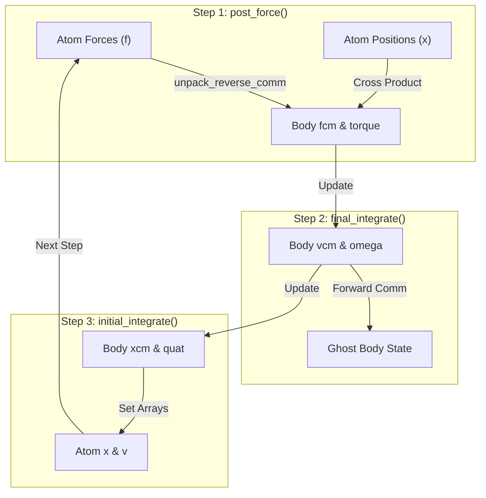

# Rigid Body Constraints

Relevant source files

The following files were used as context for generating this wiki page:

- [doc/src/fix_ilves.rst](doc/src/fix_ilves.rst)
- [doc/src/fix_shake.rst](doc/src/fix_shake.rst)
- [examples/PACKAGES/colvars/in.peptide-colvars](examples/PACKAGES/colvars/in.peptide-colvars)
- [examples/PACKAGES/colvars/peptide.colvars](examples/PACKAGES/colvars/peptide.colvars)
- [examples/reaxff/in.reaxff.tatb](examples/reaxff/in.reaxff.tatb)
- [src/CG-DNA/fix_nve_dot.cpp](src/CG-DNA/fix_nve_dot.cpp)
- [src/CG-DNA/fix_nve_dotc_langevin.cpp](src/CG-DNA/fix_nve_dotc_langevin.cpp)
- [src/COLVARS/colvarproxy_lammps.cpp](src/COLVARS/colvarproxy_lammps.cpp)
- [src/COLVARS/colvarproxy_lammps.h](src/COLVARS/colvarproxy_lammps.h)
- [src/COLVARS/colvarproxy_lammps_version.h](src/COLVARS/colvarproxy_lammps_version.h)
- [src/COLVARS/fix_colvars.cpp](src/COLVARS/fix_colvars.cpp)
- [src/COLVARS/fix_colvars.h](src/COLVARS/fix_colvars.h)
- [src/GPU/fix_nve_asphere_gpu.cpp](src/GPU/fix_nve_asphere_gpu.cpp)
- [src/GPU/fix_nve_asphere_gpu.h](src/GPU/fix_nve_asphere_gpu.h)
- [src/GRAPHICS/fix_graphics_isosurface.cpp](src/GRAPHICS/fix_graphics_isosurface.cpp)
- [src/INTEL/fix_nve_asphere_intel.cpp](src/INTEL/fix_nve_asphere_intel.cpp)
- [src/KOKKOS/compute_reaxff_atom_kokkos.cpp](src/KOKKOS/compute_reaxff_atom_kokkos.cpp)
- [src/KOKKOS/compute_reaxff_atom_kokkos.h](src/KOKKOS/compute_reaxff_atom_kokkos.h)
- [src/KOKKOS/fix_acks2_reaxff_kokkos.cpp](src/KOKKOS/fix_acks2_reaxff_kokkos.cpp)
- [src/KOKKOS/fix_acks2_reaxff_kokkos.h](src/KOKKOS/fix_acks2_reaxff_kokkos.h)
- [src/KOKKOS/fix_neigh_history_kokkos.cpp](src/KOKKOS/fix_neigh_history_kokkos.cpp)
- [src/KOKKOS/fix_neigh_history_kokkos.h](src/KOKKOS/fix_neigh_history_kokkos.h)
- [src/KOKKOS/fix_qeq_reaxff_kokkos.cpp](src/KOKKOS/fix_qeq_reaxff_kokkos.cpp)
- [src/KOKKOS/fix_qeq_reaxff_kokkos.h](src/KOKKOS/fix_qeq_reaxff_kokkos.h)
- [src/KOKKOS/fix_shake_kokkos.cpp](src/KOKKOS/fix_shake_kokkos.cpp)
- [src/KOKKOS/fix_shake_kokkos.h](src/KOKKOS/fix_shake_kokkos.h)
- [src/KOKKOS/fix_wall_gran_kokkos.cpp](src/KOKKOS/fix_wall_gran_kokkos.cpp)
- [src/KOKKOS/fix_wall_gran_kokkos.h](src/KOKKOS/fix_wall_gran_kokkos.h)
- [src/KOKKOS/pair_gran_hooke_history_kokkos.cpp](src/KOKKOS/pair_gran_hooke_history_kokkos.cpp)
- [src/KOKKOS/pair_gran_hooke_history_kokkos.h](src/KOKKOS/pair_gran_hooke_history_kokkos.h)
- [src/KOKKOS/pair_reaxff_kokkos.cpp](src/KOKKOS/pair_reaxff_kokkos.cpp)
- [src/KOKKOS/pair_reaxff_kokkos.h](src/KOKKOS/pair_reaxff_kokkos.h)
- [src/OPENMP/fix_nh_asphere_omp.cpp](src/OPENMP/fix_nh_asphere_omp.cpp)
- [src/OPENMP/fix_rigid_nh_omp.cpp](src/OPENMP/fix_rigid_nh_omp.cpp)
- [src/OPENMP/fix_rigid_omp.cpp](src/OPENMP/fix_rigid_omp.cpp)
- [src/OPENMP/fix_rigid_small_omp.cpp](src/OPENMP/fix_rigid_small_omp.cpp)
- [src/PHONON/fix_phonon.cpp](src/PHONON/fix_phonon.cpp)
- [src/REAXFF/compute_reaxff_atom.cpp](src/REAXFF/compute_reaxff_atom.cpp)
- [src/REAXFF/compute_reaxff_atom.h](src/REAXFF/compute_reaxff_atom.h)
- [src/REAXFF/fix_acks2_reaxff.cpp](src/REAXFF/fix_acks2_reaxff.cpp)
- [src/REAXFF/fix_acks2_reaxff.h](src/REAXFF/fix_acks2_reaxff.h)
- [src/REAXFF/fix_qeq_reaxff.cpp](src/REAXFF/fix_qeq_reaxff.cpp)
- [src/RIGID/fix_ilves.cpp](src/RIGID/fix_ilves.cpp)
- [src/RIGID/fix_ilves.h](src/RIGID/fix_ilves.h)
- [src/RIGID/fix_rattle.cpp](src/RIGID/fix_rattle.cpp)
- [src/RIGID/fix_rattle.h](src/RIGID/fix_rattle.h)
- [src/RIGID/fix_rigid.cpp](src/RIGID/fix_rigid.cpp)
- [src/RIGID/fix_rigid.h](src/RIGID/fix_rigid.h)
- [src/RIGID/fix_rigid_nh.cpp](src/RIGID/fix_rigid_nh.cpp)
- [src/RIGID/fix_rigid_nh.h](src/RIGID/fix_rigid_nh.h)
- [src/RIGID/fix_rigid_nh_small.cpp](src/RIGID/fix_rigid_nh_small.cpp)
- [src/RIGID/fix_rigid_small.cpp](src/RIGID/fix_rigid_small.cpp)
- [src/RIGID/fix_rigid_small.h](src/RIGID/fix_rigid_small.h)
- [src/RIGID/fix_shake.cpp](src/RIGID/fix_shake.cpp)
- [src/RIGID/fix_shake.h](src/RIGID/fix_shake.h)
- [src/RIGID/ilves.cpp](src/RIGID/ilves.cpp)
- [src/RIGID/ilves.h](src/RIGID/ilves.h)
- [src/RIGID/ilves_graph.cpp](src/RIGID/ilves_graph.cpp)
- [src/RIGID/ilves_graph.h](src/RIGID/ilves_graph.h)
- [src/RIGID/ilves_molecule.cpp](src/RIGID/ilves_molecule.cpp)
- [src/RIGID/ilves_molecule.h](src/RIGID/ilves_molecule.h)
- [src/RIGID/ilves_solver.cpp](src/RIGID/ilves_solver.cpp)
- [src/RIGID/ilves_solver.h](src/RIGID/ilves_solver.h)
- [src/RIGID/rigid_const.h](src/RIGID/rigid_const.h)
- [src/nbin_manual.cpp](src/nbin_manual.cpp)
- [src/nbin_manual.h](src/nbin_manual.h)
- [src/nstencil_manual.cpp](src/nstencil_manual.cpp)
- [src/nstencil_manual.h](src/nstencil_manual.h)

Rigid body constraints in LAMMPS enable the treatment of groups of atoms as rigid entities that maintain their internal structure throughout a simulation. This page explains the rigid body simulation capabilities in LAMMPS, focusing on how rigid body constraints are implemented, the parallel communication mechanisms, specialized constraint solvers like ILVES, and Kokkos-accelerated implementations.

## Overview of Rigid Body Constraints

LAMMPS implements rigid body constraints through several fix commands that force collections of atoms to move as rigid entities. These fixes update positions and orientations of all atoms in a rigid body based on the body's center of mass motion and angular momentum, preserving the internal structure via quaternion-based rotation.

### Code Entity Map: Rigid Body Styles
The following diagram maps the high-level rigid body styles to their corresponding implementation classes in the `src/RIGID` and `src/KOKKOS` directories.

```mermaid
graph TD
    subgraph "Standard Implementation"
        FR["FixRigid"] -- "Small # of bodies" --> FR_C["src/RIGID/fix_rigid.cpp"]
        FRS["FixRigidSmall"] -- "Many small bodies" --> FRS_C["src/RIGID/fix_rigid_small.cpp"]
    end

    subgraph "Thermostats & Barostats"
        FRNH["FixRigidNH"] -- "Nose-Hoover" --> FRNH_C["src/RIGID/fix_rigid_nh.cpp"]
        FRNHS["FixRigidNHSmall"] -- "Nose-Hoover (Small)" --> FRNHS_C["src/RIGID/fix_rigid_nh_small.cpp"]
    end

    subgraph "Constraint Solvers"
        FS["FixShake"] -- "Distance constraints" --> FS_C["src/RIGID/fix_shake.cpp"]
        FI["FixIlves"] -- "ILVES linear solver" --> FI_C["src/RIGID/fix_ilves.cpp"]
    end

    subgraph "Accelerated Versions"
        FR_OMP["FixRigidOMP"] --> FR_OMP_C["src/OPENMP/fix_rigid_omp.cpp"]
        FS_KK["FixShakeKokkos"] --> FS_KK_C["src/KOKKOS/fix_shake_kokkos.cpp"]
    end
```

Sources: [src/RIGID/fix_rigid.h:16-17](), [src/RIGID/fix_rigid_small.h:16-17](), [src/RIGID/fix_shake.h:16-17](), [src/RIGID/fix_ilves.h:16-17](), [src/KOKKOS/fix_shake_kokkos.h:16-17]().

## Implementation Approaches

### Standard Rigid (FixRigid)
The standard rigid body implementation is designed for scenarios where the number of rigid bodies is relatively small. It manages global arrays of body properties across all processors.
*   **Body Definition**: Supports `single`, `molecule`, `group`, and `custom` styles [src/RIGID/fix_rigid.cpp:98-175]().
*   **Data Storage**: Uses arrays like `xcm`, `vcm`, `fcm`, `quat`, and `inertia` to store per-body state [src/RIGID/fix_rigid.h:51-58]().

### Small Rigid (FixRigidSmall)
Optimized for simulations with many small rigid bodies (e.g., small molecules). Each body is owned by a single processor, and its atoms are typically within the ghost atom cutoff of the owner.
*   **Body Struct**: Uses a `Body` struct to encapsulate all properties for a single rigid entity [src/RIGID/fix_rigid_small.h:70-91]().
*   **Rendezvous Communication**: Uses a rendezvous algorithm to efficiently build body definitions across processors [src/RIGID/fix_rigid_small.cpp:53-54]().

### SHAKE and RATTLE (FixShake)
SHAKE is a constraint method that maintains fixed distances (bonds) and angles.
*   **Algorithm**: Iteratively adjusts atom positions to satisfy distance constraints [src/RIGID/fix_shake.cpp:143-146]().
*   **RATTLE**: An extension of SHAKE that also constrains velocities [src/RIGID/fix_rattle.cpp:15-20]().
*   **Cluster Finding**: Automatically identifies clusters of constrained bonds/angles via `find_clusters()` [src/RIGID/fix_shake.cpp:134]().

Sources: [src/RIGID/fix_rigid.cpp:49-170](), [src/RIGID/fix_rigid_small.cpp:56-155](), [src/RIGID/fix_shake.cpp:50-175]().

## Parallel Data Flow

The following diagram illustrates the data flow during a single time step for `FixRigidSmall`, highlighting how per-atom forces are reduced to body-level torques and forces.

Sources: [src/RIGID/fix_rigid_small.cpp:37-38](), [src/RIGID/fix_rigid_small.cpp:729-786](), [src/RIGID/fix_rigid_small.cpp:831-873]().

## ILVES Constraint Solver

`FixIlves` implements a linear constraint solver designed for massive parallelism. Unlike SHAKE, which is iterative and can be difficult to parallelize for large coupled systems, ILVES uses a matrix-based approach.

*   **Linear System**: Solves $Ax = b$ where $A$ is the constraint matrix.
*   **Molecules**: Managed via `IlvesMolecule` objects which track internal constraints and connectivity [src/RIGID/ilves_molecule.h:25-30]().
*   **Integration**: Integrated into the Verlet loop via `post_force` and `final_integrate` to ensure constraints are satisfied at both position and velocity levels [src/RIGID/fix_ilves.cpp:34-45]().

Sources: [src/RIGID/fix_ilves.cpp:20-50](), [src/RIGID/ilves.h:15-25]().

## Kokkos Rigid Body Implementation

The Kokkos version of rigid body constraints (specifically `FixShakeKokkos`) provides performance portability across CPUs and GPUs.

### Data Management with DualViews
Kokkos implementations use `DualView` to manage data that resides on both the Host and the Device.
*   **Syncing**: Uses `k_shake_flag.sync<DeviceType>()` to ensure the GPU has the latest constraint definitions [src/KOKKOS/fix_shake_kokkos.cpp:211]().
*   **Execution**: Constraint kernels are launched as Kokkos parallel loops (e.g., `parallel_for`) [src/KOKKOS/fix_shake_kokkos.cpp:192]().

### SHAKE Kokkos Logic
`FixShakeKokkos` mirrors the logic of the standard `FixShake` but replaces the iterative loops with GPU-friendly kernels.
*   **Atoms/Bonds**: Bond and angle distances are stored in `k_bond_distance` and `k_angle_distance` views [src/KOKKOS/fix_shake_kokkos.cpp:84-85]().
*   **Constraint Loops**: The `shake()` function is implemented to run on the device [src/KOKKOS/fix_shake_kokkos.h:57-60]().

Sources: [src/KOKKOS/fix_shake_kokkos.cpp:40-107](), [src/KOKKOS/fix_shake_kokkos.h:25-40]().

## Integration with ReaxFF (QEq)

Rigid body constraints often interact with charge equilibration (QEq) in reactive force fields. 
*   **FixQEqReaxFFKokkos**: Implements charge equilibration for ReaxFF using Kokkos. It must ensure that as atoms move within rigid bodies, their charges are updated correctly according to the local environment [src/KOKKOS/fix_qeq_reaxff_kokkos.cpp:54-83]().
*   **Matrix-Free**: Supports a matrix-free form to reduce memory overhead on GPUs [src/KOKKOS/fix_qeq_reaxff_kokkos.cpp:81-82]().

Sources: [src/KOKKOS/fix_qeq_reaxff_kokkos.cpp:100-133](), [src/REAXFF/fix_qeq_reaxff.cpp:69-162]().

## Summary Table: Rigid Body Features

| Feature | FixRigid | FixRigidSmall | FixShake | FixIlves |
| :--- | :--- | :--- | :--- | :--- |
| **Parallelism** | Global Body Arrays | Distributed (Rendezvous) | Domain Decomposition | Matrix-based |
| **Rotation** | Quaternions | Quaternions | N/A (Distance only) | Linear Solver |
| **Best For** | Few large bodies | Many small molecules | Bond constraints | Large coupled systems |
| **Kokkos** | No | No | Yes | No |
| **OpenMP** | Yes | Yes | No | No |

Sources: [src/RIGID/fix_rigid.cpp:49-60](), [src/RIGID/fix_rigid_small.cpp:56-65](), [src/RIGID/fix_shake.cpp:49-59](), [src/RIGID/fix_ilves.cpp:25-35]().

---