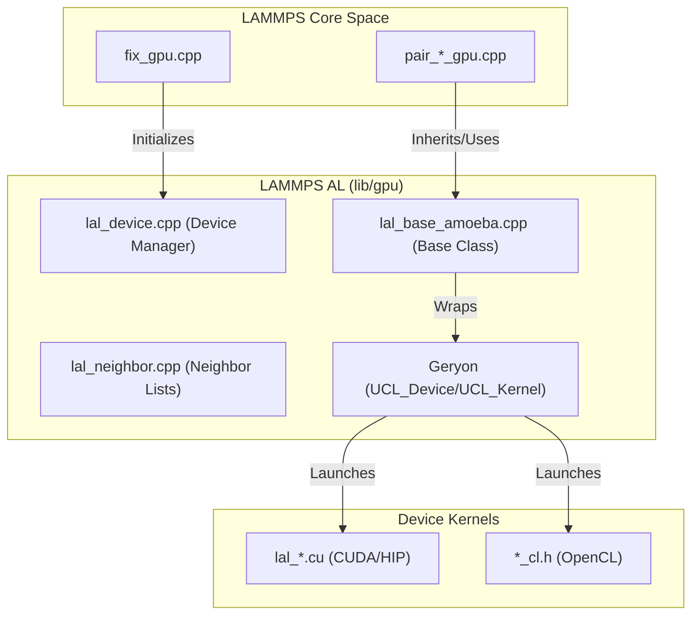
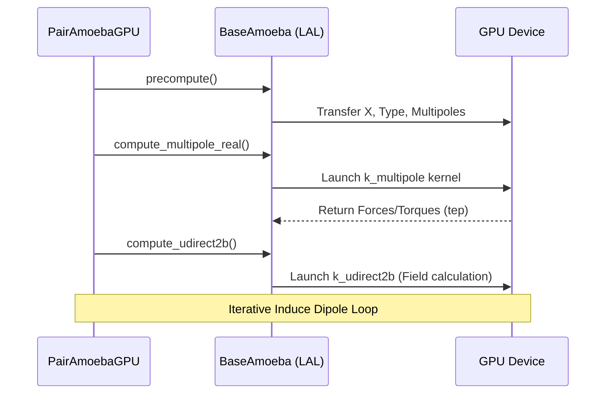

# GPU Package

Relevant source files

The following files were used as context for generating this wiki page:

- [lib/gpu/README](lib/gpu/README)
- [lib/gpu/cudpp_mini/cudpp_maximal_launch.cpp](lib/gpu/cudpp_mini/cudpp_maximal_launch.cpp)
- [lib/gpu/geryon/VERSION.txt](lib/gpu/geryon/VERSION.txt)
- [lib/gpu/geryon/hip_device.h](lib/gpu/geryon/hip_device.h)
- [lib/gpu/geryon/hip_macros.h](lib/gpu/geryon/hip_macros.h)
- [lib/gpu/geryon/hip_texture.h](lib/gpu/geryon/hip_texture.h)
- [lib/gpu/geryon/nvd_device.h](lib/gpu/geryon/nvd_device.h)
- [lib/gpu/geryon/nvd_kernel.h](lib/gpu/geryon/nvd_kernel.h)
- [lib/gpu/geryon/nvd_macros.h](lib/gpu/geryon/nvd_macros.h)
- [lib/gpu/geryon/nvd_mat.h](lib/gpu/geryon/nvd_mat.h)
- [lib/gpu/geryon/nvd_memory.h](lib/gpu/geryon/nvd_memory.h)
- [lib/gpu/geryon/nvd_texture.h](lib/gpu/geryon/nvd_texture.h)
- [lib/gpu/geryon/ocl_device.h](lib/gpu/geryon/ocl_device.h)
- [lib/gpu/geryon/ocl_kernel.h](lib/gpu/geryon/ocl_kernel.h)
- [lib/gpu/geryon/ocl_macros.h](lib/gpu/geryon/ocl_macros.h)
- [lib/gpu/geryon/ocl_memory.h](lib/gpu/geryon/ocl_memory.h)
- [lib/gpu/geryon/ocl_texture.h](lib/gpu/geryon/ocl_texture.h)
- [lib/gpu/geryon/ocl_timer.h](lib/gpu/geryon/ocl_timer.h)
- [lib/gpu/geryon/ucl_arg_kludge.h](lib/gpu/geryon/ucl_arg_kludge.h)
- [lib/gpu/geryon/ucl_basemat.h](lib/gpu/geryon/ucl_basemat.h)
- [lib/gpu/geryon/ucl_copy.h](lib/gpu/geryon/ucl_copy.h)
- [lib/gpu/geryon/ucl_d_mat.h](lib/gpu/geryon/ucl_d_mat.h)
- [lib/gpu/geryon/ucl_d_vec.h](lib/gpu/geryon/ucl_d_vec.h)
- [lib/gpu/geryon/ucl_h_mat.h](lib/gpu/geryon/ucl_h_mat.h)
- [lib/gpu/geryon/ucl_h_vec.h](lib/gpu/geryon/ucl_h_vec.h)
- [lib/gpu/geryon/ucl_matrix.h](lib/gpu/geryon/ucl_matrix.h)
- [lib/gpu/geryon/ucl_nv_kernel.h](lib/gpu/geryon/ucl_nv_kernel.h)
- [lib/gpu/geryon/ucl_print.h](lib/gpu/geryon/ucl_print.h)
- [lib/gpu/geryon/ucl_s_obj_help.h](lib/gpu/geryon/ucl_s_obj_help.h)
- [lib/gpu/geryon/ucl_vector.h](lib/gpu/geryon/ucl_vector.h)
- [lib/gpu/lal_amoeba.cpp](lib/gpu/lal_amoeba.cpp)
- [lib/gpu/lal_amoeba.cu](lib/gpu/lal_amoeba.cu)
- [lib/gpu/lal_amoeba.h](lib/gpu/lal_amoeba.h)
- [lib/gpu/lal_amoeba_ext.cpp](lib/gpu/lal_amoeba_ext.cpp)
- [lib/gpu/lal_answer.cpp](lib/gpu/lal_answer.cpp)
- [lib/gpu/lal_base_amoeba.cpp](lib/gpu/lal_base_amoeba.cpp)
- [lib/gpu/lal_base_amoeba.h](lib/gpu/lal_base_amoeba.h)
- [lib/gpu/lal_base_atomic.cpp](lib/gpu/lal_base_atomic.cpp)
- [lib/gpu/lal_base_charge.cpp](lib/gpu/lal_base_charge.cpp)
- [lib/gpu/lal_base_charge.h](lib/gpu/lal_base_charge.h)
- [lib/gpu/lal_base_dipole.cpp](lib/gpu/lal_base_dipole.cpp)
- [lib/gpu/lal_base_dpd.cpp](lib/gpu/lal_base_dpd.cpp)
- [lib/gpu/lal_base_ellipsoid.cpp](lib/gpu/lal_base_ellipsoid.cpp)
- [lib/gpu/lal_base_three.cpp](lib/gpu/lal_base_three.cpp)
- [lib/gpu/lal_charmm_long_ext.cpp](lib/gpu/lal_charmm_long_ext.cpp)
- [lib/gpu/lal_device.cpp](lib/gpu/lal_device.cpp)
- [lib/gpu/lal_device.h](lib/gpu/lal_device.h)
- [lib/gpu/lal_hippo.cpp](lib/gpu/lal_hippo.cpp)
- [lib/gpu/lal_hippo.cu](lib/gpu/lal_hippo.cu)
- [lib/gpu/lal_hippo.h](lib/gpu/lal_hippo.h)
- [lib/gpu/lal_hippo_ext.cpp](lib/gpu/lal_hippo_ext.cpp)
- [lib/gpu/lal_hippo_extra.h](lib/gpu/lal_hippo_extra.h)
- [lib/gpu/lal_lj_coul_long_ext.cpp](lib/gpu/lal_lj_coul_long_ext.cpp)
- [lib/gpu/lal_neighbor.cpp](lib/gpu/lal_neighbor.cpp)
- [lib/gpu/lal_neighbor.h](lib/gpu/lal_neighbor.h)
- [lib/gpu/lal_neighbor_gpu.cu](lib/gpu/lal_neighbor_gpu.cu)
- [lib/gpu/lal_neighbor_shared.cpp](lib/gpu/lal_neighbor_shared.cpp)
- [lib/gpu/lal_neighbor_shared.h](lib/gpu/lal_neighbor_shared.h)
- [lib/gpu/lal_pppm.cpp](lib/gpu/lal_pppm.cpp)
- [lib/gpu/lal_pppm.cu](lib/gpu/lal_pppm.cu)
- [lib/gpu/lal_pppm.h](lib/gpu/lal_pppm.h)
- [lib/gpu/lal_pppm_ext.cpp](lib/gpu/lal_pppm_ext.cpp)
- [src/GPU/Install.sh](src/GPU/Install.sh)
- [src/GPU/fix_gpu.cpp](src/GPU/fix_gpu.cpp)
- [src/GPU/fix_gpu.h](src/GPU/fix_gpu.h)
- [src/GPU/gpu_extra.h](src/GPU/gpu_extra.h)
- [src/GPU/pair_amoeba_gpu.cpp](src/GPU/pair_amoeba_gpu.cpp)
- [src/GPU/pair_amoeba_gpu.h](src/GPU/pair_amoeba_gpu.h)
- [src/GPU/pair_coul_long_gpu.cpp](src/GPU/pair_coul_long_gpu.cpp)
- [src/GPU/pair_gayberne_gpu.cpp](src/GPU/pair_gayberne_gpu.cpp)
- [src/GPU/pair_gayberne_gpu.h](src/GPU/pair_gayberne_gpu.h)
- [src/GPU/pair_hippo_gpu.cpp](src/GPU/pair_hippo_gpu.cpp)
- [src/GPU/pair_hippo_gpu.h](src/GPU/pair_hippo_gpu.h)
- [src/GPU/pair_lj96_cut_gpu.cpp](src/GPU/pair_lj96_cut_gpu.cpp)
- [src/GPU/pair_lj96_cut_gpu.h](src/GPU/pair_lj96_cut_gpu.h)
- [src/GPU/pair_lj_charmm_coul_long_gpu.cpp](src/GPU/pair_lj_charmm_coul_long_gpu.cpp)
- [src/GPU/pair_lj_class2_coul_long_gpu.cpp](src/GPU/pair_lj_class2_coul_long_gpu.cpp)
- [src/GPU/pair_lj_class2_gpu.cpp](src/GPU/pair_lj_class2_gpu.cpp)
- [src/GPU/pair_lj_cut_coul_cut_gpu.cpp](src/GPU/pair_lj_cut_coul_cut_gpu.cpp)
- [src/GPU/pair_lj_cut_coul_cut_gpu.h](src/GPU/pair_lj_cut_coul_cut_gpu.h)
- [src/GPU/pair_lj_cut_coul_long_gpu.cpp](src/GPU/pair_lj_cut_coul_long_gpu.cpp)
- [src/GPU/pair_lj_cut_coul_long_gpu.h](src/GPU/pair_lj_cut_coul_long_gpu.h)
- [src/GPU/pair_lj_cut_gpu.cpp](src/GPU/pair_lj_cut_gpu.cpp)
- [src/GPU/pair_lj_cut_gpu.h](src/GPU/pair_lj_cut_gpu.h)
- [src/GPU/pair_lj_expand_gpu.cpp](src/GPU/pair_lj_expand_gpu.cpp)
- [src/GPU/pair_morse_gpu.cpp](src/GPU/pair_morse_gpu.cpp)
- [src/GPU/pair_resquared_gpu.cpp](src/GPU/pair_resquared_gpu.cpp)

The GPU package provides acceleration for short-range, long-range, and three-body potentials by offloading computationally intensive force and neighbor list calculations to GPUs or other hardware accelerators. It supports multiple backends including **CUDA**, **HIP**, and **OpenCL** through the **Geryon** library abstraction layer.

## Architecture Overview

The GPU package is split into two main components:
1.  **LAMMPS Classes (`src/GPU`)**: C++ classes that interface with the LAMMPS core, managing memory transfer and calling accelerated routines.
2.  **Accelerator Library (`lib/gpu`)**: The "LAMMPS Accelerator Library" (LAMMPS_AL), containing device-specific kernels and the Geryon abstraction layer.

### System Mapping: Code Entities

The following diagram maps high-level GPU package concepts to their specific C++ and kernel implementations.

Sources: [src/GPU/fix_gpu.cpp:44-56](), [lib/gpu/lal_device.cpp:81-102](), [lib/gpu/lal_base_amoeba.cpp:24-31]()

## Geryon Abstraction Layer

Geryon is a "Unified Coprocessor Library" (UCL) located in `lib/gpu/geryon`. It provides a common API for memory management, kernel compilation, and execution across different hardware vendors.

*   **`UCL_Device`**: Handles device selection, context creation, and command queues (streams).
*   **`UCL_Kernel`**: Manages just-in-time (JIT) compilation for OpenCL or loading of pre-compiled binaries for CUDA/HIP.
*   **`UCL_Memory`**: Provides `UCL_H_Vec` (Host) and `UCL_D_Vec` (Device) containers for transparent data movement.

Sources: [lib/gpu/geryon/ocl_device.h:109-202](), [lib/gpu/lal_device.cpp:107-117]()

## Device Management: Fix GPU

The `fix gpu` command is the central manager for device initialization. It determines how many GPUs to use, which ranks are assigned to which devices, and the "split" between CPU and GPU work.

### Key Functions
*   `FixGPU::FixGPU`: Parses the `package gpu` command arguments, including `neigh`, `newton`, `binsize`, and `split` [src/GPU/fix_gpu.cpp:116-250]().
*   `lmp_init_device`: External call to the library to initialize hardware via `Device::init_device` [src/GPU/fix_gpu.cpp:44-49](), [lib/gpu/lal_device.cpp:81-102]().
*   `Device::init_device`: Handles MPI rank assignment to physical device IDs and initializes the Geryon `UCL_Device` [lib/gpu/lal_device.cpp:119-163]().

### Particle Splitting
The package supports concurrent CPU and GPU execution. The `split` parameter (default 1.0) determines the fraction of atoms handled by the GPU. If `split < 1.0`, the CPU computes forces for a subset of atoms while the GPU handles the rest.

Sources: [src/GPU/fix_gpu.cpp:134-172](), [lib/gpu/lal_device.cpp:99-101]()

## Neighbor List Infrastructure

The GPU package can either build neighbor lists on the GPU or receive them from the CPU.

| Mode | Description | Code Pointer |
| :--- | :--- | :--- |
| `GPU_FORCE` | GPU only computes forces; CPU builds neighbor lists and sends them to GPU. | [src/GPU/fix_gpu.cpp:155]() |
| `GPU_NEIGH` | GPU builds the neighbor list and computes forces. | [src/GPU/fix_gpu.cpp:153]() |
| `GPU_HYB_NEIGH` | Hybrid mode for specific complex styles. | [src/GPU/fix_gpu.cpp:151]() |

### Data Flow: Neighbor List Building
When `GPU_NEIGH` is active, the following flow occurs:
1.  `PairGPU::compute` calls `ans->precompute`.
2.  Atom coordinates are transferred to the device.
3.  `lal_neighbor.cpp` executes kernels to bin atoms and build the list on the device.

Sources: [lib/gpu/lal_neighbor.cpp:1-50](), [lib/gpu/lal_base_amoeba.cpp:212-230]()

## Implementation of Pair Styles

GPU-accelerated pair styles (e.g., `pair_lj_cut_gpu.cpp`) typically wrap a corresponding `lib/gpu` class (e.g., `BaseAtomic`). A complex example is the AMOEBA/HIPPO implementation.

### Case Study: AMOEBA/HIPPO GPU Implementation
The AMOEBA package utilizes a sophisticated multi-step kernel execution flow to handle multipoles and induced dipoles.

Sources: [src/GPU/pair_amoeba_gpu.cpp:159-182](), [lib/gpu/lal_base_amoeba.cpp:147-168](), [lib/gpu/lal_amoeba.cpp:149-185]()

### Key Classes in lib/gpu
*   **`BaseAmoeba`**: Manages per-atom data for positions, charges, and types for multipole potentials [lib/gpu/lal_base_amoeba.h:49-72]().
*   **`Hippo`**: Extends `BaseAmoeba` with specific kernels for the HIPPO force field, including repulsion and dispersion [lib/gpu/lal_hippo.cpp:31-64]().
*   **`Answer`**: A buffer class that stores computed forces, energies, and virials on the device before transferring them back to the host [lib/gpu/lal_answer.cpp:1-20]().

## Performance Tuning
The GPU package provides several parameters for optimization:
*   **`threads_per_atom`**: Controls how many GPU threads work on a single atom's interactions. Useful for potentials with large cutoffs or many-body terms [src/GPU/fix_gpu.cpp:137](), [lib/gpu/lal_device.cpp:87-89]().
*   **`blocksize`**: Sets the number of threads per GPU thread block [src/GPU/fix_gpu.cpp:140]().
*   **`binsize`**: Adjusts the size of the binning grid for neighbor list building on the GPU [src/GPU/fix_gpu.cpp:161-166]().

Sources: [src/GPU/fix_gpu.cpp:135-146](), [lib/gpu/lal_device.cpp:81-102]()

---