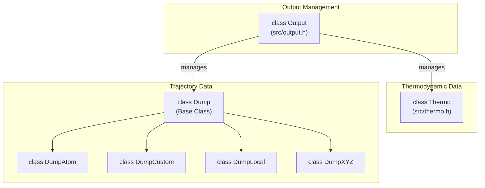
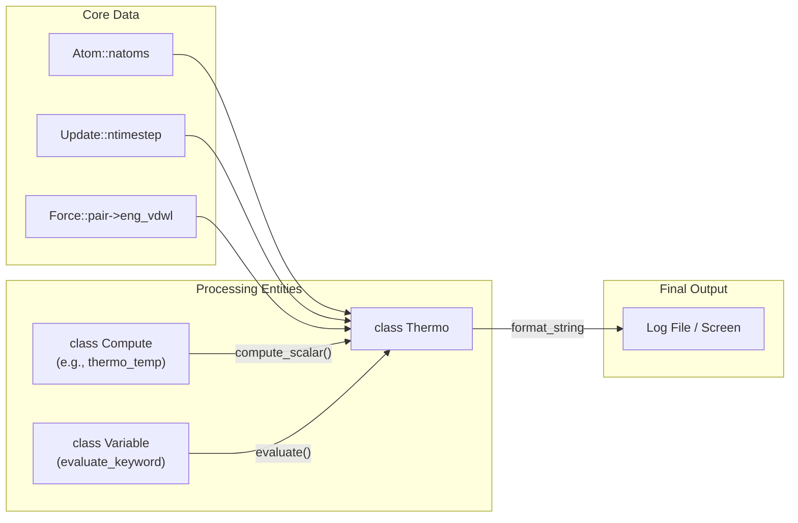

# Data Input/Output

Relevant source files

The following files were used as context for generating this wiki page:

- [doc/src/Howto_chunk.rst](doc/src/Howto_chunk.rst)
- [doc/src/compute_reduce.rst](doc/src/compute_reduce.rst)
- [doc/src/compute_reduce_chunk.rst](doc/src/compute_reduce_chunk.rst)
- [doc/src/fix_bond_react.rst](doc/src/fix_bond_react.rst)
- [doc/src/fix_nh.rst](doc/src/fix_nh.rst)
- [doc/src/fix_npt_cauchy.rst](doc/src/fix_npt_cauchy.rst)
- [doc/src/fix_spring_chunk.rst](doc/src/fix_spring_chunk.rst)
- [doc/src/fix_spring_rg.rst](doc/src/fix_spring_rg.rst)
- [doc/src/fix_temp_berendsen.rst](doc/src/fix_temp_berendsen.rst)
- [doc/src/fix_temp_csvr.rst](doc/src/fix_temp_csvr.rst)
- [doc/src/fix_temp_rescale.rst](doc/src/fix_temp_rescale.rst)
- [doc/src/fix_ti_spring.rst](doc/src/fix_ti_spring.rst)
- [doc/src/reset_atoms.rst](doc/src/reset_atoms.rst)
- [doc/src/thermo_modify.rst](doc/src/thermo_modify.rst)
- [doc/src/thermo_style.rst](doc/src/thermo_style.rst)
- [src/dump.cpp](src/dump.cpp)
- [src/dump.h](src/dump.h)
- [src/dump_atom.cpp](src/dump_atom.cpp)
- [src/dump_atom.h](src/dump_atom.h)
- [src/dump_cfg.cpp](src/dump_cfg.cpp)
- [src/dump_cfg.h](src/dump_cfg.h)
- [src/dump_custom.cpp](src/dump_custom.cpp)
- [src/dump_custom.h](src/dump_custom.h)
- [src/dump_local.cpp](src/dump_local.cpp)
- [src/dump_local.h](src/dump_local.h)
- [src/dump_xyz.cpp](src/dump_xyz.cpp)
- [src/dump_xyz.h](src/dump_xyz.h)
- [src/fix_spring_chunk.h](src/fix_spring_chunk.h)
- [src/thermo.cpp](src/thermo.cpp)
- [src/thermo.h](src/thermo.h)
- [tools/binary2txt.cpp](tools/binary2txt.cpp)

This document provides an overview of the data input/output systems in LAMMPS, showing how simulation data is recorded and exported. It covers the main components responsible for output generation: the thermodynamic information system (`Thermo`), trajectory data (`Dump`), and image/visualization outputs. For information about restarting simulations or initial data setup, see [Restart and Data Files](#5.3).

## Overview

LAMMPS provides several methods for outputting data during simulations:

1.  **Thermodynamic Output**: Global quantities like temperature, pressure, and energy, printed to the log file or console.
2.  **Dump Files**: Atom trajectories and properties written in various formats (text, binary, or compressed).
3.  **Images and Movies**: Visual representations of the simulation rendered directly by LAMMPS.
4.  **Restart and Data Files**: Complete simulation state for continuing runs or initializing new ones.

The `Output` class coordinates all these operations, ensuring they happen at the appropriate timesteps during simulation. [src/output.cpp:58-138]().

### Code Entity Relationship
The following diagram associates the logical I/O subsystems with their primary C++ class implementations.

Sources: [src/output.h:21-59](), [src/thermo.h:23-59](), [src/dump.h:25-60]()

## Output Management

The `Output` class serves as the central coordinator. It is initialized during the `LAMMPS` object instantiation and maintains lists of active `Dump` objects and the single `Thermo` object. [src/output.cpp:58-95]().

During a simulation run, the `Verlet` or `Respa` integrators call `Output::write(bigint nstep)` to trigger periodic I/O. [src/output.cpp:188-210]().

The output frequency is controlled by:
*   `thermo_every`: Interval for thermodynamic printing. [src/output.cpp:218-225]().
*   `dump_every`: Individual intervals defined per `Dump` object. [src/dump.cpp:71-73]().
*   `restart_every`: Interval for writing binary restart files. [src/output.cpp:240-250]().

For details, see [Thermodynamic Output](#5.1) and [Trajectory and Visualization Output](#5.2).

## Thermodynamic Output

The `Thermo` class handles global simulation quantities. It calculates values by querying other LAMMPS subsystems (Force, Neighbor, Modify) or by evaluating internal `Compute` objects. [src/thermo.cpp:398-466]().

### Thermo Styles and Keywords
LAMMPS supports predefined styles (`one`, `multi`, `yaml`) and a `custom` style where users select specific keywords. [src/thermo.cpp:131-166]().

| Style | Class Field | Default Keywords |
| :--- | :--- | :--- |
| `one` | `ONE` | step temp epair emol etotal press |
| `multi` | `MULTI` | etotal ke temp pe ebond eangle ... |
| `yaml` | `YAML` | step temp ke pe ebond eangle ... |

Sources: [src/thermo.cpp:76-88]().

### Data Retrieval Path
The following diagram illustrates how the `Thermo` class gathers data from the simulation core to produce a log entry.

Sources: [src/thermo.cpp:470-550](), [src/thermo.h:109-122]()

For details on calculating specific variables and averaging, see [Thermodynamic Output](#5.1).

## Trajectory and Visualization Output

The `Dump` system provides per-atom, per-molecule, or per-local-entry data. The base `Dump` class handles MPI communication, file I/O, and sorting, while derived classes implement specific file formats. [src/dump.cpp:47-138]().

### Common Dump Styles
*   **`dump atom`**: Outputs atom ID, type, and coordinates. [src/dump_atom.cpp:34-49]().
*   **`dump custom`**: Flexible style allowing selection of any per-atom attribute, compute, or fix value. [src/dump_custom.cpp:57-109]().
*   **`dump local`**: Outputs information about bonds, angles, or neighbor interactions. [src/dump_local.cpp:37-88]().
*   **`dump cfg`**: Format for the AtomEye visualizer, inheriting from `DumpCustom`. [src/dump_cfg.cpp:39-86]().
*   **`dump xyz`**: Simple XYZ format for molecular viewers. [src/dump_xyz.cpp:28-45]().

### Parallel I/O
LAMMPS supports three modes of dump writing:
1.  **Single File**: Processor 0 gathers all data and writes to one file. [src/dump.cpp:120]().
2.  **Multi-proc File**: Use of `%` in filename; each processor (or cluster) writes its own file. [src/dump.cpp:124-133]().
3.  **Timestep-specific File**: Use of `*` in filename; a new file is created per output step. [src/dump.cpp:135]().

For details on trajectory formats and image rendering, see [Trajectory and Visualization Output](#5.2).

## Restart and Data Files

LAMMPS uses two primary formats for full system state:
*   **Data Files (`read_data`/`write_data`)**: Human-readable text files containing topology and coordinates. [src/atom.cpp:2.2]().
*   **Restart Files (`read_restart`/`write_restart`)**: Binary files for exact state reproduction. [src/output.cpp:240]().

The system also supports `read_dump` for replaying trajectories and `rerun` for calculating properties from existing dump files. [src/read_dump.h]().

For details on file formats and the `LabelMap` system, see [Restart and Data Files](#5.3).

Sources: [src/output.cpp:58-138](), [src/thermo.cpp:103-173](), [src/dump.cpp:47-138](), [src/dump_custom.cpp:56-167](), [src/dump_atom.cpp:34-49]()

---