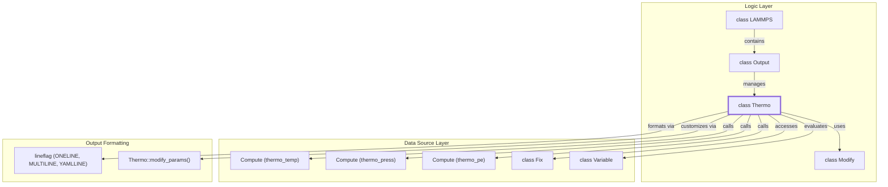
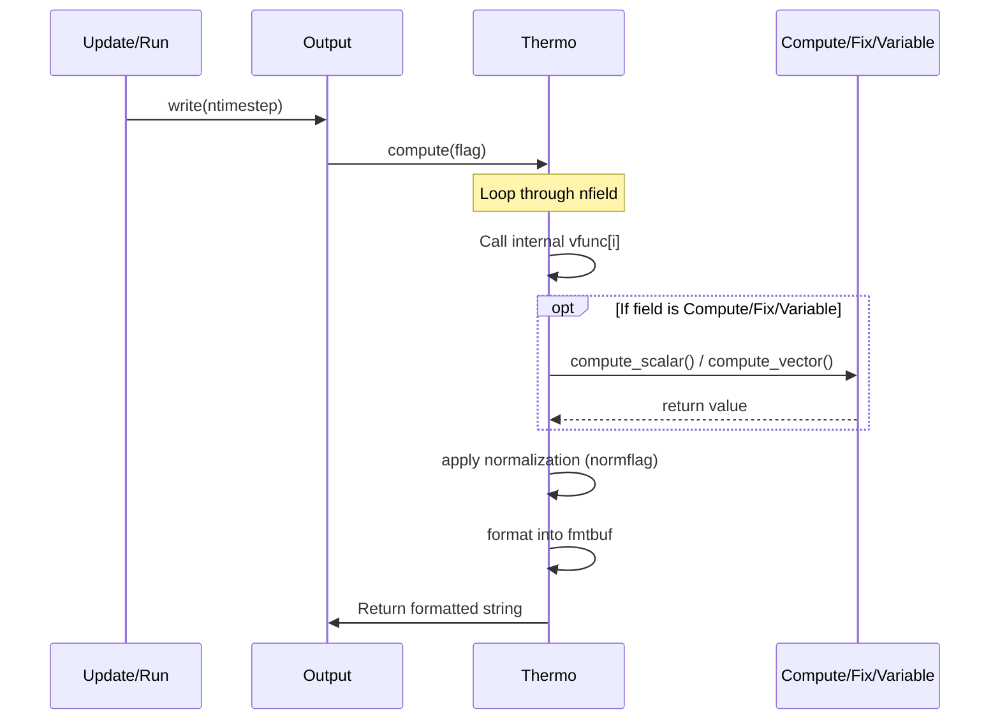

# Thermodynamic Output

Relevant source files

The following files were used as context for generating this wiki page:

- [doc/src/Howto_chunk.rst](doc/src/Howto_chunk.rst)
- [doc/src/compute_reduce.rst](doc/src/compute_reduce.rst)
- [doc/src/compute_reduce_chunk.rst](doc/src/compute_reduce_chunk.rst)
- [doc/src/fix_bond_react.rst](doc/src/fix_bond_react.rst)
- [doc/src/fix_nh.rst](doc/src/fix_nh.rst)
- [doc/src/fix_npt_cauchy.rst](doc/src/fix_npt_cauchy.rst)
- [doc/src/fix_spring_chunk.rst](doc/src/fix_spring_chunk.rst)
- [doc/src/fix_spring_rg.rst](doc/src/fix_spring_rg.rst)
- [doc/src/fix_temp_berendsen.rst](doc/src/fix_temp_berendsen.rst)
- [doc/src/fix_temp_csvr.rst](doc/src/fix_temp_csvr.rst)
- [doc/src/fix_temp_rescale.rst](doc/src/fix_temp_rescale.rst)
- [doc/src/fix_ti_spring.rst](doc/src/fix_ti_spring.rst)
- [doc/src/pair_hybrid.rst](doc/src/pair_hybrid.rst)
- [doc/src/reset_atoms.rst](doc/src/reset_atoms.rst)
- [doc/src/thermo_modify.rst](doc/src/thermo_modify.rst)
- [doc/src/thermo_style.rst](doc/src/thermo_style.rst)
- [src/ASPHERE/compute_temp_asphere.cpp](src/ASPHERE/compute_temp_asphere.cpp)
- [src/ASPHERE/compute_temp_asphere.h](src/ASPHERE/compute_temp_asphere.h)
- [src/EXTRA-FIX/fix_ave_correlate_long.cpp](src/EXTRA-FIX/fix_ave_correlate_long.cpp)
- [src/EXTRA-FIX/fix_ave_correlate_long.h](src/EXTRA-FIX/fix_ave_correlate_long.h)
- [src/KOKKOS/pair_hybrid_scaled_kokkos.cpp](src/KOKKOS/pair_hybrid_scaled_kokkos.cpp)
- [src/KOKKOS/pair_hybrid_scaled_kokkos.h](src/KOKKOS/pair_hybrid_scaled_kokkos.h)
- [src/OPENMP/pair_reaxff_omp.h](src/OPENMP/pair_reaxff_omp.h)
- [src/angle_hybrid.cpp](src/angle_hybrid.cpp)
- [src/angle_hybrid.h](src/angle_hybrid.h)
- [src/bond_hybrid.cpp](src/bond_hybrid.cpp)
- [src/bond_hybrid.h](src/bond_hybrid.h)
- [src/compute.cpp](src/compute.cpp)
- [src/compute.h](src/compute.h)
- [src/compute_centroid_stress_atom.cpp](src/compute_centroid_stress_atom.cpp)
- [src/compute_chunk_spread_atom.cpp](src/compute_chunk_spread_atom.cpp)
- [src/compute_chunk_spread_atom.h](src/compute_chunk_spread_atom.h)
- [src/compute_global_atom.cpp](src/compute_global_atom.cpp)
- [src/compute_global_atom.h](src/compute_global_atom.h)
- [src/compute_heat_flux.cpp](src/compute_heat_flux.cpp)
- [src/compute_heat_flux.h](src/compute_heat_flux.h)
- [src/compute_pe.cpp](src/compute_pe.cpp)
- [src/compute_pe.h](src/compute_pe.h)
- [src/compute_pe_atom.cpp](src/compute_pe_atom.cpp)
- [src/compute_pe_atom.h](src/compute_pe_atom.h)
- [src/compute_pressure.cpp](src/compute_pressure.cpp)
- [src/compute_pressure.h](src/compute_pressure.h)
- [src/compute_reduce.cpp](src/compute_reduce.cpp)
- [src/compute_reduce.h](src/compute_reduce.h)
- [src/compute_reduce_chunk.cpp](src/compute_reduce_chunk.cpp)
- [src/compute_reduce_chunk.h](src/compute_reduce_chunk.h)
- [src/compute_reduce_region.cpp](src/compute_reduce_region.cpp)
- [src/compute_reduce_region.h](src/compute_reduce_region.h)
- [src/compute_slice.cpp](src/compute_slice.cpp)
- [src/compute_slice.h](src/compute_slice.h)
- [src/compute_stress_atom.cpp](src/compute_stress_atom.cpp)
- [src/compute_stress_atom.h](src/compute_stress_atom.h)
- [src/compute_temp.cpp](src/compute_temp.cpp)
- [src/compute_temp.h](src/compute_temp.h)
- [src/compute_temp_com.cpp](src/compute_temp_com.cpp)
- [src/compute_temp_com.h](src/compute_temp_com.h)
- [src/compute_temp_deform.cpp](src/compute_temp_deform.cpp)
- [src/compute_temp_deform.h](src/compute_temp_deform.h)
- [src/compute_temp_partial.cpp](src/compute_temp_partial.cpp)
- [src/compute_temp_partial.h](src/compute_temp_partial.h)
- [src/compute_temp_profile.cpp](src/compute_temp_profile.cpp)
- [src/compute_temp_profile.h](src/compute_temp_profile.h)
- [src/compute_temp_ramp.cpp](src/compute_temp_ramp.cpp)
- [src/compute_temp_ramp.h](src/compute_temp_ramp.h)
- [src/compute_temp_region.cpp](src/compute_temp_region.cpp)
- [src/compute_temp_region.h](src/compute_temp_region.h)
- [src/compute_temp_sphere.cpp](src/compute_temp_sphere.cpp)
- [src/compute_temp_sphere.h](src/compute_temp_sphere.h)
- [src/dihedral_hybrid.cpp](src/dihedral_hybrid.cpp)
- [src/dihedral_hybrid.h](src/dihedral_hybrid.h)
- [src/fix_ave_atom.cpp](src/fix_ave_atom.cpp)
- [src/fix_ave_atom.h](src/fix_ave_atom.h)
- [src/fix_ave_chunk.cpp](src/fix_ave_chunk.cpp)
- [src/fix_ave_chunk.h](src/fix_ave_chunk.h)
- [src/fix_ave_correlate.cpp](src/fix_ave_correlate.cpp)
- [src/fix_ave_correlate.h](src/fix_ave_correlate.h)
- [src/fix_ave_histo.cpp](src/fix_ave_histo.cpp)
- [src/fix_ave_histo.h](src/fix_ave_histo.h)
- [src/fix_ave_histo_weight.cpp](src/fix_ave_histo_weight.cpp)
- [src/fix_ave_histo_weight.h](src/fix_ave_histo_weight.h)
- [src/fix_ave_time.cpp](src/fix_ave_time.cpp)
- [src/fix_ave_time.h](src/fix_ave_time.h)
- [src/fix_spring_chunk.h](src/fix_spring_chunk.h)
- [src/improper_hybrid.cpp](src/improper_hybrid.cpp)
- [src/improper_hybrid.h](src/improper_hybrid.h)
- [src/pair_hybrid.cpp](src/pair_hybrid.cpp)
- [src/pair_hybrid.h](src/pair_hybrid.h)
- [src/pair_hybrid_overlay.cpp](src/pair_hybrid_overlay.cpp)
- [src/pair_hybrid_overlay.h](src/pair_hybrid_overlay.h)
- [src/pair_hybrid_scaled.cpp](src/pair_hybrid_scaled.cpp)
- [src/pair_hybrid_scaled.h](src/pair_hybrid_scaled.h)
- [src/thermo.cpp](src/thermo.cpp)
- [src/thermo.h](src/thermo.h)

Thermodynamic output in LAMMPS provides essential global measurements of the simulation system at regular intervals. This includes properties like temperature, pressure, energy values, and other system-wide quantities that help users monitor simulation progress and stability.

## Overview

The thermodynamic output system calculates and displays system-wide properties at specified timesteps. It is primarily implemented through the `Thermo` class, which is managed by the `Output` class. Users configure thermodynamic output using the `thermo`, `thermo_style`, and `thermo_modify` commands.

### System Architecture and Code Entities

The following diagram maps the thermodynamic output concepts to their respective code entities and classes.

**Thermodynamic Output Class Map**

Sources: [src/thermo.h:23-26](), [src/thermo.cpp:103-107](), [src/output.cpp:68-72]()

## Thermo Styles

LAMMPS provides different styles for thermodynamic output, defined in `thermo.cpp`. Each style has a default set of keywords and formatting strings.

| Style | Keywords | Implementation Detail |
| :--- | :--- | :--- |
| `one` | `step temp epair emol etotal press` | `ONELINE` enum [src/thermo.cpp:76-79]() |
| `multi` | `etotal ke temp pe ebond eangle edihed eimp evdwl ecoul elong press` | `MULTILINE` enum [src/thermo.cpp:80-84]() |
| `yaml` | `step temp ke pe ebond eangle edihed eimp evdwl ecoul elong press` | `YAMLLINE` enum [src/thermo.cpp:85-89]() |
| `custom` | User-defined | Uses `utils::expand_args` for wildcards [src/thermo.cpp:141-163]() |

Sources: [src/thermo.cpp:75-89](), [src/thermo.cpp:131-166]()

## Data Flow and Calculation

The `Thermo` class calculates properties by either direct access to system variables or by invoking `Compute` and `Fix` objects.

### Calculation Sequence

Sources: [src/thermo.cpp:397-479](), [src/output.cpp:348-362]()

### Core Thermodynamic Computes
For properties like temperature and pressure, `Thermo` creates internal `Compute` objects if they don't already exist:
* **Temperature**: ID `thermo_temp`, style `temp` [src/thermo.cpp:95]()
* **Pressure**: ID `thermo_press`, style `pressure` [src/thermo.cpp:96]()
* **Potential Energy**: ID `thermo_pe`, style `pe` [src/thermo.cpp:97]()

Sources: [src/thermo.cpp:95-98](), [src/thermo.h:61]()

## Averaging and Advanced Output

Beyond standard thermodynamic snapshots, LAMMPS provides `Fix` styles to perform time, spatial, or statistical averaging of data. These fixes can then be referenced by `thermo_style custom` using the `f_ID` syntax.

### Time Averaging (`fix ave/time`)
`FixAveTime` averages global scalars or vectors over time. It can produce output to a file or make the averaged values available to other LAMMPS commands.
* **Keywords**: `nevery`, `nrepeat`, `nfreq` [src/fix_ave_time.cpp:48-50]()
* **Modes**: `SCALAR` or `VECTOR` [src/fix_ave_time.cpp:37]()

### Chunk Averaging (`fix ave/chunk`)
`FixAveChunk` calculates properties (like density or temperature) for spatial "chunks" defined by `compute chunk/atom`.
* **Properties**: `vx`, `vy`, `vz`, `mass`, `density/number`, `density/mass`, `temp` [src/fix_ave_chunk.cpp:90-125]()
* **Normalization**: `norm all`, `norm sample`, `norm none` [src/fix_ave_chunk.cpp:161-172]()

### Histogram Calculation (`fix ave/histo`)
`FixAveHisto` calculates histograms of global, per-atom, or local values.
* **Input types**: Global, Per-atom, or Local [src/fix_ave_histo.cpp:179-204]()
* **Operations**: Defines bins between `lo` and `hi` [src/fix_ave_histo.cpp:62-64]()

Sources: [src/fix_ave_time.cpp:41-45](), [src/fix_ave_chunk.cpp:44-49](), [src/fix_ave_histo.cpp:41-44]()

## Implementation Details

### The `Thermo` Class
The `Thermo` class uses a vector of function pointers (`vfunc`) to map keywords to internal calculation methods.

| Keyword | Method | File Reference |
| :--- | :--- | :--- |
| `step` | `compute_step()` | [src/thermo.cpp:151]() |
| `temp` | `compute_temp()` | [src/thermo.cpp:165]() |
| `press` | `compute_press()` | [src/thermo.cpp:166]() |
| `pe` | `compute_pe()` | [src/thermo.cpp:167]() |
| `ke` | `compute_ke()` | [src/thermo.cpp:168]() |
| `vol` | `compute_vol()` | [src/thermo.cpp:186]() |
| `pxx` | `compute_pxx()` | [src/thermo.cpp:225]() |

Sources: [src/thermo.h:140-231](), [src/thermo.cpp:57-71]()

### Custom Keyword Processing
When `thermo_style custom` is used, `Thermo::parse_fields` tokenizes the input string and matches keywords against internal tables. If a keyword starts with `c_`, `f_`, or `v_`, it is treated as a reference to a `Compute`, `Fix`, or `Variable` respectively.

* **Computes**: `add_compute()` [src/thermo.cpp:1085]()
* **Fixes**: `add_fix()` [src/thermo.cpp:1152]()
* **Variables**: `add_variable()` [src/thermo.cpp:1186]()

Sources: [src/thermo.cpp:1052-1209]()

### Normalization
The `normflag` determines if extensive properties (like energy) are divided by the total number of atoms.
* `normflag = 1`: Normalize by `natoms`.
* `normflag = 0`: Do not normalize.
Normalization is controlled by `thermo_modify norm` and defaults based on the `unit_style` (e.g., `lj` defaults to `norm yes`).

Sources: [src/thermo.cpp:190-201](), [src/thermo.h:28]()

## Thermo Modify Options

The `thermo_modify` command calls `Thermo::modify_params` to update internal flags.

| Keyword | Action | Code Reference |
| :--- | :--- | :--- |
| `lost` | Set `lostflag` (error, warn, ignore) | [src/thermo.cpp:617]() |
| `norm` | Set `normuserflag` and `normuser` | [src/thermo.cpp:655]() |
| `flush` | Set `flushflag` for file I/O | [src/thermo.cpp:594]() |
| `format` | Override default `printf` format strings | [src/thermo.cpp:567]() |

Sources: [src/thermo.cpp:536-769]()

---