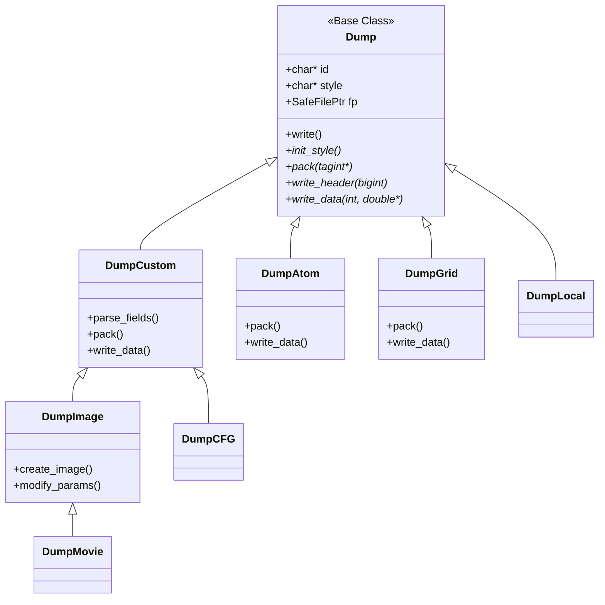
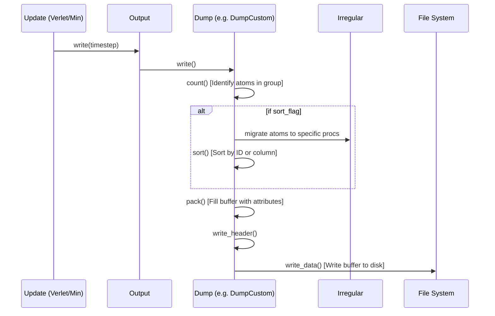

# Trajectory and Visualization Output

<details>
<summary>Relevant source files</summary>

The following files were used as context for generating this wiki page:

- [doc/src/dump.rst](doc/src/dump.rst)
- [doc/src/dump_image.rst](doc/src/dump_image.rst)
- [doc/src/dump_modify.rst](doc/src/dump_modify.rst)
- [doc/src/dump_vtk.rst](doc/src/dump_vtk.rst)
- [doc/src/fix_graphics_chunk.rst](doc/src/fix_graphics_chunk.rst)
- [doc/src/fix_saed_vtk.rst](doc/src/fix_saed_vtk.rst)
- [examples/python/README.fix_python_move](examples/python/README.fix_python_move)
- [examples/python/in.fix_python_move_nve_melt](examples/python/in.fix_python_move_nve_melt)
- [examples/python/in.fix_python_move_nve_melt_group](examples/python/in.fix_python_move_nve_melt_group)
- [examples/python/in.fix_python_move_nve_melt_opt](examples/python/in.fix_python_move_nve_melt_opt)
- [examples/python/in.pair_python_coulomb](examples/python/in.pair_python_coulomb)
- [examples/python/in.pair_python_hybrid](examples/python/in.pair_python_hybrid)
- [examples/python/in.pair_python_melt](examples/python/in.pair_python_melt)
- [examples/python/in.pair_python_spce](examples/python/in.pair_python_spce)
- [examples/python/in.pair_python_table](examples/python/in.pair_python_table)
- [examples/python/log.7Aug25.fix_python_move_nve_melt.g++.1](examples/python/log.7Aug25.fix_python_move_nve_melt.g++.1)
- [examples/python/log.7Aug25.fix_python_move_nve_melt.g++.4](examples/python/log.7Aug25.fix_python_move_nve_melt.g++.4)
- [examples/python/log.7Aug25.fix_python_move_nve_melt_group.g++.1](examples/python/log.7Aug25.fix_python_move_nve_melt_group.g++.1)
- [examples/python/py_pot.py](examples/python/py_pot.py)
- [src/ADIOS/adios_common.h](src/ADIOS/adios_common.h)
- [src/ADIOS/dump_atom_adios.cpp](src/ADIOS/dump_atom_adios.cpp)
- [src/ADIOS/dump_atom_adios.h](src/ADIOS/dump_atom_adios.h)
- [src/ADIOS/dump_custom_adios.cpp](src/ADIOS/dump_custom_adios.cpp)
- [src/ADIOS/dump_custom_adios.h](src/ADIOS/dump_custom_adios.h)
- [src/ADIOS/reader_adios.cpp](src/ADIOS/reader_adios.cpp)
- [src/ADIOS/reader_adios.h](src/ADIOS/reader_adios.h)
- [src/DIFFRACTION/compute_saed.cpp](src/DIFFRACTION/compute_saed.cpp)
- [src/DIFFRACTION/compute_saed_consts.h](src/DIFFRACTION/compute_saed_consts.h)
- [src/DIFFRACTION/compute_xrd.cpp](src/DIFFRACTION/compute_xrd.cpp)
- [src/DIFFRACTION/compute_xrd_consts.h](src/DIFFRACTION/compute_xrd_consts.h)
- [src/DIFFRACTION/fix_saed_vtk.cpp](src/DIFFRACTION/fix_saed_vtk.cpp)
- [src/DIFFRACTION/fix_saed_vtk.h](src/DIFFRACTION/fix_saed_vtk.h)
- [src/ELECTRODE/electrode_kspace.h](src/ELECTRODE/electrode_kspace.h)
- [src/EXTRA-DUMP/dump_vtk.cpp](src/EXTRA-DUMP/dump_vtk.cpp)
- [src/EXTRA-DUMP/dump_vtk.h](src/EXTRA-DUMP/dump_vtk.h)
- [src/EXTRA-FIX/fix_ttm.cpp](src/EXTRA-FIX/fix_ttm.cpp)
- [src/EXTRA-FIX/fix_ttm.h](src/EXTRA-FIX/fix_ttm.h)
- [src/EXTRA-FIX/fix_ttm_grid.cpp](src/EXTRA-FIX/fix_ttm_grid.cpp)
- [src/EXTRA-FIX/fix_ttm_grid.h](src/EXTRA-FIX/fix_ttm_grid.h)
- [src/EXTRA-FIX/fix_ttm_mod.cpp](src/EXTRA-FIX/fix_ttm_mod.cpp)
- [src/EXTRA-FIX/fix_ttm_mod.h](src/EXTRA-FIX/fix_ttm_mod.h)
- [src/EXTRA-PAIR/pair_lj_cubic_const.h](src/EXTRA-PAIR/pair_lj_cubic_const.h)
- [src/GRAPHICS/dump_image.cpp](src/GRAPHICS/dump_image.cpp)
- [src/GRAPHICS/dump_image.h](src/GRAPHICS/dump_image.h)
- [src/GRAPHICS/fix_graphics_chunk.cpp](src/GRAPHICS/fix_graphics_chunk.cpp)
- [src/GRAPHICS/fix_graphics_chunk.h](src/GRAPHICS/fix_graphics_chunk.h)
- [src/GRAPHICS/fix_graphics_labels.cpp](src/GRAPHICS/fix_graphics_labels.cpp)
- [src/GRAPHICS/fix_graphics_labels.h](src/GRAPHICS/fix_graphics_labels.h)
- [src/GRAPHICS/image.cpp](src/GRAPHICS/image.cpp)
- [src/GRAPHICS/image.h](src/GRAPHICS/image.h)
- [src/GRAPHICS/image_objects.cpp](src/GRAPHICS/image_objects.cpp)
- [src/GRAPHICS/image_objects.h](src/GRAPHICS/image_objects.h)
- [src/GRAPHICS/scalable_font.cpp](src/GRAPHICS/scalable_font.cpp)
- [src/GRAPHICS/scalable_font.h](src/GRAPHICS/scalable_font.h)
- [src/GRAPHICS/scalable_sans_font.h](src/GRAPHICS/scalable_sans_font.h)
- [src/H5MD/dump_h5md.cpp](src/H5MD/dump_h5md.cpp)
- [src/H5MD/dump_h5md.h](src/H5MD/dump_h5md.h)
- [src/KOKKOS/fix_reaxff_bonds_kokkos.cpp](src/KOKKOS/fix_reaxff_bonds_kokkos.cpp)
- [src/ML-HDNNP/pair_hdnnp.cpp](src/ML-HDNNP/pair_hdnnp.cpp)
- [src/OPENMP/npair_omp.h](src/OPENMP/npair_omp.h)
- [src/OPENMP/thr_omp.cpp](src/OPENMP/thr_omp.cpp)
- [src/OPENMP/thr_omp.h](src/OPENMP/thr_omp.h)
- [src/PYTHON/fix_python_invoke.cpp](src/PYTHON/fix_python_invoke.cpp)
- [src/PYTHON/fix_python_invoke.h](src/PYTHON/fix_python_invoke.h)
- [src/PYTHON/fix_python_move.cpp](src/PYTHON/fix_python_move.cpp)
- [src/PYTHON/fix_python_move.h](src/PYTHON/fix_python_move.h)
- [src/PYTHON/pair_python.cpp](src/PYTHON/pair_python.cpp)
- [src/PYTHON/pair_python.h](src/PYTHON/pair_python.h)
- [src/PYTHON/python_compat.h](src/PYTHON/python_compat.h)
- [src/PYTHON/python_impl.cpp](src/PYTHON/python_impl.cpp)
- [src/PYTHON/python_impl.h](src/PYTHON/python_impl.h)
- [src/REAXFF/reaxff_control.cpp](src/REAXFF/reaxff_control.cpp)
- [src/REAXFF/reaxff_ffield.cpp](src/REAXFF/reaxff_ffield.cpp)
- [src/compute_property_grid.cpp](src/compute_property_grid.cpp)
- [src/compute_property_grid.h](src/compute_property_grid.h)
- [src/dump.cpp](src/dump.cpp)
- [src/dump.h](src/dump.h)
- [src/dump_atom.cpp](src/dump_atom.cpp)
- [src/dump_atom.h](src/dump_atom.h)
- [src/dump_cfg.cpp](src/dump_cfg.cpp)
- [src/dump_cfg.h](src/dump_cfg.h)
- [src/dump_custom.cpp](src/dump_custom.cpp)
- [src/dump_custom.h](src/dump_custom.h)
- [src/dump_grid.cpp](src/dump_grid.cpp)
- [src/dump_grid.h](src/dump_grid.h)
- [src/dump_grid_vtk.cpp](src/dump_grid_vtk.cpp)
- [src/dump_grid_vtk.h](src/dump_grid_vtk.h)
- [src/dump_local.cpp](src/dump_local.cpp)
- [src/dump_local.h](src/dump_local.h)
- [src/dump_xyz.cpp](src/dump_xyz.cpp)
- [src/dump_xyz.h](src/dump_xyz.h)
- [src/fix_ave_grid.cpp](src/fix_ave_grid.cpp)
- [src/fix_ave_grid.h](src/fix_ave_grid.h)
- [src/graphics.h](src/graphics.h)
- [src/grid2d.cpp](src/grid2d.cpp)
- [src/grid2d.h](src/grid2d.h)
- [src/grid3d.cpp](src/grid3d.cpp)
- [src/grid3d.h](src/grid3d.h)
- [src/lmppython.cpp](src/lmppython.cpp)
- [src/lmppython.h](src/lmppython.h)
- [src/pointers.h](src/pointers.h)
- [src/vtk_writer.cpp](src/vtk_writer.cpp)
- [src/vtk_writer.h](src/vtk_writer.h)
- [tools/binary2txt.cpp](tools/binary2txt.cpp)
- [unittest/formats/test_dump_grid.cpp](unittest/formats/test_dump_grid.cpp)
- [unittest/formats/test_dump_vtk.cpp](unittest/formats/test_dump_vtk.cpp)
- [unittest/formats/test_dump_vtk_mpi.cpp](unittest/formats/test_dump_vtk_mpi.cpp)
- [unittest/formats/test_vtk_writer.cpp](unittest/formats/test_vtk_writer.cpp)
- [unittest/graphics/tests/dump-image-depthcue-color.yaml](unittest/graphics/tests/dump-image-depthcue-color.yaml)
- [unittest/graphics/tests/dump-image-depthcue-start.yaml](unittest/graphics/tests/dump-image-depthcue-start.yaml)
- [unittest/graphics/tests/dump-image-depthcue.yaml](unittest/graphics/tests/dump-image-depthcue.yaml)

</details>


This document covers the systems and mechanisms that LAMMPS uses to produce trajectory data and visualization outputs from simulations. It explains how to generate trajectory files in various formats, create rendered images and movies, and use both built-in and external tools to visualize simulation results.

For information on thermodynamic output (temperatures, energies, etc.), see [Thermodynamic Output](#5.1).

## Dump System Architecture

LAMMPS implements trajectory and visualization output primarily through its `dump` command system, which consists of a hierarchy of classes that handle different output formats and capabilities. The `Dump` class serves as the base, providing core functionality for file management, sorting, and atom selection.

### Code-to-Entity Mapping: Dump Hierarchy


Sources: [src/dump.h:25-182](), [src/dump_custom.h:29-106](), [src/dump_atom.h:28-86](), [src/GRAPHICS/dump_image.h:35-132]()

## Dump Command Basics

The basic syntax for dump commands is:

```
dump ID group-ID style N file [args]
```

Where:
- `ID`: User-assigned name for the dump [src/dump.cpp:58]()
- `group-ID`: Group of atoms to include [src/dump.cpp:60]()
- `style`: Output format (atom, custom, image, etc.) [src/dump.cpp:63]()
- `N`: Output frequency (every N timesteps) [src/dump_custom.cpp:71]()
- `file`: Output filename [src/dump.cpp:65]()

Common dump styles include:

| Style | Class | Description |
|-------|-------|-------------|
| `atom` | `DumpAtom` | Basic atom properties (ID, type, x, y, z) [src/dump_atom.cpp:34]() |
| `custom` | `DumpCustom` | User-selected atom properties, computes, fixes [src/dump_custom.cpp:57]() |
| `local` | `DumpLocal` | Data from computes/fixes that produce local info (bonds, etc.) [src/dump_local.cpp:44]() |
| `grid` | `DumpGrid` | Grid-based data from computes/fixes [src/dump_grid.cpp:46]() |
| `image` | `DumpImage` | Rendered JPG/PNG/PPM snapshots [src/GRAPHICS/dump_image.cpp:132]() |
| `movie` | `DumpMovie` | Encoded video via FFmpeg pipe [src/GRAPHICS/dump_movie.cpp:32]() |

Sources: [src/dump.cpp:47-140](), [doc/src/dump.rst:54-96]()

## Trajectory Output Process

The trajectory generation process is managed by the `Output` class, which calls the `write()` method of registered `Dump` objects at specified intervals.

### Data Flow for Per-Atom Dumps


Sources: [src/dump.cpp:193-316](), [src/dump_custom.cpp:247-316](), [src/output.cpp:576-620]()

## Output Control and Formatting

LAMMPS provides extensive control over output through the `dump_modify` command.

### Formatting Options
Subclasses of `Dump` (like `DumpCustom`) allow per-column or per-type formatting. The `vtype` array tracks whether a field is `INT`, `DOUBLE`, `STRING`, or `BIGINT` [src/dump_custom.cpp:88]().
- `format line`: Sets the C-style format string for the entire line [src/dump.cpp:153]().
- `format float`: Sets the default format for floating-point values [src/dump.cpp:154]().
- `precision`: Used in styles like `xtc` to control coordinate quantization [doc/src/dump_modify.rst:63]().

### Thresholding
The `dump_modify thresh` command (implemented in `DumpCustom`) allows outputting atoms only if they meet specific criteria (e.g., `vx > 5.0`).
- `nthresh`: Number of active thresholds [src/dump_custom.cpp:96]().
- `thresh_op`: Stores operators like `EQ`, `NEQ`, `LT`, `GT` [src/dump_custom.cpp:50]().

Sources: [src/dump_custom.cpp:706-815](), [doc/src/dump_modify.rst:47-86]()

## Visualization and Graphics

The `GRAPHICS` package enables on-the-fly rendering.

### Image Rendering (dump image)
The `DumpImage` class coordinates with the `Image` class to perform software rendering without requiring a GPU or X11.
- **Coloring**: Can be based on atom type, element, or per-atom values from computes/fixes [src/GRAPHICS/dump_image.cpp:191-215]().
- **Objects**: Supports rendering atoms, bonds, grid cells, and regions [doc/src/dump_image.rst:27-106]().
- **Advanced Effects**: SSAO (Screen Space Ambient Occlusion), depth cueing, and anti-aliasing (FSAA) [src/GRAPHICS/image.cpp:1115-1150]().

### Grid Output (fix ave/grid)
For continuum-like visualization, `fix ave/grid` averages per-atom or per-grid properties into a regular 2D or 3D mesh.
- `nxgrid`, `nygrid`, `nzgrid`: Define the mesh resolution [src/fix_ave_grid.cpp:75-77]().
- `dump grid`: Specifically designed to output the results of these grid-based fixes [src/dump_grid.cpp:46]().

Sources: [src/GRAPHICS/dump_image.cpp:132-240](), [src/fix_ave_grid.cpp:47-200](), [src/GRAPHICS/image.cpp:20-176]()

## Binary to Text Conversion
For performance, LAMMPS can write binary dump files (suffix `.bin`). The repository includes a standalone tool, `binary2txt`, to convert these files back to human-readable ASCII.
- **Logic**: It reads the binary header, identifies the `size_one` (attributes per atom), and iterates through snapshots to print values based on the stored `bigint` and `double` types.

Sources: [tools/binary2txt.cpp:20-100](), [src/dump.cpp:137-138]()

## Summary of File Extensions and Compression
LAMMPS automatically detects compression and binary formats based on the filename suffix:
- `.gz`: Gzip compression (requires `-DLAMMPS_GZIP`) [src/dump.cpp:139]().
- `.zst`: Zstd compression [doc/src/dump.rst:18-22]().
- `.bin` / `.lammpsbin`: Native binary format [src/dump.cpp:137-138]().
- `.jpg` / `.png`: Rendered images (requires `LAMMPS_JPEG` / `LAMMPS_PNG`) [src/GRAPHICS/dump_image.cpp:157-162]().

Sources: [src/dump.cpp:101-140](), [src/GRAPHICS/dump_image.cpp:154-184]()

---