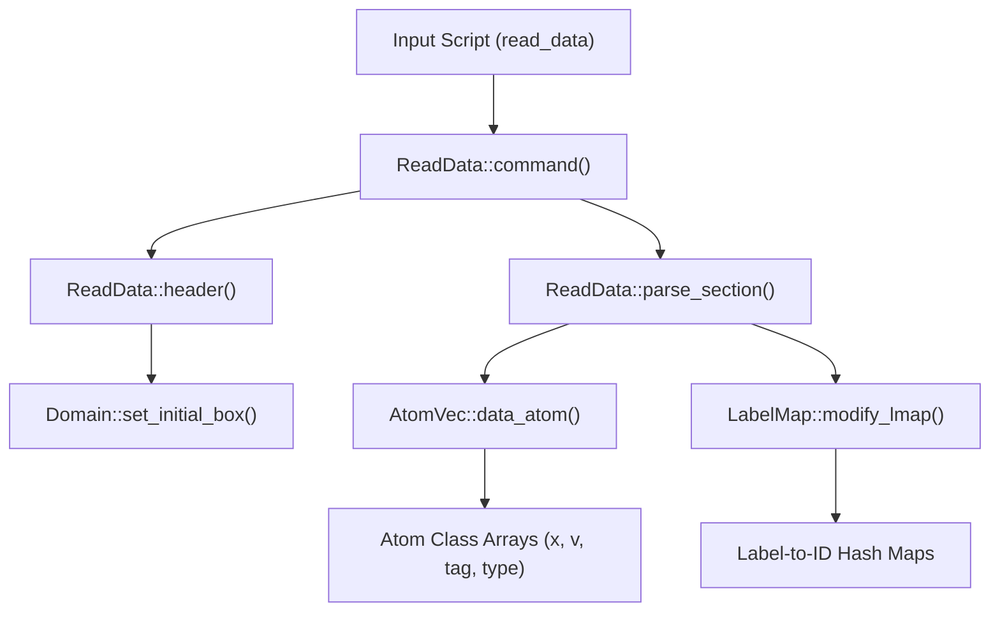
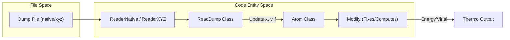

# Restart and Data Files

Relevant source files

The following files were used as context for generating this wiki page:

- [doc/src/Howto_2d.rst](doc/src/Howto_2d.rst)
- [doc/src/Howto_triclinic.rst](doc/src/Howto_triclinic.rst)
- [doc/src/Howto_type_labels.rst](doc/src/Howto_type_labels.rst)
- [doc/src/angle_coeff.rst](doc/src/angle_coeff.rst)
- [doc/src/bond_coeff.rst](doc/src/bond_coeff.rst)
- [doc/src/boundary.rst](doc/src/boundary.rst)
- [doc/src/create_atoms.rst](doc/src/create_atoms.rst)
- [doc/src/create_box.rst](doc/src/create_box.rst)
- [doc/src/dihedral_coeff.rst](doc/src/dihedral_coeff.rst)
- [doc/src/dump_molfile.rst](doc/src/dump_molfile.rst)
- [doc/src/fix_imd.rst](doc/src/fix_imd.rst)
- [doc/src/improper_coeff.rst](doc/src/improper_coeff.rst)
- [doc/src/kim_commands.rst](doc/src/kim_commands.rst)
- [doc/src/labelmap.rst](doc/src/labelmap.rst)
- [doc/src/lattice.rst](doc/src/lattice.rst)
- [doc/src/pair_coeff.rst](doc/src/pair_coeff.rst)
- [doc/src/read_data.rst](doc/src/read_data.rst)
- [doc/src/read_dump.rst](doc/src/read_dump.rst)
- [doc/src/rerun.rst](doc/src/rerun.rst)
- [doc/src/write_data.rst](doc/src/write_data.rst)
- [src/GRANULAR/fix_pour.cpp](src/GRANULAR/fix_pour.cpp)
- [src/GRANULAR/fix_pour.h](src/GRANULAR/fix_pour.h)
- [src/atom.cpp](src/atom.cpp)
- [src/atom.h](src/atom.h)
- [src/create_atoms.cpp](src/create_atoms.cpp)
- [src/create_atoms.h](src/create_atoms.h)
- [src/fix_deposit.cpp](src/fix_deposit.cpp)
- [src/fix_deposit.h](src/fix_deposit.h)
- [src/fix_evaporate.cpp](src/fix_evaporate.cpp)
- [src/fix_evaporate.h](src/fix_evaporate.h)
- [src/fix_thermal_conductivity.cpp](src/fix_thermal_conductivity.cpp)
- [src/fix_thermal_conductivity.h](src/fix_thermal_conductivity.h)
- [src/label_map.cpp](src/label_map.cpp)
- [src/label_map.h](src/label_map.h)
- [src/lmprestart.h](src/lmprestart.h)
- [src/read_data.cpp](src/read_data.cpp)
- [src/read_data.h](src/read_data.h)
- [src/read_dump.cpp](src/read_dump.cpp)
- [src/read_dump.h](src/read_dump.h)
- [src/read_restart.cpp](src/read_restart.cpp)
- [src/read_restart.h](src/read_restart.h)
- [src/reader.cpp](src/reader.cpp)
- [src/reader.h](src/reader.h)
- [src/reader_native.cpp](src/reader_native.cpp)
- [src/reader_native.h](src/reader_native.h)
- [src/reader_xyz.cpp](src/reader_xyz.cpp)
- [src/reader_xyz.h](src/reader_xyz.h)
- [src/replicate.cpp](src/replicate.cpp)
- [src/rerun.cpp](src/rerun.cpp)
- [src/rerun.h](src/rerun.h)
- [src/write_data.cpp](src/write_data.cpp)
- [src/write_data.h](src/write_data.h)
- [src/write_restart.cpp](src/write_restart.cpp)
- [src/write_restart.h](src/write_restart.h)
- [unittest/commands/test_labelmap.cpp](unittest/commands/test_labelmap.cpp)

This section documents the mechanisms LAMMPS uses to save and restore simulation states. This includes binary restart files for exact state persistence, text-based data files for system setup and portability, the LabelMap system for alphanumeric type identification, and the `read_dump` / `rerun` infrastructure for trajectory analysis.

## 1. Binary Restart Files

Restart files in LAMMPS are binary snapshots designed for exact continuation of a simulation. Unlike text data files, they store the complete internal state, including atom velocities, image flags, and internal fix/compute states.

### Implementation and Data Flow
The primary classes responsible for these operations are `WriteRestart` and `ReadRestart`.

*   **`WriteRestart`**: Orchestrates the collection of global and per-atom data. It triggers a system initialization and communication exchange to ensure all atoms are within their correct sub-domains before writing `[src/write_restart.cpp:86-108]()`.
*   **`ReadRestart`**: Reads the binary header to define the simulation box, then allocates atom arrays based on the `AtomVec` style stored in the file `[src/read_restart.cpp:121-142]()`.

### Restart File Structure
Restart files use a "magic string" and versioning system to ensure compatibility.

| Component | Description |
| :--- | :--- |
| **Magic String** | Identifies the file as a LAMMPS restart `[src/read_restart.cpp:113]()`. |
| **Endian Flag** | Detects if the file was written on a big-endian or little-endian machine `[src/read_restart.cpp:114]()`. |
| **Header** | Contains `natoms`, `ntypes`, box bounds, and force field styles `[src/read_restart.cpp:124]()`. |
| **Per-Atom Data** | Binary chunks containing coordinates, velocities, and atom-specific attributes `[src/read_restart.cpp:200-237]()`. |
| **Fix/Compute State** | Fixes that implement `write_restart()` save their internal state to restore history (e.g., granular contact history) `[src/write_restart.cpp:31]()`. |

**Sources:** `[src/write_restart.cpp]()`, `[src/read_restart.cpp]()`, `[src/lmprestart.h]()`.

---

## 2. Data Files (read_data / write_data)

Data files are the standard text-based format for defining molecular systems. They are structured into sections (e.g., `Atoms`, `Bonds`, `Masses`).

### Parsing Logic
The `ReadData` class parses the file in two passes:
1.  **Header Pass**: Reads global counts (`atoms`, `bonds`, `atom types`) and box dimensions.
2.  **Section Pass**: Uses a keyword-based approach to populate the `Atom` class arrays `[src/read_data.cpp:61-71]()`.

### Type Labels (LabelMap)
LAMMPS supports alphanumeric labels for atom, bond, and other topology types via the `LabelMap` class `[src/label_map.cpp:14]()`. This allows users to refer to types as "C" or "H" instead of "1" or "2".

*   **Mapping**: The `LabelMap` maintains `std::unordered_map` structures to link string labels to integer IDs `[src/label_map.cpp:80-113]()`.
*   **Data File Integration**: Labels can be defined in sections like `Atom Type Labels` `[src/read_data.cpp:69-70]()`.

**Data File Flow Diagram**

**Sources:** `[src/read_data.cpp:87-115]()`, `[src/write_data.cpp:51-110]()`, `[src/label_map.cpp:50-114]()`.

---

## 3. Trajectory Replay (read_dump and rerun)

LAMMPS provides mechanisms to "replay" an existing trajectory as if it were a live simulation, which is useful for post-processing calculations (e.g., calculating energy for saved snapshots).

### The `read_dump` Command
The `ReadDump` class facilitates reading snapshots from various dump formats (native, xyz, etc.).
*   **Reader Registry**: Uses `CreatorRegistry<ReaderCreator>` to support multiple file formats `[src/read_dump.cpp:45-49]()`.
*   **Atom Matching**: It matches atoms in the dump file to existing atoms in the simulation using their IDs (tags). It can `purge` (delete missing atoms), `replace` (update coordinates), or `add` (create new atoms) `[src/read_dump.cpp:135-162]()`.

### The `rerun` Command
The `rerun` command is a wrapper that repeatedly calls `read_dump` and then invokes the `Modify` and `Force` subsystems to compute properties for each snapshot.

**Trajectory Replay Logic**

**Sources:** `[src/read_dump.cpp:91-163]()`, `[src/reader.h]()`, `[src/reader_native.cpp:54-103]()`.

---

## 4. System Creation and Modification

Beyond reading files, LAMMPS provides commands to generate atoms and replicate systems.

### `create_atoms`
The `CreateAtoms` class handles the insertion of atoms based on a lattice, a geometric region, or random placement `[src/create_atoms.cpp:125-169]()`.
*   **Molecules**: It can insert entire molecules by cloning a `Molecule` object `[src/create_atoms.cpp:175-180]()`.

### `replicate`
The `Replicate` class multiplies the current simulation box in the X, Y, and Z dimensions.
*   **Implementation**: It creates a temporary `Atom` object, copies the original atoms, and then generates new atoms with shifted coordinates and incremented tags `[src/replicate.cpp:198-218]()`.
*   **Bond Connectivity**: It handles periodic bond updates if the `bond/periodic` flag is used `[src/replicate.cpp:92-98]()`.

**Sources:** `[src/create_atoms.cpp:97-170]()`, `[src/replicate.cpp:51-112]()`.

---

## 5. Summary of Key Classes

| Class | File | Responsibility |
| :--- | :--- | :--- |
| `Atom` | `[src/atom.h]()` | Central storage for per-atom arrays. |
| `ReadData` | `[src/read_data.h]()` | Logic for parsing text data files. |
| `WriteData` | `[src/write_data.h]()` | Logic for formatting text data files. |
| `ReadRestart` | `[src/read_restart.h]()` | Logic for restoring binary state. |
| `LabelMap` | `[src/label_map.h]()` | Management of alphanumeric type labels. |
| `ReadDump` | `[src/read_dump.h]()` | Coordinating trajectory snapshot reading. |
| `Reader` | `[src/reader.h]()` | Virtual base class for format-specific dump readers. |

**Sources:** `[src/atom.h:32-42]()`, `[src/label_map.h:50-60]()`, `[src/read_dump.h:53-66]()`.

---