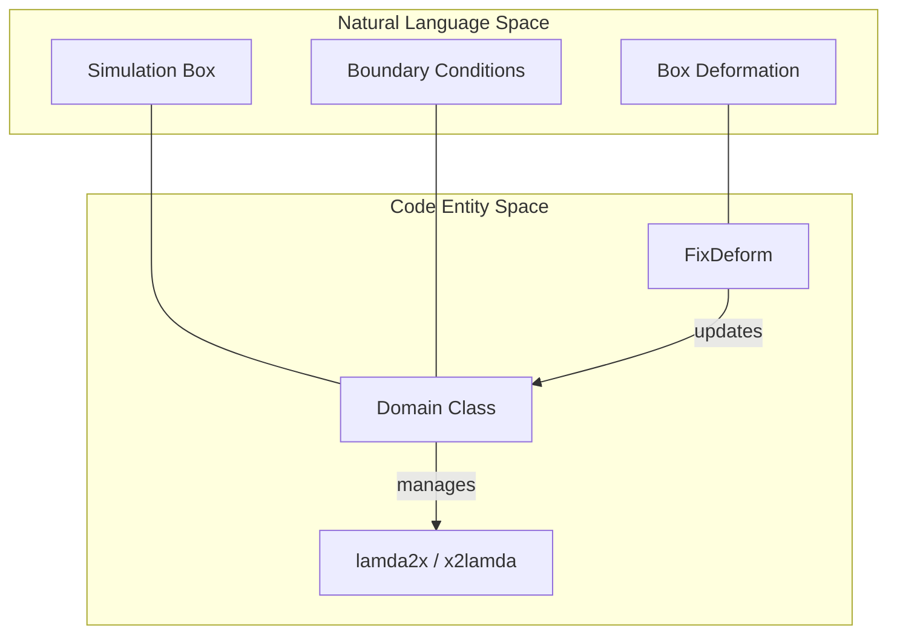
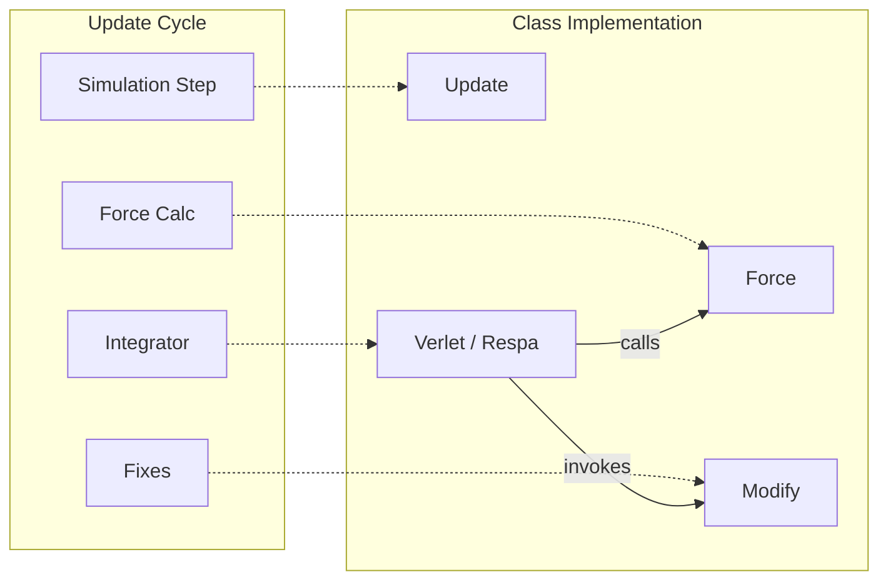

# Simulation Methods

Relevant source files

The following files were used as context for generating this wiki page:

- [doc/src/fix_charge_regulation.rst](doc/src/fix_charge_regulation.rst)
- [doc/src/fix_deform.rst](doc/src/fix_deform.rst)
- [doc/src/fix_deform_pressure.rst](doc/src/fix_deform_pressure.rst)
- [doc/src/fix_gcmc.rst](doc/src/fix_gcmc.rst)
- [doc/src/fix_hyper_global.rst](doc/src/fix_hyper_global.rst)
- [doc/src/fix_hyper_local.rst](doc/src/fix_hyper_local.rst)
- [doc/src/fix_neighbor_swap.rst](doc/src/fix_neighbor_swap.rst)
- [doc/src/fix_restrain.rst](doc/src/fix_restrain.rst)
- [doc/src/fix_sgcmc.rst](doc/src/fix_sgcmc.rst)
- [doc/src/fix_widom.rst](doc/src/fix_widom.rst)
- [examples/PACKAGES/neighbor-swap/MoCoNiVFeAlCr_2nn.meam](examples/PACKAGES/neighbor-swap/MoCoNiVFeAlCr_2nn.meam)
- [examples/PACKAGES/neighbor-swap/in.KMC_pulse_center](examples/PACKAGES/neighbor-swap/in.KMC_pulse_center)
- [examples/PACKAGES/neighbor-swap/in.KMC_pulse_edge](examples/PACKAGES/neighbor-swap/in.KMC_pulse_edge)
- [examples/PACKAGES/neighbor-swap/library_2nn.meam](examples/PACKAGES/neighbor-swap/library_2nn.meam)
- [examples/gjf/argon.lmp](examples/gjf/argon.lmp)
- [examples/gjf/ff-argon.lmp](examples/gjf/ff-argon.lmp)
- [src/EXTRA-FIX/fix_deform_pressure.cpp](src/EXTRA-FIX/fix_deform_pressure.cpp)
- [src/EXTRA-FIX/fix_deform_pressure.h](src/EXTRA-FIX/fix_deform_pressure.h)
- [src/KOKKOS/verlet_kokkos.h](src/KOKKOS/verlet_kokkos.h)
- [src/MC/fix_atom_swap.cpp](src/MC/fix_atom_swap.cpp)
- [src/MC/fix_atom_swap.h](src/MC/fix_atom_swap.h)
- [src/MC/fix_charge_regulation.cpp](src/MC/fix_charge_regulation.cpp)
- [src/MC/fix_charge_regulation.h](src/MC/fix_charge_regulation.h)
- [src/MC/fix_gcmc.cpp](src/MC/fix_gcmc.cpp)
- [src/MC/fix_gcmc.h](src/MC/fix_gcmc.h)
- [src/MC/fix_mol_swap.cpp](src/MC/fix_mol_swap.cpp)
- [src/MC/fix_mol_swap.h](src/MC/fix_mol_swap.h)
- [src/MC/fix_neighbor_swap.cpp](src/MC/fix_neighbor_swap.cpp)
- [src/MC/fix_neighbor_swap.h](src/MC/fix_neighbor_swap.h)
- [src/MC/fix_sgcmc.cpp](src/MC/fix_sgcmc.cpp)
- [src/MC/fix_sgcmc.h](src/MC/fix_sgcmc.h)
- [src/MC/fix_widom.cpp](src/MC/fix_widom.cpp)
- [src/MC/fix_widom.h](src/MC/fix_widom.h)
- [src/create_box.cpp](src/create_box.cpp)
- [src/domain.cpp](src/domain.cpp)
- [src/domain.h](src/domain.h)
- [src/fix_box_relax.cpp](src/fix_box_relax.cpp)
- [src/fix_box_relax.h](src/fix_box_relax.h)
- [src/fix_deform.cpp](src/fix_deform.cpp)
- [src/fix_deform.h](src/fix_deform.h)
- [src/fix_langevin.cpp](src/fix_langevin.cpp)
- [src/fix_langevin.h](src/fix_langevin.h)
- [src/fix_nh.cpp](src/fix_nh.cpp)
- [src/fix_nh.h](src/fix_nh.h)
- [src/fix_press_berendsen.cpp](src/fix_press_berendsen.cpp)
- [src/fix_press_berendsen.h](src/fix_press_berendsen.h)
- [src/fix_restrain.cpp](src/fix_restrain.cpp)
- [src/fix_restrain.h](src/fix_restrain.h)
- [src/fix_temp_berendsen.cpp](src/fix_temp_berendsen.cpp)
- [src/fix_temp_berendsen.h](src/fix_temp_berendsen.h)
- [src/fix_temp_rescale.cpp](src/fix_temp_rescale.cpp)
- [src/fix_temp_rescale.h](src/fix_temp_rescale.h)
- [src/integrate.cpp](src/integrate.cpp)
- [src/integrate.h](src/integrate.h)
- [src/lattice.cpp](src/lattice.cpp)
- [src/lattice.h](src/lattice.h)
- [src/min.cpp](src/min.cpp)
- [src/min.h](src/min.h)
- [src/min_cg.cpp](src/min_cg.cpp)
- [src/min_cg.h](src/min_cg.h)
- [src/min_fire.cpp](src/min_fire.cpp)
- [src/min_fire.h](src/min_fire.h)
- [src/min_hftn.cpp](src/min_hftn.cpp)
- [src/min_hftn.h](src/min_hftn.h)
- [src/min_linesearch.cpp](src/min_linesearch.cpp)
- [src/min_linesearch.h](src/min_linesearch.h)
- [src/min_quickmin.cpp](src/min_quickmin.cpp)
- [src/min_quickmin.h](src/min_quickmin.h)
- [src/min_sd.cpp](src/min_sd.cpp)
- [src/min_sd.h](src/min_sd.h)
- [src/minimize.cpp](src/minimize.cpp)
- [src/respa.cpp](src/respa.cpp)
- [src/respa.h](src/respa.h)
- [src/run.cpp](src/run.cpp)
- [src/verlet.cpp](src/verlet.cpp)
- [src/verlet.h](src/verlet.h)

This section provides an overview of the primary simulation methods and algorithmic frameworks available in LAMMPS. It covers the evolution of the system state through time integration, the search for energy minima, and stochastic sampling via Monte Carlo methods.

## Time Integration and Minimization
Time integration in LAMMPS is governed by the `Integrate` class and its derivatives, which implement various molecular dynamics (MD) schemes. The default is the Velocity Verlet algorithm implemented in the `Verlet` class [src/verlet.cpp:42-43](). For systems requiring multi-timescale integration, the `Respa` class implements the rRESPA (reversible Reference System Propagator Algorithm), allowing different forces (e.g., bonded vs. long-range) to be updated at different frequencies [src/respa.cpp:47-50]().

Energy minimization is handled by the `Min` class hierarchy [src/min.cpp:56-91](). LAMMPS supports several algorithms, including Conjugate Gradient (CG), Steepest Descent (SD), and the Fast Iterative Relaxation Engine (FIRE) [src/min_fire.cpp]().

### Key Code Entities
*   `Verlet`: Standard MD integrator [src/verlet.h]().
*   `Respa`: Multi-timescale integrator [src/respa.h]().
*   `Min`: Base class for energy minimizers [src/min.h]().
*   `FixNH`: Implements Nose-Hoover style NVT, NPT, and NPH integration [src/fix_nh.cpp:56-60]().

For details, see [Time Integration and Minimization](#6.1).

Sources: [src/verlet.cpp](), [src/respa.cpp](), [src/min.cpp](), [src/fix_nh.cpp]()

## Monte Carlo Methods
LAMMPS includes a suite of Monte Carlo (MC) methods, often implemented as "fixes" that operate alongside or instead of MD integration. These methods enable grand canonical ensembles, atom-type swapping, and reactive simulations.

The `FixGCMC` class provides Grand Canonical Monte Carlo capabilities, allowing for the insertion and deletion of atoms or molecules into a reservoir at a specific chemical potential and temperature [src/MC/fix_gcmc.cpp:72-79](). Hybrid MD/MC simulations are also supported, such as atom swapping for alloy modeling via `FixAtomSwap` [src/MC/fix_atom_swap.cpp:55-60]() and `FixNeighborSwap` for accelerated diffusion [src/MC/fix_neighbor_swap.cpp:71-77]().

For details, see [Monte Carlo Methods](#6.2).

Sources: [src/MC/fix_gcmc.cpp](), [src/MC/fix_atom_swap.cpp](), [src/MC/fix_neighbor_swap.cpp]()

## Replica and Enhanced Sampling Methods
Enhanced sampling methods facilitate the exploration of rare events and complex energy landscapes. These often involve running multiple "replicas" of a system simultaneously.

*   **Nudged Elastic Band (NEB):** Used for finding transition states and minimum energy paths.
*   **Parallel Tempering:** Swapping configurations between replicas at different temperatures (via the `temper` command).
*   **Hyperdynamics:** Accelerating time evolution by biasing the potential energy surface.
*   **Path-Integral MD:** Quantum nuclear effects via the `fix pimd` family.

For details, see [Replica and Enhanced Sampling Methods](#6.3).

## Domain and System Manipulation
The simulation environment is managed by the `Domain` class, which handles the geometry of the simulation box, periodicity, and triclinic transformations [src/domain.cpp:67-113](). System manipulation involves commands that change the box shape, rebalance processor loads, or modify atom positions.

### System Evolution and Domain Mapping
The following diagram illustrates how the `Domain` class interacts with integrators and fixes to manage the physical space of the simulation.

`FixDeform` is specifically used to change the box size or shape over time, supporting styles like `FINAL`, `DELTA`, `SCALE`, and `VEL` [src/fix_deform.cpp:99-120](). It interacts with the `Domain` class to update the shape matrix `h` and tilt factors `xy`, `xz`, `yz` [src/domain.h:88-91]().

For details, see [Domain and System Manipulation](#6.4).

Sources: [src/domain.cpp](), [src/domain.h](), [src/fix_deform.cpp]()

## Integration Flow Architecture
The following diagram bridges the high-level concept of a "Simulation Step" to the specific code classes responsible for different stages of the update.

Sources: [src/verlet.cpp:229-235](), [src/respa.cpp:165-175](), [src/update.h]()

---