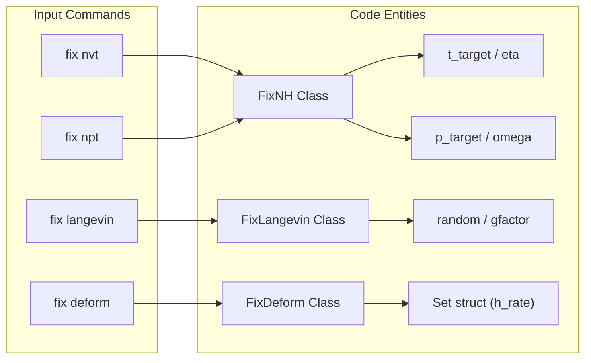

# Time Integration and Minimization

<details>
<summary>Relevant source files</summary>

The following files were used as context for generating this wiki page:

- [doc/src/fix_deform.rst](doc/src/fix_deform.rst)
- [doc/src/fix_deform_pressure.rst](doc/src/fix_deform_pressure.rst)
- [examples/gjf/argon.lmp](examples/gjf/argon.lmp)
- [examples/gjf/ff-argon.lmp](examples/gjf/ff-argon.lmp)
- [src/EXTRA-FIX/fix_deform_pressure.cpp](src/EXTRA-FIX/fix_deform_pressure.cpp)
- [src/EXTRA-FIX/fix_deform_pressure.h](src/EXTRA-FIX/fix_deform_pressure.h)
- [src/KOKKOS/dynamical_matrix_kokkos.cpp](src/KOKKOS/dynamical_matrix_kokkos.cpp)
- [src/KOKKOS/dynamical_matrix_kokkos.h](src/KOKKOS/dynamical_matrix_kokkos.h)
- [src/KOKKOS/fix_minimize_kokkos.cpp](src/KOKKOS/fix_minimize_kokkos.cpp)
- [src/KOKKOS/fix_minimize_kokkos.h](src/KOKKOS/fix_minimize_kokkos.h)
- [src/KOKKOS/min_cg_kokkos.cpp](src/KOKKOS/min_cg_kokkos.cpp)
- [src/KOKKOS/min_cg_kokkos.h](src/KOKKOS/min_cg_kokkos.h)
- [src/KOKKOS/min_kokkos.cpp](src/KOKKOS/min_kokkos.cpp)
- [src/KOKKOS/min_kokkos.h](src/KOKKOS/min_kokkos.h)
- [src/KOKKOS/min_linesearch_kokkos.cpp](src/KOKKOS/min_linesearch_kokkos.cpp)
- [src/KOKKOS/min_linesearch_kokkos.h](src/KOKKOS/min_linesearch_kokkos.h)
- [src/KOKKOS/pair_hybrid_kokkos.cpp](src/KOKKOS/pair_hybrid_kokkos.cpp)
- [src/KOKKOS/pair_hybrid_kokkos.h](src/KOKKOS/pair_hybrid_kokkos.h)
- [src/KOKKOS/pair_hybrid_overlay_kokkos.cpp](src/KOKKOS/pair_hybrid_overlay_kokkos.cpp)
- [src/KOKKOS/pair_hybrid_overlay_kokkos.h](src/KOKKOS/pair_hybrid_overlay_kokkos.h)
- [src/KOKKOS/third_order_kokkos.cpp](src/KOKKOS/third_order_kokkos.cpp)
- [src/KOKKOS/third_order_kokkos.h](src/KOKKOS/third_order_kokkos.h)
- [src/KOKKOS/verlet_kokkos.cpp](src/KOKKOS/verlet_kokkos.cpp)
- [src/KOKKOS/verlet_kokkos.h](src/KOKKOS/verlet_kokkos.h)
- [src/PHONON/dynamical_matrix.cpp](src/PHONON/dynamical_matrix.cpp)
- [src/PHONON/dynamical_matrix.h](src/PHONON/dynamical_matrix.h)
- [src/PHONON/third_order.cpp](src/PHONON/third_order.cpp)
- [src/PHONON/third_order.h](src/PHONON/third_order.h)
- [src/create_box.cpp](src/create_box.cpp)
- [src/domain.cpp](src/domain.cpp)
- [src/domain.h](src/domain.h)
- [src/fix_box_relax.cpp](src/fix_box_relax.cpp)
- [src/fix_box_relax.h](src/fix_box_relax.h)
- [src/fix_deform.cpp](src/fix_deform.cpp)
- [src/fix_deform.h](src/fix_deform.h)
- [src/fix_langevin.cpp](src/fix_langevin.cpp)
- [src/fix_langevin.h](src/fix_langevin.h)
- [src/fix_minimize.cpp](src/fix_minimize.cpp)
- [src/fix_minimize.h](src/fix_minimize.h)
- [src/fix_nh.cpp](src/fix_nh.cpp)
- [src/fix_nh.h](src/fix_nh.h)
- [src/fix_press_berendsen.cpp](src/fix_press_berendsen.cpp)
- [src/fix_press_berendsen.h](src/fix_press_berendsen.h)
- [src/fix_temp_berendsen.cpp](src/fix_temp_berendsen.cpp)
- [src/fix_temp_berendsen.h](src/fix_temp_berendsen.h)
- [src/fix_temp_rescale.cpp](src/fix_temp_rescale.cpp)
- [src/fix_temp_rescale.h](src/fix_temp_rescale.h)
- [src/integrate.cpp](src/integrate.cpp)
- [src/integrate.h](src/integrate.h)
- [src/lattice.cpp](src/lattice.cpp)
- [src/lattice.h](src/lattice.h)
- [src/min.cpp](src/min.cpp)
- [src/min.h](src/min.h)
- [src/min_cg.cpp](src/min_cg.cpp)
- [src/min_cg.h](src/min_cg.h)
- [src/min_fire.cpp](src/min_fire.cpp)
- [src/min_fire.h](src/min_fire.h)
- [src/min_hftn.cpp](src/min_hftn.cpp)
- [src/min_hftn.h](src/min_hftn.h)
- [src/min_linesearch.cpp](src/min_linesearch.cpp)
- [src/min_linesearch.h](src/min_linesearch.h)
- [src/min_quickmin.cpp](src/min_quickmin.cpp)
- [src/min_quickmin.h](src/min_quickmin.h)
- [src/min_sd.cpp](src/min_sd.cpp)
- [src/min_sd.h](src/min_sd.h)
- [src/minimize.cpp](src/minimize.cpp)
- [src/respa.cpp](src/respa.cpp)
- [src/respa.h](src/respa.h)
- [src/run.cpp](src/run.cpp)
- [src/verlet.cpp](src/verlet.cpp)
- [src/verlet.h](src/verlet.h)

</details>


This section documents the simulation methods used to evolve atomistic systems through time or towards local energy minima. LAMMPS separates the responsibility of updating positions and velocities between **Integrators** (which define the high-level loop) and **Fixes** (which implement specific thermostat/barostat constraints).

## Time Integration

Time integration in LAMMPS is managed by the `Update` class, which orchestrates the execution of an `Integrate` style. The two primary integrators are the velocity Verlet algorithm and the rRESPA multi-timescale integrator.

### Verlet Integrator
The standard velocity Verlet integrator is implemented in the `Verlet` class. It follows a two-step integration process within each timestep:
1. **Initial Integration**: Update velocities by a half-step and positions by a full step.
2. **Force Calculation**: Compute all interactions (Pair, Bond, KSpace, etc.).
3. **Final Integration**: Update velocities by the remaining half-step using the new forces.

The `Verlet::run(int n)` function contains the main simulation loop `[src/verlet.cpp:230-280]()`.

### rRESPA (Reversible Reference System Propagator Algorithm)
The `Respa` class implements a multi-timescale integrator that allows different force components to be evaluated at different frequencies `[src/respa.cpp:18-50]()`. For example, fast bond vibrations can be computed more frequently than slow long-range electrostatics.

**Hierarchy of rRESPA levels:**
- **Inner**: Typically for bonds, angles, and short-range pair interactions.
- **Middle**: Optional intermediate level for pair interactions.
- **Outer**: Long-range pair interactions and KSpace.

### Integration Flow Diagram
This diagram illustrates the association between the `Integrate` base class and its concrete implementations, and how they interact with the `Modify` system to apply integration fixes.

```mermaid
graph TD
    subgraph "Code Entity Space"
        Update["Update Class"]
        Integrate["Integrate (Base)"]
        Verlet["Verlet Style"]
        Respa["Respa Style"]
        FixIntegrate["Fix::time_integrate == 1"]
        
        Update --> Integrate
        Integrate <|-- Verlet
        Integrate <|-- Respa
        
        Verlet -- "calls" --> FixNVE["FixNH (nve)"]
        Verlet -- "calls" --> FixNVT["FixNH (nvt)"]
    end

    subgraph "Natural Language Space"
        Loop["Simulation Loop"]
        Algorithm["Integration Algorithm"]
        Thermostat["Thermostat/Barostat"]
    end

    Loop --> Update
    Algorithm --> Integrate
    Thermostat --> FixIntegrate
```
**Sources:** `[src/verlet.cpp:42-43]()`, `[src/respa.cpp:47-50]()`, `[src/update.h:1-50]()`.

---

## Energy Minimization

Minimization in LAMMPS seeks to find a local potential energy minimum by adjusting atomic coordinates (and potentially box dimensions). All minimizers derive from the `Min` base class `[src/min.h:22-150]()`.

### Minimization Algorithms
| Style | Class | Description |
| :--- | :--- | :--- |
| **CG** | `MinCG` | Polak-Ribiere Conjugate Gradient; efficient for most molecular systems `[src/min_cg.cpp:25-50]()`. |
| **SD** | `MinSD` | Steepest Descent; robust but slow convergence. |
| **FIRE** | `MinFIRE` | Fast Inertial Relaxation Engine; uses MD-like dynamics with velocity damping `[src/min_fire.cpp:25-50]()`. |
| **Quickmin** | `MinQuickmin` | Damped dynamics minimizer popular in some materials science applications. |
| **HFTN** | `MinHFTN` | Hessian-Free Truncated Newton; uses second-derivative information via finite differences `[src/min_hftn.cpp:20-40]()`. |

### Minimization Logic
The `Min::setup()` function prepares the system, including creating a `FixMinimize` instance to store auxiliary per-atom data (like search directions) `[src/min.cpp:202-230]()`. The `Min::iterate()` method is implemented by each style to perform the actual optimization steps `[src/min.h:58-58]()`.

**Sources:** `[src/min.cpp:56-91]()`, `[src/min.h:22-150]()`, `[src/min_cg.cpp:25-50]()`.

---

## Thermostats and Barostats (Fixes)

Time integration with temperature and pressure control is handled by the `Fix` system.

### Nose-Hoover (Fix NH)
The `FixNH` class is the engine for `fix nve`, `fix nvt`, `fix npt`, and `fix nph` `[src/fix_nh.cpp:56-60]()`. It implements the Nose-Hoover equations of motion with MTK (Martyna-Tobias-Klein) corrections for barostatting.
- **NVT**: Thermostatting via a chain of Nose-Hoover thermostats `[src/fix_nh.cpp:133-147]()`.
- **NPT/NPH**: Barostatting via box scaling `[src/fix_nh.cpp:150-193]()`.

### Langevin Dynamics
`FixLangevin` adds a stochastic force and a frictional drag term to the equations of motion to maintain temperature `[src/fix_langevin.cpp:50-153]()`. It does not perform time integration itself; it must be used in conjunction with `fix nve`.
- **Key Function**: `post_force()` applies the random and damping forces `[src/fix_langevin.cpp:184-202]()`.

### Other Controls
- **fix temp/rescale**: Simple velocity rescaling to a target temperature.
- **fix press/berendsen**: Weak-coupling barostat for rapid box equilibration.
- **fix deform**: Dynamically changes the simulation box shape/size over time `[src/fix_deform.cpp:48-88]()`.

### Code Mapping: Integration Fixes
This diagram maps the high-level commands to the underlying C++ classes and their primary data members.


**Sources:** `[src/fix_nh.h:21-149]()`, `[src/fix_langevin.h:27-80]()`, `[src/fix_deform.h:54-95]()`.

---

## Domain and Box Manipulation

The `Domain` class manages the simulation box geometry, including support for triclinic (non-orthogonal) cells `[src/domain.cpp:67-113]()`.

- **Triclinic Support**: Handled via tilt factors `xy`, `xz`, and `yz` `[src/domain.h:88-91]()`.
- **Box Deformation**: `FixDeform` modifies the `h` matrix (shape matrix) in the `Domain` class to simulate strain `[src/fix_deform.cpp:400-450]()`.
- **Remapping**: When the box deforms, atoms can be remapped in position (`X_REMAP`) or velocity (`V_REMAP`) `[src/domain.h:114-114]()`.

**Key Functions in `Domain`:**
- `set_global_box()`: Defines the boundaries based on processor decomposition `[src/domain.h:125-125]()`.
- `pbc()`: Enforces periodic boundary conditions `[src/domain.h:129-129]()`.
- `x2lamda()` / `lamda2x()`: Converts between Cartesian and fractional (lattice) coordinates `[src/domain.h:178-183]()`.

**Sources:** `[src/domain.cpp:67-113]()`, `[src/domain.h:28-185]()`, `[src/fix_deform.cpp:48-88]()`.

---