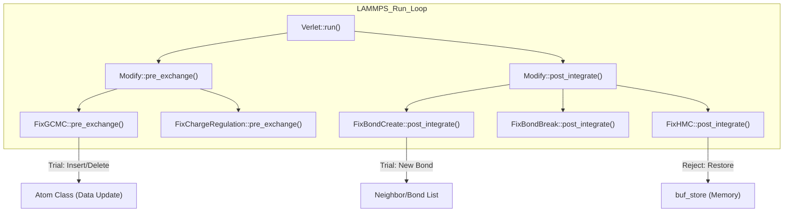
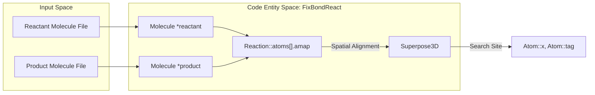

# Monte Carlo Methods

Relevant source files

The following files were used as context for generating this wiki page:

- [doc/src/fix_bond_break.rst](doc/src/fix_bond_break.rst)
- [doc/src/fix_bond_create.rst](doc/src/fix_bond_create.rst)
- [doc/src/fix_bond_swap.rst](doc/src/fix_bond_swap.rst)
- [doc/src/fix_charge_regulation.rst](doc/src/fix_charge_regulation.rst)
- [doc/src/fix_gcmc.rst](doc/src/fix_gcmc.rst)
- [doc/src/fix_hmc.rst](doc/src/fix_hmc.rst)
- [doc/src/fix_hyper_global.rst](doc/src/fix_hyper_global.rst)
- [doc/src/fix_hyper_local.rst](doc/src/fix_hyper_local.rst)
- [doc/src/fix_neighbor_swap.rst](doc/src/fix_neighbor_swap.rst)
- [doc/src/fix_restrain.rst](doc/src/fix_restrain.rst)
- [doc/src/fix_sgcmc.rst](doc/src/fix_sgcmc.rst)
- [doc/src/fix_widom.rst](doc/src/fix_widom.rst)
- [examples/PACKAGES/neighbor-swap/MoCoNiVFeAlCr_2nn.meam](examples/PACKAGES/neighbor-swap/MoCoNiVFeAlCr_2nn.meam)
- [examples/PACKAGES/neighbor-swap/in.KMC_pulse_center](examples/PACKAGES/neighbor-swap/in.KMC_pulse_center)
- [examples/PACKAGES/neighbor-swap/in.KMC_pulse_edge](examples/PACKAGES/neighbor-swap/in.KMC_pulse_edge)
- [examples/PACKAGES/neighbor-swap/library_2nn.meam](examples/PACKAGES/neighbor-swap/library_2nn.meam)
- [examples/mc/data.hmc.spce](examples/mc/data.hmc.spce)
- [examples/mc/in.hmc.flexible.melt](examples/mc/in.hmc.flexible.melt)
- [examples/mc/in.hmc.rigid](examples/mc/in.hmc.rigid)
- [examples/mc/log.2Jul25.hmc.flexible.melt.g++.1](examples/mc/log.2Jul25.hmc.flexible.melt.g++.1)
- [examples/mc/log.2Jul25.hmc.flexible.melt.g++.4](examples/mc/log.2Jul25.hmc.flexible.melt.g++.4)
- [src/EXTRA-FIX/fix_controller.cpp](src/EXTRA-FIX/fix_controller.cpp)
- [src/EXTRA-FIX/fix_ffl.cpp](src/EXTRA-FIX/fix_ffl.cpp)
- [src/EXTRA-FIX/fix_gle.cpp](src/EXTRA-FIX/fix_gle.cpp)
- [src/EXTRA-FIX/fix_nvk.cpp](src/EXTRA-FIX/fix_nvk.cpp)
- [src/EXTRA-FIX/fix_wall_ees.cpp](src/EXTRA-FIX/fix_wall_ees.cpp)
- [src/EXTRA-FIX/fix_wall_region_ees.cpp](src/EXTRA-FIX/fix_wall_region_ees.cpp)
- [src/MC/fix_atom_swap.cpp](src/MC/fix_atom_swap.cpp)
- [src/MC/fix_atom_swap.h](src/MC/fix_atom_swap.h)
- [src/MC/fix_bond_break.cpp](src/MC/fix_bond_break.cpp)
- [src/MC/fix_bond_break.h](src/MC/fix_bond_break.h)
- [src/MC/fix_bond_create.cpp](src/MC/fix_bond_create.cpp)
- [src/MC/fix_bond_create.h](src/MC/fix_bond_create.h)
- [src/MC/fix_bond_create_angle.cpp](src/MC/fix_bond_create_angle.cpp)
- [src/MC/fix_bond_create_angle.h](src/MC/fix_bond_create_angle.h)
- [src/MC/fix_bond_swap.cpp](src/MC/fix_bond_swap.cpp)
- [src/MC/fix_bond_swap.h](src/MC/fix_bond_swap.h)
- [src/MC/fix_charge_regulation.cpp](src/MC/fix_charge_regulation.cpp)
- [src/MC/fix_charge_regulation.h](src/MC/fix_charge_regulation.h)
- [src/MC/fix_gcmc.cpp](src/MC/fix_gcmc.cpp)
- [src/MC/fix_gcmc.h](src/MC/fix_gcmc.h)
- [src/MC/fix_hmc.cpp](src/MC/fix_hmc.cpp)
- [src/MC/fix_hmc.h](src/MC/fix_hmc.h)
- [src/MC/fix_mol_swap.cpp](src/MC/fix_mol_swap.cpp)
- [src/MC/fix_mol_swap.h](src/MC/fix_mol_swap.h)
- [src/MC/fix_neighbor_swap.cpp](src/MC/fix_neighbor_swap.cpp)
- [src/MC/fix_neighbor_swap.h](src/MC/fix_neighbor_swap.h)
- [src/MC/fix_sgcmc.cpp](src/MC/fix_sgcmc.cpp)
- [src/MC/fix_sgcmc.h](src/MC/fix_sgcmc.h)
- [src/MC/fix_widom.cpp](src/MC/fix_widom.cpp)
- [src/MC/fix_widom.h](src/MC/fix_widom.h)
- [src/REACTION/README](src/REACTION/README)
- [src/REACTION/fix_bond_react.cpp](src/REACTION/fix_bond_react.cpp)
- [src/REACTION/fix_bond_react.h](src/REACTION/fix_bond_react.h)
- [src/RIGID/compute_rigid_local.cpp](src/RIGID/compute_rigid_local.cpp)
- [src/fix_restrain.cpp](src/fix_restrain.cpp)
- [src/fix_restrain.h](src/fix_restrain.h)

Monte Carlo (MC) methods in LAMMPS are primarily implemented as `Fix` styles that perform stochastic trials to modify the system state. These include particle exchanges (GCMC), identity swaps, connectivity changes (Bond/React), and hybrid MD/MC algorithms.

## Grand Canonical Monte Carlo (GCMC)

`FixGCMC` implements the Grand Canonical ensemble ($\mu VT$) by performing insertions and deletions of atoms or molecules, along with translation and rotation moves.

### Implementation Details
- **Exchange Modes**: Supports both `EXCHATOM` and `EXCHMOL` [src/MC/fix_gcmc.cpp:67-68]().
- **Energy Calculation**: Can use a fast local energy update `energy()` or a full system energy calculation `energy_full()` [src/MC/fix_gcmc.h:142-143]().
- **Metropolis Criterion**: Success depends on the chemical potential $\mu$, reservoir temperature $T$, and the energy change $\Delta E$ [src/MC/fix_gcmc.cpp:105-106]().

### Key Functions
- `pre_exchange()`: The main entry point called during the simulation loop to perform MC trials [src/MC/fix_gcmc.cpp:637-640]().
- `attempt_atomic_insertion()` / `attempt_molecule_insertion()`: Handles the generation of random coordinates and checking for overlaps/energy changes [src/MC/fix_gcmc.h:129,133]().
- `pick_random_gas_atom()`: Randomly selects a particle for a deletion or move trial [src/MC/fix_gcmc.h:146]().

**Sources:** [src/MC/fix_gcmc.cpp](), [src/MC/fix_gcmc.h]()

---

## Identity and Neighbor Swapping

These methods accelerate diffusion or sample compositional ensembles by swapping atom types or positions.

### fix atom/swap
Performs Monte Carlo swaps of atom types between two different species to sample the semi-grand canonical ensemble [src/MC/fix_atom_swap.cpp:177-181]().
- Uses `random_equal` to ensure all processors pick the same atoms for potential swapping [src/MC/fix_atom_swap.cpp:103]().
- Supports a `semi-grand` flag to transition atoms between types based on chemical potential differences $\Delta \mu$ [src/MC/fix_atom_swap.cpp:161]().

### fix neighbor/swap
Implements a Kinetic Monte Carlo (KMC) approach where atoms swap positions with their neighbors based on a rates-based probability model or Metropolis criterion [src/MC/fix_neighbor_swap.cpp:58-65]().
- Relies on `compute voronoi/atom` to determine the neighbor list for potential swaps [src/MC/fix_neighbor_swap.cpp:123-129]().

**Sources:** [src/MC/fix_atom_swap.cpp](), [src/MC/fix_neighbor_swap.cpp]()

---

## Reactive Methods

LAMMPS provides several fixes to simulate chemical reactions by dynamically creating or breaking bonds.

### fix bond/react
The `FixBondReact` class is a heuristic engine for complex chemical reactions using template molecules.
- **Templates**: Uses "pre-reaction" and "post-reaction" molecule templates to identify reactive sites and update the topology [src/REACTION/fix_bond_react.h:96-97]().
- **Superposition**: Uses the `Superpose3D` algorithm to map simulation atoms onto the reactant template [src/REACTION/fix_bond_react.h:50,67]().
- **Stabilization**: Can invoke a stabilization period (e.g., using `fix nve/limit`) to relax the system after a reaction event [src/REACTION/fix_bond_react.cpp:171-180]().

### fix bond/create and fix bond/break
- `FixBondCreate`: Creates new bonds between atoms of specific types within a cutoff distance `cutsq` [src/MC/fix_bond_create.cpp:68-80]().
- `FixBondBreak`: Removes existing bonds if they exceed a certain distance or randomly based on a probability `fraction` [src/MC/fix_bond_break.cpp:62-74]().

**Sources:** [src/REACTION/fix_bond_react.cpp](), [src/REACTION/fix_bond_react.h](), [src/MC/fix_bond_create.cpp](), [src/MC/fix_bond_break.cpp]()

---

## Hamiltonian Monte Carlo (HMC)

`FixHMC` implements the Hamiltonian (or Hybrid) Monte Carlo algorithm. It uses MD trajectories to generate trial moves, which are then accepted/rejected based on the total Hamiltonian change $\Delta H$ [doc/src/fix_hmc.rst:41-49]().

### Workflow [src/MC/fix_hmc.cpp]()
1. **Store state**: Saves atom positions, velocities, and potential energy [doc/src/fix_hmc.rst:54-57]().
2. **MD Integration**: Runs $N$ steps of NVE integration.
3. **Metropolis**: Calculates $P = \min(1, e^{-\beta \Delta H})$.
4. **Accept/Reject**: If rejected, restores the previous state and resamples velocities [doc/src/fix_hmc.rst:88-98]().

**Sources:** [src/MC/fix_hmc.cpp](), [doc/src/fix_hmc.rst]()

---

## Chemical Potential Calculation (Widom)

`FixWidom` implements the Widom insertion method to calculate the excess chemical potential without actually modifying the system state.

- **Non-destructive**: It performs "ghost" insertions of atoms or molecules [src/MC/fix_widom.cpp:83-86]().
- **Statistical Weighting**: Accumulates the Boltzmann factor $e^{-\beta \Delta E}$ across many trials [src/MC/fix_widom.cpp:169]().

**Sources:** [src/MC/fix_widom.cpp]()

---

## Technical Architecture Diagrams

### Monte Carlo Simulation Flow
The following diagram illustrates how MC fixes integrate into the standard LAMMPS `Verlet` integration loop via the `Modify` class.

**Sources:** [src/MC/fix_gcmc.cpp:33,637](), [src/MC/fix_hmc.cpp:57,163](), [src/MC/fix_bond_create.cpp:15](), [src/MC/fix_charge_regulation.cpp:188]()

### Reactive System Data Mapping
This diagram shows the relationship between input templates and the code entities used in `fix bond/react`.

**Sources:** [src/REACTION/fix_bond_react.h:94-133](), [src/REACTION/fix_bond_react.cpp:50]()

---

## Comparison Table: Monte Carlo Fixes

| Fix Style | Ensemble | Primary Action | Key Parameters |
| :--- | :--- | :--- | :--- |
| `gcmc` | $\mu VT$ | Atom/Mol Insert/Delete | `mu`, `temp`, `onemol` |
| `atom/swap` | Semi-grand | Type swap | `types`, `mu`, `temp` |
| `neighbor/swap` | Kinetic MC | Position swap | `r_0`, `temp`, `voro` |
| `bond/react` | Reactive | Topo transformation | `react`, templates |
| `hmc` | $NVT$ | MD trial move | `N`, `seed`, `temp` |
| `widom` | N/A | Test insertion | `ninsertions`, `temp` |
| `charge/regulation` | Variable Charge | Protonation/Deprotonation | `pH`, `pK`, `cation/anion` |

**Sources:** [src/MC/fix_gcmc.cpp:100-108](), [src/MC/fix_atom_swap.cpp:81-85](), [src/MC/fix_neighbor_swap.cpp:100-118](), [src/REACTION/fix_bond_react.cpp:148-155](), [src/MC/fix_hmc.cpp:68-70](), [src/MC/fix_widom.cpp:82-86](), [src/MC/fix_charge_regulation.cpp:101-110]()

---