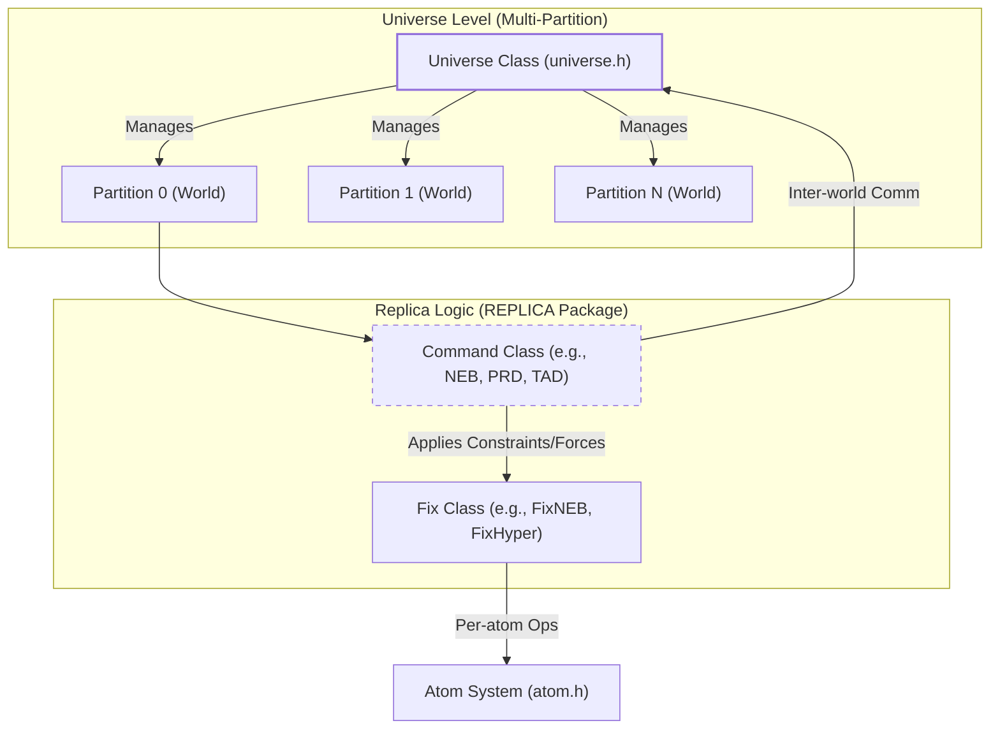
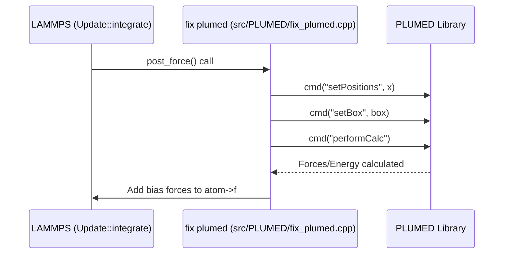

# Replica and Enhanced Sampling Methods

Relevant source files

The following files were used as context for generating this wiki page:

- [cmake/.coveragerc.in](cmake/.coveragerc.in)
- [cmake/Modules/CodeCoverage.cmake](cmake/Modules/CodeCoverage.cmake)
- [cmake/Modules/ExternalCMakeProject.cmake](cmake/Modules/ExternalCMakeProject.cmake)
- [cmake/Modules/Packages/MDI.cmake](cmake/Modules/Packages/MDI.cmake)
- [cmake/Modules/Packages/ML-HDNNP.cmake](cmake/Modules/Packages/ML-HDNNP.cmake)
- [cmake/Modules/Packages/ML-QUIP.cmake](cmake/Modules/Packages/ML-QUIP.cmake)
- [cmake/Modules/Packages/ML-RUNNER.cmake](cmake/Modules/Packages/ML-RUNNER.cmake)
- [cmake/Modules/Packages/PLUMED.cmake](cmake/Modules/Packages/PLUMED.cmake)
- [cmake/Modules/Packages/SCAFACOS.cmake](cmake/Modules/Packages/SCAFACOS.cmake)
- [cmake/patches/runner-cmake.patch](cmake/patches/runner-cmake.patch)
- [doc/lammps.1](doc/lammps.1)
- [doc/src/Commands_removed.rst](doc/src/Commands_removed.rst)
- [doc/src/Intro_portability.rst](doc/src/Intro_portability.rst)
- [doc/src/Run_basics.rst](doc/src/Run_basics.rst)
- [doc/src/Run_options.rst](doc/src/Run_options.rst)
- [doc/src/compute_composition_atom.rst](doc/src/compute_composition_atom.rst)
- [doc/src/compute_voronoi_atom.rst](doc/src/compute_voronoi_atom.rst)
- [doc/src/fix_atc.rst](doc/src/fix_atc.rst)
- [doc/src/fix_ave_spatial.rst](doc/src/fix_ave_spatial.rst)
- [doc/src/fix_ave_spatial_sphere.rst](doc/src/fix_ave_spatial_sphere.rst)
- [doc/src/fix_deposit.rst](doc/src/fix_deposit.rst)
- [doc/src/fix_dpd_source.rst](doc/src/fix_dpd_source.rst)
- [doc/src/fix_halt.rst](doc/src/fix_halt.rst)
- [doc/src/fix_ipi.rst](doc/src/fix_ipi.rst)
- [doc/src/fix_langevin.rst](doc/src/fix_langevin.rst)
- [doc/src/fix_pimd.rst](doc/src/fix_pimd.rst)
- [doc/src/fix_poems.rst](doc/src/fix_poems.rst)
- [doc/src/fix_pour.rst](doc/src/fix_pour.rst)
- [doc/src/fix_vector.rst](doc/src/fix_vector.rst)
- [doc/src/pair_mgpt.rst](doc/src/pair_mgpt.rst)
- [doc/src/pair_runner.rst](doc/src/pair_runner.rst)
- [doc/src/read_restart.rst](doc/src/read_restart.rst)
- [examples/SPIN/gneb/README](examples/SPIN/gneb/README)
- [examples/SPIN/gneb/iron/final.iron_spin](examples/SPIN/gneb/iron/final.iron_spin)
- [examples/SPIN/gneb/iron/in.gneb.iron](examples/SPIN/gneb/iron/in.gneb.iron)
- [examples/SPIN/gneb/iron/initial.iron_spin](examples/SPIN/gneb/iron/initial.iron_spin)
- [examples/SPIN/gneb/skyrmion/final.skyrmion](examples/SPIN/gneb/skyrmion/final.skyrmion)
- [examples/SPIN/gneb/skyrmion/in.gneb.skyrmion](examples/SPIN/gneb/skyrmion/in.gneb.skyrmion)
- [examples/SPIN/gneb/skyrmion/initial.skyrmion](examples/SPIN/gneb/skyrmion/initial.skyrmion)
- [src/BOCS/compute_pressure_bocs.cpp](src/BOCS/compute_pressure_bocs.cpp)
- [src/MAKE/Makefile.mpi](src/MAKE/Makefile.mpi)
- [src/MAKE/Makefile.serial](src/MAKE/Makefile.serial)
- [src/MISC/fix_imd.cpp](src/MISC/fix_imd.cpp)
- [src/MISC/fix_imd.h](src/MISC/fix_imd.h)
- [src/MISC/fix_ipi.cpp](src/MISC/fix_ipi.cpp)
- [src/MISC/fix_ipi.h](src/MISC/fix_ipi.h)
- [src/ML-RUNNER/Install.sh](src/ML-RUNNER/Install.sh)
- [src/ML-RUNNER/pair_runner.cpp](src/ML-RUNNER/pair_runner.cpp)
- [src/ML-RUNNER/pair_runner.h](src/ML-RUNNER/pair_runner.h)
- [src/PLUMED/fix_plumed.cpp](src/PLUMED/fix_plumed.cpp)
- [src/REPLICA/bosonic_exchange.cpp](src/REPLICA/bosonic_exchange.cpp)
- [src/REPLICA/bosonic_exchange.h](src/REPLICA/bosonic_exchange.h)
- [src/REPLICA/compute_event_displace.cpp](src/REPLICA/compute_event_displace.cpp)
- [src/REPLICA/compute_event_displace.h](src/REPLICA/compute_event_displace.h)
- [src/REPLICA/fix_event.cpp](src/REPLICA/fix_event.cpp)
- [src/REPLICA/fix_event.h](src/REPLICA/fix_event.h)
- [src/REPLICA/fix_event_hyper.cpp](src/REPLICA/fix_event_hyper.cpp)
- [src/REPLICA/fix_event_prd.cpp](src/REPLICA/fix_event_prd.cpp)
- [src/REPLICA/fix_event_prd.h](src/REPLICA/fix_event_prd.h)
- [src/REPLICA/fix_event_tad.cpp](src/REPLICA/fix_event_tad.cpp)
- [src/REPLICA/fix_event_tad.h](src/REPLICA/fix_event_tad.h)
- [src/REPLICA/fix_hyper.cpp](src/REPLICA/fix_hyper.cpp)
- [src/REPLICA/fix_hyper.h](src/REPLICA/fix_hyper.h)
- [src/REPLICA/fix_hyper_global.cpp](src/REPLICA/fix_hyper_global.cpp)
- [src/REPLICA/fix_hyper_global.h](src/REPLICA/fix_hyper_global.h)
- [src/REPLICA/fix_hyper_local.cpp](src/REPLICA/fix_hyper_local.cpp)
- [src/REPLICA/fix_hyper_local.h](src/REPLICA/fix_hyper_local.h)
- [src/REPLICA/fix_neb.cpp](src/REPLICA/fix_neb.cpp)
- [src/REPLICA/fix_neb.h](src/REPLICA/fix_neb.h)
- [src/REPLICA/fix_pimd_langevin.cpp](src/REPLICA/fix_pimd_langevin.cpp)
- [src/REPLICA/fix_pimd_langevin.h](src/REPLICA/fix_pimd_langevin.h)
- [src/REPLICA/fix_pimd_nvt.cpp](src/REPLICA/fix_pimd_nvt.cpp)
- [src/REPLICA/fix_pimd_nvt.h](src/REPLICA/fix_pimd_nvt.h)
- [src/REPLICA/hyper.cpp](src/REPLICA/hyper.cpp)
- [src/REPLICA/neb.cpp](src/REPLICA/neb.cpp)
- [src/REPLICA/neb.h](src/REPLICA/neb.h)
- [src/REPLICA/prd.cpp](src/REPLICA/prd.cpp)
- [src/REPLICA/prd.h](src/REPLICA/prd.h)
- [src/REPLICA/tad.cpp](src/REPLICA/tad.cpp)
- [src/REPLICA/tad.h](src/REPLICA/tad.h)
- [src/REPLICA/temper.cpp](src/REPLICA/temper.cpp)
- [src/REPLICA/temper.h](src/REPLICA/temper.h)
- [src/REPLICA/temper_grem.cpp](src/REPLICA/temper_grem.cpp)
- [src/REPLICA/temper_grem.h](src/REPLICA/temper_grem.h)
- [src/REPLICA/temper_npt.cpp](src/REPLICA/temper_npt.cpp)
- [src/REPLICA/temper_npt.h](src/REPLICA/temper_npt.h)
- [src/SPIN/fix_neb_spin.cpp](src/SPIN/fix_neb_spin.cpp)
- [src/SPIN/fix_neb_spin.h](src/SPIN/fix_neb_spin.h)
- [src/SPIN/neb_spin.cpp](src/SPIN/neb_spin.cpp)
- [src/SPIN/neb_spin.h](src/SPIN/neb_spin.h)
- [src/fix_halt.cpp](src/fix_halt.cpp)
- [src/fix_halt.h](src/fix_halt.h)
- [src/fix_vector.cpp](src/fix_vector.cpp)
- [src/fix_vector.h](src/fix_vector.h)
- [src/lmptype.h](src/lmptype.h)
- [src/my_page.cpp](src/my_page.cpp)
- [src/my_page.h](src/my_page.h)
- [src/my_pool_chunk.cpp](src/my_pool_chunk.cpp)
- [src/version.h](src/version.h)
- [tools/i-pi/README.md](tools/i-pi/README.md)

LAMMPS provides a suite of multi-replica simulation methods designed to explore long-timescale events, calculate reaction paths, and enhance the sampling of configuration space. These methods typically involve running multiple instances of a simulation (replicas) that interact or exchange information through the LAMMPS `Universe` and `Partition` infrastructure.

## Multi-Replica Infrastructure

Replica methods require LAMMPS to be launched in multi-partition mode using the `-partition` command-line flag [doc/lammps.1:175-188](). This splits the total number of MPI processors into $N$ worlds, where each world (replica) runs its own simulation [src/REPLICA/neb.cpp:54-61]().

### Data Flow and Code Entity Mapping

The following diagram illustrates how the high-level replica commands interface with the core LAMMPS `Universe` and the specific `Fix` classes that manage inter-replica communication.

**Diagram: Replica System Architecture**

**Sources:** [src/REPLICA/neb.cpp:54-61](), [src/REPLICA/fix_neb.cpp:127-140](), [doc/lammps.1:175-188]()

---

## Nudged Elastic Band (NEB)

The `NEB` command finds the minimum energy path (MEP) between a known initial and final state [src/REPLICA/neb.cpp:116-127](). It requires the `REPLICA` package and works in conjunction with `fix neb`.

*   **Implementation**: The `NEB` class [src/REPLICA/neb.h]() manages the high-level minimization loop across replicas. It uses `MPI_Comm_split` to create a `roots` communicator for inter-replica coordination [src/REPLICA/neb.cpp:198-205]().
*   **Inter-replica Forces**: `FixNEB` calculates the spring forces between adjacent replicas [src/REPLICA/fix_neb.cpp:47-59](). It supports different modes: `neigh`, `ideal`, and `equal` [src/REPLICA/fix_neb.cpp:72-77]().
*   **Data Exchange**: Replicas exchange coordinates and forces with their neighbors (`procprev` and `procnext`) using either `SINGLE_PROC_MAP` or `MULTI_PROC` communication modes [src/REPLICA/fix_neb.cpp:131-161]().

**Sources:** [src/REPLICA/neb.cpp:14-31](), [src/REPLICA/fix_neb.cpp:19-38]()

---

## Path-Integral Molecular Dynamics (PIMD)

PIMD enables quantum MD simulations by exploiting the isomorphism between a quantum particle and a classical ring-polymer of $P$ beads [doc/src/fix_pimd.rst:83-88]().

### Distinguishable Particles
*   **fix pimd/nvt**: Implements a massive Nose-Hoover chain thermostat where each degree of freedom for each bead is coupled to a chain [doc/src/fix_pimd.rst:137-144]().
*   **fix pimd/langevin**: Implements Langevin integration in the normal mode representation [src/REPLICA/fix_pimd_langevin.cpp:14-26](). It supports NVE, NVT, NPH, and NPT ensembles [src/REPLICA/fix_pimd_langevin.h:38]().

### Bosonic Exchange
*   **fix pimd/langevin/bosonic**: Extends PIMD to include exchange effects for bosons using the Hirshberg-Feldman algorithm [doc/src/fix_pimd.rst:118-129]().
*   **Implementation**: The `BosonicExchange` class handles the recurrence relations for the bosonic spring potential, scaling as $O(N^2 + PN)$ [src/REPLICA/bosonic_exchange.cpp:1-20]().

**Sources:** [doc/src/fix_pimd.rst:6-62](), [src/REPLICA/fix_pimd_langevin.h:27-52](), [src/REPLICA/fix_pimd_langevin.cpp:81-122]()

---

## Hyperdynamics and Accelerated MD

These methods accelerate the escape from local minima by modifying the potential energy surface.

*   **Hyperdynamics**: Managed via `fix hyper/global` and `fix hyper/local`. These fixes bias the potential to reduce the depth of energy wells without altering the transition state theory (TST) rates [src/REPLICA/fix_hyper_global.cpp:1-20]().
*   **Parallel Replica Dynamics (PRD)**: The `PRD` command parallelizes the "search for transitions" by running independent replicas and synchronizing when any replica detects an event [src/REPLICA/prd.cpp]().
*   **Temperature-Accelerated Dynamics (TAD)**: The `TAD` command runs a high-temperature simulation to find transitions faster, then uses the harmonic TST to extrapolate the event to a lower target temperature [src/REPLICA/tad.cpp]().

**Sources:** [src/REPLICA/hyper.cpp](), [src/REPLICA/prd.cpp](), [src/REPLICA/tad.cpp]()

---

## Parallel Tempering (Replica Exchange)

The `temper` command performs parallel tempering, where replicas at different temperatures attempt to swap configurations based on a Metropolis criterion [src/REPLICA/temper.cpp]().

*   **Logic**: It coordinates swaps between worlds in the `Universe`.
*   **Thermostat Integration**: Usually requires a thermostat (like `fix nvt`) to be active in each replica.

**Sources:** [src/REPLICA/temper.cpp:1-20]()

---

## PLUMED Integration

The `PLUMED` package provides an interface to the external PLUMED library for collective variable-based enhanced sampling (e.g., Metadynamics, Umbrella Sampling).

*   **fix plumed**: Acts as the bridge between LAMMPS and PLUMED. It passes the current coordinates and cell dimensions to PLUMED and retrieves the bias forces to be added to the LAMMPS force array [src/PLUMED/fix_plumed.cpp]().
*   **Build System**: The `PLUMED` package can be built by downloading PLUMED during the CMake process [cmake/Modules/Packages/PLUMED.cmake:35-60]().

**Diagram: LAMMPS-PLUMED Interaction**

**Sources:** [src/PLUMED/fix_plumed.cpp:1-50](), [cmake/Modules/Packages/PLUMED.cmake:1-32]()

---