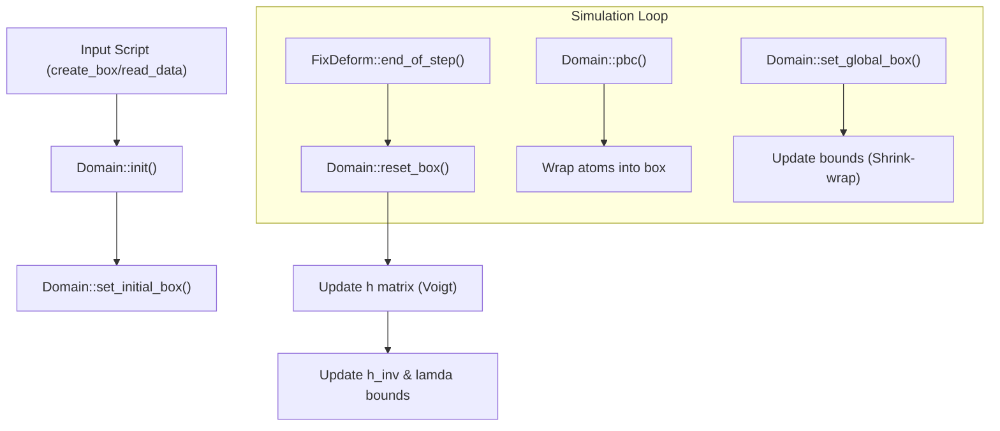
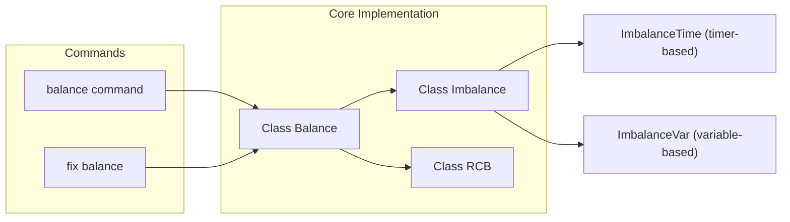

# Domain and System Manipulation

Relevant source files

The following files were used as context for generating this wiki page:

- [doc/src/Python_examples.rst](doc/src/Python_examples.rst)
- [doc/src/balance.rst](doc/src/balance.rst)
- [doc/src/change_box.rst](doc/src/change_box.rst)
- [doc/src/create_bonds.rst](doc/src/create_bonds.rst)
- [doc/src/delete_atoms.rst](doc/src/delete_atoms.rst)
- [doc/src/delete_bonds.rst](doc/src/delete_bonds.rst)
- [doc/src/dielectric.rst](doc/src/dielectric.rst)
- [doc/src/dimension.rst](doc/src/dimension.rst)
- [doc/src/displace_atoms.rst](doc/src/displace_atoms.rst)
- [doc/src/fix_balance.rst](doc/src/fix_balance.rst)
- [doc/src/fix_deform.rst](doc/src/fix_deform.rst)
- [doc/src/fix_deform_pressure.rst](doc/src/fix_deform_pressure.rst)
- [doc/src/region.rst](doc/src/region.rst)
- [examples/gjf/argon.lmp](examples/gjf/argon.lmp)
- [examples/gjf/ff-argon.lmp](examples/gjf/ff-argon.lmp)
- [src/EXTRA-FIX/fix_deform_pressure.cpp](src/EXTRA-FIX/fix_deform_pressure.cpp)
- [src/EXTRA-FIX/fix_deform_pressure.h](src/EXTRA-FIX/fix_deform_pressure.h)
- [src/balance.cpp](src/balance.cpp)
- [src/balance.h](src/balance.h)
- [src/change_box.cpp](src/change_box.cpp)
- [src/command.h](src/command.h)
- [src/create_bonds.cpp](src/create_bonds.cpp)
- [src/create_bonds.h](src/create_bonds.h)
- [src/create_box.cpp](src/create_box.cpp)
- [src/delete_atoms.cpp](src/delete_atoms.cpp)
- [src/delete_atoms.h](src/delete_atoms.h)
- [src/delete_bonds.cpp](src/delete_bonds.cpp)
- [src/displace_atoms.cpp](src/displace_atoms.cpp)
- [src/domain.cpp](src/domain.cpp)
- [src/domain.h](src/domain.h)
- [src/fix_balance.cpp](src/fix_balance.cpp)
- [src/fix_balance.h](src/fix_balance.h)
- [src/fix_box_relax.cpp](src/fix_box_relax.cpp)
- [src/fix_box_relax.h](src/fix_box_relax.h)
- [src/fix_deform.cpp](src/fix_deform.cpp)
- [src/fix_deform.h](src/fix_deform.h)
- [src/fix_gravity.cpp](src/fix_gravity.cpp)
- [src/fix_gravity.h](src/fix_gravity.h)
- [src/fix_langevin.cpp](src/fix_langevin.cpp)
- [src/fix_langevin.h](src/fix_langevin.h)
- [src/fix_move.cpp](src/fix_move.cpp)
- [src/fix_move.h](src/fix_move.h)
- [src/fix_nh.cpp](src/fix_nh.cpp)
- [src/fix_nh.h](src/fix_nh.h)
- [src/fix_press_berendsen.cpp](src/fix_press_berendsen.cpp)
- [src/fix_press_berendsen.h](src/fix_press_berendsen.h)
- [src/fix_temp_berendsen.cpp](src/fix_temp_berendsen.cpp)
- [src/fix_temp_berendsen.h](src/fix_temp_berendsen.h)
- [src/fix_temp_rescale.cpp](src/fix_temp_rescale.cpp)
- [src/fix_temp_rescale.h](src/fix_temp_rescale.h)
- [src/group.cpp](src/group.cpp)
- [src/group.h](src/group.h)
- [src/lattice.cpp](src/lattice.cpp)
- [src/lattice.h](src/lattice.h)
- [src/region.cpp](src/region.cpp)
- [src/region.h](src/region.h)
- [src/region_block.cpp](src/region_block.cpp)
- [src/region_block.h](src/region_block.h)
- [src/region_cone.cpp](src/region_cone.cpp)
- [src/region_cone.h](src/region_cone.h)
- [src/region_cylinder.cpp](src/region_cylinder.cpp)
- [src/region_cylinder.h](src/region_cylinder.h)
- [src/region_ellipsoid.cpp](src/region_ellipsoid.cpp)
- [src/region_ellipsoid.h](src/region_ellipsoid.h)
- [src/region_intersect.cpp](src/region_intersect.cpp)
- [src/region_intersect.h](src/region_intersect.h)
- [src/region_plane.cpp](src/region_plane.cpp)
- [src/region_prism.cpp](src/region_prism.cpp)
- [src/region_prism.h](src/region_prism.h)
- [src/region_sphere.cpp](src/region_sphere.cpp)
- [src/region_sphere.h](src/region_sphere.h)
- [src/region_union.cpp](src/region_union.cpp)
- [src/region_union.h](src/region_union.h)
- [src/velocity.cpp](src/velocity.cpp)
- [src/velocity.h](src/velocity.h)

This section documents the core components and commands responsible for managing the simulation box geometry, atom groupings, load balancing, and manual system modifications.

## Domain Geometry and the Domain Class

The `Domain` class is the central manager for the simulation box. It handles orthogonal and triclinic geometries, periodic boundary conditions (PBC), and coordinate transformations (e.g., between real space and scaled "lamda" coordinates).

### Simulation Box Types
*   **Orthogonal:** Defined by `boxlo` and `boxhi` arrays [src/domain.h:62]().
*   **Triclinic:** LAMMPS supports restricted triclinic boxes where tilt factors `xy`, `xz`, and `yz` represent the displacement of the upper face. The box is defined by a shape matrix `h` in Voigt notation [src/domain.h:89]().
*   **General Triclinic:** Support for arbitrary orientations is handled via rotation matrices `rotate_g2r` and `rotate_r2g` to map general coordinates to the restricted LAMMPS representation [src/domain.h:97-98]().

### Coordinate Transformations
LAMMPS frequently converts between Cartesian coordinates ($x$) and scaled coordinates ($\lambda \in [0, 1]$) for operations like atom migration and box deformation.
*   `x2lamda`: Converts Cartesian to scaled [src/domain.cpp:665]().
*   `lamda2x`: Converts scaled to Cartesian [src/domain.cpp:687]().

### Boundary Conditions
The `boundary` settings [src/domain.h:38]() define the behavior of the six faces:
1.  **Periodic:** Atoms wrap around via `pbc()` [src/domain.cpp:787]().
2.  **Fixed:** Non-periodic, atoms are lost if they leave the box.
3.  **Shrink-wrap:** Box boundaries reset to encompass all atoms [src/domain.cpp:486]().

### Logic Flow: Domain Initialization and Update
Title: Domain Geometry and Transformation Flow

Sources: [src/domain.h:28-188](), [src/domain.cpp:128-250](), [src/domain.cpp:787-820]()

---

## Box Manipulation Commands

### fix deform
`FixDeform` changes the simulation box size and/or shape over time. It can perform linear scaling, volume-conserving changes, or tilt factor modifications [src/fix_deform.cpp:48]().
*   **Remapping:** It can remap atom positions (`x`) or both positions and velocities (`v`) to stay consistent with the changing box [src/fix_deform.h:66]().
*   **Flipping:** For large shears, it triggers a box "flip" to maintain the tilt factors within the restricted range (tilt < 0.5 * box length) [src/fix_deform.cpp:698]().

### change_box
The `change_box` command performs a one-time modification of the simulation box, such as converting an orthogonal box to triclinic or resetting boundary conditions [src/change_box.cpp:18]().

Sources: [src/fix_deform.cpp:48-160](), [src/change_box.cpp:18-50]()

---

## Load Balancing

LAMMPS provides tools to balance the computational load across processors by adjusting the sub-domains assigned to each MPI rank.

### The Balance Class
The `Balance` class implements the core algorithms [src/balance.h:35]():
*   **Shift:** Adjusts the 1D cutting planes in a regular grid to equalize atom counts or computational costs [src/balance.cpp:523]().
*   **RCB (Recursive Coordinate Bisection):** Creates a tiled decomposition (non-grid) for highly inhomogeneous systems [src/balance.cpp:886]().

### Static vs. Dynamic Balancing
*   **balance command:** A one-time invocation via `Balance::command()` [src/balance.cpp:103]().
*   **fix balance:** Periodically invokes balancing during a simulation run [src/fix_balance.cpp:42]().

Title: Load Balancing Code Entity Mapping

Sources: [src/balance.h:35-95](), [src/balance.cpp:103-202](), [src/fix_balance.cpp:42-148]()

---

## System Manipulation Commands

### Grouping Atoms
The `Group` class manages collections of atoms. Groups are stored as bitmasks in the `atom->mask` array [src/group.cpp:64]().
*   **Static Groups:** Defined by ID, type, or region [src/group.cpp:101]().
*   **Dynamic Groups:** Updated every timestep based on a region or variable [src/group.cpp:655]().

### Atom Creation and Deletion
*   **delete_atoms:** Removes atoms based on group, region, or overlap. It can also "compress" or "condense" atom IDs to maintain a contiguous range [src/delete_atoms.cpp:66]().
*   **create_bonds:** Creates new bond interactions between atoms based on distance criteria, typically used for cross-linking [src/create_bonds.cpp:18]().

### Manual Movement and Initialization
*   **velocity:** Sets or changes atom velocities using various distributions (uniform, gaussian) or by ramping [src/velocity.cpp:49]().
*   **displace_atoms:** Directly shifts atom coordinates [src/displace_atoms.cpp:17]().
*   **fix move:** Constrains atoms to move along a specific trajectory (linear, wiggle, rotate) defined by variables [src/fix_move.cpp:49]().
*   **fix gravity:** Adds an external acceleration to a group of atoms [src/fix_gravity.cpp:18]().

### Region Management
Regions are geometric volumes (blocks, spheres, cylinders) used by groups, `delete_atoms`, and `fix wall`.
*   **Base Class:** `Region` [src/region.h:27]().
*   **Logic:** The `match(x, y, z)` function determines if a point is inside the volume [src/region.cpp:100]().

Sources: [src/group.cpp:64-95](), [src/delete_atoms.cpp:66-103](), [src/velocity.cpp:49-135](), [src/fix_move.cpp:49-192](), [src/region.h:27-80]()

---