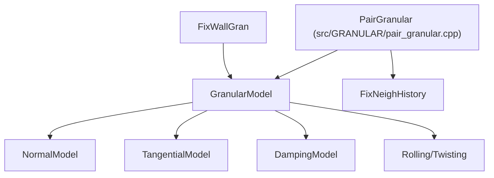
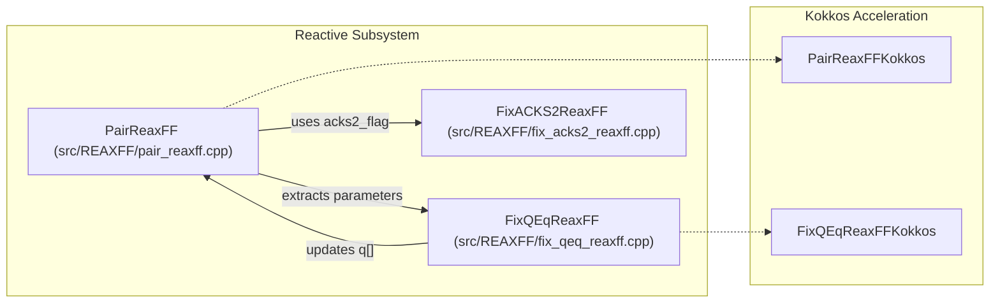

# Specialized Physics Packages

Relevant source files

The following files were used as context for generating this wiki page:

- [doc/src/fix_shake.rst](doc/src/fix_shake.rst)
- [doc/src/fix_wall_gran.rst](doc/src/fix_wall_gran.rst)
- [doc/src/fix_wall_gran_region.rst](doc/src/fix_wall_gran_region.rst)
- [examples/reaxff/in.reaxff.tatb](examples/reaxff/in.reaxff.tatb)
- [src/DIELECTRIC/atom_vec_dielectric.cpp](src/DIELECTRIC/atom_vec_dielectric.cpp)
- [src/DIELECTRIC/atom_vec_dielectric.h](src/DIELECTRIC/atom_vec_dielectric.h)
- [src/DIPOLE/atom_vec_dipole.h](src/DIPOLE/atom_vec_dipole.h)
- [src/EFF/fix_langevin_eff.cpp](src/EFF/fix_langevin_eff.cpp)
- [src/EXTRA-FIX/fix_tmd.cpp](src/EXTRA-FIX/fix_tmd.cpp)
- [src/GRANULAR/fix_wall_gran.cpp](src/GRANULAR/fix_wall_gran.cpp)
- [src/GRANULAR/fix_wall_gran.h](src/GRANULAR/fix_wall_gran.h)
- [src/GRANULAR/fix_wall_gran_region.cpp](src/GRANULAR/fix_wall_gran_region.cpp)
- [src/GRANULAR/fix_wall_gran_region.h](src/GRANULAR/fix_wall_gran_region.h)
- [src/GRANULAR/pair_gran_hertz_history.cpp](src/GRANULAR/pair_gran_hertz_history.cpp)
- [src/GRANULAR/pair_gran_hertz_history.h](src/GRANULAR/pair_gran_hertz_history.h)
- [src/GRANULAR/pair_gran_hooke.cpp](src/GRANULAR/pair_gran_hooke.cpp)
- [src/GRANULAR/pair_gran_hooke.h](src/GRANULAR/pair_gran_hooke.h)
- [src/GRANULAR/pair_gran_hooke_history.cpp](src/GRANULAR/pair_gran_hooke_history.cpp)
- [src/GRANULAR/pair_gran_hooke_history.h](src/GRANULAR/pair_gran_hooke_history.h)
- [src/GRANULAR/pair_granular.cpp](src/GRANULAR/pair_granular.cpp)
- [src/GRANULAR/pair_granular.h](src/GRANULAR/pair_granular.h)
- [src/KOKKOS/compute_reaxff_atom_kokkos.cpp](src/KOKKOS/compute_reaxff_atom_kokkos.cpp)
- [src/KOKKOS/compute_reaxff_atom_kokkos.h](src/KOKKOS/compute_reaxff_atom_kokkos.h)
- [src/KOKKOS/fix_acks2_reaxff_kokkos.cpp](src/KOKKOS/fix_acks2_reaxff_kokkos.cpp)
- [src/KOKKOS/fix_acks2_reaxff_kokkos.h](src/KOKKOS/fix_acks2_reaxff_kokkos.h)
- [src/KOKKOS/fix_neigh_history_kokkos.cpp](src/KOKKOS/fix_neigh_history_kokkos.cpp)
- [src/KOKKOS/fix_neigh_history_kokkos.h](src/KOKKOS/fix_neigh_history_kokkos.h)
- [src/KOKKOS/fix_qeq_reaxff_kokkos.cpp](src/KOKKOS/fix_qeq_reaxff_kokkos.cpp)
- [src/KOKKOS/fix_qeq_reaxff_kokkos.h](src/KOKKOS/fix_qeq_reaxff_kokkos.h)
- [src/KOKKOS/fix_shake_kokkos.cpp](src/KOKKOS/fix_shake_kokkos.cpp)
- [src/KOKKOS/fix_shake_kokkos.h](src/KOKKOS/fix_shake_kokkos.h)
- [src/KOKKOS/fix_wall_gran_kokkos.cpp](src/KOKKOS/fix_wall_gran_kokkos.cpp)
- [src/KOKKOS/fix_wall_gran_kokkos.h](src/KOKKOS/fix_wall_gran_kokkos.h)
- [src/KOKKOS/fix_wall_gran_old.cpp](src/KOKKOS/fix_wall_gran_old.cpp)
- [src/KOKKOS/pair_gran_hooke_history_kokkos.cpp](src/KOKKOS/pair_gran_hooke_history_kokkos.cpp)
- [src/KOKKOS/pair_gran_hooke_history_kokkos.h](src/KOKKOS/pair_gran_hooke_history_kokkos.h)
- [src/KOKKOS/pair_reaxff_kokkos.cpp](src/KOKKOS/pair_reaxff_kokkos.cpp)
- [src/KOKKOS/pair_reaxff_kokkos.h](src/KOKKOS/pair_reaxff_kokkos.h)
- [src/KSPACE/fix_tune_kspace.cpp](src/KSPACE/fix_tune_kspace.cpp)
- [src/KSPACE/fix_tune_kspace.h](src/KSPACE/fix_tune_kspace.h)
- [src/MACHDYN/atom_vec_smd.cpp](src/MACHDYN/atom_vec_smd.cpp)
- [src/MACHDYN/atom_vec_smd.h](src/MACHDYN/atom_vec_smd.h)
- [src/MACHDYN/fix_smd_adjust_dt.cpp](src/MACHDYN/fix_smd_adjust_dt.cpp)
- [src/PERI/atom_vec_peri.h](src/PERI/atom_vec_peri.h)
- [src/REAXFF/compute_reaxff_atom.cpp](src/REAXFF/compute_reaxff_atom.cpp)
- [src/REAXFF/compute_reaxff_atom.h](src/REAXFF/compute_reaxff_atom.h)
- [src/REAXFF/fix_acks2_reaxff.cpp](src/REAXFF/fix_acks2_reaxff.cpp)
- [src/REAXFF/fix_acks2_reaxff.h](src/REAXFF/fix_acks2_reaxff.h)
- [src/REAXFF/fix_qeq_reaxff.cpp](src/REAXFF/fix_qeq_reaxff.cpp)
- [src/RIGID/fix_rattle.cpp](src/RIGID/fix_rattle.cpp)
- [src/RIGID/fix_rattle.h](src/RIGID/fix_rattle.h)
- [src/RIGID/fix_shake.cpp](src/RIGID/fix_shake.cpp)
- [src/RIGID/fix_shake.h](src/RIGID/fix_shake.h)
- [src/SPIN/atom_vec_spin.cpp](src/SPIN/atom_vec_spin.cpp)
- [src/SPIN/atom_vec_spin.h](src/SPIN/atom_vec_spin.h)
- [src/SPIN/compute_spin.cpp](src/SPIN/compute_spin.cpp)
- [src/SPIN/compute_spin.h](src/SPIN/compute_spin.h)
- [src/SPIN/fix_langevin_spin.cpp](src/SPIN/fix_langevin_spin.cpp)
- [src/SPIN/fix_langevin_spin.h](src/SPIN/fix_langevin_spin.h)
- [src/SPIN/fix_nve_spin.cpp](src/SPIN/fix_nve_spin.cpp)
- [src/SPIN/fix_nve_spin.h](src/SPIN/fix_nve_spin.h)
- [src/SPIN/fix_precession_spin.cpp](src/SPIN/fix_precession_spin.cpp)
- [src/SPIN/fix_precession_spin.h](src/SPIN/fix_precession_spin.h)
- [src/SPIN/pair_spin.cpp](src/SPIN/pair_spin.cpp)
- [src/SPIN/pair_spin.h](src/SPIN/pair_spin.h)
- [src/SPIN/pair_spin_dipole_cut.cpp](src/SPIN/pair_spin_dipole_cut.cpp)
- [src/SPIN/pair_spin_dipole_long.cpp](src/SPIN/pair_spin_dipole_long.cpp)
- [src/SPIN/pair_spin_dmi.cpp](src/SPIN/pair_spin_dmi.cpp)
- [src/SPIN/pair_spin_dmi.h](src/SPIN/pair_spin_dmi.h)
- [src/SPIN/pair_spin_exchange.cpp](src/SPIN/pair_spin_exchange.cpp)
- [src/SPIN/pair_spin_exchange.h](src/SPIN/pair_spin_exchange.h)
- [src/SPIN/pair_spin_magelec.cpp](src/SPIN/pair_spin_magelec.cpp)
- [src/SPIN/pair_spin_magelec.h](src/SPIN/pair_spin_magelec.h)
- [src/SPIN/pair_spin_neel.cpp](src/SPIN/pair_spin_neel.cpp)
- [src/SPIN/pair_spin_neel.h](src/SPIN/pair_spin_neel.h)

LAMMPS includes a diverse set of specialized packages designed to simulate physics beyond standard molecular dynamics, including macroscopic granular materials, magnetic spin systems, and chemical reactions. These packages often introduce specific `atom_style` variants, unique time integrators, and complex sub-model architectures for force calculations.

## Granular Mechanics
The granular simulation capabilities in LAMMPS focus on macroscopic particles where contact mechanics, friction, and history-dependent forces are critical. The core of this system is the `pair_granular` style, which utilizes a modular architecture for defining contact models.

*   **Sub-model Architecture**: Interactions are decomposed into normal, damping, tangential, rolling, and twisting components [src/GRANULAR/pair_granular.cpp:94-119]().
*   **Contact History**: Forces often depend on the history of the contact (e.g., tangential displacement), managed via `FixNeighHistory` [src/GRANULAR/pair_granular.cpp:81-88]().
*   **Wall Interactions**: Specialized fixes like `fix wall/gran` and `fix wall/gran/region` allow particles to interact with complex geometries, including moving and oscillating boundaries [src/GRANULAR/fix_wall_gran.cpp:195-208](), [src/GRANULAR/fix_wall_gran_region.cpp:40-54]().

For details, see [Granular Mechanics](#7.1).

### Granular Code Mapping
The following diagram illustrates how the granular physics models are organized within the C++ class hierarchy.

| System Component | Code Entity | Role |
| :--- | :--- | :--- |
| Contact Manager | `PairGranular` | Main entry point for granular pair interactions [src/GRANULAR/pair_granular.h:42]() |
| Model Resolver | `GranularModel` | Dispatches specific physics to sub-models [src/GRANULAR/pair_granular.cpp:208-218]() |
| History Tracking | `FixNeighHistory` | Stores per-contact data like shear displacement [src/GRANULAR/pair_granular.cpp:25-30]() |
| Boundary Physics | `FixWallGran` | Handles particle-wall contact logic [src/GRANULAR/fix_wall_gran.h:35]() |

Sources: [src/GRANULAR/pair_granular.cpp:21-37](), [src/GRANULAR/fix_wall_gran.cpp:20-37](), [src/GRANULAR/pair_granular.h:35-50]()

## Spin Dynamics
The `SPIN` package enables the simulation of magnetic systems by treating atomic spins as classical vectors. It supports coupled MD and spin dynamics (MD-SD).

*   **Data Structures**: Uses `atom_vec_spin` to store magnetic moments and their orientations [src/SPIN/atom_vec_spin.cpp:25-40]().
*   **Integrators**: The `fix nve/spin` command implements a symplectic algorithm for evolving spin orientations [src/SPIN/fix_nve_spin.cpp:47-59]().
*   **Interactions**: Includes exchange, Dzyaloshinskii-Moriya (DMI), Neel anisotropy, and dipole-dipole interactions [src/SPIN/fix_nve_spin.cpp:165-183]().

For details, see [Spin Dynamics](#7.2).

## Reactive Force Fields
Reactive force fields allow for the breaking and forming of chemical bonds during a simulation. LAMMPS provides high-performance implementations of several major reactive models.

*   **ReaxFF**: A bond-order-based potential. The `pair_reaxff` style handles complex many-body interactions, often coupled with charge equilibration [src/KOKKOS/pair_reaxff_kokkos.cpp:57-68]().
*   **Charge Equilibration (QEq)**: Methods like `fix qeq/reaxff` and `fix acks2/reaxff` dynamically update atomic charges to minimize electrostatic energy [src/REAXFF/fix_qeq_reaxff.cpp:69-80](), [src/KOKKOS/fix_qeq_reaxff_kokkos.cpp:53-65]().
*   **COMB**: The Charge-Optimized Many-Body potentials integrate bond-order terms with variable charges.

For details, see [Reactive Force Fields](#7.3).

### Reactive Physics Code Mapping
This diagram shows the relationship between the ReaxFF force calculation and the required charge equilibration fixes.

Sources: [src/KOKKOS/pair_reaxff_kokkos.cpp:165-185](), [src/KOKKOS/fix_qeq_reaxff_kokkos.cpp:53-83](), [src/REAXFF/fix_qeq_reaxff.cpp:151-162]()

## Coarse-Grained and Mesoscale Models
LAMMPS includes several packages for simulating systems at length and time scales beyond atomistic MD.

*   **CG-DNA**: Specialized models for DNA/RNA (e.g., oxDNA) that use rigid-body interactions to represent nucleotides.
*   **Mesoscale Hydrodynamics**: The `RHEO` and `SRD` packages provide methods for fluid flow, while `DPD-REACT` handles dissipative particle dynamics with chemical reactions.
*   **Constraint Solvers**: The `RIGID` package provides `fix shake` and `fix rattle` for maintaining rigid bond and angle constraints in molecular systems [src/RIGID/fix_shake.cpp:49-65](), [src/KOKKOS/fix_shake_kokkos.cpp:39-50]().

For details, see [Coarse-Grained and Mesoscale Models](#7.4).

Sources: [src/RIGID/fix_shake.cpp:78-90](), [src/KOKKOS/fix_shake_kokkos.cpp:153-162]()

---