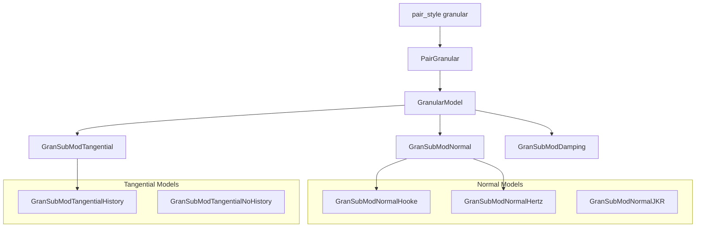
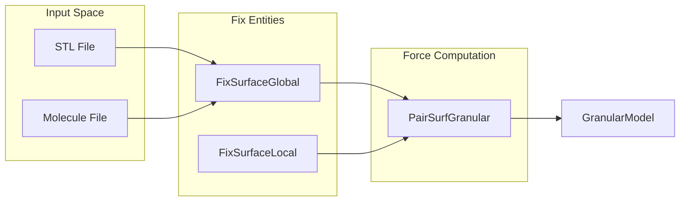

# Granular Mechanics

Relevant source files

The following files were used as context for generating this wiki page:

- [doc/src/Errors_messages.rst](doc/src/Errors_messages.rst)
- [doc/src/Errors_warnings.rst](doc/src/Errors_warnings.rst)
- [doc/src/Howto_granular.rst](doc/src/Howto_granular.rst)
- [doc/src/Howto_granular_surfaces.rst](doc/src/Howto_granular_surfaces.rst)
- [doc/src/Howto_spherical.rst](doc/src/Howto_spherical.rst)
- [doc/src/fix_surface_global.rst](doc/src/fix_surface_global.rst)
- [doc/src/fix_surface_local.rst](doc/src/fix_surface_local.rst)
- [doc/src/fix_wall_gran.rst](doc/src/fix_wall_gran.rst)
- [doc/src/fix_wall_gran_region.rst](doc/src/fix_wall_gran_region.rst)
- [doc/src/img/gransurf_T_geom.png](doc/src/img/gransurf_T_geom.png)
- [doc/src/img/gransurf_U_geom.png](doc/src/img/gransurf_U_geom.png)
- [doc/src/img/gransurf_consistent_side.png](doc/src/img/gransurf_consistent_side.png)
- [doc/src/img/gransurf_mixer.png](doc/src/img/gransurf_mixer.png)
- [doc/src/img/gransurf_nonflat_turn.png](doc/src/img/gransurf_nonflat_turn.png)
- [doc/src/img/mixer-drum.jpg](doc/src/img/mixer-drum.jpg)
- [doc/src/molecule.rst](doc/src/molecule.rst)
- [doc/src/pair_granular.rst](doc/src/pair_granular.rst)
- [doc/src/pair_granular_superellipsoid.rst](doc/src/pair_granular_superellipsoid.rst)
- [doc/src/pair_surf_granular.rst](doc/src/pair_surf_granular.rst)
- [doc/src/pair_tracker.rst](doc/src/pair_tracker.rst)
- [examples/ASPHERE/superellipsoid_gran/in.bowling](examples/ASPHERE/superellipsoid_gran/in.bowling)
- [examples/ASPHERE/superellipsoid_gran/in.drop_test](examples/ASPHERE/superellipsoid_gran/in.drop_test)
- [examples/ASPHERE/superellipsoid_gran/in.ellipsoid_gran](examples/ASPHERE/superellipsoid_gran/in.ellipsoid_gran)
- [examples/bpm/pour/in.bpm.pour](examples/bpm/pour/in.bpm.pour)
- [examples/granular/in.tableting.200](examples/granular/in.tableting.200)
- [examples/granular/in.triaxial.compaction.12](examples/granular/in.triaxial.compaction.12)
- [examples/granular/log.4Feb25.tableting.200.g++.1](examples/granular/log.4Feb25.tableting.200.g++.1)
- [examples/granular/log.4Feb25.triaxial.compaction.12.g++.1](examples/granular/log.4Feb25.triaxial.compaction.12.g++.1)
- [src/ASPHERE/math_extra_superellipsoids.cpp](src/ASPHERE/math_extra_superellipsoids.cpp)
- [src/ASPHERE/math_extra_superellipsoids.h](src/ASPHERE/math_extra_superellipsoids.h)
- [src/ASPHERE/pair_granular_superellipsoid.cpp](src/ASPHERE/pair_granular_superellipsoid.cpp)
- [src/ASPHERE/pair_granular_superellipsoid.h](src/ASPHERE/pair_granular_superellipsoid.h)
- [src/BPM/fix_update_special_bonds.cpp](src/BPM/fix_update_special_bonds.cpp)
- [src/BPM/fix_update_special_bonds.h](src/BPM/fix_update_special_bonds.h)
- [src/EFF/fix_langevin_eff.cpp](src/EFF/fix_langevin_eff.cpp)
- [src/EXTRA-FIX/fix_tmd.cpp](src/EXTRA-FIX/fix_tmd.cpp)
- [src/GRANSURF/fix_surface.cpp](src/GRANSURF/fix_surface.cpp)
- [src/GRANSURF/fix_surface.h](src/GRANSURF/fix_surface.h)
- [src/GRANSURF/fix_surface_global.cpp](src/GRANSURF/fix_surface_global.cpp)
- [src/GRANSURF/fix_surface_global.h](src/GRANSURF/fix_surface_global.h)
- [src/GRANSURF/fix_surface_local.cpp](src/GRANSURF/fix_surface_local.cpp)
- [src/GRANSURF/fix_surface_local.h](src/GRANSURF/fix_surface_local.h)
- [src/GRANSURF/pair_surf_granular.cpp](src/GRANSURF/pair_surf_granular.cpp)
- [src/GRANSURF/pair_surf_granular.h](src/GRANSURF/pair_surf_granular.h)
- [src/GRANSURF/surf_extra.cpp](src/GRANSURF/surf_extra.cpp)
- [src/GRANSURF/surf_extra.h](src/GRANSURF/surf_extra.h)
- [src/GRANULAR/fix_granular_mdr.cpp](src/GRANULAR/fix_granular_mdr.cpp)
- [src/GRANULAR/fix_granular_mdr.h](src/GRANULAR/fix_granular_mdr.h)
- [src/GRANULAR/fix_wall_gran.cpp](src/GRANULAR/fix_wall_gran.cpp)
- [src/GRANULAR/fix_wall_gran.h](src/GRANULAR/fix_wall_gran.h)
- [src/GRANULAR/fix_wall_gran_region.cpp](src/GRANULAR/fix_wall_gran_region.cpp)
- [src/GRANULAR/fix_wall_gran_region.h](src/GRANULAR/fix_wall_gran_region.h)
- [src/GRANULAR/gran_sub_mod.cpp](src/GRANULAR/gran_sub_mod.cpp)
- [src/GRANULAR/gran_sub_mod.h](src/GRANULAR/gran_sub_mod.h)
- [src/GRANULAR/gran_sub_mod_damping.cpp](src/GRANULAR/gran_sub_mod_damping.cpp)
- [src/GRANULAR/gran_sub_mod_damping.h](src/GRANULAR/gran_sub_mod_damping.h)
- [src/GRANULAR/gran_sub_mod_heat.cpp](src/GRANULAR/gran_sub_mod_heat.cpp)
- [src/GRANULAR/gran_sub_mod_heat.h](src/GRANULAR/gran_sub_mod_heat.h)
- [src/GRANULAR/gran_sub_mod_normal.cpp](src/GRANULAR/gran_sub_mod_normal.cpp)
- [src/GRANULAR/gran_sub_mod_normal.h](src/GRANULAR/gran_sub_mod_normal.h)
- [src/GRANULAR/gran_sub_mod_rolling.cpp](src/GRANULAR/gran_sub_mod_rolling.cpp)
- [src/GRANULAR/gran_sub_mod_rolling.h](src/GRANULAR/gran_sub_mod_rolling.h)
- [src/GRANULAR/gran_sub_mod_tangential.cpp](src/GRANULAR/gran_sub_mod_tangential.cpp)
- [src/GRANULAR/gran_sub_mod_tangential.h](src/GRANULAR/gran_sub_mod_tangential.h)
- [src/GRANULAR/gran_sub_mod_twisting.cpp](src/GRANULAR/gran_sub_mod_twisting.cpp)
- [src/GRANULAR/gran_sub_mod_twisting.h](src/GRANULAR/gran_sub_mod_twisting.h)
- [src/GRANULAR/granular_model.cpp](src/GRANULAR/granular_model.cpp)
- [src/GRANULAR/granular_model.h](src/GRANULAR/granular_model.h)
- [src/GRANULAR/pair_gran_hertz_history.cpp](src/GRANULAR/pair_gran_hertz_history.cpp)
- [src/GRANULAR/pair_gran_hertz_history.h](src/GRANULAR/pair_gran_hertz_history.h)
- [src/GRANULAR/pair_gran_hooke.cpp](src/GRANULAR/pair_gran_hooke.cpp)
- [src/GRANULAR/pair_gran_hooke.h](src/GRANULAR/pair_gran_hooke.h)
- [src/GRANULAR/pair_gran_hooke_history.cpp](src/GRANULAR/pair_gran_hooke_history.cpp)
- [src/GRANULAR/pair_gran_hooke_history.h](src/GRANULAR/pair_gran_hooke_history.h)
- [src/GRANULAR/pair_granular.cpp](src/GRANULAR/pair_granular.cpp)
- [src/GRANULAR/pair_granular.h](src/GRANULAR/pair_granular.h)
- [src/KOKKOS/fix_wall_gran_old.cpp](src/KOKKOS/fix_wall_gran_old.cpp)
- [src/KSPACE/fix_tune_kspace.cpp](src/KSPACE/fix_tune_kspace.cpp)
- [src/KSPACE/fix_tune_kspace.h](src/KSPACE/fix_tune_kspace.h)
- [src/MACHDYN/fix_smd_adjust_dt.cpp](src/MACHDYN/fix_smd_adjust_dt.cpp)
- [src/MISC/pair_tracker.cpp](src/MISC/pair_tracker.cpp)
- [src/MISC/pair_tracker.h](src/MISC/pair_tracker.h)
- [src/OPENMP/fix_neigh_history_omp.cpp](src/OPENMP/fix_neigh_history_omp.cpp)
- [src/fix_neigh_history.cpp](src/fix_neigh_history.cpp)
- [src/fix_neigh_history.h](src/fix_neigh_history.h)
- [src/fix_store_local.cpp](src/fix_store_local.cpp)
- [src/fix_store_local.h](src/fix_store_local.h)
- [src/molecule.cpp](src/molecule.cpp)
- [src/molecule.h](src/molecule.h)
- [tools/json/molecule-schema.json](tools/json/molecule-schema.json)
- [unittest/utils/test_math_extra_superellipsoids.cpp](unittest/utils/test_math_extra_superellipsoids.cpp)

The granular mechanics implementation in LAMMPS provides a flexible framework for simulating macroscopic particles where contact forces are governed by normal, tangential, damping, rolling, and twisting models. The system is designed around a sub-model architecture that allows users to mix and match different physical interactions for both particle-particle and particle-wall contacts.

## Granular Model Architecture

The core of the granular system is the `GranularModel` class, which manages a collection of sub-models representing different components of the contact force. This architecture separates the geometric contact detection from the force calculation logic.

### Sub-Model Hierarchy
Granular interactions are decomposed into five primary modes, each represented by a specialized class inheriting from `GranSubMod`:
*   **Normal**: Elastic repulsion (e.g., Hooke, Hertz, JKR, DMT, MDR) [`src/GRANULAR/gran_sub_mod_normal.cpp:86-90`]().
*   **Damping**: Dissipative forces (e.g., Viscoelastic, Tsuji) [`src/GRANULAR/gran_sub_mod_damping.cpp:20-24`]().
*   **Tangential**: Friction and shear history (e.g., Mindlin, Cundall-Strack) [`src/GRANULAR/gran_sub_mod_tangential.cpp:24-28`]().
*   **Rolling**: Resistance to rolling motion [`src/GRANULAR/gran_sub_mod_rolling.cpp:20-24`]().
*   **Twisting**: Resistance to twisting/torsion [`src/GRANULAR/gran_sub_mod.h:20-25`]().

### Data Flow for Contact Calculation
When a contact is detected, the `PairGranular::compute` function iterates through active models. The `GranularModel` object serves as a container for geometric data (overlap, contact radius, relative velocity) which is then accessed by the sub-models to compute individual force components.

| Component | Code Entity | Role |
| :--- | :--- | :--- |
| **Manager** | `GranularModel` | Coordinates sub-models and stores shared contact state [`src/GRANULAR/granular_model.h:35-40`](). |
| **Normal Force** | `GranSubModNormal` | Calculates $F_n$ based on overlap $\delta$ [`src/GRANULAR/gran_sub_mod_normal.cpp:161-164`](). |
| **History** | `FixNeighHistory` | Stores per-contact shear displacement across timesteps [`src/fix_neigh_history.cpp:45-50`](). |
| **Wall** | `FixWallGran` | Applies granular models to analytical wall surfaces [`src/GRANULAR/fix_wall_gran.cpp:57-60`](). |

**Sources:** [`src/GRANULAR/pair_granular.cpp:200-240`](), [`src/GRANULAR/granular_model.cpp:25-35`](), [`src/GRANULAR/gran_sub_mod_normal.cpp:14-30`]().

## Pair Potentials: pair_granular

The `pair_granular` style is the primary interface for particle-particle interactions. It supports multi-type interactions where different pairs of atom types can use different contact models.

### Implementation Details
*   **History Management**: Many granular models (like `tangential history`) require storing the accumulated shear displacement. `PairGranular` utilizes `FixNeighHistory` to manage this per-atom-pair data [`src/GRANULAR/pair_granular.cpp:85-92`]().
*   **Effective Mass**: The model accounts for whether particles are part of a rigid body using `mass_rigid`. If a particle is part of a rigid body, its total body mass is used to calculate the effective mass $m_{eff}$ for damping terms [`src/GRANULAR/pair_granular.cpp:237-243`]().
*   **Newton's Third Law**: Granular pair styles typically use `newton off` because torques and shear history are direction-dependent and stored relative to specific atom pairs.

### System Mapping: Pair Styles to Code
The following diagram maps the user-facing `pair_style granular` keywords to the internal class structure.

**Sources:** [`src/GRANULAR/pair_granular.h:30-50`](), [`doc/src/pair_granular.rst:52-60`](), [`src/GRANULAR/gran_sub_mod_normal.h:20-40`]().

## Granular Walls and Regions

LAMMPS provides several fixes to simulate boundaries for granular particles.

### fix wall/gran
This fix handles interactions with simple analytical planes (x, y, z). It instantiates its own `GranularModel` to calculate forces between particles and the wall [`src/GRANULAR/fix_wall_gran.cpp:70-72`](). It supports moving walls via `wiggle` or `variable` commands to simulate vibrating containers or shear cells [`src/GRANULAR/fix_wall_gran.cpp:195-200`]().

### fix wall/gran/region
Extends granular wall capabilities to complex geometries defined by the `region` command. It calculates the distance from a particle to the nearest surface of the region and applies the granular contact force [`src/GRANULAR/fix_wall_gran_region.cpp:20-30`].

**Sources:** [`src/GRANULAR/fix_wall_gran.cpp:57-120`](), [`doc/src/fix_wall_gran.rst:49-60`]().

## Complex Surfaces: The GRANSURF Package

The `GRANSURF` package allows granular particles to interact with complex surfaces defined by meshes of line segments (2D) or triangles (3D).

### Surface Definitions
Surfaces are loaded via `molecule` templates or STL files:
*   **fix surface/global**: Stores a single global mesh. All processors have access to the mesh data, which is suitable for stationary or simple moving boundaries [`src/GRANSURF/fix_surface_global.cpp:120-135`]().
*   **fix surface/local**: Distributes mesh elements (lines/tris) across processors as "surface atoms." This allows for massive meshes and complex mesh dynamics where the surface itself is treated as a collection of particles [`src/GRANSURF/fix_surface_local.cpp:170-185`]().

### Contact Logic: pair surf/granular
The `pair surf/granular` style computes interactions between spheres and the mesh elements managed by the `fix surface` classes. It includes logic to handle "composite contacts" where a sphere might overlap multiple adjacent triangles or edges simultaneously, ensuring force continuity [`src/GRANSURF/pair_surf_granular.cpp:200-210`]().

**Sources:** [`src/GRANSURF/fix_surface_global.cpp:82-110`](), [`src/GRANSURF/pair_surf_granular.cpp:69-80`](), [`doc/src/Howto_granular_surfaces.rst:10-30`]().

## Superellipsoid Granular Particles

LAMMPS supports non-spherical granular particles through superellipsoids. These are particles whose shape is defined by:
$$f(x,y,z) = \left( \left| \frac{x}{a} \right|^{\frac{2}{\epsilon_2}} + \left| \frac{y}{b} \right|^{\frac{2}{\epsilon_2}} \right)^{\frac{\epsilon_2}{\epsilon_1}} + \left| \frac{z}{c} \right|^{\frac{2}{\epsilon_1}} = 1$$

### Implementation
*   **MathExtraSuperellipsoid**: Contains the numerical solvers required to find the point of closest approach and the surface normal for two interacting superellipsoids [`src/ASPHERE/math_extra_superellipsoids.cpp:20-40`].
*   **Integration**: Superellipsoids require `atom_style body` or specialized aspherical integrators to track orientation and angular momentum [`examples/ASPHERE/superellipsoid_gran/in.ellipsoid_gran:5-15`]().

**Sources:** [`src/ASPHERE/math_extra_superellipsoids.h:15-30`](), [`examples/ASPHERE/superellipsoid_gran/in.drop_test:1-20`]().

---