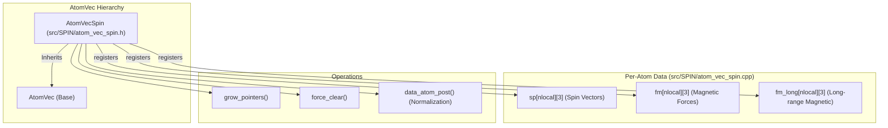
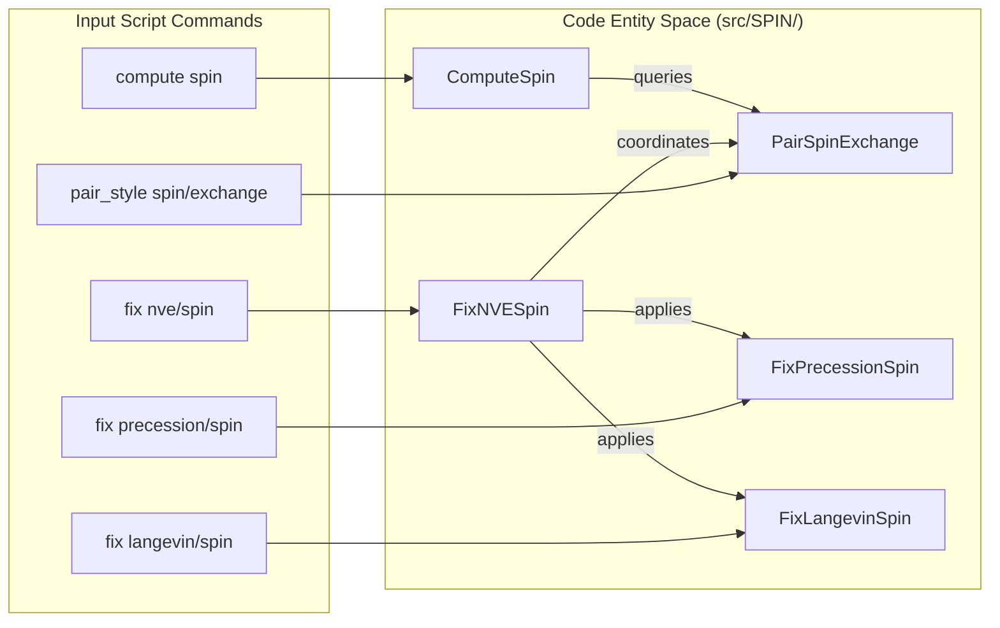

# Spin Dynamics

Relevant source files

The following files were used as context for generating this wiki page:

- [src/DIELECTRIC/atom_vec_dielectric.cpp](src/DIELECTRIC/atom_vec_dielectric.cpp)
- [src/DIELECTRIC/atom_vec_dielectric.h](src/DIELECTRIC/atom_vec_dielectric.h)
- [src/DIPOLE/atom_vec_dipole.h](src/DIPOLE/atom_vec_dipole.h)
- [src/MACHDYN/atom_vec_smd.cpp](src/MACHDYN/atom_vec_smd.cpp)
- [src/MACHDYN/atom_vec_smd.h](src/MACHDYN/atom_vec_smd.h)
- [src/PERI/atom_vec_peri.h](src/PERI/atom_vec_peri.h)
- [src/SPIN/atom_vec_spin.cpp](src/SPIN/atom_vec_spin.cpp)
- [src/SPIN/atom_vec_spin.h](src/SPIN/atom_vec_spin.h)
- [src/SPIN/compute_spin.cpp](src/SPIN/compute_spin.cpp)
- [src/SPIN/compute_spin.h](src/SPIN/compute_spin.h)
- [src/SPIN/fix_langevin_spin.cpp](src/SPIN/fix_langevin_spin.cpp)
- [src/SPIN/fix_langevin_spin.h](src/SPIN/fix_langevin_spin.h)
- [src/SPIN/fix_nve_spin.cpp](src/SPIN/fix_nve_spin.cpp)
- [src/SPIN/fix_nve_spin.h](src/SPIN/fix_nve_spin.h)
- [src/SPIN/fix_precession_spin.cpp](src/SPIN/fix_precession_spin.cpp)
- [src/SPIN/fix_precession_spin.h](src/SPIN/fix_precession_spin.h)
- [src/SPIN/pair_spin.cpp](src/SPIN/pair_spin.cpp)
- [src/SPIN/pair_spin.h](src/SPIN/pair_spin.h)
- [src/SPIN/pair_spin_dipole_cut.cpp](src/SPIN/pair_spin_dipole_cut.cpp)
- [src/SPIN/pair_spin_dipole_long.cpp](src/SPIN/pair_spin_dipole_long.cpp)
- [src/SPIN/pair_spin_dmi.cpp](src/SPIN/pair_spin_dmi.cpp)
- [src/SPIN/pair_spin_dmi.h](src/SPIN/pair_spin_dmi.h)
- [src/SPIN/pair_spin_exchange.cpp](src/SPIN/pair_spin_exchange.cpp)
- [src/SPIN/pair_spin_exchange.h](src/SPIN/pair_spin_exchange.h)
- [src/SPIN/pair_spin_magelec.cpp](src/SPIN/pair_spin_magelec.cpp)
- [src/SPIN/pair_spin_magelec.h](src/SPIN/pair_spin_magelec.h)
- [src/SPIN/pair_spin_neel.cpp](src/SPIN/pair_spin_neel.cpp)
- [src/SPIN/pair_spin_neel.h](src/SPIN/pair_spin_neel.h)

The **SPIN** package in LAMMPS enables the simulation of atomic magnetic moments (spins) coupled with molecular dynamics. It implements a massively parallel symplectic algorithm to solve the stochastic Landau-Lifshitz-Gilbert (LLG) equations for spin evolution, potentially coupled with the velocity Verlet integrator for lattice dynamics.

### Core Data Structures and Atom Representation

Magnetic simulations require the `atom_style spin`, which is managed by the `AtomVecSpin` class. This class extends the standard atomic data to include spin vectors and magnetic forces (torques).

*   **Spin Vector (`sp`)**: A 3D unit vector representing the magnetic moment direction for each atom `[src/SPIN/atom_vec_spin.cpp:52-62]()`.
*   **Magnetic Force (`fm`, `fm_long`)**: Represents the effective magnetic field (torque) acting on the spins `[src/SPIN/atom_vec_spin.cpp:52-56]()`.
*   **Normalization**: The spin vectors are automatically normalized to unit length during initialization and integration `[src/SPIN/atom_vec_spin.cpp:97-104]()`.

#### Spin Data Flow Diagram
This diagram shows how spin-specific data is registered and handled within the `AtomVec` hierarchy.

**Sources:** `[src/SPIN/atom_vec_spin.h:27-46]()`, `[src/SPIN/atom_vec_spin.cpp:37-66]()`.

---

### Time Integration: Fix NVE/Spin

The primary integrator for spin systems is `fix nve/spin`. It implements a symplectic decomposition to update spin orientations. If the `lattice` option is enabled, it simultaneously integrates atomic positions and velocities using a standard NVE approach `[src/SPIN/fix_nve_spin.cpp:97-109]()`.

*   **Symplectic Algorithm**: Updates spins using a sequence of rotations based on the effective field `[src/SPIN/fix_nve_spin.cpp:49-58]()`.
*   **Sectoring**: For parallel execution, the fix utilizes a sectoring algorithm to handle spin updates across processor boundaries without violating the symplectic nature of the integrator `[src/SPIN/fix_nve_spin.cpp:88-90]()`.
*   **Interaction Management**: `FixNVESpin` caches pointers to all active magnetic pair styles and fixes (precession, Langevin) to efficiently calculate the total effective field `[src/SPIN/fix_nve_spin.cpp:163-230]()`.

**Sources:** `[src/SPIN/fix_nve_spin.h:27-98]()`, `[src/SPIN/fix_nve_spin.cpp:63-124]()`.

---

### Magnetic Interactions (Pair Spin Styles)

Magnetic interactions are implemented as `PairSpin` styles. Unlike standard pair styles that return forces, these styles primarily contribute to the effective magnetic field `fm` and the magnetic energy `emag` `[src/SPIN/pair_spin.cpp:45-53]()`.

| Style | Class | Description |
| :--- | :--- | :--- |
| `exchange` | `PairSpinExchange` | Heisenberg exchange interaction (J1, J2, J3) `[src/SPIN/pair_spin_exchange.h:25]()` |
| `dmi` | `PairSpinDmi` | Dzyaloshinskii-Moriya interaction `[src/SPIN/pair_spin_dmi.h:25]()` |
| `neel` | `PairSpinNeel` | Neel surface anisotropy (spin-lattice coupling) `[src/SPIN/pair_spin_neel.h:25]()` |
| `magelec` | `PairSpinMagelec` | Magneto-electric coupling `[src/SPIN/pair_spin_magelec.h:25]()` |
| `dipole/cut` | `PairSpinDipoleCut` | Short-range magnetic dipole-dipole interaction |

#### Implementation Pattern
Every `PairSpin` style must:
1.  Inherit from `PairSpin` `[src/SPIN/pair_spin.h:28]()`.
2.  Request a **Full** neighbor list `[src/SPIN/pair_spin.cpp:92]()`.
3.  Calculate the torque/field: $\mathbf{H}_{i} = \sum_j J_{ij} \mathbf{S}_j$.
4.  Optionally calculate mechanical forces if `lattice_flag` is active (spin-lattice coupling) `[src/SPIN/pair_spin_exchange.cpp:258-262]()`.

**Sources:** `[src/SPIN/pair_spin.cpp:74-106]()`, `[src/SPIN/pair_spin_exchange.cpp:209-236]()`, `[src/SPIN/pair_spin_neel.cpp:203-240]()`.

---

### Thermal and External Fields

#### Fix Langevin/Spin
Implements the stochastic part of the LLG equation. It adds a damping torque (Gilbert damping) and a random noise torque (thermal fluctuations) to the effective field `[src/SPIN/fix_langevin_spin.cpp:131-162]()`.
*   **Gilbert Damping**: Controlled by the `alpha_t` parameter `[src/SPIN/fix_langevin_spin.cpp:52]()`.
*   **Temperature**: The noise strength is scaled according to the Fluctuation-Dissipation Theorem `[src/SPIN/fix_langevin_spin.cpp:109-115]()`.

#### Fix Precession/Spin
Applies external magnetic fields and anisotropy torques:
*   **Zeeman**: Interaction with an external field $\mathbf{H}$ `[src/SPIN/fix_precession_spin.cpp:89-96]()`.
*   **Anisotropy**: Uniaxial, Cubic, or Hexagonal anisotropy terms `[src/SPIN/fix_precession_spin.cpp:105-140]()`.

**Sources:** `[src/SPIN/fix_langevin_spin.cpp:46-75]()`, `[src/SPIN/fix_precession_spin.cpp:48-86]()`.

---

### Analysis and Diagnostics

#### Compute Spin
The `compute spin` command calculates global magnetic properties `[src/SPIN/compute_spin.cpp:45-64]()`:
1.  **Total Magnetization**: Sum of all spin vectors `[src/SPIN/compute_spin.cpp:194-196]()`.
2.  **Magnetic Energy**: Sum of energies from all `PairSpin` and `FixPrecessionSpin` styles `[src/SPIN/compute_spin.cpp:200-212]()`.
3.  **Spin Temperature**: Calculated based on the average torque (Nurdin et al. formula) `[src/SPIN/compute_spin.cpp:214-219]()`.

#### System Integration Diagram
This diagram associates user-facing simulation components with their C++ implementation classes.

**Sources:** `[src/SPIN/fix_nve_spin.h:16]()`, `[src/SPIN/pair_spin_exchange.h:25]()`, `[src/SPIN/fix_precession_spin.h:16]()`, `[src/SPIN/compute_spin.h:25]()`.

---

### Nudged Elastic Band (NEB) for Spins
The package supports `fix neb/spin` (handled via the `NEB` command) to find minimum energy paths for magnetic transitions (e.g., spin flips or skyrmion migration). It adapts the NEB algorithm to operate on the curved manifold of unit spin vectors.

**Sources:** `[src/SPIN/pair_spin.cpp:81-83]()`.

---