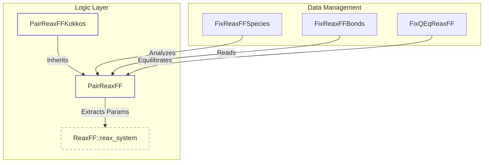
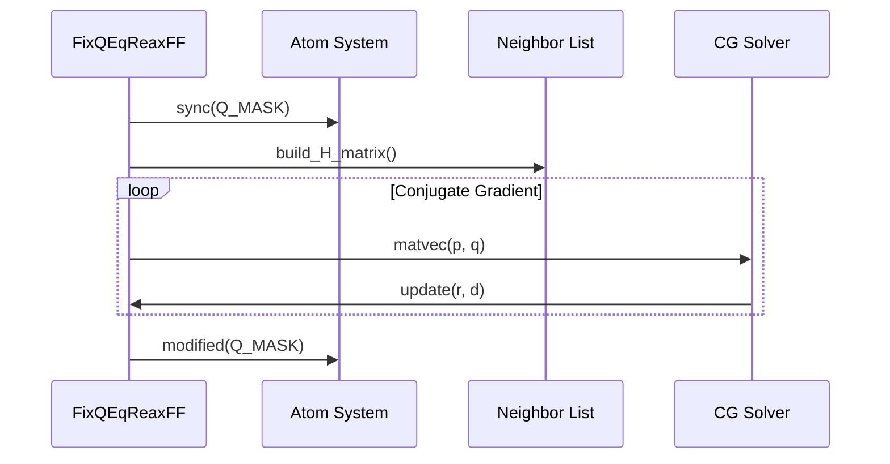

# Reactive Force Fields

Relevant source files

The following files were used as context for generating this wiki page:

- [doc/src/Build_windows.rst](doc/src/Build_windows.rst)
- [doc/src/Developer_code_design.rst](doc/src/Developer_code_design.rst)
- [doc/src/Developer_notes.rst](doc/src/Developer_notes.rst)
- [doc/src/Developer_platform.rst](doc/src/Developer_platform.rst)
- [doc/src/Errors_bugs.rst](doc/src/Errors_bugs.rst)
- [doc/src/Intro_website.rst](doc/src/Intro_website.rst)
- [doc/src/Modify.rst](doc/src/Modify.rst)
- [doc/src/Modify_atom.rst](doc/src/Modify_atom.rst)
- [doc/src/Modify_contribute.rst](doc/src/Modify_contribute.rst)
- [doc/src/Modify_overview.rst](doc/src/Modify_overview.rst)
- [doc/src/Modify_requirements.rst](doc/src/Modify_requirements.rst)
- [doc/src/Modify_style.rst](doc/src/Modify_style.rst)
- [doc/src/Modify_thermo.rst](doc/src/Modify_thermo.rst)
- [doc/src/Modify_variable.rst](doc/src/Modify_variable.rst)
- [doc/src/fix_acks2_reaxff.rst](doc/src/fix_acks2_reaxff.rst)
- [doc/src/fix_modify.rst](doc/src/fix_modify.rst)
- [doc/src/fix_qeq.rst](doc/src/fix_qeq.rst)
- [doc/src/fix_qeq_comb.rst](doc/src/fix_qeq_comb.rst)
- [doc/src/fix_qeq_reaxff.rst](doc/src/fix_qeq_reaxff.rst)
- [doc/src/fix_qeq_rel_reaxff.rst](doc/src/fix_qeq_rel_reaxff.rst)
- [doc/src/fix_qtpie_reaxff.rst](doc/src/fix_qtpie_reaxff.rst)
- [doc/src/fix_reaxff_bonds.rst](doc/src/fix_reaxff_bonds.rst)
- [doc/src/fix_reaxff_species.rst](doc/src/fix_reaxff_species.rst)
- [doc/src/fix_shake.rst](doc/src/fix_shake.rst)
- [doc/src/pair_coul.rst](doc/src/pair_coul.rst)
- [examples/reaxff/in.reaxff.tatb](examples/reaxff/in.reaxff.tatb)
- [src/APIP/pair_eam_apip.cpp](src/APIP/pair_eam_apip.cpp)
- [src/APIP/pair_eam_apip.h](src/APIP/pair_eam_apip.h)
- [src/APIP/pair_eam_fs_apip.cpp](src/APIP/pair_eam_fs_apip.cpp)
- [src/APIP/pair_eam_fs_apip.h](src/APIP/pair_eam_fs_apip.h)
- [src/APIP/pair_pace_apip.cpp](src/APIP/pair_pace_apip.cpp)
- [src/APIP/pair_pace_apip.h](src/APIP/pair_pace_apip.h)
- [src/APIP/pair_pace_fast_apip.cpp](src/APIP/pair_pace_fast_apip.cpp)
- [src/APIP/pair_pace_fast_apip.h](src/APIP/pair_pace_fast_apip.h)
- [src/APIP/pair_pace_precise_apip.cpp](src/APIP/pair_pace_precise_apip.cpp)
- [src/APIP/pair_pace_precise_apip.h](src/APIP/pair_pace_precise_apip.h)
- [src/EXTRA-PAIR/pair_coul_ctip.cpp](src/EXTRA-PAIR/pair_coul_ctip.cpp)
- [src/EXTRA-PAIR/pair_coul_ctip.h](src/EXTRA-PAIR/pair_coul_ctip.h)
- [src/KOKKOS/compute_reaxff_atom_kokkos.cpp](src/KOKKOS/compute_reaxff_atom_kokkos.cpp)
- [src/KOKKOS/compute_reaxff_atom_kokkos.h](src/KOKKOS/compute_reaxff_atom_kokkos.h)
- [src/KOKKOS/fix_acks2_reaxff_kokkos.cpp](src/KOKKOS/fix_acks2_reaxff_kokkos.cpp)
- [src/KOKKOS/fix_acks2_reaxff_kokkos.h](src/KOKKOS/fix_acks2_reaxff_kokkos.h)
- [src/KOKKOS/fix_neigh_history_kokkos.cpp](src/KOKKOS/fix_neigh_history_kokkos.cpp)
- [src/KOKKOS/fix_neigh_history_kokkos.h](src/KOKKOS/fix_neigh_history_kokkos.h)
- [src/KOKKOS/fix_qeq_reaxff_kokkos.cpp](src/KOKKOS/fix_qeq_reaxff_kokkos.cpp)
- [src/KOKKOS/fix_qeq_reaxff_kokkos.h](src/KOKKOS/fix_qeq_reaxff_kokkos.h)
- [src/KOKKOS/fix_shake_kokkos.cpp](src/KOKKOS/fix_shake_kokkos.cpp)
- [src/KOKKOS/fix_shake_kokkos.h](src/KOKKOS/fix_shake_kokkos.h)
- [src/KOKKOS/fix_wall_gran_kokkos.cpp](src/KOKKOS/fix_wall_gran_kokkos.cpp)
- [src/KOKKOS/fix_wall_gran_kokkos.h](src/KOKKOS/fix_wall_gran_kokkos.h)
- [src/KOKKOS/pair_gran_hooke_history_kokkos.cpp](src/KOKKOS/pair_gran_hooke_history_kokkos.cpp)
- [src/KOKKOS/pair_gran_hooke_history_kokkos.h](src/KOKKOS/pair_gran_hooke_history_kokkos.h)
- [src/KOKKOS/pair_reaxff_kokkos.cpp](src/KOKKOS/pair_reaxff_kokkos.cpp)
- [src/KOKKOS/pair_reaxff_kokkos.h](src/KOKKOS/pair_reaxff_kokkos.h)
- [src/OPENMP/thr_data.cpp](src/OPENMP/thr_data.cpp)
- [src/QEQ/Install.sh](src/QEQ/Install.sh)
- [src/QEQ/fix_qeq.cpp](src/QEQ/fix_qeq.cpp)
- [src/QEQ/fix_qeq.h](src/QEQ/fix_qeq.h)
- [src/QEQ/fix_qeq_ctip.cpp](src/QEQ/fix_qeq_ctip.cpp)
- [src/QEQ/fix_qeq_ctip.h](src/QEQ/fix_qeq_ctip.h)
- [src/QEQ/fix_qeq_dynamic.cpp](src/QEQ/fix_qeq_dynamic.cpp)
- [src/QEQ/fix_qeq_dynamic.h](src/QEQ/fix_qeq_dynamic.h)
- [src/QEQ/fix_qeq_fire.cpp](src/QEQ/fix_qeq_fire.cpp)
- [src/QEQ/fix_qeq_fire.h](src/QEQ/fix_qeq_fire.h)
- [src/QEQ/fix_qeq_point.cpp](src/QEQ/fix_qeq_point.cpp)
- [src/QEQ/fix_qeq_point.h](src/QEQ/fix_qeq_point.h)
- [src/QEQ/fix_qeq_shielded.cpp](src/QEQ/fix_qeq_shielded.cpp)
- [src/QEQ/fix_qeq_shielded.h](src/QEQ/fix_qeq_shielded.h)
- [src/QEQ/fix_qeq_slater.cpp](src/QEQ/fix_qeq_slater.cpp)
- [src/QEQ/fix_qeq_slater.h](src/QEQ/fix_qeq_slater.h)
- [src/REAXFF/compute_reaxff_atom.cpp](src/REAXFF/compute_reaxff_atom.cpp)
- [src/REAXFF/compute_reaxff_atom.h](src/REAXFF/compute_reaxff_atom.h)
- [src/REAXFF/compute_spec_atom.h](src/REAXFF/compute_spec_atom.h)
- [src/REAXFF/fix_acks2_reaxff.cpp](src/REAXFF/fix_acks2_reaxff.cpp)
- [src/REAXFF/fix_acks2_reaxff.h](src/REAXFF/fix_acks2_reaxff.h)
- [src/REAXFF/fix_qeq_reaxff.cpp](src/REAXFF/fix_qeq_reaxff.cpp)
- [src/REAXFF/fix_qeq_reaxff.h](src/REAXFF/fix_qeq_reaxff.h)
- [src/REAXFF/fix_qeq_rel_reaxff.cpp](src/REAXFF/fix_qeq_rel_reaxff.cpp)
- [src/REAXFF/fix_qeq_rel_reaxff.h](src/REAXFF/fix_qeq_rel_reaxff.h)
- [src/REAXFF/fix_qtpie_reaxff.cpp](src/REAXFF/fix_qtpie_reaxff.cpp)
- [src/REAXFF/fix_qtpie_reaxff.h](src/REAXFF/fix_qtpie_reaxff.h)
- [src/REAXFF/fix_reaxff_bonds.cpp](src/REAXFF/fix_reaxff_bonds.cpp)
- [src/REAXFF/fix_reaxff_bonds.h](src/REAXFF/fix_reaxff_bonds.h)
- [src/REAXFF/fix_reaxff_species.cpp](src/REAXFF/fix_reaxff_species.cpp)
- [src/REAXFF/fix_reaxff_species.h](src/REAXFF/fix_reaxff_species.h)
- [src/REAXFF/pair_reaxff.h](src/REAXFF/pair_reaxff.h)
- [src/RIGID/fix_rattle.cpp](src/RIGID/fix_rattle.cpp)
- [src/RIGID/fix_rattle.h](src/RIGID/fix_rattle.h)
- [src/RIGID/fix_shake.cpp](src/RIGID/fix_shake.cpp)
- [src/RIGID/fix_shake.h](src/RIGID/fix_shake.h)
- [src/fix_store_atom.cpp](src/fix_store_atom.cpp)
- [src/fix_store_global.cpp](src/fix_store_global.cpp)
- [src/platform.cpp](src/platform.cpp)
- [src/platform.h](src/platform.h)
- [tools/json/README.md](tools/json/README.md)
- [tools/json/color-schema.json](tools/json/color-schema.json)
- [tools/json/dump-molecules-schema.json](tools/json/dump-molecules-schema.json)
- [tools/json/reformat-json.cpp](tools/json/reformat-json.cpp)
- [unittest/force-styles/tests/mol-pair-coul_ctip.yaml](unittest/force-styles/tests/mol-pair-coul_ctip.yaml)
- [unittest/utils/test_platform.cpp](unittest/utils/test_platform.cpp)

Reactive force fields in LAMMPS enable the simulation of chemical reactions by allowing bonds to form and break dynamically based on the local atomic environment. The primary implementation is **ReaxFF**, supported by various charge equilibration (QEq) methods and analysis fixes.

## ReaxFF Implementation

The ReaxFF implementation in LAMMPS is primarily contained within the `REAXFF` and `KOKKOS` packages. It calculates bond orders and various energy terms (bond, over/under-coordination, valence angle, torsion, hydrogen bond, and non-bonded interactions) at every timestep.

### Code Entity Map: ReaxFF Subsystem

The following diagram maps the high-level ReaxFF concepts to their specific C++ classes and data structures.

**Sources:** `src/REAXFF/pair_reaxff.h`, `src/KOKKOS/pair_reaxff_kokkos.h` [src/KOKKOS/pair_reaxff_kokkos.h:109-126](), `src/REAXFF/fix_reaxff_species.h`.

### Pair Style reaxff/kk

The Kokkos-accelerated version of ReaxFF (`pair_style reaxff/kk`) is designed for high-performance execution on GPUs and many-core CPUs. It uses a series of specialized kernels (functors) to compute different parts of the potential [src/KOKKOS/pair_reaxff_kokkos.h:46-106]().

*   **Bond Order Kernels:** `TagPairReaxBondOrder1`, `TagPairReaxBondOrder2`, `TagPairReaxBondOrder3` [src/KOKKOS/pair_reaxff_kokkos.h:70-74]().
*   **Interaction Kernels:** Includes torsion (`TagPairReaxComputeTorsionPreprocessed`), angular (`TagPairReaxComputeAngularPreprocessed`), and hydrogen bonding (`TagPairReaxComputeHydrogen`) [src/KOKKOS/pair_reaxff_kokkos.h:92-99]().
*   **Memory Management:** Uses `DualView` to manage parameter sets (`params_sing`, `params_twbp`, etc.) between host and device [src/KOKKOS/pair_reaxff_kokkos.cpp:136-154]().

**Sources:** `src/KOKKOS/pair_reaxff_kokkos.cpp` [src/KOKKOS/pair_reaxff_kokkos.cpp:57-89](), `src/KOKKOS/pair_reaxff_kokkos.h` [src/KOKKOS/pair_reaxff_kokkos.h:139-230]().

## Charge Equilibration (QEq)

Reactive potentials require dynamic updating of atomic charges. LAMMPS provides several `fix qeq` variants to solve the electronegativity equalization equations.

### QEq Architecture

All QEq fixes typically solve a system of linear equations $Hq = -\chi$ using a Conjugate Gradient (CG) solver.

| Fix Style | Description | Code Reference |
| :--- | :--- | :--- |
| `qeq/reaxff` | Standard ReaxFF QEq using shielded Coulomb interactions. | `FixQEqReaxFF` [src/REAXFF/fix_qeq_reaxff.h:26]() |
| `qeq/reaxff/kk` | Kokkos-accelerated QEq, supporting matrix-free CG. | `FixQEqReaxFFKokkos` [src/KOKKOS/fix_qeq_reaxff_kokkos.h:43]() |
| `acks2/reaxff` | ACKS2 method which enforces charge neutrality and corrects long-range behavior. | `FixACKS2ReaxFF` [src/REAXFF/fix_acks2_reaxff.cpp:21]() |
| `qtpie/reaxff` | Charge transfer potential using Gaussian orbitals. | `FixQtpieReaxFF` [src/REAXFF/fix_qtpie_reaxff.h:29]() |

### Data Flow: QEq Solver

**Sources:** `src/REAXFF/fix_qeq_reaxff.cpp` [src/REAXFF/fix_qeq_reaxff.cpp:193-205](), `src/KOKKOS/fix_qeq_reaxff_kokkos.cpp` [src/KOKKOS/fix_qeq_reaxff_kokkos.cpp:189-224]().

## Analysis and Analysis Fixes

### fix reaxff/species
This fix identifies molecular species based on bond-order cutoffs. It clusters atoms and outputs the chemical formula of each detected molecule [src/REAXFF/fix_reaxff_species.cpp:69-74]().

*   **Cutoff Management:** Uses a 2D array `BOCut[ntypes+1][ntypes+1]` to store per-element-pair bond order thresholds [src/REAXFF/fix_reaxff_species.cpp:155-160]().
*   **Output Styles:** Supports native text and JSON output formats [src/REAXFF/fix_reaxff_species.cpp:65]().
*   **Deletion:** Can optionally delete species based on a `delete` keyword, which uses `fdel` to track atoms marked for removal [src/REAXFF/fix_reaxff_species.cpp:204-208]().

### fix reaxff/bonds
Writes out the bond information (atom IDs, bond orders, and coordination numbers) for each atom at specified intervals.

**Sources:** `src/REAXFF/fix_reaxff_species.cpp` [src/REAXFF/fix_reaxff_species.cpp:177-193](), `src/REAXFF/fix_reaxff_bonds.cpp`.

## Constraint Handling: Fix Shake

While not strictly a "reactive" force field, `fix shake` is often used in conjunction with many-body potentials to constrain bonds involving light atoms (e.g., O-H bonds).

*   **Cluster Identification:** `find_clusters()` identifies groups of atoms (clusters of size 2, 3, or 4) to be constrained [src/RIGID/fix_shake.cpp:134]().
*   **Kokkos Support:** `FixShakeKokkos` mirrors the cluster data into `k_shake_flag`, `k_shake_atom`, and `k_shake_type` DualViews for device execution [src/KOKKOS/fix_shake_kokkos.cpp:70-82]().
*   **Iterative Solver:** Uses an iterative approach to satisfy distance constraints within a specified `tolerance` [src/RIGID/fix_shake.cpp:103]().

**Sources:** `src/RIGID/fix_shake.cpp` [src/RIGID/fix_shake.cpp:49-95](), `src/KOKKOS/fix_shake_kokkos.cpp` [src/KOKKOS/fix_shake_kokkos.cpp:40-107]().

## Platform Abstractions
The reactive force field implementations utilize the `platform` namespace for file I/O, specifically handling compressed potential files and species logs.

*   **Compression Detection:** `platform::has_compress_extension` and `platform::compressed_write` are used to handle `.gz`, `.zst`, and other formats seamlessly [src/platform.cpp:112-122]().

**Sources:** `src/platform.cpp` [src/platform.cpp:97-107](), `src/REAXFF/fix_reaxff_species.cpp` [src/REAXFF/fix_reaxff_species.cpp:137-142]().

---