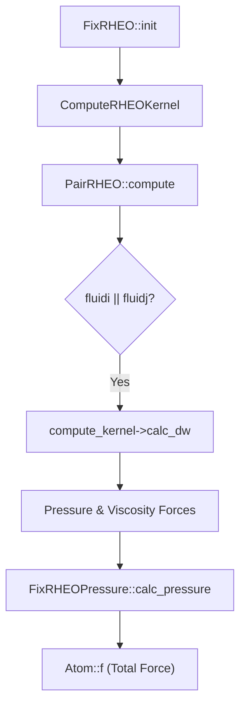
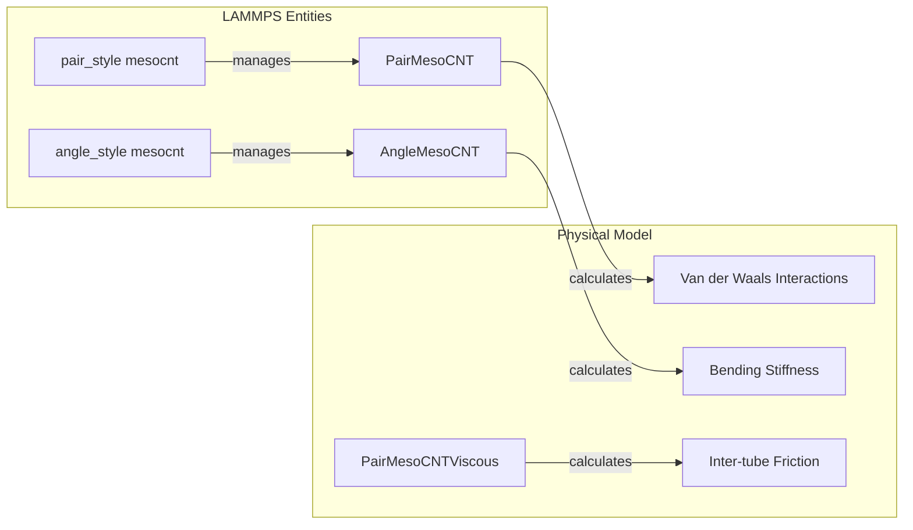

# Coarse-Grained and Mesoscale Models

Relevant source files

The following files were used as context for generating this wiki page:

- [doc/src/angle_mesocnt.rst](doc/src/angle_mesocnt.rst)
- [doc/src/bond_mesocnt.rst](doc/src/bond_mesocnt.rst)
- [doc/src/fix_srd.rst](doc/src/fix_srd.rst)
- [doc/src/fix_wall_srd.rst](doc/src/fix_wall_srd.rst)
- [doc/src/pair_mesocnt.rst](doc/src/pair_mesocnt.rst)
- [src/CG-DNA/Install.sh](src/CG-DNA/Install.sh)
- [src/CG-DNA/bond_oxdna2_fene.h](src/CG-DNA/bond_oxdna2_fene.h)
- [src/CG-DNA/bond_oxdna3_fene.cpp](src/CG-DNA/bond_oxdna3_fene.cpp)
- [src/CG-DNA/bond_oxdna3_fene.h](src/CG-DNA/bond_oxdna3_fene.h)
- [src/CG-DNA/bond_oxdna_fene.cpp](src/CG-DNA/bond_oxdna_fene.cpp)
- [src/CG-DNA/bond_oxdna_fene.h](src/CG-DNA/bond_oxdna_fene.h)
- [src/CG-DNA/bond_oxrna2_fene.h](src/CG-DNA/bond_oxrna2_fene.h)
- [src/CG-DNA/constants_oxdna.cpp](src/CG-DNA/constants_oxdna.cpp)
- [src/CG-DNA/constants_oxdna.h](src/CG-DNA/constants_oxdna.h)
- [src/CG-DNA/pair_oxdna2_coaxstk.cpp](src/CG-DNA/pair_oxdna2_coaxstk.cpp)
- [src/CG-DNA/pair_oxdna2_coaxstk.h](src/CG-DNA/pair_oxdna2_coaxstk.h)
- [src/CG-DNA/pair_oxdna2_dh.cpp](src/CG-DNA/pair_oxdna2_dh.cpp)
- [src/CG-DNA/pair_oxdna2_dh.h](src/CG-DNA/pair_oxdna2_dh.h)
- [src/CG-DNA/pair_oxdna2_excv.h](src/CG-DNA/pair_oxdna2_excv.h)
- [src/CG-DNA/pair_oxdna3_coaxstk.cpp](src/CG-DNA/pair_oxdna3_coaxstk.cpp)
- [src/CG-DNA/pair_oxdna3_coaxstk.h](src/CG-DNA/pair_oxdna3_coaxstk.h)
- [src/CG-DNA/pair_oxdna3_excv.cpp](src/CG-DNA/pair_oxdna3_excv.cpp)
- [src/CG-DNA/pair_oxdna3_excv.h](src/CG-DNA/pair_oxdna3_excv.h)
- [src/CG-DNA/pair_oxdna3_hbond.cpp](src/CG-DNA/pair_oxdna3_hbond.cpp)
- [src/CG-DNA/pair_oxdna3_hbond.h](src/CG-DNA/pair_oxdna3_hbond.h)
- [src/CG-DNA/pair_oxdna3_stk.cpp](src/CG-DNA/pair_oxdna3_stk.cpp)
- [src/CG-DNA/pair_oxdna3_stk.h](src/CG-DNA/pair_oxdna3_stk.h)
- [src/CG-DNA/pair_oxdna3_xstk.cpp](src/CG-DNA/pair_oxdna3_xstk.cpp)
- [src/CG-DNA/pair_oxdna3_xstk.h](src/CG-DNA/pair_oxdna3_xstk.h)
- [src/CG-DNA/pair_oxdna_coaxstk.cpp](src/CG-DNA/pair_oxdna_coaxstk.cpp)
- [src/CG-DNA/pair_oxdna_coaxstk.h](src/CG-DNA/pair_oxdna_coaxstk.h)
- [src/CG-DNA/pair_oxdna_excv.cpp](src/CG-DNA/pair_oxdna_excv.cpp)
- [src/CG-DNA/pair_oxdna_excv.h](src/CG-DNA/pair_oxdna_excv.h)
- [src/CG-DNA/pair_oxdna_hbond.cpp](src/CG-DNA/pair_oxdna_hbond.cpp)
- [src/CG-DNA/pair_oxdna_hbond.h](src/CG-DNA/pair_oxdna_hbond.h)
- [src/CG-DNA/pair_oxdna_stk.cpp](src/CG-DNA/pair_oxdna_stk.cpp)
- [src/CG-DNA/pair_oxdna_stk.h](src/CG-DNA/pair_oxdna_stk.h)
- [src/CG-DNA/pair_oxdna_xstk.cpp](src/CG-DNA/pair_oxdna_xstk.cpp)
- [src/CG-DNA/pair_oxdna_xstk.h](src/CG-DNA/pair_oxdna_xstk.h)
- [src/CG-DNA/pair_oxrna2_dh.h](src/CG-DNA/pair_oxrna2_dh.h)
- [src/CG-DNA/pair_oxrna2_excv.h](src/CG-DNA/pair_oxrna2_excv.h)
- [src/CG-DNA/pair_oxrna2_stk.cpp](src/CG-DNA/pair_oxrna2_stk.cpp)
- [src/CG-DNA/pair_oxrna2_stk.h](src/CG-DNA/pair_oxrna2_stk.h)
- [src/CG-DNA/pair_oxrna2_xstk.cpp](src/CG-DNA/pair_oxrna2_xstk.cpp)
- [src/CG-DNA/pair_oxrna2_xstk.h](src/CG-DNA/pair_oxrna2_xstk.h)
- [src/DPD-REACT/fix_eos_table.cpp](src/DPD-REACT/fix_eos_table.cpp)
- [src/DPD-REACT/fix_eos_table_rx.cpp](src/DPD-REACT/fix_eos_table_rx.cpp)
- [src/DPD-REACT/fix_eos_table_rx.h](src/DPD-REACT/fix_eos_table_rx.h)
- [src/DPD-REACT/fix_rx.cpp](src/DPD-REACT/fix_rx.cpp)
- [src/DPD-REACT/fix_rx.h](src/DPD-REACT/fix_rx.h)
- [src/DPD-REACT/pair_exp6_rx.cpp](src/DPD-REACT/pair_exp6_rx.cpp)
- [src/DPD-REACT/pair_exp6_rx.h](src/DPD-REACT/pair_exp6_rx.h)
- [src/DPD-REACT/pair_multi_lucy.cpp](src/DPD-REACT/pair_multi_lucy.cpp)
- [src/DPD-REACT/pair_multi_lucy_rx.cpp](src/DPD-REACT/pair_multi_lucy_rx.cpp)
- [src/DPD-REACT/pair_multi_lucy_rx.h](src/DPD-REACT/pair_multi_lucy_rx.h)
- [src/DPD-REACT/pair_table_rx.cpp](src/DPD-REACT/pair_table_rx.cpp)
- [src/DPD-REACT/pair_table_rx.h](src/DPD-REACT/pair_table_rx.h)
- [src/EXTRA-FIX/fix_viscosity.cpp](src/EXTRA-FIX/fix_viscosity.cpp)
- [src/KIM/README](src/KIM/README)
- [src/KOKKOS/fix_eos_table_rx_kokkos.cpp](src/KOKKOS/fix_eos_table_rx_kokkos.cpp)
- [src/KOKKOS/fix_eos_table_rx_kokkos.h](src/KOKKOS/fix_eos_table_rx_kokkos.h)
- [src/KOKKOS/fix_rx_kokkos.cpp](src/KOKKOS/fix_rx_kokkos.cpp)
- [src/KOKKOS/fix_rx_kokkos.h](src/KOKKOS/fix_rx_kokkos.h)
- [src/KOKKOS/fix_shardlow_kokkos.cpp](src/KOKKOS/fix_shardlow_kokkos.cpp)
- [src/KOKKOS/fix_shardlow_kokkos.h](src/KOKKOS/fix_shardlow_kokkos.h)
- [src/KOKKOS/pair_dpd_fdt_energy_kokkos.cpp](src/KOKKOS/pair_dpd_fdt_energy_kokkos.cpp)
- [src/KOKKOS/pair_dpd_fdt_energy_kokkos.h](src/KOKKOS/pair_dpd_fdt_energy_kokkos.h)
- [src/KOKKOS/pair_exp6_rx_kokkos.cpp](src/KOKKOS/pair_exp6_rx_kokkos.cpp)
- [src/KOKKOS/pair_exp6_rx_kokkos.h](src/KOKKOS/pair_exp6_rx_kokkos.h)
- [src/KOKKOS/pair_multi_lucy_rx_kokkos.cpp](src/KOKKOS/pair_multi_lucy_rx_kokkos.cpp)
- [src/KOKKOS/pair_multi_lucy_rx_kokkos.h](src/KOKKOS/pair_multi_lucy_rx_kokkos.h)
- [src/KOKKOS/pair_table_rx_kokkos.cpp](src/KOKKOS/pair_table_rx_kokkos.cpp)
- [src/KOKKOS/pair_table_rx_kokkos.h](src/KOKKOS/pair_table_rx_kokkos.h)
- [src/MANYBODY/pair_tersoff_table.cpp](src/MANYBODY/pair_tersoff_table.cpp)
- [src/MANYBODY/pair_tersoff_table.h](src/MANYBODY/pair_tersoff_table.h)
- [src/MESONT/angle_mesocnt.cpp](src/MESONT/angle_mesocnt.cpp)
- [src/MESONT/angle_mesocnt.h](src/MESONT/angle_mesocnt.h)
- [src/MESONT/bond_mesocnt.cpp](src/MESONT/bond_mesocnt.cpp)
- [src/MESONT/bond_mesocnt.h](src/MESONT/bond_mesocnt.h)
- [src/MESONT/pair_mesocnt.cpp](src/MESONT/pair_mesocnt.cpp)
- [src/MESONT/pair_mesocnt.h](src/MESONT/pair_mesocnt.h)
- [src/MESONT/pair_mesocnt_viscous.cpp](src/MESONT/pair_mesocnt_viscous.cpp)
- [src/MESONT/pair_mesocnt_viscous.h](src/MESONT/pair_mesocnt_viscous.h)
- [src/OPENMP/pair_tersoff_table_omp.cpp](src/OPENMP/pair_tersoff_table_omp.cpp)
- [src/RHEO/bond_rheo_shell.cpp](src/RHEO/bond_rheo_shell.cpp)
- [src/RHEO/bond_rheo_shell.h](src/RHEO/bond_rheo_shell.h)
- [src/RHEO/compute_rheo_grad.cpp](src/RHEO/compute_rheo_grad.cpp)
- [src/RHEO/compute_rheo_grad.h](src/RHEO/compute_rheo_grad.h)
- [src/RHEO/compute_rheo_interface.cpp](src/RHEO/compute_rheo_interface.cpp)
- [src/RHEO/compute_rheo_interface.h](src/RHEO/compute_rheo_interface.h)
- [src/RHEO/compute_rheo_kernel.cpp](src/RHEO/compute_rheo_kernel.cpp)
- [src/RHEO/compute_rheo_kernel.h](src/RHEO/compute_rheo_kernel.h)
- [src/RHEO/compute_rheo_property_atom.cpp](src/RHEO/compute_rheo_property_atom.cpp)
- [src/RHEO/compute_rheo_property_atom.h](src/RHEO/compute_rheo_property_atom.h)
- [src/RHEO/compute_rheo_rho_sum.cpp](src/RHEO/compute_rheo_rho_sum.cpp)
- [src/RHEO/compute_rheo_surface.cpp](src/RHEO/compute_rheo_surface.cpp)
- [src/RHEO/compute_rheo_surface.h](src/RHEO/compute_rheo_surface.h)
- [src/RHEO/compute_rheo_vshift.cpp](src/RHEO/compute_rheo_vshift.cpp)
- [src/RHEO/compute_rheo_vshift.h](src/RHEO/compute_rheo_vshift.h)
- [src/RHEO/fix_rheo.cpp](src/RHEO/fix_rheo.cpp)
- [src/RHEO/fix_rheo.h](src/RHEO/fix_rheo.h)
- [src/RHEO/fix_rheo_oxidation.cpp](src/RHEO/fix_rheo_oxidation.cpp)
- [src/RHEO/fix_rheo_oxidation.h](src/RHEO/fix_rheo_oxidation.h)
- [src/RHEO/fix_rheo_pressure.cpp](src/RHEO/fix_rheo_pressure.cpp)
- [src/RHEO/fix_rheo_pressure.h](src/RHEO/fix_rheo_pressure.h)
- [src/RHEO/fix_rheo_thermal.cpp](src/RHEO/fix_rheo_thermal.cpp)
- [src/RHEO/fix_rheo_thermal.h](src/RHEO/fix_rheo_thermal.h)
- [src/RHEO/fix_rheo_viscosity.cpp](src/RHEO/fix_rheo_viscosity.cpp)
- [src/RHEO/fix_rheo_viscosity.h](src/RHEO/fix_rheo_viscosity.h)
- [src/RHEO/pair_rheo.cpp](src/RHEO/pair_rheo.cpp)
- [src/RHEO/pair_rheo.h](src/RHEO/pair_rheo.h)
- [src/SHOCK/fix_append_atoms.cpp](src/SHOCK/fix_append_atoms.cpp)
- [src/SHOCK/fix_append_atoms.h](src/SHOCK/fix_append_atoms.h)
- [src/SHOCK/fix_msst.cpp](src/SHOCK/fix_msst.cpp)
- [src/SHOCK/fix_msst.h](src/SHOCK/fix_msst.h)
- [src/SHOCK/fix_nphug.cpp](src/SHOCK/fix_nphug.cpp)
- [src/SHOCK/fix_nphug.h](src/SHOCK/fix_nphug.h)
- [src/SHOCK/fix_wall_piston.cpp](src/SHOCK/fix_wall_piston.cpp)
- [src/SHOCK/fix_wall_piston.h](src/SHOCK/fix_wall_piston.h)
- [src/SRD/fix_srd.cpp](src/SRD/fix_srd.cpp)
- [src/SRD/fix_srd.h](src/SRD/fix_srd.h)
- [src/SRD/fix_wall_srd.cpp](src/SRD/fix_wall_srd.cpp)
- [src/SRD/fix_wall_srd.h](src/SRD/fix_wall_srd.h)
- [src/UEF/compute_pressure_uef.cpp](src/UEF/compute_pressure_uef.cpp)
- [src/UEF/compute_temp_uef.cpp](src/UEF/compute_temp_uef.cpp)
- [src/UEF/dump_cfg_uef.cpp](src/UEF/dump_cfg_uef.cpp)
- [src/VORONOI/README](src/VORONOI/README)
- [src/VORONOI/compute_voronoi_atom.cpp](src/VORONOI/compute_voronoi_atom.cpp)
- [src/VORONOI/compute_voronoi_atom.h](src/VORONOI/compute_voronoi_atom.h)

This section documents LAMMPS packages designed for coarse-grained (CG) and mesoscale simulations. These models bridge the gap between atomistic MD and continuum mechanics by grouping atoms into representative beads or using stochastic and hydrodynamic frameworks.

## CG-DNA (oxDNA and oxRNA Models)

The **CG-DNA** package implements the oxDNA and oxRNA coarse-grained models for nucleic acids. These models represent each nucleotide as a single rigid body with multiple interaction sites (backbone, stacking, and hydrogen bonding) to capture the structural and thermodynamic properties of DNA/RNA.

### Data Flow and Interaction Styles
The oxDNA implementation relies on specialized pair styles that handle distinct physical interactions:
*   **Excluded Volume**: `pair_oxdna_excv.cpp` prevents overlap of nucleotides [src/CG-DNA/pair_oxdna_excv.cpp:1-20]().
*   **Stacking**: `pair_oxdna_stk.cpp` and `pair_oxdna3_stk.cpp` handle the stabilizing interactions between adjacent bases [src/CG-DNA/pair_oxdna_stk.cpp:1-20]().
*   **Hydrogen Bonding**: `pair_oxdna_hbond.cpp` models base-pairing [src/CG-DNA/pair_oxdna_hbond.cpp:1-20]().
*   **Cross-Stacking**: `pair_oxdna_xstk.cpp` and `pair_oxdna2_coaxstk.cpp` manage interactions between non-adjacent strands [src/CG-DNA/pair_oxdna_xstk.cpp:1-15]().

**Sources:** [src/CG-DNA/pair_oxdna_excv.cpp:1-20](), [src/CG-DNA/pair_oxdna_stk.cpp:1-20](), [src/CG-DNA/pair_oxdna_hbond.cpp:1-20](), [src/CG-DNA/pair_oxdna_xstk.cpp:1-15]().

---

## RHEO (Smoothed Particle Hydrodynamics)

The **RHEO** package provides a framework for Smoothed Particle Hydrodynamics (SPH), specifically optimized for dynamic multi-phase flows and hybrid mesh-free modeling of elastic objects in fluids.

### Core Implementation
The central manager is the `FixRHEO` class, which initializes the kernel functions and manages physical properties like density ($\rho_0$) and speed of sound ($c_s$) [src/RHEO/fix_rheo.cpp:58-87]().

| Component | Class Name | Function |
| :--- | :--- | :--- |
| **Integrator** | `FixRHEO` | Manages time integration and property updates [src/RHEO/fix_rheo.cpp:63-68](). |
| **Force Compute** | `PairRHEO` | Calculates SPH forces including artificial viscosity and pressure [src/RHEO/pair_rheo.cpp:79-127](). |
| **Kernel** | `ComputeRHEOKernel` | Evaluates smoothing kernels (Quintic, Wendland C4, RK) [src/RHEO/fix_rheo.cpp:102-114](). |
| **Thermal** | `FixRHEOThermal` | Handles heat conduction and phase change (latent heat) [src/RHEO/fix_rheo_thermal.cpp:62-95](). |

### RHEO Logic Flow

**Sources:** [src/RHEO/fix_rheo.cpp:58-114](), [src/RHEO/pair_rheo.cpp:79-214](), [src/RHEO/fix_rheo_thermal.cpp:62-95]().

---

## DPD-REACT (Reactive Dissipative Particle Dynamics)

**DPD-REACT** extends Dissipative Particle Dynamics to include chemical reactions using Shardlow-like splitting algorithms.

### Key Classes and Solvers
*   **`FixRX`**: The primary engine for DPD reactions. It supports both **Sparse** and **Dense** kinetics representations [src/DPD-REACT/fix_rx.cpp:98-104]().
*   **ODE Integration**: Implements `rk4` (Runge-Kutta 4th order) and `rkf45` (Runge-Kutta-Fehlberg) for solving the chemical rate equations [src/DPD-REACT/fix_rx.cpp:107-113]().
*   **Pair Styles**: Works in conjunction with `pair_style dpd/fdt/energy` to maintain energy conservation during reactions [src/DPD-REACT/fix_rx.cpp:135-140]().

### Kokkos Acceleration
The package includes Kokkos-enabled versions for high-performance execution on GPUs:
*   `FixRxKokkos` [src/KOKKOS/fix_rx_kokkos.cpp:55-67]()
*   `PairExp6rxKokkos` [src/KOKKOS/pair_exp6_rx_kokkos.cpp:57-69]()
*   `FixShardlowKokkos` [src/KOKKOS/fix_shardlow_kokkos.cpp:66-101]()

**Sources:** [src/DPD-REACT/fix_rx.cpp:59-159](), [src/KOKKOS/fix_rx_kokkos.cpp:55-67](), [src/KOKKOS/fix_shardlow_kokkos.cpp:66-101]().

---

## MESONT (Mesoscopic Carbon Nanotubes)

The **MESONT** package implements a mesoscopic model for carbon nanotubes (CNTs), where tubes are treated as chains of segments.

### Interaction Logic
The `PairMesoCNT` style calculates interactions between segments using a sophisticated geometry-based approach:
1.  **Geometry Determination**: The `geometry()` function identifies the relative orientation and distance between two CNT segments [src/MESONT/pair_mesocnt.cpp:234-235]().
2.  **Segment-Segment Interaction**: Iterates over neighboring chains and excludes `SELF_CUTOFF` neighbors within the same chain [src/MESONT/pair_mesocnt.cpp:214-224]().
3.  **Viscous Damping**: `PairMesoCNTViscous` adds friction based on weighted relative velocities of segments [src/MESONT/pair_mesocnt_viscous.cpp:164-170]().

### CNT System Mapping

**Sources:** [src/MESONT/pair_mesocnt.cpp:60-82](), [src/MESONT/pair_mesocnt.cpp:214-235](), [src/MESONT/pair_mesocnt_viscous.cpp:164-170]().

---

## SRD (Stochastic Rotation Dynamics)

The `FixSRD` class implements Stochastic Rotation Dynamics (also known as Multi-Particle Collision Dynamics). It provides a coarse-grained fluid that interacts with "big" particles (solutes) through collisions.

### Collision and Integration
*   **Collision Styles**: Supports `SLIP` and `NOSLIP` boundary conditions for particles interacting with the SRD fluid [src/SRD/fix_srd.cpp:141-147]().
*   **Grid Management**: The fluid is partitioned into bins of size `gridsrd`. Particles within a bin undergo a stochastic rotation of their relative velocities [src/SRD/fix_srd.cpp:109-110]().
*   **Big Particle Coupling**: `FixSRD` can be restricted to a specific group of particles (`biggroup`) that are explicitly resolved [src/SRD/fix_srd.cpp:99-105]().

**Sources:** [src/SRD/fix_srd.cpp:78-113](), [src/SRD/fix_srd.cpp:141-147]().

---

## Additional Mesoscale Utilities

### BOCS (Pressure Correction)
The BOCS (Bottom-Up Open-source Coarse-graining Software) pressure correction is often used in conjunction with coarse-grained potentials to correct the pressure virial that arises from the loss of degrees of freedom.

### DIELECTRIC
The **DIELECTRIC** package (implemented via various fixes and computes) allows for simulations of particles with varying dielectric constants, often using the Induced Charge Method (ICM) to solve Poisson's equation at mesoscopic scales.

### Voronoi Analysis
The `ComputeVoronoi` class provides per-atom Voronoi tessellation, which is critical for calculating local volumes and neighbor environments in mesoscale systems like granular flows or SPH [src/VORONOI/compute_voronoi_atom.cpp:42-109]().

**Sources:** [src/VORONOI/compute_voronoi_atom.cpp:42-109]().

---