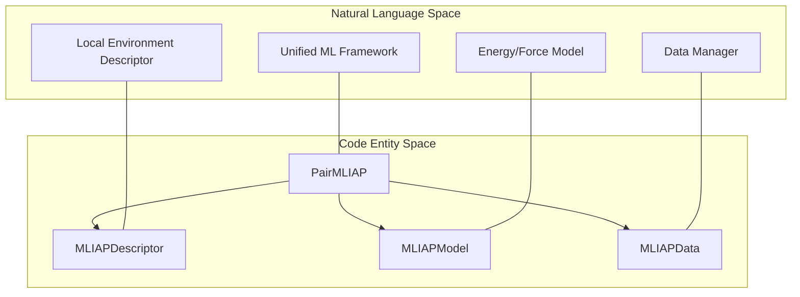
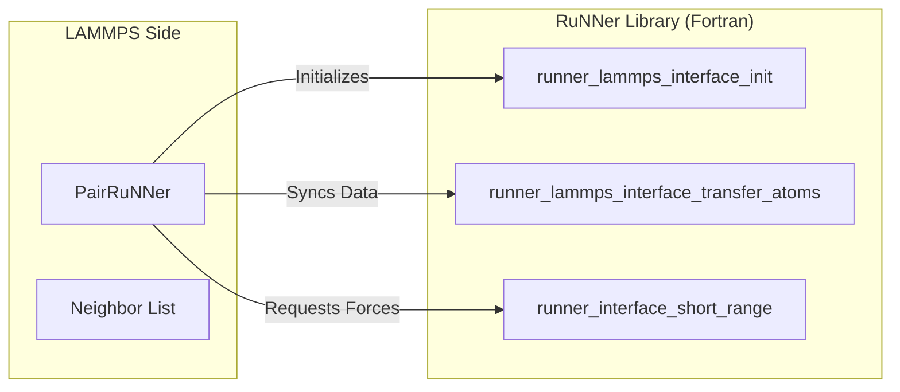

# Machine Learning Potentials

Relevant source files

The following files were used as context for generating this wiki page:

- [cmake/.coveragerc.in](cmake/.coveragerc.in)
- [cmake/Modules/CodeCoverage.cmake](cmake/Modules/CodeCoverage.cmake)
- [cmake/Modules/ExternalCMakeProject.cmake](cmake/Modules/ExternalCMakeProject.cmake)
- [cmake/Modules/Packages/MDI.cmake](cmake/Modules/Packages/MDI.cmake)
- [cmake/Modules/Packages/ML-HDNNP.cmake](cmake/Modules/Packages/ML-HDNNP.cmake)
- [cmake/Modules/Packages/ML-QUIP.cmake](cmake/Modules/Packages/ML-QUIP.cmake)
- [cmake/Modules/Packages/ML-RUNNER.cmake](cmake/Modules/Packages/ML-RUNNER.cmake)
- [cmake/Modules/Packages/PLUMED.cmake](cmake/Modules/Packages/PLUMED.cmake)
- [cmake/Modules/Packages/SCAFACOS.cmake](cmake/Modules/Packages/SCAFACOS.cmake)
- [cmake/patches/runner-cmake.patch](cmake/patches/runner-cmake.patch)
- [doc/lammps.1](doc/lammps.1)
- [doc/src/Commands_removed.rst](doc/src/Commands_removed.rst)
- [doc/src/Intro_portability.rst](doc/src/Intro_portability.rst)
- [doc/src/Run_basics.rst](doc/src/Run_basics.rst)
- [doc/src/Run_options.rst](doc/src/Run_options.rst)
- [doc/src/compute_composition_atom.rst](doc/src/compute_composition_atom.rst)
- [doc/src/compute_voronoi_atom.rst](doc/src/compute_voronoi_atom.rst)
- [doc/src/fix_atc.rst](doc/src/fix_atc.rst)
- [doc/src/fix_ave_spatial.rst](doc/src/fix_ave_spatial.rst)
- [doc/src/fix_ave_spatial_sphere.rst](doc/src/fix_ave_spatial_sphere.rst)
- [doc/src/fix_deposit.rst](doc/src/fix_deposit.rst)
- [doc/src/fix_dpd_source.rst](doc/src/fix_dpd_source.rst)
- [doc/src/fix_ipi.rst](doc/src/fix_ipi.rst)
- [doc/src/fix_langevin.rst](doc/src/fix_langevin.rst)
- [doc/src/fix_pimd.rst](doc/src/fix_pimd.rst)
- [doc/src/fix_poems.rst](doc/src/fix_poems.rst)
- [doc/src/fix_pour.rst](doc/src/fix_pour.rst)
- [doc/src/pair_mgpt.rst](doc/src/pair_mgpt.rst)
- [doc/src/pair_runner.rst](doc/src/pair_runner.rst)
- [doc/src/read_restart.rst](doc/src/read_restart.rst)
- [src/ADIOS/Install.sh](src/ADIOS/Install.sh)
- [src/BOCS/compute_pressure_bocs.cpp](src/BOCS/compute_pressure_bocs.cpp)
- [src/KOKKOS/compute_gaussian_grid_local_kokkos.cpp](src/KOKKOS/compute_gaussian_grid_local_kokkos.cpp)
- [src/KOKKOS/compute_gaussian_grid_local_kokkos.h](src/KOKKOS/compute_gaussian_grid_local_kokkos.h)
- [src/KOKKOS/compute_sna_grid_kokkos.cpp](src/KOKKOS/compute_sna_grid_kokkos.cpp)
- [src/KOKKOS/compute_sna_grid_kokkos.h](src/KOKKOS/compute_sna_grid_kokkos.h)
- [src/KOKKOS/compute_sna_grid_kokkos_impl.h](src/KOKKOS/compute_sna_grid_kokkos_impl.h)
- [src/KOKKOS/compute_sna_grid_local_kokkos.cpp](src/KOKKOS/compute_sna_grid_local_kokkos.cpp)
- [src/KOKKOS/compute_sna_grid_local_kokkos.h](src/KOKKOS/compute_sna_grid_local_kokkos.h)
- [src/KOKKOS/compute_sna_grid_local_kokkos_impl.h](src/KOKKOS/compute_sna_grid_local_kokkos_impl.h)
- [src/KOKKOS/memory_kokkos.h](src/KOKKOS/memory_kokkos.h)
- [src/KOKKOS/mliap_data_kokkos.cpp](src/KOKKOS/mliap_data_kokkos.cpp)
- [src/KOKKOS/mliap_data_kokkos.h](src/KOKKOS/mliap_data_kokkos.h)
- [src/KOKKOS/mliap_descriptor_kokkos.h](src/KOKKOS/mliap_descriptor_kokkos.h)
- [src/KOKKOS/mliap_descriptor_so3_kokkos.cpp](src/KOKKOS/mliap_descriptor_so3_kokkos.cpp)
- [src/KOKKOS/mliap_descriptor_so3_kokkos.h](src/KOKKOS/mliap_descriptor_so3_kokkos.h)
- [src/KOKKOS/mliap_model_kokkos.h](src/KOKKOS/mliap_model_kokkos.h)
- [src/KOKKOS/mliap_model_linear_kokkos.cpp](src/KOKKOS/mliap_model_linear_kokkos.cpp)
- [src/KOKKOS/mliap_model_linear_kokkos.h](src/KOKKOS/mliap_model_linear_kokkos.h)
- [src/KOKKOS/mliap_model_python_couple_kokkos.pyx](src/KOKKOS/mliap_model_python_couple_kokkos.pyx)
- [src/KOKKOS/mliap_model_python_kokkos.cpp](src/KOKKOS/mliap_model_python_kokkos.cpp)
- [src/KOKKOS/mliap_model_python_kokkos.h](src/KOKKOS/mliap_model_python_kokkos.h)
- [src/KOKKOS/mliap_so3_kokkos.cpp](src/KOKKOS/mliap_so3_kokkos.cpp)
- [src/KOKKOS/mliap_so3_kokkos.h](src/KOKKOS/mliap_so3_kokkos.h)
- [src/KOKKOS/mliap_unified_couple_kokkos.pyx](src/KOKKOS/mliap_unified_couple_kokkos.pyx)
- [src/KOKKOS/mliap_unified_kokkos.cpp](src/KOKKOS/mliap_unified_kokkos.cpp)
- [src/KOKKOS/pair_mliap_kokkos.cpp](src/KOKKOS/pair_mliap_kokkos.cpp)
- [src/KOKKOS/pair_mliap_kokkos.h](src/KOKKOS/pair_mliap_kokkos.h)
- [src/KOKKOS/pair_pod_kokkos.cpp](src/KOKKOS/pair_pod_kokkos.cpp)
- [src/KOKKOS/pair_pod_kokkos.h](src/KOKKOS/pair_pod_kokkos.h)
- [src/KOKKOS/pair_snap_kokkos.h](src/KOKKOS/pair_snap_kokkos.h)
- [src/KOKKOS/pair_snap_kokkos_impl.h](src/KOKKOS/pair_snap_kokkos_impl.h)
- [src/KOKKOS/pair_zbl_kokkos.cpp](src/KOKKOS/pair_zbl_kokkos.cpp)
- [src/KOKKOS/pair_zbl_kokkos.h](src/KOKKOS/pair_zbl_kokkos.h)
- [src/KOKKOS/sna_kokkos.h](src/KOKKOS/sna_kokkos.h)
- [src/KOKKOS/sna_kokkos_impl.h](src/KOKKOS/sna_kokkos_impl.h)
- [src/LATBOLTZ/latboltz_const.h](src/LATBOLTZ/latboltz_const.h)
- [src/MISC/fix_ipi.cpp](src/MISC/fix_ipi.cpp)
- [src/MISC/fix_ipi.h](src/MISC/fix_ipi.h)
- [src/ML-IAP/Install.sh](src/ML-IAP/Install.sh)
- [src/ML-IAP/compute_mliap.cpp](src/ML-IAP/compute_mliap.cpp)
- [src/ML-IAP/compute_mliap.h](src/ML-IAP/compute_mliap.h)
- [src/ML-IAP/mliap_data.cpp](src/ML-IAP/mliap_data.cpp)
- [src/ML-IAP/mliap_data.h](src/ML-IAP/mliap_data.h)
- [src/ML-IAP/mliap_descriptor.cpp](src/ML-IAP/mliap_descriptor.cpp)
- [src/ML-IAP/mliap_descriptor.h](src/ML-IAP/mliap_descriptor.h)
- [src/ML-IAP/mliap_descriptor_ace.cpp](src/ML-IAP/mliap_descriptor_ace.cpp)
- [src/ML-IAP/mliap_descriptor_ace.h](src/ML-IAP/mliap_descriptor_ace.h)
- [src/ML-IAP/mliap_descriptor_so3.cpp](src/ML-IAP/mliap_descriptor_so3.cpp)
- [src/ML-IAP/mliap_descriptor_so3.h](src/ML-IAP/mliap_descriptor_so3.h)
- [src/ML-IAP/mliap_model.h](src/ML-IAP/mliap_model.h)
- [src/ML-IAP/mliap_model_linear.cpp](src/ML-IAP/mliap_model_linear.cpp)
- [src/ML-IAP/mliap_model_nn.h](src/ML-IAP/mliap_model_nn.h)
- [src/ML-IAP/mliap_model_python.cpp](src/ML-IAP/mliap_model_python.cpp)
- [src/ML-IAP/mliap_model_python.h](src/ML-IAP/mliap_model_python.h)
- [src/ML-IAP/mliap_model_python_couple.pyx](src/ML-IAP/mliap_model_python_couple.pyx)
- [src/ML-IAP/mliap_so3.cpp](src/ML-IAP/mliap_so3.cpp)
- [src/ML-IAP/mliap_so3.h](src/ML-IAP/mliap_so3.h)
- [src/ML-IAP/mliap_so3_math.h](src/ML-IAP/mliap_so3_math.h)
- [src/ML-IAP/mliap_unified.cpp](src/ML-IAP/mliap_unified.cpp)
- [src/ML-IAP/mliap_unified.h](src/ML-IAP/mliap_unified.h)
- [src/ML-IAP/mliap_unified_couple.pyx](src/ML-IAP/mliap_unified_couple.pyx)
- [src/ML-IAP/pair_mliap.cpp](src/ML-IAP/pair_mliap.cpp)
- [src/ML-IAP/pair_mliap.h](src/ML-IAP/pair_mliap.h)
- [src/ML-POD/compute_pod_atom.cpp](src/ML-POD/compute_pod_atom.cpp)
- [src/ML-POD/compute_pod_atom.h](src/ML-POD/compute_pod_atom.h)
- [src/ML-POD/compute_pod_global.cpp](src/ML-POD/compute_pod_global.cpp)
- [src/ML-POD/compute_pod_global.h](src/ML-POD/compute_pod_global.h)
- [src/ML-POD/compute_pod_local.cpp](src/ML-POD/compute_pod_local.cpp)
- [src/ML-POD/compute_pod_local.h](src/ML-POD/compute_pod_local.h)
- [src/ML-POD/compute_podd_atom.cpp](src/ML-POD/compute_podd_atom.cpp)
- [src/ML-POD/compute_podd_atom.h](src/ML-POD/compute_podd_atom.h)
- [src/ML-POD/eapod.cpp](src/ML-POD/eapod.cpp)
- [src/ML-POD/eapod.h](src/ML-POD/eapod.h)
- [src/ML-POD/fitpod_command.cpp](src/ML-POD/fitpod_command.cpp)
- [src/ML-POD/fitpod_command.h](src/ML-POD/fitpod_command.h)
- [src/ML-POD/pair_pod.cpp](src/ML-POD/pair_pod.cpp)
- [src/ML-POD/pair_pod.h](src/ML-POD/pair_pod.h)
- [src/ML-RUNNER/Install.sh](src/ML-RUNNER/Install.sh)
- [src/ML-RUNNER/pair_runner.cpp](src/ML-RUNNER/pair_runner.cpp)
- [src/ML-RUNNER/pair_runner.h](src/ML-RUNNER/pair_runner.h)
- [src/ML-SNAP/compute_gaussian_grid_local.cpp](src/ML-SNAP/compute_gaussian_grid_local.cpp)
- [src/ML-SNAP/compute_gaussian_grid_local.h](src/ML-SNAP/compute_gaussian_grid_local.h)
- [src/ML-SNAP/compute_grid.cpp](src/ML-SNAP/compute_grid.cpp)
- [src/ML-SNAP/compute_grid_local.cpp](src/ML-SNAP/compute_grid_local.cpp)
- [src/ML-SNAP/compute_sna_grid.cpp](src/ML-SNAP/compute_sna_grid.cpp)
- [src/ML-SNAP/compute_sna_grid.h](src/ML-SNAP/compute_sna_grid.h)
- [src/ML-SNAP/compute_sna_grid_local.cpp](src/ML-SNAP/compute_sna_grid_local.cpp)
- [src/ML-SNAP/compute_sna_grid_local.h](src/ML-SNAP/compute_sna_grid_local.h)
- [src/PLUMED/fix_plumed.cpp](src/PLUMED/fix_plumed.cpp)
- [src/compute_dipole_chunk.h](src/compute_dipole_chunk.h)
- [src/version.h](src/version.h)
- [tools/i-pi/README.md](tools/i-pi/README.md)
- [unittest/force-styles/test_mliappy_unified.cpp](unittest/force-styles/test_mliappy_unified.cpp)

LAMMPS provides a comprehensive suite of Machine Learning Interatomic Potentials (ML-IAPs) that bridge the accuracy of quantum mechanical calculations with the efficiency of classical molecular dynamics. These implementations range from high-dimensional neural networks to descriptor-based linear and non-linear models. The repository organizes these capabilities into specialized packages like `ML-IAP`, `ML-SNAP`, `ML-POD`, `ML-PACE`, and `ML-RUNNER`.

### Architecture Overview

The ML-IAP infrastructure in LAMMPS is built around a unified framework that decouples the geometric **Descriptor** (which characterizes the local atomic environment) from the **Model** (which maps those descriptors to energy and forces). This design allows developers to mix and match different descriptors (e.g., SO3, ACE, SNAP) with various model backends (Linear, Quadratic, or Neural Networks).

#### ML-IAP Framework to Code Entity Mapping
The following diagram illustrates how the abstract ML-IAP components map to specific C++ classes and their relationships.

**Sources:** [src/ML-IAP/pair_mliap.cpp:1-50](), [src/ML-IAP/mliap_data.h:1-30](), [src/KOKKOS/pair_mliap_kokkos.cpp:18-34]()

---

### SNAP and the Unified ML-IAP Framework
The **Spectral Neighbor Analysis Potential (SNAP)** is a prominent descriptor-based potential in LAMMPS. It uses bispectrum components to represent the local neighbor density. The unified `ML-IAP` framework extends this by supporting multiple backends, including a PyTorch interface for deep learning models.

*   **Key Classes:** `PairSNAP` [src/KOKKOS/pair_snap_kokkos.h:78](), `SNA` (Spectral Neighbor Analysis) [src/KOKKOS/sna_kokkos.h:198](), and `PairMLIAP` [src/ML-IAP/pair_mliap.cpp:24]().
*   **Acceleration:** Extensive support for Kokkos enables SNAP to run efficiently on NVIDIA (CUDA), AMD (HIP), and Intel (SYCL) GPUs [src/KOKKOS/pair_snap_kokkos.h:95-154]().
*   **Descriptors:** Supports SO3 (Bispectrum) and ACE (Atomic Cluster Expansion) descriptors [src/KOKKOS/pair_mliap_kokkos.cpp:195-205]().

For details, see [SNAP and ML-IAP Framework](#8.1).

---

### ML-POD and ML-PACE
These packages implement potentials based on systematic expansions of the atomic environment.

*   **ML-POD (Proper Orthogonal Descriptors):** Utilizes a linear combination of many-body descriptors. It includes a specialized `fitpod` command for performing least-squares fitting of potential parameters directly within LAMMPS [src/ML-POD/fitpod_command.cpp:151-177]().
*   **ML-PACE (Atomic Cluster Expansion):** Implements the highly efficient ACE formalism, providing a complete basis for the atomic environment. It includes `pair_style pace/extrapolation` for uncertainty quantification during production runs.

| Component | Style/Command | Implementation Class |
| :--- | :--- | :--- |
| POD Potential | `pair_style pod` | `PairPOD` [src/ML-POD/pair_pod.cpp:44]() |
| POD Fitting | `fitpod` | `FitPOD` [src/ML-POD/fitpod_command.cpp:98]() |
| PACE Potential | `pair_style pace` | `PairPACE` |

For details, see [ML-POD and ML-PACE](#8.2).

---

### Neural Network Potentials
LAMMPS supports several High-Dimensional Neural Network Potential (HDNNP) implementations, most notably through the `ML-RUNNER` package which interfaces with the RuNNer library.

*   **ML-RUNNER:** Supports 2nd, 3rd, and 4th generation HDNNPs, including support for long-range electrostatics and committee-based uncertainty estimation [src/ML-RUNNER/pair_runner.cpp:38-109]().
*   **Infrastructure:** Uses a static Fortran interface to communicate with the RuNNer backend, requiring careful management of singleton instances [src/ML-RUNNER/pair_runner.cpp:127-136]().
*   **Other NNPs:** Includes interfaces for `ML-HDNNP` and `ML-QUIP` (Gaussian Approximation Potentials).

#### RuNNer Interface Mapping

**Sources:** [src/ML-RUNNER/pair_runner.h:20-50](), [src/ML-RUNNER/pair_runner.cpp:38-80]()

For details, see [Neural Network Potentials](#8.3).

---

### Summary of Packages
The following table summarizes the primary ML packages and their requirements.

| Package | Purpose | Dependencies |
| :--- | :--- | :--- |
| `ML-IAP` | Unified Descriptor/Model framework | None (Optional: Python/PyTorch) |
| `ML-SNAP` | Spectral Neighbor Analysis Potentials | None (Kokkos recommended) |
| `ML-POD` | Proper Orthogonal Descriptors | None |
| `ML-PACE` | Atomic Cluster Expansion | None |
| `ML-RUNNER` | RuNNer HDNNP Interface | External RuNNer library [cmake/Modules/Packages/ML-RUNNER.cmake:71-99]() |

**Sources:** [src/ML-IAP/Install.sh:1-10](), [cmake/Modules/Packages/ML-RUNNER.cmake:1-40](), [src/version.h:1-2]()

---