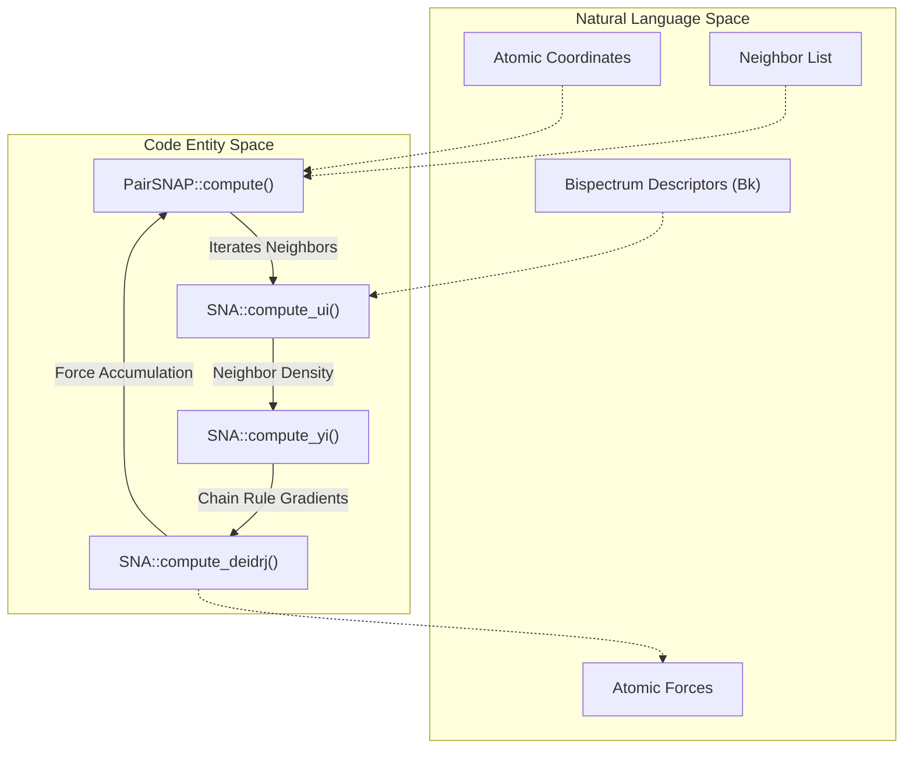
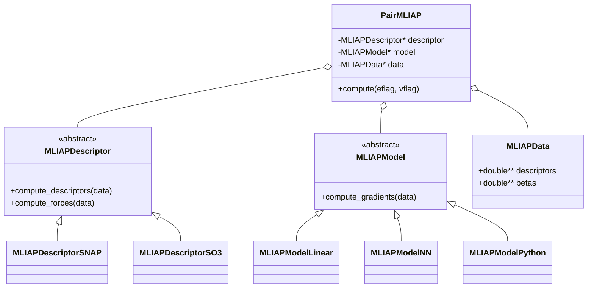
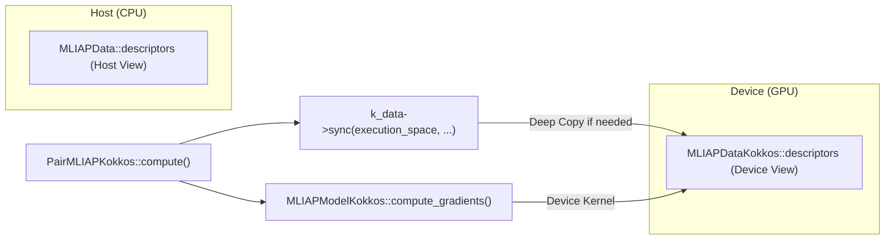

# SNAP and ML-IAP Framework

Relevant source files

The following files were used as context for generating this wiki page:

- [doc/src/compute_gaussian_grid_local.rst](doc/src/compute_gaussian_grid_local.rst)
- [doc/src/compute_mliap.rst](doc/src/compute_mliap.rst)
- [doc/src/compute_sna_atom.rst](doc/src/compute_sna_atom.rst)
- [doc/src/fix_efield_lepton.rst](doc/src/fix_efield_lepton.rst)
- [doc/src/pair_mliap.rst](doc/src/pair_mliap.rst)
- [doc/src/pair_snap.rst](doc/src/pair_snap.rst)
- [examples/LEPTON/in.efield-lepton](examples/LEPTON/in.efield-lepton)
- [examples/LEPTON/log.13Jan25.efield-lepton.g++.1](examples/LEPTON/log.13Jan25.efield-lepton.g++.1)
- [examples/LEPTON/log.13Jan25.efield-lepton.g++.4](examples/LEPTON/log.13Jan25.efield-lepton.g++.4)
- [examples/snap/README.md](examples/snap/README.md)
- [examples/snap/compute_snap_dgrad.py](examples/snap/compute_snap_dgrad.py)
- [examples/snap/in.gaussian.grid](examples/snap/in.gaussian.grid)
- [examples/snap/in.snap.grid](examples/snap/in.snap.grid)
- [examples/snap/in.snap.grid.triclinic](examples/snap/in.snap.grid.triclinic)
- [examples/snap/log.10Dec24.gaussian.grid.g++.1](examples/snap/log.10Dec24.gaussian.grid.g++.1)
- [examples/snap/log.10Dec24.gaussian.grid.g++.4](examples/snap/log.10Dec24.gaussian.grid.g++.4)
- [src/ADIOS/Install.sh](src/ADIOS/Install.sh)
- [src/KOKKOS/compute_gaussian_grid_local_kokkos.cpp](src/KOKKOS/compute_gaussian_grid_local_kokkos.cpp)
- [src/KOKKOS/compute_gaussian_grid_local_kokkos.h](src/KOKKOS/compute_gaussian_grid_local_kokkos.h)
- [src/KOKKOS/compute_sna_grid_kokkos.cpp](src/KOKKOS/compute_sna_grid_kokkos.cpp)
- [src/KOKKOS/compute_sna_grid_kokkos.h](src/KOKKOS/compute_sna_grid_kokkos.h)
- [src/KOKKOS/compute_sna_grid_kokkos_impl.h](src/KOKKOS/compute_sna_grid_kokkos_impl.h)
- [src/KOKKOS/compute_sna_grid_local_kokkos.cpp](src/KOKKOS/compute_sna_grid_local_kokkos.cpp)
- [src/KOKKOS/compute_sna_grid_local_kokkos.h](src/KOKKOS/compute_sna_grid_local_kokkos.h)
- [src/KOKKOS/compute_sna_grid_local_kokkos_impl.h](src/KOKKOS/compute_sna_grid_local_kokkos_impl.h)
- [src/KOKKOS/memory_kokkos.h](src/KOKKOS/memory_kokkos.h)
- [src/KOKKOS/mliap_data_kokkos.cpp](src/KOKKOS/mliap_data_kokkos.cpp)
- [src/KOKKOS/mliap_data_kokkos.h](src/KOKKOS/mliap_data_kokkos.h)
- [src/KOKKOS/mliap_descriptor_kokkos.h](src/KOKKOS/mliap_descriptor_kokkos.h)
- [src/KOKKOS/mliap_descriptor_so3_kokkos.cpp](src/KOKKOS/mliap_descriptor_so3_kokkos.cpp)
- [src/KOKKOS/mliap_descriptor_so3_kokkos.h](src/KOKKOS/mliap_descriptor_so3_kokkos.h)
- [src/KOKKOS/mliap_model_kokkos.h](src/KOKKOS/mliap_model_kokkos.h)
- [src/KOKKOS/mliap_model_linear_kokkos.cpp](src/KOKKOS/mliap_model_linear_kokkos.cpp)
- [src/KOKKOS/mliap_model_linear_kokkos.h](src/KOKKOS/mliap_model_linear_kokkos.h)
- [src/KOKKOS/mliap_model_python_couple_kokkos.pyx](src/KOKKOS/mliap_model_python_couple_kokkos.pyx)
- [src/KOKKOS/mliap_model_python_kokkos.cpp](src/KOKKOS/mliap_model_python_kokkos.cpp)
- [src/KOKKOS/mliap_model_python_kokkos.h](src/KOKKOS/mliap_model_python_kokkos.h)
- [src/KOKKOS/mliap_so3_kokkos.cpp](src/KOKKOS/mliap_so3_kokkos.cpp)
- [src/KOKKOS/mliap_so3_kokkos.h](src/KOKKOS/mliap_so3_kokkos.h)
- [src/KOKKOS/mliap_unified_couple_kokkos.pyx](src/KOKKOS/mliap_unified_couple_kokkos.pyx)
- [src/KOKKOS/mliap_unified_kokkos.cpp](src/KOKKOS/mliap_unified_kokkos.cpp)
- [src/KOKKOS/pair_mliap_kokkos.cpp](src/KOKKOS/pair_mliap_kokkos.cpp)
- [src/KOKKOS/pair_mliap_kokkos.h](src/KOKKOS/pair_mliap_kokkos.h)
- [src/KOKKOS/pair_snap_kokkos.h](src/KOKKOS/pair_snap_kokkos.h)
- [src/KOKKOS/pair_snap_kokkos_impl.h](src/KOKKOS/pair_snap_kokkos_impl.h)
- [src/KOKKOS/pair_zbl_kokkos.cpp](src/KOKKOS/pair_zbl_kokkos.cpp)
- [src/KOKKOS/pair_zbl_kokkos.h](src/KOKKOS/pair_zbl_kokkos.h)
- [src/KOKKOS/sna_kokkos.h](src/KOKKOS/sna_kokkos.h)
- [src/KOKKOS/sna_kokkos_impl.h](src/KOKKOS/sna_kokkos_impl.h)
- [src/LATBOLTZ/latboltz_const.h](src/LATBOLTZ/latboltz_const.h)
- [src/ML-IAP/Install.sh](src/ML-IAP/Install.sh)
- [src/ML-IAP/compute_mliap.cpp](src/ML-IAP/compute_mliap.cpp)
- [src/ML-IAP/compute_mliap.h](src/ML-IAP/compute_mliap.h)
- [src/ML-IAP/mliap_data.cpp](src/ML-IAP/mliap_data.cpp)
- [src/ML-IAP/mliap_data.h](src/ML-IAP/mliap_data.h)
- [src/ML-IAP/mliap_descriptor.cpp](src/ML-IAP/mliap_descriptor.cpp)
- [src/ML-IAP/mliap_descriptor.h](src/ML-IAP/mliap_descriptor.h)
- [src/ML-IAP/mliap_descriptor_ace.cpp](src/ML-IAP/mliap_descriptor_ace.cpp)
- [src/ML-IAP/mliap_descriptor_ace.h](src/ML-IAP/mliap_descriptor_ace.h)
- [src/ML-IAP/mliap_descriptor_snap.cpp](src/ML-IAP/mliap_descriptor_snap.cpp)
- [src/ML-IAP/mliap_descriptor_snap.h](src/ML-IAP/mliap_descriptor_snap.h)
- [src/ML-IAP/mliap_descriptor_so3.cpp](src/ML-IAP/mliap_descriptor_so3.cpp)
- [src/ML-IAP/mliap_descriptor_so3.h](src/ML-IAP/mliap_descriptor_so3.h)
- [src/ML-IAP/mliap_model.h](src/ML-IAP/mliap_model.h)
- [src/ML-IAP/mliap_model_linear.cpp](src/ML-IAP/mliap_model_linear.cpp)
- [src/ML-IAP/mliap_model_nn.h](src/ML-IAP/mliap_model_nn.h)
- [src/ML-IAP/mliap_model_python.cpp](src/ML-IAP/mliap_model_python.cpp)
- [src/ML-IAP/mliap_model_python.h](src/ML-IAP/mliap_model_python.h)
- [src/ML-IAP/mliap_model_python_couple.pyx](src/ML-IAP/mliap_model_python_couple.pyx)
- [src/ML-IAP/mliap_so3.cpp](src/ML-IAP/mliap_so3.cpp)
- [src/ML-IAP/mliap_so3.h](src/ML-IAP/mliap_so3.h)
- [src/ML-IAP/mliap_so3_math.h](src/ML-IAP/mliap_so3_math.h)
- [src/ML-IAP/mliap_unified.cpp](src/ML-IAP/mliap_unified.cpp)
- [src/ML-IAP/mliap_unified.h](src/ML-IAP/mliap_unified.h)
- [src/ML-IAP/mliap_unified_couple.pyx](src/ML-IAP/mliap_unified_couple.pyx)
- [src/ML-IAP/pair_mliap.cpp](src/ML-IAP/pair_mliap.cpp)
- [src/ML-IAP/pair_mliap.h](src/ML-IAP/pair_mliap.h)
- [src/ML-SNAP/compute_gaussian_grid_local.cpp](src/ML-SNAP/compute_gaussian_grid_local.cpp)
- [src/ML-SNAP/compute_gaussian_grid_local.h](src/ML-SNAP/compute_gaussian_grid_local.h)
- [src/ML-SNAP/compute_grid.cpp](src/ML-SNAP/compute_grid.cpp)
- [src/ML-SNAP/compute_grid_local.cpp](src/ML-SNAP/compute_grid_local.cpp)
- [src/ML-SNAP/compute_sna_atom.cpp](src/ML-SNAP/compute_sna_atom.cpp)
- [src/ML-SNAP/compute_sna_atom.h](src/ML-SNAP/compute_sna_atom.h)
- [src/ML-SNAP/compute_sna_grid.cpp](src/ML-SNAP/compute_sna_grid.cpp)
- [src/ML-SNAP/compute_sna_grid.h](src/ML-SNAP/compute_sna_grid.h)
- [src/ML-SNAP/compute_sna_grid_local.cpp](src/ML-SNAP/compute_sna_grid_local.cpp)
- [src/ML-SNAP/compute_sna_grid_local.h](src/ML-SNAP/compute_sna_grid_local.h)
- [src/ML-SNAP/compute_snad_atom.cpp](src/ML-SNAP/compute_snad_atom.cpp)
- [src/ML-SNAP/compute_snad_atom.h](src/ML-SNAP/compute_snad_atom.h)
- [src/ML-SNAP/compute_snap.cpp](src/ML-SNAP/compute_snap.cpp)
- [src/ML-SNAP/compute_snap.h](src/ML-SNAP/compute_snap.h)
- [src/ML-SNAP/compute_snav_atom.cpp](src/ML-SNAP/compute_snav_atom.cpp)
- [src/ML-SNAP/compute_snav_atom.h](src/ML-SNAP/compute_snav_atom.h)
- [src/ML-SNAP/pair_snap.cpp](src/ML-SNAP/pair_snap.cpp)
- [src/ML-SNAP/pair_snap.h](src/ML-SNAP/pair_snap.h)
- [src/ML-SNAP/sna.cpp](src/ML-SNAP/sna.cpp)
- [src/ML-SNAP/sna.h](src/ML-SNAP/sna.h)
- [src/compute_dipole_chunk.h](src/compute_dipole_chunk.h)
- [unittest/force-styles/test_mliappy_unified.cpp](unittest/force-styles/test_mliappy_unified.cpp)

The Spectral Neighbor Analysis Potential (SNAP) and the Machine Learning Interatomic Potential (ML-IAP) framework provide a robust infrastructure for high-accuracy many-body interatomic potentials in LAMMPS. While SNAP is a specific descriptor-based potential, the ML-IAP framework provides a unified interface to various descriptors (SNAP, SO3, ACE) and model backends (Linear, Neural Networks, PyTorch).

## SNAP: Spectral Neighbor Analysis Potential

SNAP characterizes the local atomic environment using bispectrum components, which are Fourier transforms of the neighbor density on a 3-sphere. The potential energy is typically expressed as a linear or quadratic function of these bispectrum components.

### Implementation Overview

The SNAP implementation is split between the `PairSNAP` class for force calculations and the `SNA` class for the mathematical heavy lifting of calculating bispectrum components and their derivatives.

*   **`PairSNAP`**: Manages the neighbor list iteration and accumulates energy, forces, and virials `[src/ML-SNAP/pair_snap.cpp:87-240]()`.
*   **`SNA`**: Computes the Wigner D-matrices, $u$-matrices (neighbor density coefficients), and bispectrum components $B_k$ `[src/ML-SNAP/sna.cpp:1-50]()`.

### Data Flow for SNAP Force Calculation

The following diagram illustrates how atomic coordinates are transformed into descriptors and finally into forces within the SNAP implementation.

**SNAP Force Calculation Logic**

**Sources:** `[src/ML-SNAP/pair_snap.cpp:87-240]()`, `[src/ML-SNAP/sna.cpp:1000-1100]()`

---

## ML-IAP Framework

The `ML-IAP` package provides a unified `pair_style mliap` that decouples the **Descriptor** (geometric representation) from the **Model** (functional form mapping descriptors to energy).

### Core Components

1.  **`PairMLIAP`**: The primary pair style that coordinates between a `MLIAPDescriptor` and a `MLIAPModel` `[src/ML-IAP/pair_mliap.cpp:49-58]()`.
2.  **`MLIAPData`**: A container class that holds descriptors, gradients ($\beta_i$), and neighbor information to be shared between the descriptor and model objects `[src/ML-IAP/mliap_data.h:25-50]()`.
3.  **`MLIAPDescriptor`**: Abstract base class for geometric descriptors.
    *   `MLIAPDescriptorSNAP`: Interface to the SNAP bispectrum descriptors `[src/ML-IAP/mliap_descriptor_snap.cpp:1-30]()`.
    *   `MLIAPDescriptorSO3`: Interface to the Smooth SO(3) power spectrum descriptors `[src/ML-IAP/mliap_descriptor_so3.cpp:1-30]()`.
    *   `MLIAPDescriptorACE`: Interface to the Atomic Cluster Expansion (ACE) descriptors `[src/ML-IAP/mliap_descriptor_ace.cpp:1-30]()`.
4.  **`MLIAPModel`**: Abstract base class for energy models.
    *   `MLIAPModelLinear`: Standard linear regression model `[src/ML-IAP/mliap_model_linear.h:20-36]()`.
    *   `MLIAPModelNN`: Multi-layer perceptron (Neural Network) implementation `[src/ML-IAP/mliap_model_nn.h:20-40]()`.
    *   `MLIAPModelPython`: Interface to PyTorch or other Python-based models via the `mliappy` style `[src/ML-IAP/mliap_model_python.cpp:1-50]()`.

### ML-IAP Architecture Diagram

**ML-IAP Decoupled Architecture**

**Sources:** `[src/ML-IAP/pair_mliap.h:20-52]()`, `[src/ML-IAP/mliap_data.h:25-60]()`

---

## Kokkos Acceleration

Both SNAP and the ML-IAP framework are heavily optimized for many-core and GPU architectures using Kokkos.

### SNAP Kokkos Implementation
The Kokkos version of SNAP (`pair snap/kk`) utilizes specialized kernels to handle the complex mathematical operations of bispectrum calculation.

*   **`PairSNAPKokkos`**: Inherits from `PairSNAP` and manages Kokkos views for atom data and neighbor lists `[src/KOKKOS/pair_snap_kokkos.h:78-100]()`.
*   **`SNAKokkos`**: A Kokkos-enabled version of the `SNA` class. It uses hierarchical parallelism (teams and threads) to compute $u$-matrices and bispectrum components `[src/KOKKOS/sna_kokkos.h:198-250]()`.
*   **Fused Kernels**: The implementation uses fused kernels such as `TagPairSNAPComputeFusedDeidrj` to minimize memory bandwidth usage during force calculation `[src/KOKKOS/pair_snap_kokkos.h:66-69]()`.

### ML-IAP Kokkos Implementation
The `pair mliap/kk` style mirrors the decoupled architecture of the CPU version but uses `MLIAPDataKokkos` to manage data synchronization between the Host and Device `[src/KOKKOS/pair_mliap_kokkos.cpp:71-147]()`.

**Kokkos Data Synchronization**

**Sources:** `[src/KOKKOS/pair_mliap_kokkos.cpp:71-147]()`, `[src/KOKKOS/mliap_data_kokkos.h:20-50]()`

---

## Computes for Training and Analysis

To support the training of machine learning potentials, LAMMPS provides several computes to extract descriptors and their derivatives.

| Command | Description | File |
| :--- | :--- | :--- |
| `compute sna/atom` | Calculates bispectrum components for each atom. | `[src/ML-SNAP/compute_sna_atom.cpp:1-50]()` |
| `compute snap` | Calculates global SNAP descriptors and gradients w.r.t. coefficients. | `[src/ML-SNAP/compute_snap.cpp:35-180]()` |
| `compute mliap` | Extracts descriptors and gradients from the ML-IAP framework. | `[src/ML-IAP/compute_mliap.cpp:1-50]()` |
| `compute sna/grid` | Calculates bispectrum components on a spatial grid. | `[src/ML-SNAP/compute_sna_grid.cpp:1-50]()` |

### SNAP Compute Options
The `compute snap` command is particularly important for training, as it can output the derivative of the total energy, force, and stress with respect to the SNAP coefficients (`coeffelem`). This is controlled by the `bikflag` and `dgradflag` keywords `[src/ML-SNAP/compute_snap.cpp:59-60]()`.

**Sources:** `[doc/src/compute_sna_atom.rst:10-100]()`, `[src/ML-SNAP/compute_snap.h:20-50]()`

---