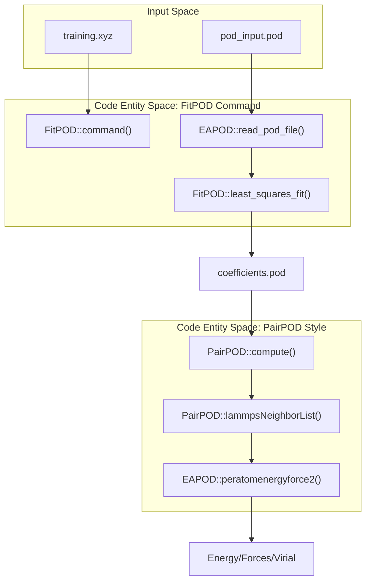
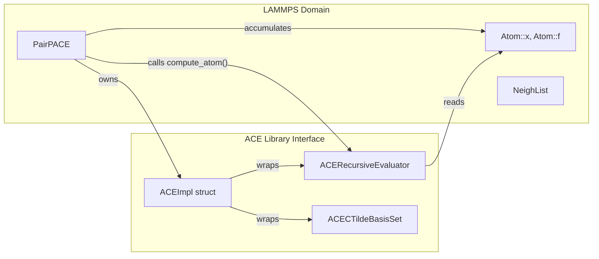

# ML-POD and ML-PACE

Relevant source files

The following files were used as context for generating this wiki page:

- [cmake/Modules/Packages/ML-PACE.cmake](cmake/Modules/Packages/ML-PACE.cmake)
- [src/EFF/fix_langevin_eff.h](src/EFF/fix_langevin_eff.h)
- [src/KOKKOS/pair_adp_kokkos.cpp](src/KOKKOS/pair_adp_kokkos.cpp)
- [src/KOKKOS/pair_adp_kokkos.h](src/KOKKOS/pair_adp_kokkos.h)
- [src/KOKKOS/pair_pace_extrapolation_kokkos.cpp](src/KOKKOS/pair_pace_extrapolation_kokkos.cpp)
- [src/KOKKOS/pair_pace_extrapolation_kokkos.h](src/KOKKOS/pair_pace_extrapolation_kokkos.h)
- [src/KOKKOS/pair_pace_kokkos.cpp](src/KOKKOS/pair_pace_kokkos.cpp)
- [src/KOKKOS/pair_pace_kokkos.h](src/KOKKOS/pair_pace_kokkos.h)
- [src/KOKKOS/pair_pod_kokkos.cpp](src/KOKKOS/pair_pod_kokkos.cpp)
- [src/KOKKOS/pair_pod_kokkos.h](src/KOKKOS/pair_pod_kokkos.h)
- [src/ML-PACE/pair_pace.cpp](src/ML-PACE/pair_pace.cpp)
- [src/ML-PACE/pair_pace.h](src/ML-PACE/pair_pace.h)
- [src/ML-PACE/pair_pace_extrapolation.cpp](src/ML-PACE/pair_pace_extrapolation.cpp)
- [src/ML-PACE/pair_pace_extrapolation.h](src/ML-PACE/pair_pace_extrapolation.h)
- [src/ML-POD/compute_pod_atom.cpp](src/ML-POD/compute_pod_atom.cpp)
- [src/ML-POD/compute_pod_atom.h](src/ML-POD/compute_pod_atom.h)
- [src/ML-POD/compute_pod_global.cpp](src/ML-POD/compute_pod_global.cpp)
- [src/ML-POD/compute_pod_global.h](src/ML-POD/compute_pod_global.h)
- [src/ML-POD/compute_pod_local.cpp](src/ML-POD/compute_pod_local.cpp)
- [src/ML-POD/compute_pod_local.h](src/ML-POD/compute_pod_local.h)
- [src/ML-POD/compute_podd_atom.cpp](src/ML-POD/compute_podd_atom.cpp)
- [src/ML-POD/compute_podd_atom.h](src/ML-POD/compute_podd_atom.h)
- [src/ML-POD/eapod.cpp](src/ML-POD/eapod.cpp)
- [src/ML-POD/eapod.h](src/ML-POD/eapod.h)
- [src/ML-POD/fitpod_command.cpp](src/ML-POD/fitpod_command.cpp)
- [src/ML-POD/fitpod_command.h](src/ML-POD/fitpod_command.h)
- [src/ML-POD/pair_pod.cpp](src/ML-POD/pair_pod.cpp)
- [src/ML-POD/pair_pod.h](src/ML-POD/pair_pod.h)
- [src/fix_pair.cpp](src/fix_pair.cpp)
- [src/fix_pair.h](src/fix_pair.h)

The ML-POD and ML-PACE packages implement machine learning interatomic potentials based on Proper Orthogonal Descriptors (POD) and Atomic Cluster Expansion (ACE), respectively. These methods represent the local atomic environment through many-body descriptors to predict energies, forces, and stresses with high accuracy.

## 8.2.1 ML-POD (Proper Orthogonal Descriptors)

The ML-POD package provides a framework for training and evaluating POD potentials. It utilizes a set of base descriptors (radial and angular) which are then compressed using Proper Orthogonal Decomposition (POD) to form a compact representation of the chemical environment.

### Training Infrastructure: `fitpod` Command

The `fitpod` command is the primary entry point for training POD potentials within LAMMPS. It handles data loading, descriptor calculation, and the solving of the linear least-squares problem to determine model coefficients.

*   **Data Structures**: The `FitPOD` class defines several internal structures to manage training data:
    *   `datastruct`: Manages configuration data including lattice, energy, stress, positions, and forces `[src/ML-POD/fitpod_command.h:34-81]()`.
    *   `descriptorstruct`: Holds base descriptors (`bd`), global descriptors (`gd`), and the least-squares matrix `A` and vector `b` `[src/ML-POD/fitpod_command.h:99-112]()`.
*   **Workflow**:
    1.  Initialize `EAPOD` evaluator `[src/ML-POD/fitpod_command.cpp:117]()`.
    2.  Read training and test data files (typically in `extxyz` format) `[src/ML-POD/fitpod_command.cpp:121-122]()`.
    3.  Perform least-squares fitting using `least_squares_fit()` `[src/ML-POD/fitpod_command.cpp:153]()`.
    4.  Save resulting coefficients to a `.pod` file `[src/ML-POD/fitpod_command.cpp:156-176]()`.

### Potential Evaluation: `pair_style pod`

The `PairPOD` class implements the force field evaluation. It can operate in two modes: a standard neighbor-loop mode and a block-based mode for optimized performance `[src/ML-POD/pair_pod.cpp:188-235]()`.

*   **Key Functions**:
    *   `compute()`: Orchestrates the calculation of energy, forces, and virials `[src/ML-POD/pair_pod.cpp:161-260]()`.
    *   `lammpsNeighborList()`: Custom neighbor list processing for POD descriptors `[src/ML-POD/pair_pod.cpp:322-351]()`.
    *   `fastpodptr`: An instance of `EAPOD` that performs the heavy mathematical lifting for descriptor and energy/force calculations `[src/ML-POD/pair_pod.h:95]()`.

### POD Data Flow Diagram

**Sources:** `[src/ML-POD/fitpod_command.cpp:104-177]()`, `[src/ML-POD/pair_pod.cpp:161-233]()`, `[src/ML-POD/eapod.cpp:135-145]()`

---

## 8.2.2 ML-PACE (Atomic Cluster Expansion)

The ML-PACE package implements the Atomic Cluster Expansion (ACE) method. It relies on an external library (`libpace`) which is integrated during the LAMMPS build process `[cmake/Modules/Packages/ML-PACE.cmake:1-68]()`.

### Core Implementation: `pair_style pace`

The `PairPACE` class serves as the interface between LAMMPS and the `ACERecursiveEvaluator`.

*   **Initialization**: The `aceimpl` structure encapsulates the `ACECTildeBasisSet` and `ACERecursiveEvaluator` `[src/ML-PACE/pair_pace.cpp:52-61]()`.
*   **Computation**: In `PairPACE::compute()`, the code iterates over the neighbor list and calls `aceimpl->ace->compute_atom()` for each atom `[src/ML-PACE/pair_pace.cpp:175-198]()`.
*   **Force Tallying**: Forces returned by the evaluator are scaled and accumulated into the LAMMPS force array `f[i]` and `f[j]` `[src/ML-PACE/pair_pace.cpp:212-221]()`.

### Uncertainty Quantification: `pair_style pace/extrapolation`

This style extends PACE to provide "extrapolation grades," which quantify the uncertainty of the potential for a given atomic configuration.

*   **Mechanism**: It uses `ACEBEvaluator` to compute projections of the local environment onto the basis set `[src/ML-PACE/pair_pace_extrapolation.cpp:220-222]()`.
*   **Output**: The per-atom extrapolation grade is stored in the `extrapolation_grade_gamma` array `[src/ML-PACE/pair_pace_extrapolation.cpp:173]()`.

### PACE Code Entity Mapping

**Sources:** `[src/ML-PACE/pair_pace.cpp:52-61]()`, `[src/ML-PACE/pair_pace.cpp:195-227]()`

---

## 8.2.3 Kokkos Acceleration

Both POD and PACE have Kokkos-enabled versions for performance portability on GPUs and multi-core CPUs.

### PairPACEKokkos
The Kokkos implementation (`PairPACEKokkos`) manages memory through `DualView` and utilizes Kokkos kernels for the heavy descriptor calculations.

*   **Memory Management**: Reallocates device buffers for radial functions (`fr`, `dfr`), density arrays (`rhos`), and intermediate projections (`A`, `A_sph`) `[src/KOKKOS/pair_pace_kokkos.cpp:115-166]()`.
*   **Execution**: Defines multiple Kokkos functors for different stages of the calculation:
    *   `TagPairPACEComputeRadial`: Calculates radial basis functions.
    *   `TagPairPACEComputeAi`: Computes the $A_i$ density functions.
    *   `TagPairPACEComputeForce`: Final force accumulation `[src/KOKKOS/pair_pace_extrapolation_kokkos.h:37-49]()`.

### Implementation Comparison

| Feature | ML-POD | ML-PACE |
| :--- | :--- | :--- |
| **Primary Class** | `PairPOD` | `PairPACE` |
| **Evaluator** | `EAPOD` | `ACERecursiveEvaluator` |
| **Training** | In-code (`fitpod` command) | External (Python/Julia) |
| **Uncertainty** | N/A | `pace/extrapolation` |
| **Kokkos Support** | Yes (`PairPODKokkos`) | Yes (`PairPACEKokkos`) |

**Sources:** `[src/ML-POD/pair_pod.h:27]()`, `[src/ML-PACE/pair_pace.h:29]()`, `[src/KOKKOS/pair_pace_kokkos.h:34]()`, `[src/ML-PACE/pair_pace_extrapolation.h:67]()`

---

## 8.2.4 Compute Styles

The ML-POD package includes specialized computes for extracting descriptor information:

*   **compute pod/atom**: Calculates POD descriptors for each atom and stores them as a per-atom array `[src/ML-POD/compute_pod_atom.cpp]()`.
*   **compute podd/atom**: Calculates the derivatives of the POD descriptors with respect to atomic positions `[src/ML-POD/compute_podd_atom.cpp]()`.
*   **compute pod/local**: Extracts local descriptor information `[src/ML-POD/compute_pod_local.cpp]()`.
*   **compute pod/global**: Sums descriptors over the system for global analysis `[src/ML-POD/compute_pod_global.cpp]()`.

**Sources:** `[src/ML-POD/compute_pod_atom.h:24]()`, `[src/ML-POD/compute_podd_atom.h:24]()`, `[src/ML-POD/compute_pod_local.h:24]()`, `[src/ML-POD/compute_pod_global.h:24]()`

---