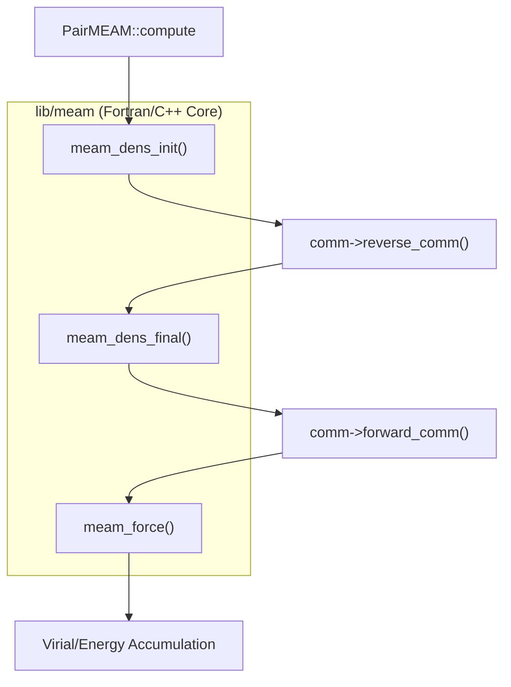

# Neural Network Potentials

Relevant source files

The following files were used as context for generating this wiki page:

- [cmake/.coveragerc.in](cmake/.coveragerc.in)
- [cmake/Modules/CodeCoverage.cmake](cmake/Modules/CodeCoverage.cmake)
- [cmake/Modules/ExternalCMakeProject.cmake](cmake/Modules/ExternalCMakeProject.cmake)
- [cmake/Modules/Packages/MDI.cmake](cmake/Modules/Packages/MDI.cmake)
- [cmake/Modules/Packages/ML-HDNNP.cmake](cmake/Modules/Packages/ML-HDNNP.cmake)
- [cmake/Modules/Packages/ML-QUIP.cmake](cmake/Modules/Packages/ML-QUIP.cmake)
- [cmake/Modules/Packages/ML-RUNNER.cmake](cmake/Modules/Packages/ML-RUNNER.cmake)
- [cmake/Modules/Packages/PLUMED.cmake](cmake/Modules/Packages/PLUMED.cmake)
- [cmake/Modules/Packages/SCAFACOS.cmake](cmake/Modules/Packages/SCAFACOS.cmake)
- [cmake/patches/runner-cmake.patch](cmake/patches/runner-cmake.patch)
- [doc/lammps.1](doc/lammps.1)
- [doc/src/Commands_removed.rst](doc/src/Commands_removed.rst)
- [doc/src/Intro_portability.rst](doc/src/Intro_portability.rst)
- [doc/src/Run_basics.rst](doc/src/Run_basics.rst)
- [doc/src/Run_options.rst](doc/src/Run_options.rst)
- [doc/src/compute_composition_atom.rst](doc/src/compute_composition_atom.rst)
- [doc/src/compute_voronoi_atom.rst](doc/src/compute_voronoi_atom.rst)
- [doc/src/fix_atc.rst](doc/src/fix_atc.rst)
- [doc/src/fix_ave_spatial.rst](doc/src/fix_ave_spatial.rst)
- [doc/src/fix_ave_spatial_sphere.rst](doc/src/fix_ave_spatial_sphere.rst)
- [doc/src/fix_deposit.rst](doc/src/fix_deposit.rst)
- [doc/src/fix_dpd_source.rst](doc/src/fix_dpd_source.rst)
- [doc/src/fix_ipi.rst](doc/src/fix_ipi.rst)
- [doc/src/fix_langevin.rst](doc/src/fix_langevin.rst)
- [doc/src/fix_pimd.rst](doc/src/fix_pimd.rst)
- [doc/src/fix_poems.rst](doc/src/fix_poems.rst)
- [doc/src/fix_pour.rst](doc/src/fix_pour.rst)
- [doc/src/pair_mgpt.rst](doc/src/pair_mgpt.rst)
- [doc/src/pair_runner.rst](doc/src/pair_runner.rst)
- [doc/src/read_restart.rst](doc/src/read_restart.rst)
- [examples/meam/in.meam](examples/meam/in.meam)
- [src/BOCS/compute_pressure_bocs.cpp](src/BOCS/compute_pressure_bocs.cpp)
- [src/KOKKOS/meam_dens_final_kokkos.h](src/KOKKOS/meam_dens_final_kokkos.h)
- [src/KOKKOS/meam_dens_init_kokkos.h](src/KOKKOS/meam_dens_init_kokkos.h)
- [src/KOKKOS/meam_force_kokkos.h](src/KOKKOS/meam_force_kokkos.h)
- [src/KOKKOS/meam_funcs_kokkos.h](src/KOKKOS/meam_funcs_kokkos.h)
- [src/KOKKOS/meam_impl_kokkos.h](src/KOKKOS/meam_impl_kokkos.h)
- [src/KOKKOS/meam_kokkos.h](src/KOKKOS/meam_kokkos.h)
- [src/KOKKOS/meam_setup_done_kokkos.h](src/KOKKOS/meam_setup_done_kokkos.h)
- [src/KOKKOS/pair_meam_kokkos.cpp](src/KOKKOS/pair_meam_kokkos.cpp)
- [src/KOKKOS/pair_meam_kokkos.h](src/KOKKOS/pair_meam_kokkos.h)
- [src/KOKKOS/pair_meam_ms_kokkos.cpp](src/KOKKOS/pair_meam_ms_kokkos.cpp)
- [src/KOKKOS/pair_meam_ms_kokkos.h](src/KOKKOS/pair_meam_ms_kokkos.h)
- [src/MEAM/meam.h](src/MEAM/meam.h)
- [src/MEAM/meam_dens_final.cpp](src/MEAM/meam_dens_final.cpp)
- [src/MEAM/meam_dens_init.cpp](src/MEAM/meam_dens_init.cpp)
- [src/MEAM/meam_force.cpp](src/MEAM/meam_force.cpp)
- [src/MEAM/meam_funcs.cpp](src/MEAM/meam_funcs.cpp)
- [src/MEAM/meam_impl.cpp](src/MEAM/meam_impl.cpp)
- [src/MEAM/meam_setup_done.cpp](src/MEAM/meam_setup_done.cpp)
- [src/MEAM/meam_setup_global.cpp](src/MEAM/meam_setup_global.cpp)
- [src/MEAM/meam_setup_param.cpp](src/MEAM/meam_setup_param.cpp)
- [src/MEAM/pair_meam.cpp](src/MEAM/pair_meam.cpp)
- [src/MEAM/pair_meam.h](src/MEAM/pair_meam.h)
- [src/MISC/fix_ipi.cpp](src/MISC/fix_ipi.cpp)
- [src/MISC/fix_ipi.h](src/MISC/fix_ipi.h)
- [src/ML-RUNNER/Install.sh](src/ML-RUNNER/Install.sh)
- [src/ML-RUNNER/pair_runner.cpp](src/ML-RUNNER/pair_runner.cpp)
- [src/ML-RUNNER/pair_runner.h](src/ML-RUNNER/pair_runner.h)
- [src/PLUMED/fix_plumed.cpp](src/PLUMED/fix_plumed.cpp)
- [src/version.h](src/version.h)
- [tools/i-pi/README.md](tools/i-pi/README.md)

Interatomic potentials based on neural networks represent a significant class of Machine Learning Interatomic Potentials (ML-IAPs) in LAMMPS. These potentials map local atomic environments to energies and forces using artificial neural network architectures. The implementations in LAMMPS cover a range of generations, from simple short-range descriptors to complex models involving global charge equilibration and committee-based uncertainty quantification.

## ML-RUNNER (RuNNer 2 Interface)

The `ML-RUNNER` package provides a high-performance interface to the **RuNNer 2** library, implementing High-Dimensional Neural Network Potentials (HDNNPs) [doc/src/pair_runner.rst:84-92](). This implementation supports multiple "generations" of HDNNPs, enabling simulations ranging from simple metallic systems to complex reactive environments with long-range interactions.

### Architecture and Data Flow

The `PairRuNNer` class manages the interaction between LAMMPS and the external Fortran-based RuNNer library. Due to the static nature of the Fortran interface, LAMMPS enforces a singleton pattern, allowing only one `pair_style runner` instance at a time [src/ML-RUNNER/pair_runner.cpp:134-136]().

The simulation flow involves transferring atom data and neighbor lists to the RuNNer library, which then computes energies and forces based on the specified HDNNP generation.

#### System Mapping: Natural Language to Code Entities

| System Concept | Code Entity | Role |
| :--- | :--- | :--- |
| **Potential Manager** | `PairRuNNer` | Central class handling initialization, coefficients, and force dispatch [src/ML-RUNNER/pair_runner.h:35-37](). |
| **RuNNer API** | `runner_lammps_interface_*` | External "C" functions for data transfer and energy/force evaluation [src/ML-RUNNER/pair_runner.cpp:38-109](). |
| **Unit Conversion** | `cfenergy`, `cflength` | Scaling factors for Bohr/Hartree native units [doc/src/pair_runner.rst:149-163](). |
| **Communication** | `COMM_AT_CHARGE`, `COMM_DEDQ` | Forward/Reverse communication buffers for charges and derivatives [src/ML-RUNNER/pair_runner.cpp:114-124](). |

### Supported Generations

`PairRuNNer` supports four distinct HDNNP generations:
1.  **2G (Second-generation):** Short-range many-body potentials where total energy is a sum of atomic contributions [doc/src/pair_runner.rst:97-101]().
2.  **3G (Third-generation):** Adds explicit long-range electrostatics using environment-dependent atomic partial charges [doc/src/pair_runner.rst:102-105]().
3.  **4G (Fourth-generation):** Includes global charge equilibration (QEq) via environment-dependent electronegativities and hardness [doc/src/pair_runner.rst:106-112]().
4.  **Augmentations:** Supports Hirshfeld-based dispersion (Tkatchenko-Scheffler) and ZBL repulsive potentials [doc/src/pair_runner.rst:113-121]().

### Committee Potentials and Uncertainty

ML-RUNNER supports **Committees**, where multiple neural networks (members) are evaluated simultaneously. The final energy and forces are the average of all members [doc/src/pair_runner.rst:192-198]().
*   **Uncertainty Quantification:** Discrepancies between committee members provide an estimate of model uncertainty.
*   **Data Storage:** Individual committee forces and charges can be written to per-atom arrays for active learning workflows [doc/src/pair_runner.rst:36-41]().

**Sources:** `src/ML-RUNNER/pair_runner.cpp`, `src/ML-RUNNER/pair_runner.h`, `doc/src/pair_runner.rst`

---

## MEAM and MEAM-Spline Potentials

The Modified Embedded Atom Method (MEAM) is a precursor to modern ML potentials, using a functional form that can be viewed as a shallow neural network with fixed descriptors. LAMMPS provides a highly optimized implementation in the `MEAM` package.

### Implementation Details

The `PairMEAM` class implements the standard MEAM formalism. It relies on the `MEAM` class (defined in `meam.h`) to perform the underlying density and force calculations [src/MEAM/pair_meam.h:43-45]().

#### MEAM Calculation Stages
The `PairMEAM::compute` function executes the calculation in three primary stages to handle the many-body density dependencies:
1.  **Density Setup/Init:** Calculates the background electron density at each atom site [src/MEAM/pair_meam.cpp:131-136]().
2.  **Density Finalization:** Performs reverse communication to sum densities and calculates the embedding energy [src/MEAM/pair_meam.cpp:137-140]().
3.  **Force Evaluation:** Computes the many-body forces based on the aggregated densities [src/MEAM/pair_meam.cpp:151-157]().

#### Data Flow Diagram: MEAM Force Calculation

**Sources:** `src/MEAM/pair_meam.cpp`, `src/MEAM/pair_meam.h`, `src/MEAM/meam.h`

---

## ML-QUIP (QUIP/GAP Interface)

The `ML-QUIP` package provides an interface to the **QUIP** (Quietly Useful Interatomic Potentials) library, which is primarily used for **GAP** (Gaussian Approximation Potentials).

### Build and Integration
The integration is managed via CMake, which can either detect an existing QUIP installation or download and build it from source [cmake/Modules/Packages/ML-QUIP.cmake:9-10]().
*   **Fortran Interoperability:** QUIP is written in Fortran; the LAMMPS interface uses `enable_language(Fortran)` and links against the `libquip` static library [cmake/Modules/Packages/ML-QUIP.cmake:1-2, 67-72]().
*   **GAP Support:** The build configuration explicitly enables `HAVE_GAP=1` and `HAVE_DESCRIPTORS_NONCOMMERCIAL=1` to support the Gaussian Approximation Potential framework [cmake/Modules/Packages/ML-QUIP.cmake:44]().

**Sources:** `cmake/Modules/Packages/ML-QUIP.cmake`

---

## External Coupling and PIMD

While not strictly NNP implementations, LAMMPS provides infrastructure to couple with external neural network drivers or perform Path Integral Molecular Dynamics (PIMD) using ML potentials.

### i-PI Interface
The `fix ipi` command allows LAMMPS to act as a client (force provider) for the i-PI Python universal force engine [src/MISC/fix_ipi.cpp:37-45]().
*   **Communication:** Uses POSIX sockets (Unix or INET domain) to exchange coordinates and forces [src/MISC/fix_ipi.cpp:87-134]().
*   **Workflow:** i-PI sends coordinates $\to$ `FixIPI` updates atom positions $\to$ LAMMPS calculates forces $\to$ `FixIPI` sends forces/virial back to i-PI [src/MISC/fix_ipi.cpp:149-172]().

### Path Integral Methods
NNPs are frequently used with `fix pimd/nvt` and `fix pimd/langevin` to capture nuclear quantum effects [doc/src/fix_pimd.rst:83-88](). These integrators use the ring-polymer isomorphism, where each quantum particle is represented by $P$ quasi-beads [doc/src/fix_pimd.rst:109-114]().

**Sources:** `src/MISC/fix_ipi.cpp`, `doc/src/fix_pimd.rst`

---

## Summary of ML Potential Packages

| Package | Style | Backend | Key Features |
| :--- | :--- | :--- | :--- |
| **ML-RUNNER** | `runner` | RuNNer 2 | 2G/3G/4G HDNNPs, Committees, QEq [doc/src/pair_runner.rst:94-112]() |
| **MEAM** | `meam` | Internal | Modified EAM, optimized for metals/alloys [src/MEAM/pair_meam.cpp:48-65]() |
| **ML-QUIP** | `quip` | QUIP/GAP | Gaussian Approximation Potentials [cmake/Modules/Packages/ML-QUIP.cmake:44]() |
| **ML-HDNNP** | `hdnnp` | n2p2 | Alternative HDNNP implementation (see section 8.2) [cmake/Modules/Packages/ML-HDNNP.cmake:1]() |

**Sources:** `src/version.h`, `doc/lammps.1`, `cmake/Modules/Packages/ML-RUNNER.cmake`

---