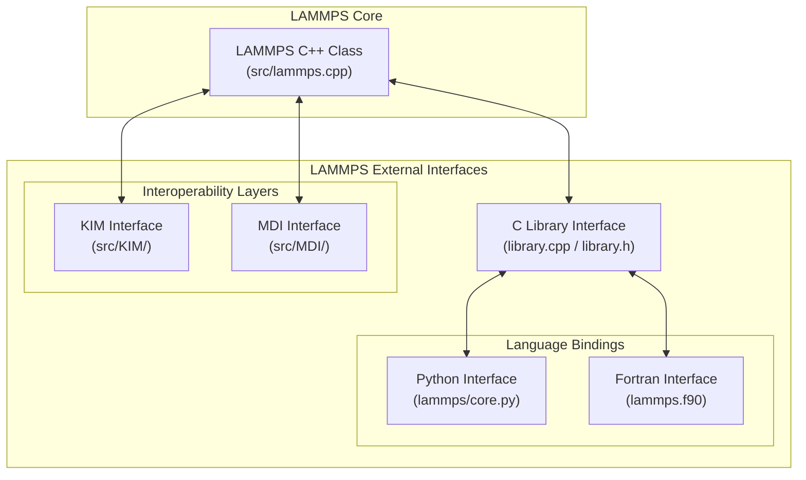

# Interfaces and Extensions

<details>
<summary>Relevant source files</summary>

The following files were used as context for generating this wiki page:

- [doc/src/Fortran.rst](doc/src/Fortran.rst)
- [doc/src/Howto_mdi.rst](doc/src/Howto_mdi.rst)
- [doc/src/Python_formats.rst](doc/src/Python_formats.rst)
- [doc/src/fix_ave_moments.rst](doc/src/fix_ave_moments.rst)
- [doc/src/fix_mdi_qm.rst](doc/src/fix_mdi_qm.rst)
- [doc/src/fix_mdi_qmmm.rst](doc/src/fix_mdi_qmmm.rst)
- [doc/src/mdi.rst](doc/src/mdi.rst)
- [doc/utils/converters/.gitignore](doc/utils/converters/.gitignore)
- [examples/COUPLE/plugin/liblammpsplugin.c](examples/COUPLE/plugin/liblammpsplugin.c)
- [examples/COUPLE/plugin/liblammpsplugin.h](examples/COUPLE/plugin/liblammpsplugin.h)
- [examples/mdi/README](examples/mdi/README)
- [examples/mdi/Run.sh](examples/mdi/Run.sh)
- [examples/mdi/in.aimd.alone](examples/mdi/in.aimd.alone)
- [examples/mdi/in.aimd.driver](examples/mdi/in.aimd.driver)
- [examples/mdi/in.aimd.driver.plugin](examples/mdi/in.aimd.driver.plugin)
- [examples/mdi/in.aimd.engine](examples/mdi/in.aimd.engine)
- [examples/mdi/in.aimdpy.mm](examples/mdi/in.aimdpy.mm)
- [examples/mdi/in.aimdpy.qm](examples/mdi/in.aimdpy.qm)
- [examples/mdi/in.sequence.python](examples/mdi/in.sequence.python)
- [examples/mdi/in.series.alone](examples/mdi/in.series.alone)
- [examples/mdi/in.series.driver](examples/mdi/in.series.driver)
- [examples/mdi/in.series.driver.plugin](examples/mdi/in.series.driver.plugin)
- [examples/mdi/in.series.engine](examples/mdi/in.series.engine)
- [examples/mdi/in.snapshot.alone](examples/mdi/in.snapshot.alone)
- [examples/mdi/in.snapshot.driver](examples/mdi/in.snapshot.driver)
- [examples/mdi/in.snapshot.driver.plugin](examples/mdi/in.snapshot.driver.plugin)
- [examples/mdi/sequence_driver.py](examples/mdi/sequence_driver.py)
- [examples/yaml/in.yaml](examples/yaml/in.yaml)
- [examples/yaml/log.7Apr22.yaml.g++.1](examples/yaml/log.7Apr22.yaml.g++.1)
- [fortran/lammps.f90](fortran/lammps.f90)
- [python/.gitignore](python/.gitignore)
- [python/install.py](python/install.py)
- [python/lammps/__init__.py](python/lammps/__init__.py)
- [python/lammps/constants.py](python/lammps/constants.py)
- [python/lammps/core.py](python/lammps/core.py)
- [python/lammps/data.py](python/lammps/data.py)
- [python/lammps/formats.py](python/lammps/formats.py)
- [python/lammps/mliap/__init__.py](python/lammps/mliap/__init__.py)
- [python/lammps/mliap/loader.py](python/lammps/mliap/loader.py)
- [python/lammps/mliap/pytorch.py](python/lammps/mliap/pytorch.py)
- [python/lammps/numpy_wrapper.py](python/lammps/numpy_wrapper.py)
- [python/makewheel.py](python/makewheel.py)
- [python/pyproject.toml](python/pyproject.toml)
- [python/setup.py](python/setup.py)
- [python/wheel_requirements.txt](python/wheel_requirements.txt)
- [src/EXTRA-FIX/fix_ave_moments.cpp](src/EXTRA-FIX/fix_ave_moments.cpp)
- [src/EXTRA-FIX/fix_ave_moments.h](src/EXTRA-FIX/fix_ave_moments.h)
- [src/KIM/fix_store_kim.cpp](src/KIM/fix_store_kim.cpp)
- [src/KIM/fix_store_kim.h](src/KIM/fix_store_kim.h)
- [src/KIM/kim_command.cpp](src/KIM/kim_command.cpp)
- [src/KIM/kim_command.h](src/KIM/kim_command.h)
- [src/KIM/kim_init.cpp](src/KIM/kim_init.cpp)
- [src/KIM/kim_init.h](src/KIM/kim_init.h)
- [src/KIM/kim_interactions.cpp](src/KIM/kim_interactions.cpp)
- [src/KIM/kim_interactions.h](src/KIM/kim_interactions.h)
- [src/KIM/kim_param.cpp](src/KIM/kim_param.cpp)
- [src/KIM/kim_param.h](src/KIM/kim_param.h)
- [src/KIM/kim_property.cpp](src/KIM/kim_property.cpp)
- [src/KIM/kim_property.h](src/KIM/kim_property.h)
- [src/KIM/kim_query.cpp](src/KIM/kim_query.cpp)
- [src/KIM/kim_query.h](src/KIM/kim_query.h)
- [src/KIM/kim_units.cpp](src/KIM/kim_units.cpp)
- [src/KIM/kim_units.h](src/KIM/kim_units.h)
- [src/KIM/pair_kim.cpp](src/KIM/pair_kim.cpp)
- [src/KIM/pair_kim.h](src/KIM/pair_kim.h)
- [src/MANIFOLD/manifold_factory.cpp](src/MANIFOLD/manifold_factory.cpp)
- [src/MDI/fix_mdi_engine.cpp](src/MDI/fix_mdi_engine.cpp)
- [src/MDI/fix_mdi_engine.h](src/MDI/fix_mdi_engine.h)
- [src/MDI/fix_mdi_qm.cpp](src/MDI/fix_mdi_qm.cpp)
- [src/MDI/fix_mdi_qm.h](src/MDI/fix_mdi_qm.h)
- [src/MDI/fix_mdi_qmmm.cpp](src/MDI/fix_mdi_qmmm.cpp)
- [src/MDI/fix_mdi_qmmm.h](src/MDI/fix_mdi_qmmm.h)
- [src/MDI/library_mdi.cpp](src/MDI/library_mdi.cpp)
- [src/MDI/library_mdi.h](src/MDI/library_mdi.h)
- [src/MDI/mdi_command.cpp](src/MDI/mdi_command.cpp)
- [src/MDI/mdi_command.h](src/MDI/mdi_command.h)
- [src/MDI/mdi_engine.cpp](src/MDI/mdi_engine.cpp)
- [src/MDI/mdi_engine.h](src/MDI/mdi_engine.h)
- [src/MDI/mdi_plugin.cpp](src/MDI/mdi_plugin.cpp)
- [src/MDI/mdi_plugin.h](src/MDI/mdi_plugin.h)
- [src/UEF/uef_utils.cpp](src/UEF/uef_utils.cpp)
- [src/library.cpp](src/library.cpp)
- [src/library.h](src/library.h)
- [tools/swig/lammps.i](tools/swig/lammps.i)
- [unittest/python/python-formats.py](unittest/python/python-formats.py)
- [unittest/python/python-pizza.py](unittest/python/python-pizza.py)

</details>


This page provides an overview of the various interfaces and extensions available for interacting with LAMMPS. While LAMMPS is primarily designed as a command-line based molecular dynamics simulator, it offers several ways to interact with it programmatically and visually. These interfaces enable developers to embed LAMMPS functionality within other applications, control simulations programmatically, and couple LAMMPS with external physics engines or interatomic model databases.

For detailed information about specific interfaces, see:
- [Library Interface](#9.1) — C/C++ API, data extraction, and plugin coupling.
- [Python Interface](#9.2) — Python class, NumPy integration, and ML-IAP PyTorch coupling.
- [KIM and MDI Interfaces](#9.3) — OpenKIM potential access and MDI code coupling.
- [Graphical User Interface](#9.4) — The visual simulation manager and editor.

## Interface Architecture Overview

LAMMPS interfaces follow a layered architecture where the C library interface serves as the foundation for higher-level bindings. The `library.cpp` file implements a C-style API that wraps the internal C++ `LAMMPS` class, allowing consistent access from Python, Fortran, and external drivers like MDI.

### Interface Hierarchy Diagram



Sources: [src/library.cpp:15-19](), [python/lammps/core.py:127-142](), [fortran/lammps.f90:14-33](), [src/KIM/pair_kim.cpp:58-72](), [src/MDI/mdi_engine.cpp:19-40]()

## C Library Interface

The C library interface is the primary entry point for embedding LAMMPS. It provides functions to create and destroy instances, execute commands, and perform high-performance data exchange via "gather" and "scatter" operations that bypass file I/O.

Key functions include:
- `lammps_open()` and `lammps_close()` for instance management [src/library.cpp:191-212]().
- `lammps_command()` for executing input script strings [src/library.cpp:586-608]().
- `lammps_extract_atom()`, `lammps_extract_compute()`, and `lammps_extract_fix()` for direct pointer access to internal memory [src/library.cpp:1151-1224]().
- `lammps_gather_atoms()` and `lammps_scatter_atoms()` for efficient parallel data transfer [src/library.cpp:2104-2228]().

For details, see [Library Interface](#9.1).

Sources: [src/library.h:132-189](), [src/library.cpp:97-110]()

## Python Interface

The Python interface uses `ctypes` to wrap the C library, providing an object-oriented `lammps` class. It supports direct integration with NumPy for zero-copy data manipulation and allows users to write custom fixes and pair styles in Python.

### Python Entity Mapping

```mermaid
classDiagram
    class "Python lammps class" {
        +__init__(name, cmdargs, ptr, comm)
        +command(cmd)
        +extract_atom(name)
        +numpy.extract_atom(name)
        +gather_atoms(name)
    }
    class "ctypes backend" {
        +liblammps.so
        +lammps_open()
        +lammps_extract_atom()
    }
    class "LAMMPS C++ Core" {
        +Atom::x
        +Atom::v
        +Force::pair
    }
    "Python lammps class" ..> "ctypes backend" : wraps
    "ctypes backend" ..> "LAMMPS C++ Core" : calls
```

Sources: [python/lammps/core.py:127-152](), [python/lammps/core.py:615-630](), [python/lammps/numpy_wrapper.py:12-40]()

Key capabilities include:
- **NumPy Integration**: The `lammps.numpy` module provides wrappers that return data as NumPy arrays [python/lammps/numpy_wrapper.py:12-25]().
- **PyTorch Coupling**: Support for ML-IAP (Machine Learning Interatomic Potentials) using PyTorch models [python/lammps/mliap/pytorch.py:14-30]().
- **Python Fixes**: `fix python/invoke` and `fix python/move` allow Python code to run during the MD loop.

For details, see [Python Interface](#9.2).

## KIM and MDI Interfaces

LAMMPS supports two major interoperability standards:

### OpenKIM (Knowledgebase of Interatomic Models)
The KIM interface allows LAMMPS to use any potential archived in the OpenKIM repository. It uses the `pair_kim` style to communicate with the KIM API.
- `kim_init`: Initializes the model and units [src/KIM/kim_init.cpp:84-116]().
- `pair_kim`: The bridge between LAMMPS force calls and KIM model evaluations [src/KIM/pair_kim.cpp:97-147]().
- `kim_query`: Queries the OpenKIM web database for model metadata [src/KIM/kim_query.cpp:107-167]().

### MDI (MolSSI Driver Interface)
The MDI interface enables code coupling, allowing LAMMPS to act as an "engine" controlled by an external "driver" (e.g., for QM/MM).
- `mdi_engine`: Sets up LAMMPS to listen for MDI commands [src/MDI/mdi_engine.cpp:67-112]().
- `fix mdi/qm` and `fix mdi/qmmm`: Specific fixes for quantum mechanics coupling [src/MDI/fix_mdi_qm.cpp:25-45]().

For details, see [KIM and MDI Interfaces](#9.3).

Sources: [src/KIM/pair_kim.h:75-96](), [src/MDI/mdi_engine.h:25-45]()

## Graphical User Interface

The LAMMPS GUI provides a desktop environment for simulation management. It includes a specialized `CodeEditor` with syntax highlighting for LAMMPS input scripts and a `LammpsWrapper` to drive the C library.

Key GUI features:
- **Interactive Execution**: Run simulations and view log output in real-time [tools/lammps-gui/lammpsgui.cpp:240-280]().
- **Visualization**: Built-in `ChartWindow` for thermo data and `ImageViewer` for `dump image` results [tools/lammps-gui/lammpsgui.h:65-80]().

For details, see [Graphical User Interface](#9.4).

Sources: [tools/lammps-gui/lammpsgui.cpp:72-100]()

---