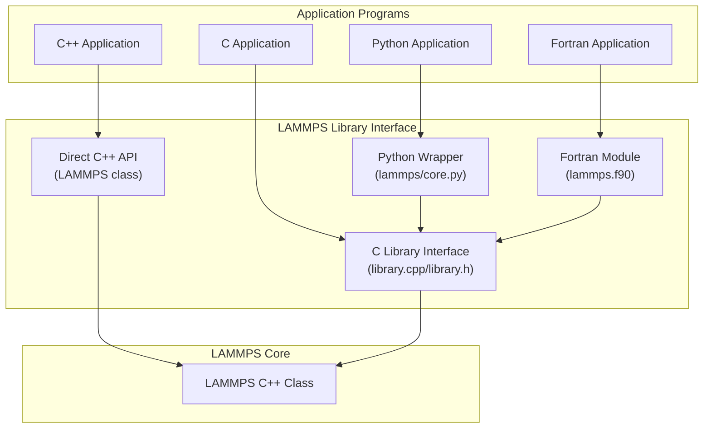
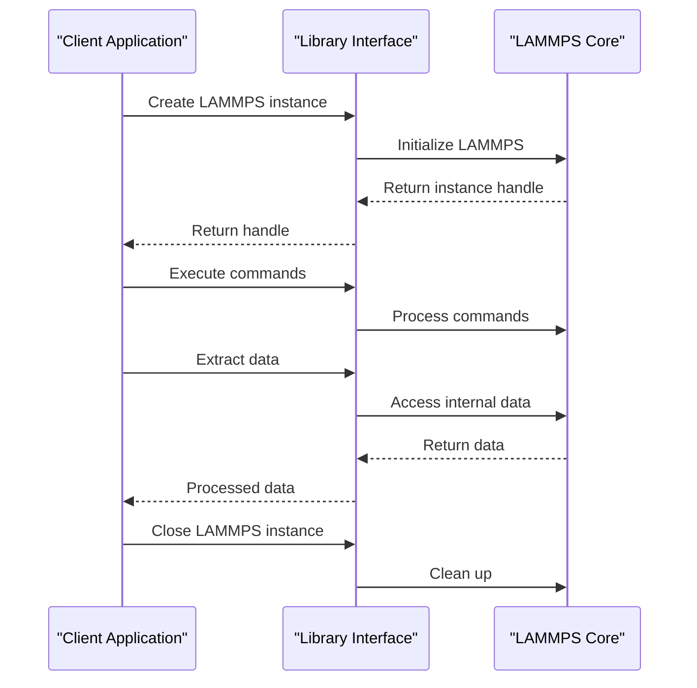
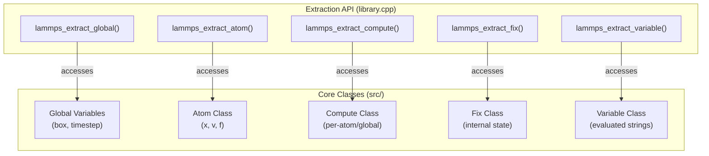

# Library Interface

<details>
<summary>Relevant source files</summary>

The following files were used as context for generating this wiki page:

- [doc/src/Fortran.rst](doc/src/Fortran.rst)
- [doc/src/Python_formats.rst](doc/src/Python_formats.rst)
- [doc/utils/converters/.gitignore](doc/utils/converters/.gitignore)
- [examples/COUPLE/plugin/liblammpsplugin.c](examples/COUPLE/plugin/liblammpsplugin.c)
- [examples/COUPLE/plugin/liblammpsplugin.h](examples/COUPLE/plugin/liblammpsplugin.h)
- [examples/yaml/in.yaml](examples/yaml/in.yaml)
- [examples/yaml/log.7Apr22.yaml.g++.1](examples/yaml/log.7Apr22.yaml.g++.1)
- [fortran/lammps.f90](fortran/lammps.f90)
- [python/.gitignore](python/.gitignore)
- [python/install.py](python/install.py)
- [python/lammps/__init__.py](python/lammps/__init__.py)
- [python/lammps/constants.py](python/lammps/constants.py)
- [python/lammps/core.py](python/lammps/core.py)
- [python/lammps/data.py](python/lammps/data.py)
- [python/lammps/formats.py](python/lammps/formats.py)
- [python/lammps/mliap/__init__.py](python/lammps/mliap/__init__.py)
- [python/lammps/mliap/loader.py](python/lammps/mliap/loader.py)
- [python/lammps/mliap/pytorch.py](python/lammps/mliap/pytorch.py)
- [python/lammps/numpy_wrapper.py](python/lammps/numpy_wrapper.py)
- [python/makewheel.py](python/makewheel.py)
- [python/pyproject.toml](python/pyproject.toml)
- [python/setup.py](python/setup.py)
- [python/wheel_requirements.txt](python/wheel_requirements.txt)
- [src/FEP/pair_morse_soft.cpp](src/FEP/pair_morse_soft.cpp)
- [src/FEP/pair_morse_soft.h](src/FEP/pair_morse_soft.h)
- [src/library.cpp](src/library.cpp)
- [src/library.h](src/library.h)
- [tools/swig/lammps.i](tools/swig/lammps.i)
- [unittest/c-library/test_library_commands.cpp](unittest/c-library/test_library_commands.cpp)
- [unittest/c-library/test_library_objects.cpp](unittest/c-library/test_library_objects.cpp)
- [unittest/c-library/test_library_open.cpp](unittest/c-library/test_library_open.cpp)
- [unittest/c-library/test_library_properties.cpp](unittest/c-library/test_library_properties.cpp)
- [unittest/cplusplus/test_input_class.cpp](unittest/cplusplus/test_input_class.cpp)
- [unittest/fortran/CMakeLists.txt](unittest/fortran/CMakeLists.txt)
- [unittest/fortran/atomdata.txt](unittest/fortran/atomdata.txt)
- [unittest/fortran/data.fourmol](unittest/fortran/data.fourmol)
- [unittest/fortran/greetings.txt](unittest/fortran/greetings.txt)
- [unittest/fortran/in.fourmol](unittest/fortran/in.fourmol)
- [unittest/fortran/keepstuff.f90](unittest/fortran/keepstuff.f90)
- [unittest/fortran/test_fortran_box.f90](unittest/fortran/test_fortran_box.f90)
- [unittest/fortran/test_fortran_commands.f90](unittest/fortran/test_fortran_commands.f90)
- [unittest/fortran/test_fortran_configuration.f90](unittest/fortran/test_fortran_configuration.f90)
- [unittest/fortran/test_fortran_create.f90](unittest/fortran/test_fortran_create.f90)
- [unittest/fortran/test_fortran_create_atoms.f90](unittest/fortran/test_fortran_create_atoms.f90)
- [unittest/fortran/test_fortran_extract_atom.f90](unittest/fortran/test_fortran_extract_atom.f90)
- [unittest/fortran/test_fortran_extract_compute.f90](unittest/fortran/test_fortran_extract_compute.f90)
- [unittest/fortran/test_fortran_extract_fix.f90](unittest/fortran/test_fortran_extract_fix.f90)
- [unittest/fortran/test_fortran_extract_global.f90](unittest/fortran/test_fortran_extract_global.f90)
- [unittest/fortran/test_fortran_extract_variable.f90](unittest/fortran/test_fortran_extract_variable.f90)
- [unittest/fortran/test_fortran_gather_scatter.f90](unittest/fortran/test_fortran_gather_scatter.f90)
- [unittest/fortran/test_fortran_get_thermo.f90](unittest/fortran/test_fortran_get_thermo.f90)
- [unittest/fortran/test_fortran_neighlist.f90](unittest/fortran/test_fortran_neighlist.f90)
- [unittest/fortran/test_fortran_properties.f90](unittest/fortran/test_fortran_properties.f90)
- [unittest/fortran/test_main.cpp](unittest/fortran/test_main.cpp)
- [unittest/fortran/test_main.h](unittest/fortran/test_main.h)
- [unittest/fortran/wrap_box.cpp](unittest/fortran/wrap_box.cpp)
- [unittest/fortran/wrap_commands.cpp](unittest/fortran/wrap_commands.cpp)
- [unittest/fortran/wrap_configuration.cpp](unittest/fortran/wrap_configuration.cpp)
- [unittest/fortran/wrap_create.cpp](unittest/fortran/wrap_create.cpp)
- [unittest/fortran/wrap_create_atoms.cpp](unittest/fortran/wrap_create_atoms.cpp)
- [unittest/fortran/wrap_extract_atom.cpp](unittest/fortran/wrap_extract_atom.cpp)
- [unittest/fortran/wrap_extract_compute.cpp](unittest/fortran/wrap_extract_compute.cpp)
- [unittest/fortran/wrap_extract_fix.cpp](unittest/fortran/wrap_extract_fix.cpp)
- [unittest/fortran/wrap_extract_global.cpp](unittest/fortran/wrap_extract_global.cpp)
- [unittest/fortran/wrap_extract_variable.cpp](unittest/fortran/wrap_extract_variable.cpp)
- [unittest/fortran/wrap_gather_scatter.cpp](unittest/fortran/wrap_gather_scatter.cpp)
- [unittest/fortran/wrap_get_thermo.cpp](unittest/fortran/wrap_get_thermo.cpp)
- [unittest/fortran/wrap_neighlist.cpp](unittest/fortran/wrap_neighlist.cpp)
- [unittest/fortran/wrap_properties.cpp](unittest/fortran/wrap_properties.cpp)
- [unittest/python/python-commands.py](unittest/python/python-commands.py)
- [unittest/python/python-formats.py](unittest/python/python-formats.py)
- [unittest/python/python-numpy.py](unittest/python/python-numpy.py)
- [unittest/python/python-open.py](unittest/python/python-open.py)
- [unittest/python/python-pizza.py](unittest/python/python-pizza.py)
- [unittest/utils/test_lepton.cpp](unittest/utils/test_lepton.cpp)

</details>


This page documents the LAMMPS library interface, which allows external programs to use LAMMPS as a simulation engine. The library interface provides APIs in C, C++, Python, and Fortran to create LAMMPS instances, send commands, extract data, and manipulate simulations programmatically without using the standalone LAMMPS executable. For information about using LAMMPS through its Python interface specifically, see [Python Interface](#9.2).

## Overview

LAMMPS can be built as a shared or static library and then linked with an external program. The library interface provides several layers of API:

Title: LAMMPS Library Architecture


Sources: [src/library.cpp:15-19](), [src/library.h:17-22](), [python/lammps/core.py:13-16](), [fortran/lammps.f90:14-17]()

The C library API serves as the foundation for the Python and Fortran interfaces, providing a language-agnostic way to interact with LAMMPS. C++ programs can directly instantiate the `LAMMPS` class for tighter integration.

## Initialization and Termination

All interfaces follow a similar pattern: create a LAMMPS instance, interact with it, and then clean up resources.

Title: Library Data Flow Sequence


Sources: [src/library.cpp:191-212](), [src/library.cpp:315-334]()

### C API: Creating and Destroying LAMMPS Instances

The C API provides functions to create and destroy LAMMPS instances. If MPI is not yet initialized, `MPI_Init()` is called during creation [src/library.cpp:152-153]().

| Function | Purpose |
| :--- | :--- |
| `lammps_open` | Creates a new instance with a specific MPI communicator [src/library.cpp:191](). |
| `lammps_open_no_mpi` | Creates a new instance using `MPI_COMM_WORLD` implicitly [src/library.cpp:218](). |
| `lammps_open_fortran` | Creates a new instance for Fortran callers [src/library.cpp:255](). |
| `lammps_close` | Deletes the LAMMPS instance and frees memory [src/library.cpp:315](). |

Sources: [src/library.cpp:191-312](), [src/library.h:135-140]()

### Python API: Creating a LAMMPS Instance

The Python interface wraps the C API in a class-based interface using `ctypes` [python/lammps/core.py:14-15]().

```python
from lammps import lammps
# Instantiate the lammps class
lmp = lammps(name="", cmdargs=None, ptr=None, comm=None)
# Use LAMMPS...
lmp.close()
```

Sources: [python/lammps/core.py:127-157](), [python/lammps/core.py:642-650]()

### Fortran API: Creating a LAMMPS Instance

The Fortran interface provides a derived type `lammps` that uses `ISO_C_BINDING` to call the C API [fortran/lammps.f90:34-40]().

```fortran
USE LIBLAMMPS
TYPE(lammps) :: lmp
! Create instance
lmp = lammps(args)
! Use LAMMPS...
CALL lmp%close(.TRUE.)  ! .TRUE. to finalize MPI/Kokkos/Python
```

Sources: [fortran/lammps.f90:97-103](), [doc/src/Fortran.rst:64-93]()

## Command Execution

All interfaces provide methods to run LAMMPS commands, either individually, as a list, or from a file.

### C API: Executing Commands

```c
void lammps_file(void *handle, const char *file);
char *lammps_command(void *handle, const char *cmd);
void lammps_commands_list(void *handle, int ncmd, const char **cmds);
void lammps_commands_string(void *handle, const char *str);
```

Sources: [src/library.cpp:575-593](), [src/library.cpp:615-635](), [src/library.cpp:659-684](), [src/library.cpp:688-713]()

### Python API: Executing Commands

The Python interface provides a `command_wrapper` that allows calling LAMMPS commands as if they were Python methods [python/lammps/core.py:58-93]().

```python
lmp.command("create_box 1 box")
lmp.commands_list(["pair_style lj/cut 2.5", "pair_coeff * * 1.0 1.0"])
# Or using the command wrapper
lmp.run(100)
```

Sources: [python/lammps/core.py:780-802](), [unittest/python/python-commands.py:97-123]()

### Fortran API: Executing Commands

```fortran
CALL lmp%command("variable zpos index 1.0")
CALL lmp%file('in.melt')
CALL lmp%commands_list(cmdlist)
```

Sources: [doc/src/Fortran.rst:134-174](), [fortran/lammps.f90:106-109]()

## Data Extraction and Manipulation

The library interfaces provide methods to access LAMMPS data and modify the simulation state using specific constants to define data types and styles.

### Data Extraction Constants

These constants must be kept in sync across all interfaces [src/library.h:43-47]().

| Constant | Description |
| :--- | :--- |
| `LAMMPS_INT` | 32-bit integer [src/library.h:51]() |
| `LAMMPS_DOUBLE` | 64-bit double [src/library.h:53]() |
| `LMP_STYLE_GLOBAL` | Return global data [src/library.h:67]() |
| `LMP_STYLE_ATOM` | Return per-atom data [src/library.h:68]() |
| `LMP_TYPE_SCALAR` | Return scalar value [src/library.h:79]() |

Sources: [src/library.h:49-123](), [fortran/lammps.f90:51-80](), [python/lammps/constants.py:15-50]()

### Accessing Internal LAMMPS Data

Title: Entity Space Mapping for Extraction


Sources: [src/library.cpp:1155-1215](), [src/library.cpp:1240-1280](), [src/library.cpp:1297-1345](), [src/library.cpp:1355-1410](), [src/library.cpp:1425-1470]()

#### C API Examples
```c
// Extract global timestep
void *ptr = lammps_extract_global(handle, "ntimestep");
// Extract per-atom coordinates
double **x = (double **) lammps_extract_atom(handle, "x");
```

Sources: [src/library.cpp:1155](), [src/library.cpp:1240]()

#### Python NumPy Integration
The `numpy_wrapper` transforms raw `ctypes` pointers into NumPy arrays for direct, zero-copy access to LAMMPS memory [python/lammps/numpy_wrapper.py:33-36]().

```python
# Returns a NumPy array viewing LAMMPS internal memory
pos = lmp.numpy.extract_atom("x")
```

Sources: [python/lammps/numpy_wrapper.py:59-110]()

### Gather/Scatter Operations

These functions copy data between LAMMPS and a provided buffer, handling atom communication and ordering.

| Function | Purpose |
| :--- | :--- |
| `lammps_gather_atoms` | Collects per-atom data from all processors to a buffer [src/library.cpp:1570](). |
| `lammps_scatter_atoms` | Distributes per-atom data from a buffer to all processors [src/library.cpp:1685](). |

Sources: [src/library.cpp:1570-1678](), [src/library.cpp:1685-1791]()

## Plugins and External Coupling

### The liblammpsplugin Interface
The `liblammpsplugin.h` header defines a variant of the C interface intended for dynamic loading as a plugin to other software [examples/COUPLE/plugin/liblammpsplugin.h:17-21](). It uses an ABI versioning system to ensure compatibility [examples/COUPLE/plugin/liblammpsplugin.h:118]().

Sources: [examples/COUPLE/plugin/liblammpsplugin.h:1-120]()

### SWIG Interface
LAMMPS provides a SWIG interface file (`lammps.i`) to facilitate generating bindings for other languages like Lua [tools/swig/lammps.i:1-21](). It maps C types to pointer and array functions [tools/swig/lammps.i:6-12]().

Sources: [tools/swig/lammps.i:1-160]()

## Summary of Key Library Functions

| Interface | Initialization | Command Execution | Data Extraction |
| :--- | :--- | :--- | :--- |
| **C** | `lammps_open` | `lammps_command` | `lammps_extract_global` |
| **Python** | `lammps()` | `lmp.command()` | `lmp.extract_global()` |
| **Fortran** | `lammps()` | `lmp%command()` | `lmp%extract_global()` |

Sources: [src/library.h:131-200](), [python/lammps/core.py:127-157](), [fortran/lammps.f90:97-131]()

---