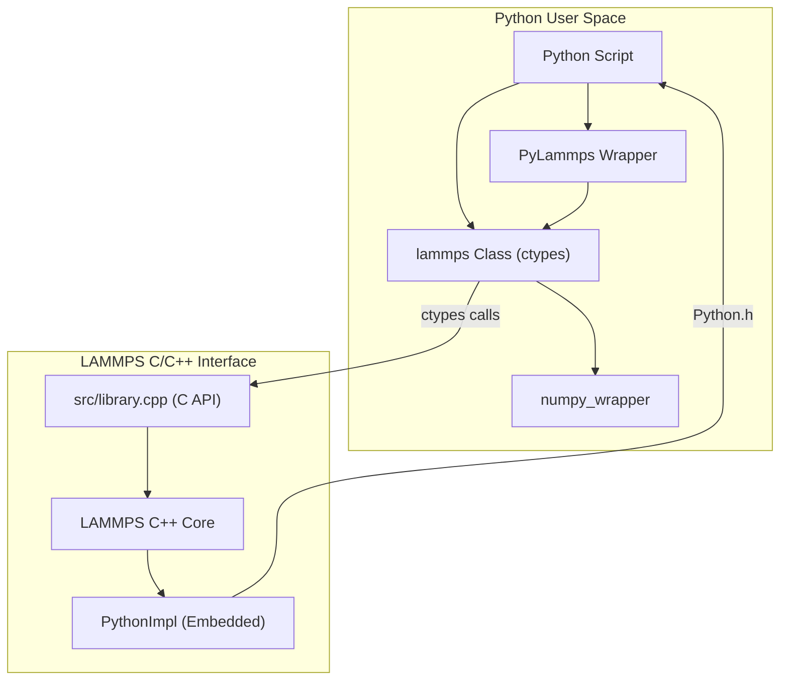
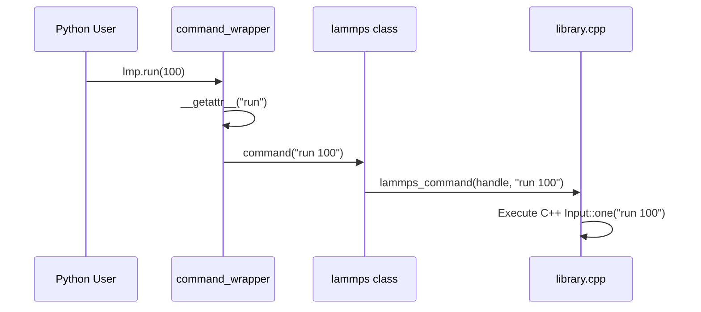

# Python Interface

<details>
<summary>Relevant source files</summary>

The following files were used as context for generating this wiki page:

- [doc/src/Fortran.rst](doc/src/Fortran.rst)
- [doc/src/Python_formats.rst](doc/src/Python_formats.rst)
- [doc/src/python.rst](doc/src/python.rst)
- [doc/utils/converters/.gitignore](doc/utils/converters/.gitignore)
- [examples/COUPLE/plugin/liblammpsplugin.c](examples/COUPLE/plugin/liblammpsplugin.c)
- [examples/COUPLE/plugin/liblammpsplugin.h](examples/COUPLE/plugin/liblammpsplugin.h)
- [examples/python/README.fix_python_move](examples/python/README.fix_python_move)
- [examples/python/dump.1May25.python.wrap.g++.1](examples/python/dump.1May25.python.wrap.g++.1)
- [examples/python/dump.1May25.python.wrap.g++.4](examples/python/dump.1May25.python.wrap.g++.4)
- [examples/python/in.fix_python_move_nve_melt](examples/python/in.fix_python_move_nve_melt)
- [examples/python/in.fix_python_move_nve_melt_group](examples/python/in.fix_python_move_nve_melt_group)
- [examples/python/in.fix_python_move_nve_melt_opt](examples/python/in.fix_python_move_nve_melt_opt)
- [examples/python/in.pair_python_coulomb](examples/python/in.pair_python_coulomb)
- [examples/python/in.pair_python_hybrid](examples/python/in.pair_python_hybrid)
- [examples/python/in.pair_python_melt](examples/python/in.pair_python_melt)
- [examples/python/in.pair_python_spce](examples/python/in.pair_python_spce)
- [examples/python/in.pair_python_table](examples/python/in.pair_python_table)
- [examples/python/in.python.wrap](examples/python/in.python.wrap)
- [examples/python/log.1May25.python.wrap.g++.1](examples/python/log.1May25.python.wrap.g++.1)
- [examples/python/log.1May25.python.wrap.g++.4](examples/python/log.1May25.python.wrap.g++.4)
- [examples/python/log.7Aug25.fix_python_move_nve_melt.g++.1](examples/python/log.7Aug25.fix_python_move_nve_melt.g++.1)
- [examples/python/log.7Aug25.fix_python_move_nve_melt.g++.4](examples/python/log.7Aug25.fix_python_move_nve_melt.g++.4)
- [examples/python/log.7Aug25.fix_python_move_nve_melt_group.g++.1](examples/python/log.7Aug25.fix_python_move_nve_melt_group.g++.1)
- [examples/python/py_pot.py](examples/python/py_pot.py)
- [examples/yaml/in.yaml](examples/yaml/in.yaml)
- [examples/yaml/log.7Apr22.yaml.g++.1](examples/yaml/log.7Apr22.yaml.g++.1)
- [fortran/lammps.f90](fortran/lammps.f90)
- [python/.gitignore](python/.gitignore)
- [python/install.py](python/install.py)
- [python/lammps/__init__.py](python/lammps/__init__.py)
- [python/lammps/constants.py](python/lammps/constants.py)
- [python/lammps/core.py](python/lammps/core.py)
- [python/lammps/data.py](python/lammps/data.py)
- [python/lammps/formats.py](python/lammps/formats.py)
- [python/lammps/mliap/__init__.py](python/lammps/mliap/__init__.py)
- [python/lammps/mliap/loader.py](python/lammps/mliap/loader.py)
- [python/lammps/mliap/pytorch.py](python/lammps/mliap/pytorch.py)
- [python/lammps/numpy_wrapper.py](python/lammps/numpy_wrapper.py)
- [python/makewheel.py](python/makewheel.py)
- [python/pyproject.toml](python/pyproject.toml)
- [python/setup.py](python/setup.py)
- [python/wheel_requirements.txt](python/wheel_requirements.txt)
- [src/ADIOS/adios_common.h](src/ADIOS/adios_common.h)
- [src/ADIOS/dump_atom_adios.cpp](src/ADIOS/dump_atom_adios.cpp)
- [src/ADIOS/dump_atom_adios.h](src/ADIOS/dump_atom_adios.h)
- [src/ADIOS/dump_custom_adios.cpp](src/ADIOS/dump_custom_adios.cpp)
- [src/ADIOS/dump_custom_adios.h](src/ADIOS/dump_custom_adios.h)
- [src/ADIOS/reader_adios.cpp](src/ADIOS/reader_adios.cpp)
- [src/ADIOS/reader_adios.h](src/ADIOS/reader_adios.h)
- [src/ELECTRODE/electrode_kspace.h](src/ELECTRODE/electrode_kspace.h)
- [src/H5MD/dump_h5md.cpp](src/H5MD/dump_h5md.cpp)
- [src/H5MD/dump_h5md.h](src/H5MD/dump_h5md.h)
- [src/ML-HDNNP/pair_hdnnp.cpp](src/ML-HDNNP/pair_hdnnp.cpp)
- [src/OPENMP/thr_omp.cpp](src/OPENMP/thr_omp.cpp)
- [src/OPENMP/thr_omp.h](src/OPENMP/thr_omp.h)
- [src/PYTHON/fix_python_invoke.cpp](src/PYTHON/fix_python_invoke.cpp)
- [src/PYTHON/fix_python_invoke.h](src/PYTHON/fix_python_invoke.h)
- [src/PYTHON/fix_python_move.cpp](src/PYTHON/fix_python_move.cpp)
- [src/PYTHON/fix_python_move.h](src/PYTHON/fix_python_move.h)
- [src/PYTHON/pair_python.cpp](src/PYTHON/pair_python.cpp)
- [src/PYTHON/pair_python.h](src/PYTHON/pair_python.h)
- [src/PYTHON/python_compat.h](src/PYTHON/python_compat.h)
- [src/PYTHON/python_impl.cpp](src/PYTHON/python_impl.cpp)
- [src/PYTHON/python_impl.h](src/PYTHON/python_impl.h)
- [src/library.cpp](src/library.cpp)
- [src/library.h](src/library.h)
- [src/lmppython.cpp](src/lmppython.cpp)
- [src/lmppython.h](src/lmppython.h)
- [src/pointers.h](src/pointers.h)
- [tools/swig/lammps.i](tools/swig/lammps.i)
- [unittest/CMakeLists.txt](unittest/CMakeLists.txt)
- [unittest/c-library/CMakeLists.txt](unittest/c-library/CMakeLists.txt)
- [unittest/c-library/test_library_config.cpp](unittest/c-library/test_library_config.cpp)
- [unittest/cplusplus/CMakeLists.txt](unittest/cplusplus/CMakeLists.txt)
- [unittest/cplusplus/test_lammps_class.cpp](unittest/cplusplus/test_lammps_class.cpp)
- [unittest/cplusplus/test_neighbor_class.cpp](unittest/cplusplus/test_neighbor_class.cpp)
- [unittest/python/CMakeLists.txt](unittest/python/CMakeLists.txt)
- [unittest/python/func.py](unittest/python/func.py)
- [unittest/python/python-formats.py](unittest/python/python-formats.py)
- [unittest/python/python-pizza.py](unittest/python/python-pizza.py)
- [unittest/python/run.py](unittest/python/run.py)
- [unittest/python/test_python_package.cpp](unittest/python/test_python_package.cpp)
- [unittest/testing/systems/melt.h](unittest/testing/systems/melt.h)
- [unittest/testing/utils.h](unittest/testing/utils.h)
- [unittest/utils/CMakeLists.txt](unittest/utils/CMakeLists.txt)

</details>


The Python Interface provides bindings to interact with LAMMPS directly from Python code. It bridges Python's flexibility and scientific ecosystem (like NumPy and PyTorch) with the high-performance C++ core of LAMMPS. The interface is primarily based on `ctypes`, loading the LAMMPS shared library (`.so`, `.dylib`, or `.dll`) and calling the C-style API defined in `src/library.cpp`.

## Architecture Overview

The Python interface is layered, starting from a low-level `ctypes` wrapper and moving up to high-level Pythonic abstractions.


Sources: [python/lammps/core.py:14-30](), [src/library.cpp:15-19](), [src/PYTHON/python_impl.cpp:71-145]()

## Core Python Interface (`lammps` class)

The `lammps` class in `python/lammps/core.py` is the primary handle for controlling a simulation. It uses `ctypes` to map Python calls to the `lammps_open`, `lammps_command`, and data extraction functions in the C library.

### Initialization and MPI
The constructor allows loading a specific shared library, passing command-line arguments, or wrapping an existing C++ pointer (useful for embedded Python).

```python
from lammps import lammps
# Load liblammps.so and init MPI
lmp = lammps(cmdargs=["-log", "none"]) 
```

Implementation details for initialization:
- **Shared Library Loading**: Searches for `liblammps.so` or variants based on the `name` parameter [python/lammps/core.py:161-230]().
- **MPI Handling**: Can accept an `mpi4py` communicator via the `comm` argument, which is converted to a C MPI communicator [python/lammps/core.py:446-520]().
- **Exception Handling**: The `ExceptionCheck` class captures C++ exceptions thrown in the core and re-raises them as Python exceptions [python/lammps/core.py:44-55]().

Sources: [python/lammps/core.py:127-152](), [python/lammps/core.py:446-520](), [src/library.cpp:191-212]()

### Data Flow: Command Execution
Commands are sent to the C++ engine via `lammps_command` [src/library.cpp:158](). The `command_wrapper` class provides a "magic" interface where LAMMPS commands appear as Python methods.


Sources: [python/lammps/core.py:58-123](), [python/lammps/core.py:635-654]()

## NumPy Integration

The `numpy_wrapper` class (accessed via `lmp.numpy`) allows direct memory access to LAMMPS internal arrays (atom coordinates, forces, etc.) without expensive data copying.

- **Direct Access**: It uses `np.ctypeslib.as_array` to wrap C pointers [python/lammps/numpy_wrapper.py:31-44]().
- **Atom Data**: `extract_atom` retrieves per-atom properties like `x`, `v`, or `f` as NumPy arrays [python/lammps/numpy_wrapper.py:59-111]().
- **Compute/Fix Data**: Supports extracting global, per-atom, or local data from computes and fixes [python/lammps/numpy_wrapper.py:114-155]().

Sources: [python/lammps/numpy_wrapper.py:29-46](), [python/lammps/numpy_wrapper.py:59-111]()

## Embedded Python and Coupling

LAMMPS can host a Python interpreter to execute Python code during a simulation via the `PYTHON` package.

### fix python/invoke and fix python/move
- **fix python/invoke**: Calls a Python function at specific simulation stages (e.g., every N steps) [src/PYTHON/fix_python_invoke.cpp:46-60]().
- **fix python/move**: Allows atom coordinates/velocities to be updated by a Python script during integration [src/PYTHON/fix_python_move.cpp:32-45]().
- **pair_python**: Implements a pair potential entirely in Python, allowing rapid prototyping of new force fields [src/PYTHON/pair_python.cpp:45-70]().

### ML-IAP PyTorch Coupling
The `ML-IAP` framework supports PyTorch backends. This involves a complex C++/Python coupling where C++ descriptors are passed to a PyTorch model to compute energies and forces.
- **Implementation**: Uses `mliap_model_python_couple.h` to bridge C++ and the PyTorch environment [src/PYTHON/python_impl.cpp:32-62]().
- **Initialization**: The `PythonImpl` class registers the `mliappy` module with the embedded interpreter [src/PYTHON/python_impl.cpp:94-123]().

Sources: [src/PYTHON/python_impl.cpp:71-145](), [src/PYTHON/fix_python_invoke.cpp:24-40](), [src/PYTHON/pair_python.cpp:28-40]()

## Advanced I/O: ADIOS and H5MD
The Python interface interacts with advanced I/O formats that are often used in data science pipelines:
- **ADIOS**: `dump atom/adios` and `dump custom/adios` provide high-performance parallel I/O [src/ADIOS/dump_atom_adios.cpp:38-55]().
- **H5MD**: `dump h5md` implements the H5MD standard for HDF5 trajectory files [src/H5MD/dump_h5md.cpp:45-60]().

Sources: [src/ADIOS/dump_atom_adios.cpp:20-35](), [src/H5MD/dump_h5md.cpp:25-40]()

## Installation and Build System

The Python interface requires the LAMMPS shared library to be built (`BUILD_SHARED_LIBS=ON` in CMake).

### Python Package Installation
The `python/install.py` script manages the creation of a Python "wheel" and its installation into `site-packages`.
- **Process**:
    1. Copies the Python source tree to a build folder [python/install.py:90-92]().
    2. Copies the compiled shared library into the package [python/install.py:94-97]().
    3. Uses `makewheel.py` to build the `.whl` file [python/install.py:107-110]().
    4. Installs via `pip` [python/install.py:149-168]().

### Testing
Unit tests for the Python interface are located in `unittest/python/`. They verify:
- Basic library opening and command execution [unittest/python/CMakeLists.txt:78-86]().
- NumPy integration and scatter/gather performance [unittest/python/CMakeLists.txt:89-94]().
- Interaction with fixes and computes [unittest/python/CMakeLists.txt:111-124]().

Sources: [python/install.py:1-33](), [python/install.py:79-121](), [unittest/python/CMakeLists.txt:1-50]()

---