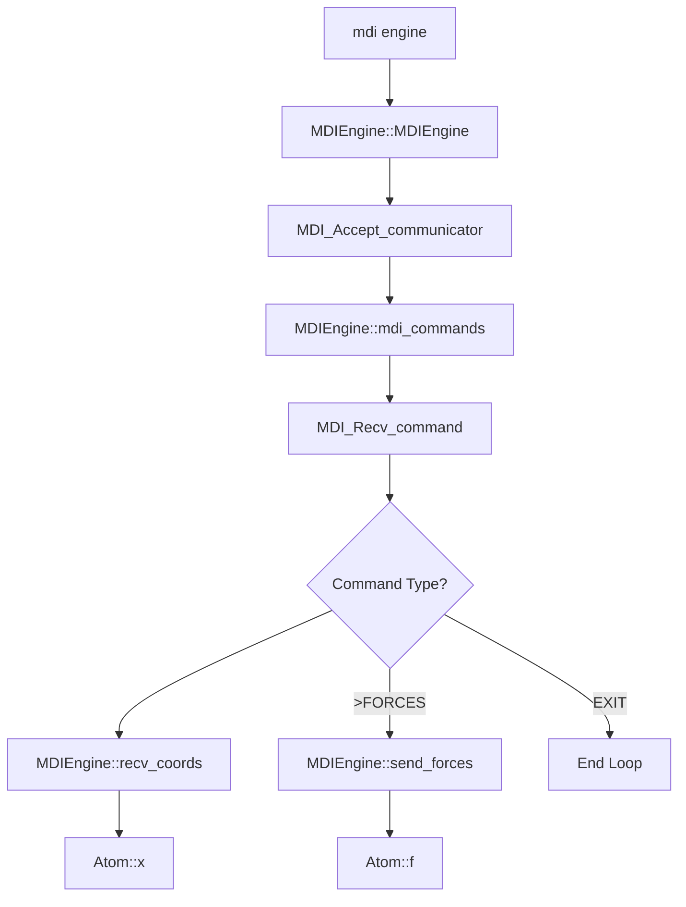
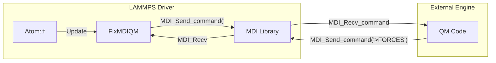

# KIM and MDI Interfaces

Relevant source files

The following files were used as context for generating this wiki page:

- [doc/src/Howto_mdi.rst](doc/src/Howto_mdi.rst)
- [doc/src/fix_ave_moments.rst](doc/src/fix_ave_moments.rst)
- [doc/src/fix_mdi_qm.rst](doc/src/fix_mdi_qm.rst)
- [doc/src/fix_mdi_qmmm.rst](doc/src/fix_mdi_qmmm.rst)
- [doc/src/mdi.rst](doc/src/mdi.rst)
- [examples/mdi/README](examples/mdi/README)
- [examples/mdi/Run.sh](examples/mdi/Run.sh)
- [examples/mdi/in.aimd.alone](examples/mdi/in.aimd.alone)
- [examples/mdi/in.aimd.driver](examples/mdi/in.aimd.driver)
- [examples/mdi/in.aimd.driver.plugin](examples/mdi/in.aimd.driver.plugin)
- [examples/mdi/in.aimd.engine](examples/mdi/in.aimd.engine)
- [examples/mdi/in.aimdpy.mm](examples/mdi/in.aimdpy.mm)
- [examples/mdi/in.aimdpy.qm](examples/mdi/in.aimdpy.qm)
- [examples/mdi/in.sequence.python](examples/mdi/in.sequence.python)
- [examples/mdi/in.series.alone](examples/mdi/in.series.alone)
- [examples/mdi/in.series.driver](examples/mdi/in.series.driver)
- [examples/mdi/in.series.driver.plugin](examples/mdi/in.series.driver.plugin)
- [examples/mdi/in.series.engine](examples/mdi/in.series.engine)
- [examples/mdi/in.snapshot.alone](examples/mdi/in.snapshot.alone)
- [examples/mdi/in.snapshot.driver](examples/mdi/in.snapshot.driver)
- [examples/mdi/in.snapshot.driver.plugin](examples/mdi/in.snapshot.driver.plugin)
- [examples/mdi/sequence_driver.py](examples/mdi/sequence_driver.py)
- [src/EXTRA-FIX/fix_ave_moments.cpp](src/EXTRA-FIX/fix_ave_moments.cpp)
- [src/EXTRA-FIX/fix_ave_moments.h](src/EXTRA-FIX/fix_ave_moments.h)
- [src/KIM/fix_store_kim.cpp](src/KIM/fix_store_kim.cpp)
- [src/KIM/fix_store_kim.h](src/KIM/fix_store_kim.h)
- [src/KIM/kim_command.cpp](src/KIM/kim_command.cpp)
- [src/KIM/kim_command.h](src/KIM/kim_command.h)
- [src/KIM/kim_init.cpp](src/KIM/kim_init.cpp)
- [src/KIM/kim_init.h](src/KIM/kim_init.h)
- [src/KIM/kim_interactions.cpp](src/KIM/kim_interactions.cpp)
- [src/KIM/kim_interactions.h](src/KIM/kim_interactions.h)
- [src/KIM/kim_param.cpp](src/KIM/kim_param.cpp)
- [src/KIM/kim_param.h](src/KIM/kim_param.h)
- [src/KIM/kim_property.cpp](src/KIM/kim_property.cpp)
- [src/KIM/kim_property.h](src/KIM/kim_property.h)
- [src/KIM/kim_query.cpp](src/KIM/kim_query.cpp)
- [src/KIM/kim_query.h](src/KIM/kim_query.h)
- [src/KIM/kim_units.cpp](src/KIM/kim_units.cpp)
- [src/KIM/kim_units.h](src/KIM/kim_units.h)
- [src/KIM/pair_kim.cpp](src/KIM/pair_kim.cpp)
- [src/KIM/pair_kim.h](src/KIM/pair_kim.h)
- [src/MANIFOLD/manifold_factory.cpp](src/MANIFOLD/manifold_factory.cpp)
- [src/MDI/fix_mdi_engine.cpp](src/MDI/fix_mdi_engine.cpp)
- [src/MDI/fix_mdi_engine.h](src/MDI/fix_mdi_engine.h)
- [src/MDI/fix_mdi_qm.cpp](src/MDI/fix_mdi_qm.cpp)
- [src/MDI/fix_mdi_qm.h](src/MDI/fix_mdi_qm.h)
- [src/MDI/fix_mdi_qmmm.cpp](src/MDI/fix_mdi_qmmm.cpp)
- [src/MDI/fix_mdi_qmmm.h](src/MDI/fix_mdi_qmmm.h)
- [src/MDI/library_mdi.cpp](src/MDI/library_mdi.cpp)
- [src/MDI/library_mdi.h](src/MDI/library_mdi.h)
- [src/MDI/mdi_command.cpp](src/MDI/mdi_command.cpp)
- [src/MDI/mdi_command.h](src/MDI/mdi_command.h)
- [src/MDI/mdi_engine.cpp](src/MDI/mdi_engine.cpp)
- [src/MDI/mdi_engine.h](src/MDI/mdi_engine.h)
- [src/MDI/mdi_plugin.cpp](src/MDI/mdi_plugin.cpp)
- [src/MDI/mdi_plugin.h](src/MDI/mdi_plugin.h)
- [src/UEF/uef_utils.cpp](src/UEF/uef_utils.cpp)

This page documents the integration of the Knowledgebase of Interatomic Models (KIM) and the MolSSI Driver Interface (MDI) within LAMMPS. These interfaces enable portable access to standardized interatomic potentials and facilitate code coupling for multi-scale simulations, such as QM/MM and AIMD.

## KIM Interface

The KIM interface allows LAMMPS to use models (potentials) archived in the OpenKIM repository. It supports both **Portable Models (PM)**, which are compiled shared libraries, and **Simulator Models (SM)**, which are implemented via native LAMMPS commands [src/KIM/kim_init.cpp:118-164]().

### Core KIM Components

The interface is primarily managed through the `PairKIM` class and several command classes:

*   **`PairKIM`**: The main pair style that communicates with the KIM API to retrieve energies and forces [src/KIM/pair_kim.h:75-179]().
*   **`KimInit`**: Handles the initial handshake with KIM, defining units and model selection [src/KIM/kim_init.cpp:84-116]().
*   **`KimInteractions`**: Maps LAMMPS atom types to KIM chemical species [src/KIM/kim_interactions.cpp:86-94]().
*   **`KimQuery`**: Queries the OpenKIM repository via web APIs (using `libcurl` if available) to retrieve model metadata or parameters [src/KIM/kim_query.cpp:107-167]().
*   **`KimParam`**: Gets or sets mutable parameters within a KIM Portable Model during a simulation [src/KIM/kim_param.cpp:87-143]().

### Data Flow and Initialization

Initialization must occur before the simulation box is defined. The `KimInit` command stores model information in a specialized fix called `FixStoreKIM` [src/KIM/kim_init.cpp:65-68](), which persists throughout the simulation setup.

| Step | Command | Code Entity | Action |
| :--- | :--- | :--- | :--- |
| 1 | `kim_init` | `KimInit::command` | Load KIM API, select model, and set units [src/KIM/kim_init.cpp:84-116](). |
| 2 | `kim_interactions` | `KimInteractions::command` | Map `atom->ntypes` to KIM species [src/KIM/kim_interactions.cpp:104-110](). |
| 3 | `pair_style kim` | `PairKIM::settings` | Instantiate the KIM model [src/KIM/pair_kim.cpp:188-213](). |
| 4 | `pair_coeff` | `PairKIM::coeff` | Finalize mapping and check model compatibility [src/KIM/pair_kim.cpp:217-252](). |

### Neighbor List Integration

`PairKIM` requests neighbor lists from LAMMPS and provides them to the KIM model through a callback mechanism. It supports multiple cutoffs and stripped neighbor lists for molecular systems [src/KIM/pair_kim.h:145-153](). The callback function `get_neigh` translates LAMMPS neighbor list structures into the format expected by the KIM API [src/KIM/pair_kim.cpp:823-868]().

**Sources:** [src/KIM/pair_kim.h:58-179](), [src/KIM/pair_kim.cpp:97-147](), [src/KIM/kim_init.cpp:84-164](), [src/KIM/kim_interactions.cpp:86-168](), [src/KIM/kim_param.cpp:87-149]().

---

## MDI Interface

The MolSSI Driver Interface (MDI) enables LAMMPS to operate as either a **Driver** (orchestrating other codes) or an **Engine** (providing energy/force calculations to a driver) [doc/src/Howto_mdi.rst:28-45]().

### LAMMPS as an MDI Engine

When running as an engine, LAMMPS enters an execution loop in `MDIEngine::MDIEngine`, waiting for commands from a driver [src/MDI/mdi_engine.cpp:67-215]().

**Entity Mapping: Engine Command Loop**

**Sources:** [src/MDI/mdi_engine.cpp:59-215](), [src/MDI/mdi_engine.cpp:200-202]().

### LAMMPS as an MDI Driver

LAMMPS acts as a driver primarily through specialized fixes that issue commands to external engines during the simulation timestepping.

*   **`fix mdi/qm`**: Used for AIMD or energy minimization. It sends coordinates to a QM engine and receives forces/energies to update the LAMMPS atoms [src/MDI/fix_mdi_qm.cpp:40-211]().
*   **`fix mdi/qmmm`**: Facilitates QM/MM coupling. It partitions atoms into QM and MM sets, communicating with an external QM engine to handle the quantum region while LAMMPS manages the classical environment [src/MDI/fix_mdi_qmmm.cpp:46-242]().
*   **`mdi plugin`**: Allows LAMMPS to load an MDI engine as a shared library plugin, avoiding socket-based communication overhead [src/MDI/mdi_plugin.cpp:40-134]().

### Data Flow: QM/MM Coupling

In a QM/MM simulation using `fix mdi/qmmm`, LAMMPS coordinates the following exchange:

1.  **Forward Communication**: LAMMPS sends QM atom coordinates and MM atom charges/coordinates (if using electrostatic embedding) to the engine [src/MDI/fix_mdi_qmmm.cpp:156-164]().
2.  **Engine Calculation**: The external QM engine (e.g., NWChem, PySCF) computes the electronic structure.
3.  **Reverse Communication**: LAMMPS receives forces acting on QM atoms and potentially the QM energy to add to the global thermo output [src/MDI/fix_mdi_qmmm.cpp:234-242]().

**Entity Mapping: Driver Interaction**

**Sources:** [src/MDI/fix_mdi_qm.cpp:64-70](), [src/MDI/fix_mdi_qmmm.cpp:72-87](), [doc/src/Howto_mdi.rst:47-54]().

### Supported Units and Conversions
Both KIM and MDI interfaces handle unit conversions between LAMMPS internal units (e.g., `real`, `metal`) and the standardized units required by the external API (typically SI or Hartree/Bohr for QM engines) [src/KIM/kim_units.cpp:1-50](), [src/MDI/mdi_engine.cpp:161-170]().

**Sources:** [src/MDI/mdi_engine.cpp:49-50](), [src/MDI/fix_mdi_qm.cpp:30-31](), [src/MDI/fix_mdi_qmmm.cpp:35-37]().

---