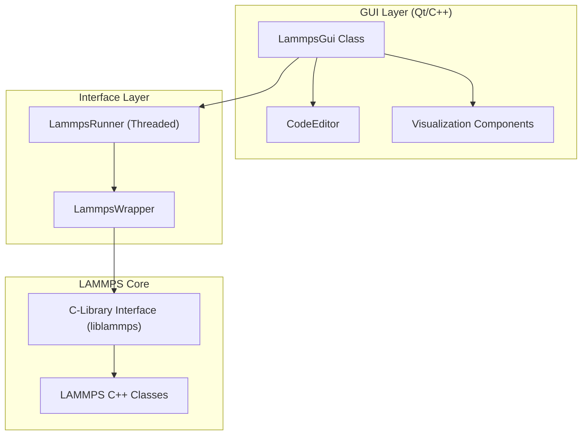
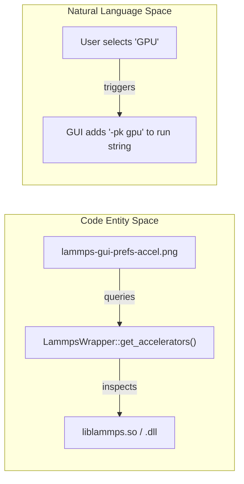

# Graphical User Interface

Relevant source files

The following files were used as context for generating this wiki page:

- [doc/src/Howto_lammps_gui.rst](doc/src/Howto_lammps_gui.rst)
- [doc/src/JPG/lammps-gui-autobond.png](doc/src/JPG/lammps-gui-autobond.png)
- [doc/src/JPG/lammps-gui-chart.png](doc/src/JPG/lammps-gui-chart.png)
- [doc/src/JPG/lammps-gui-complete.png](doc/src/JPG/lammps-gui-complete.png)
- [doc/src/JPG/lammps-gui-funnel.png](doc/src/JPG/lammps-gui-funnel.png)
- [doc/src/JPG/lammps-gui-image.png](doc/src/JPG/lammps-gui-image.png)
- [doc/src/JPG/lammps-gui-inspect-data.png](doc/src/JPG/lammps-gui-inspect-data.png)
- [doc/src/JPG/lammps-gui-inspect-image.png](doc/src/JPG/lammps-gui-inspect-image.png)
- [doc/src/JPG/lammps-gui-inspect-info.png](doc/src/JPG/lammps-gui-inspect-info.png)
- [doc/src/JPG/lammps-gui-log.png](doc/src/JPG/lammps-gui-log.png)
- [doc/src/JPG/lammps-gui-main.png](doc/src/JPG/lammps-gui-main.png)
- [doc/src/JPG/lammps-gui-popup-help.png](doc/src/JPG/lammps-gui-popup-help.png)
- [doc/src/JPG/lammps-gui-popup-view.png](doc/src/JPG/lammps-gui-popup-view.png)
- [doc/src/JPG/lammps-gui-prefs-accel.png](doc/src/JPG/lammps-gui-prefs-accel.png)
- [doc/src/JPG/lammps-gui-prefs-charts.png](doc/src/JPG/lammps-gui-prefs-charts.png)
- [doc/src/JPG/lammps-gui-prefs-editor.png](doc/src/JPG/lammps-gui-prefs-editor.png)
- [doc/src/JPG/lammps-gui-prefs-general.png](doc/src/JPG/lammps-gui-prefs-general.png)
- [doc/src/JPG/lammps-gui-prefs-image.png](doc/src/JPG/lammps-gui-prefs-image.png)
- [doc/src/JPG/lammps-gui-running.png](doc/src/JPG/lammps-gui-running.png)
- [doc/src/JPG/lammps-gui-slideshow.png](doc/src/JPG/lammps-gui-slideshow.png)
- [doc/src/JPG/lammps-gui-tutorials.png](doc/src/JPG/lammps-gui-tutorials.png)
- [doc/src/Tools.rst](doc/src/Tools.rst)
- [tools/Makefile](tools/Makefile)
- [tools/README](tools/README)
- [tools/coding_standard/README](tools/coding_standard/README)
- [tools/coding_standard/versiontags.py](tools/coding_standard/versiontags.py)
- [tools/stl_bin2txt.cpp](tools/stl_bin2txt.cpp)

The LAMMPS Graphical User Interface (LAMMPS-GUI) provides a user-friendly environment for editing LAMMPS input files, running simulations, and visualizing results. While previously bundled with the main distribution, it is now hosted separately at [github.com/akohlmey/lammps-gui](https://github.com/akohlmey/lammps-gui) and documented at [lammps-gui.lammps.org](https://lammps-gui.lammps.org/) `[doc/src/Howto_lammps_gui.rst:10-13]`.

## Overview

LAMMPS-GUI integrates several components to streamline the molecular dynamics workflow:
1.  **Input Editor**: A syntax-highlighting text editor specialized for LAMMPS commands `[doc/src/Tools.rst:96]`.
2.  **Simulation Runner**: Direct execution of simulations via the LAMMPS C-library interface `[tools/coding_standard/versiontags.py:26]`.
3.  **Visualization**: Integrated tools for real-time charting of thermodynamic data, image rendering, and slideshow animations.
4.  **Hardware Management**: GUI-based selection and configuration of accelerators like GPU, Kokkos, and OpenMP.

### System Architecture

The interface bridges the gap between high-level user interaction and the low-level LAMMPS C++ core.

Sources:
- `[doc/src/Tools.rst:96]`
- `[doc/src/Howto_lammps_gui.rst:10-13]`
- `[tools/coding_standard/versiontags.py:26]`

## Features for Simulation Management

### Input Editing and Running
The GUI provides an integrated development environment (IDE) experience for LAMMPS. Users can modify scripts and execute them without leaving the application. The execution is handled by a background thread to keep the UI responsive during long-running simulations.

*   **Syntax Highlighting**: Specialized for LAMMPS keywords and styles.
*   **Run Control**: Buttons to start, pause, or terminate simulations.
*   **Error Reporting**: Direct feedback from the LAMMPS error handler displayed in the GUI console.

### Visualization and Analysis
LAMMPS-GUI includes several modules for post-processing and real-time monitoring:
*   **Charts**: Real-time plotting of thermodynamic properties (temperature, pressure, energy) extracted via `lammps_extract_compute` or `lammps_extract_variable` `[doc/src/JPG/lammps-gui-chart.png:1]`.
*   **Images**: Rendering of simulation snapshots using internal graphics capabilities `[doc/src/JPG/lammps-gui-image.png:1]`.
*   **Slideshows**: Sequential playback of rendered frames to visualize trajectories `[doc/src/JPG/lammps-gui-slideshow.png:1]`.

Sources:
- `[doc/src/JPG/lammps-gui-chart.png:1-4]`
- `[doc/src/JPG/lammps-gui-image.png:1-4]`
- `[doc/src/JPG/lammps-gui-slideshow.png:1-4]`
- `[doc/src/JPG/lammps-gui-main.png:1-4]`

## Hardware Acceleration and Preferences

A key feature of the GUI is the simplified management of LAMMPS performance packages. Through the **Preferences** menu, users can configure:

| Preference Category | Code Entity/Functionality | Description |
| :--- | :--- | :--- |
| **General** | `lammps-gui-prefs-general` | Basic UI settings, font sizes, and file paths `[doc/src/JPG/lammps-gui-prefs-general.png:1]`. |
| **Accelerators** | `lammps-gui-prefs-accel` | Enabling OpenMP, GPU, or Kokkos styles without manual CLI flags `[doc/src/JPG/lammps-gui-prefs-accel.png:1]`. |
| **Image** | `lammps-gui-prefs-image` | Resolution and rendering style for snapshots `[doc/src/JPG/lammps-gui-prefs-image.png:1]`. |

### Accelerator Selection Logic
The GUI detects the compiled-in packages of the linked LAMMPS library and presents available options for:
*   **OpenMP**: Setting the number of threads.
*   **GPU**: Configuring device IDs and sub-styles.
*   **Kokkos**: Managing execution spaces (CUDA, OpenMP, Serial).

Sources:
- `[doc/src/JPG/lammps-gui-prefs-general.png:1-5]`
- `[doc/src/JPG/lammps-gui-prefs-accel.png:1-5]`
- `[doc/src/JPG/lammps-gui-prefs-image.png:1-5]`

## Integration with LAMMPS C-Library

The GUI relies heavily on the LAMMPS C-library interface to interact with the simulation state. Key interactions include:

*   **Command Execution**: Using `lammps_command()` to pass strings from the editor to the engine.
*   **Data Extraction**: Using `lammps_extract_global()` to retrieve simulation time, atom counts, and box dimensions for the UI status bar.
*   **Memory Management**: The `lammps_open()` and `lammps_close()` functions manage the lifecycle of the LAMMPS instance within the GUI process.

Sources:
- `[tools/coding_standard/versiontags.py:26]`
- `[doc/src/Tools.rst:96]`
- `[doc/src/Howto_lammps_gui.rst:10-13]`

---