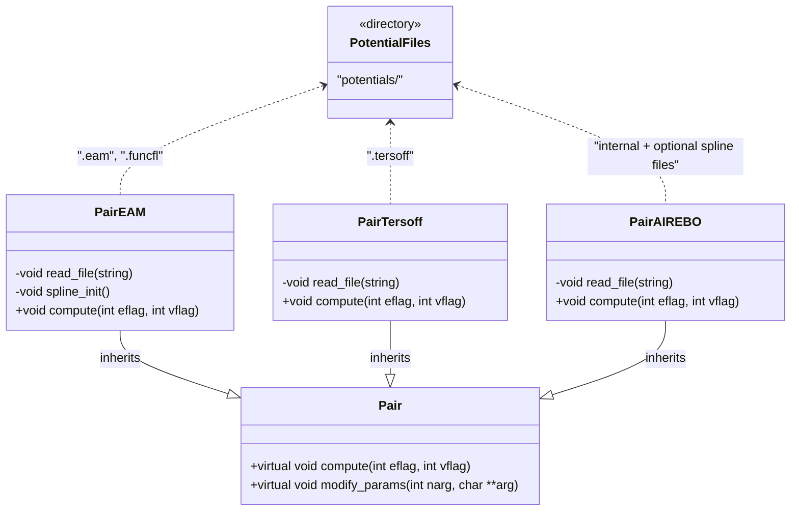
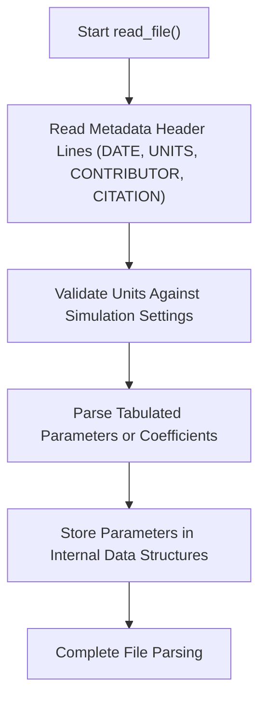

# Potentials and Force Field Files

<details>
<summary>Relevant source files</summary>

The following files were used as context for generating this wiki page:

- [doc/src/pair_sw.rst](doc/src/pair_sw.rst)
- [potentials/CH.rebo](potentials/CH.rebo)
- [src/EXTRA-DUMP/dump_xtc.cpp](src/EXTRA-DUMP/dump_xtc.cpp)
- [src/EXTRA-DUMP/xdr_compat.cpp](src/EXTRA-DUMP/xdr_compat.cpp)
- [src/EXTRA-DUMP/xdr_compat.h](src/EXTRA-DUMP/xdr_compat.h)
- [src/GPU/pair_buck_coul_cut_gpu.h](src/GPU/pair_buck_coul_cut_gpu.h)
- [src/GPU/pair_buck_coul_long_gpu.h](src/GPU/pair_buck_coul_long_gpu.h)
- [src/GPU/pair_buck_gpu.h](src/GPU/pair_buck_gpu.h)
- [src/GPU/pair_eam_alloy_gpu.cpp](src/GPU/pair_eam_alloy_gpu.cpp)
- [src/GPU/pair_eam_alloy_gpu.h](src/GPU/pair_eam_alloy_gpu.h)
- [src/GPU/pair_eam_fs_gpu.cpp](src/GPU/pair_eam_fs_gpu.cpp)
- [src/GPU/pair_eam_fs_gpu.h](src/GPU/pair_eam_fs_gpu.h)
- [src/GPU/pair_eam_gpu.cpp](src/GPU/pair_eam_gpu.cpp)
- [src/GPU/pair_eam_gpu.h](src/GPU/pair_eam_gpu.h)
- [src/GPU/pair_table_gpu.h](src/GPU/pair_table_gpu.h)
- [src/GPU/pair_yukawa_gpu.h](src/GPU/pair_yukawa_gpu.h)
- [src/GPU/pppm_gpu.cpp](src/GPU/pppm_gpu.cpp)
- [src/GPU/pppm_gpu.h](src/GPU/pppm_gpu.h)
- [src/KSPACE/ewald.cpp](src/KSPACE/ewald.cpp)
- [src/KSPACE/ewald.h](src/KSPACE/ewald.h)
- [src/KSPACE/ewald_dipole.cpp](src/KSPACE/ewald_dipole.cpp)
- [src/KSPACE/ewald_dipole.h](src/KSPACE/ewald_dipole.h)
- [src/KSPACE/ewald_dipole_spin.cpp](src/KSPACE/ewald_dipole_spin.cpp)
- [src/KSPACE/ewald_dipole_spin.h](src/KSPACE/ewald_dipole_spin.h)
- [src/KSPACE/ewald_disp.cpp](src/KSPACE/ewald_disp.cpp)
- [src/KSPACE/ewald_disp.h](src/KSPACE/ewald_disp.h)
- [src/KSPACE/msm.cpp](src/KSPACE/msm.cpp)
- [src/KSPACE/msm.h](src/KSPACE/msm.h)
- [src/KSPACE/msm_cg.cpp](src/KSPACE/msm_cg.cpp)
- [src/KSPACE/pppm.cpp](src/KSPACE/pppm.cpp)
- [src/KSPACE/pppm.h](src/KSPACE/pppm.h)
- [src/KSPACE/pppm_cg.cpp](src/KSPACE/pppm_cg.cpp)
- [src/KSPACE/pppm_cg.h](src/KSPACE/pppm_cg.h)
- [src/KSPACE/pppm_dipole.cpp](src/KSPACE/pppm_dipole.cpp)
- [src/KSPACE/pppm_dipole.h](src/KSPACE/pppm_dipole.h)
- [src/KSPACE/pppm_dipole_spin.cpp](src/KSPACE/pppm_dipole_spin.cpp)
- [src/KSPACE/pppm_dipole_spin.h](src/KSPACE/pppm_dipole_spin.h)
- [src/KSPACE/pppm_disp.cpp](src/KSPACE/pppm_disp.cpp)
- [src/KSPACE/pppm_disp.h](src/KSPACE/pppm_disp.h)
- [src/KSPACE/pppm_disp_tip4p.cpp](src/KSPACE/pppm_disp_tip4p.cpp)
- [src/KSPACE/pppm_disp_tip4p.h](src/KSPACE/pppm_disp_tip4p.h)
- [src/KSPACE/pppm_stagger.cpp](src/KSPACE/pppm_stagger.cpp)
- [src/KSPACE/pppm_stagger.h](src/KSPACE/pppm_stagger.h)
- [src/KSPACE/pppm_tip4p.cpp](src/KSPACE/pppm_tip4p.cpp)
- [src/KSPACE/pppm_tip4p.h](src/KSPACE/pppm_tip4p.h)
- [src/MANYBODY/fix_qeq_comb.cpp](src/MANYBODY/fix_qeq_comb.cpp)
- [src/MANYBODY/fix_qeq_comb.h](src/MANYBODY/fix_qeq_comb.h)
- [src/MANYBODY/pair_adp.cpp](src/MANYBODY/pair_adp.cpp)
- [src/MANYBODY/pair_adp.h](src/MANYBODY/pair_adp.h)
- [src/MANYBODY/pair_airebo.cpp](src/MANYBODY/pair_airebo.cpp)
- [src/MANYBODY/pair_airebo.h](src/MANYBODY/pair_airebo.h)
- [src/MANYBODY/pair_airebo_morse.cpp](src/MANYBODY/pair_airebo_morse.cpp)
- [src/MANYBODY/pair_airebo_morse.h](src/MANYBODY/pair_airebo_morse.h)
- [src/MANYBODY/pair_comb.cpp](src/MANYBODY/pair_comb.cpp)
- [src/MANYBODY/pair_comb.h](src/MANYBODY/pair_comb.h)
- [src/MANYBODY/pair_comb3.cpp](src/MANYBODY/pair_comb3.cpp)
- [src/MANYBODY/pair_comb3.h](src/MANYBODY/pair_comb3.h)
- [src/MANYBODY/pair_eam.cpp](src/MANYBODY/pair_eam.cpp)
- [src/MANYBODY/pair_eam.h](src/MANYBODY/pair_eam.h)
- [src/MANYBODY/pair_eam_alloy.cpp](src/MANYBODY/pair_eam_alloy.cpp)
- [src/MANYBODY/pair_eam_alloy.h](src/MANYBODY/pair_eam_alloy.h)
- [src/MANYBODY/pair_eam_cd.cpp](src/MANYBODY/pair_eam_cd.cpp)
- [src/MANYBODY/pair_eam_cd.h](src/MANYBODY/pair_eam_cd.h)
- [src/MANYBODY/pair_eam_fs.cpp](src/MANYBODY/pair_eam_fs.cpp)
- [src/MANYBODY/pair_eam_fs.h](src/MANYBODY/pair_eam_fs.h)
- [src/MANYBODY/pair_eam_he.cpp](src/MANYBODY/pair_eam_he.cpp)
- [src/MANYBODY/pair_eam_he.h](src/MANYBODY/pair_eam_he.h)
- [src/MANYBODY/pair_eim.cpp](src/MANYBODY/pair_eim.cpp)
- [src/MANYBODY/pair_extep.h](src/MANYBODY/pair_extep.h)
- [src/MANYBODY/pair_gw.cpp](src/MANYBODY/pair_gw.cpp)
- [src/MANYBODY/pair_gw.h](src/MANYBODY/pair_gw.h)
- [src/MANYBODY/pair_gw_zbl.cpp](src/MANYBODY/pair_gw_zbl.cpp)
- [src/MANYBODY/pair_gw_zbl.h](src/MANYBODY/pair_gw_zbl.h)
- [src/MANYBODY/pair_lcbop.cpp](src/MANYBODY/pair_lcbop.cpp)
- [src/MANYBODY/pair_lcbop.h](src/MANYBODY/pair_lcbop.h)
- [src/MANYBODY/pair_nb3b_harmonic.cpp](src/MANYBODY/pair_nb3b_harmonic.cpp)
- [src/MANYBODY/pair_nb3b_harmonic.h](src/MANYBODY/pair_nb3b_harmonic.h)
- [src/MANYBODY/pair_nb3b_screened.cpp](src/MANYBODY/pair_nb3b_screened.cpp)
- [src/MANYBODY/pair_rebo.cpp](src/MANYBODY/pair_rebo.cpp)
- [src/MANYBODY/pair_rebo.h](src/MANYBODY/pair_rebo.h)
- [src/MANYBODY/pair_sw.cpp](src/MANYBODY/pair_sw.cpp)
- [src/MANYBODY/pair_sw.h](src/MANYBODY/pair_sw.h)
- [src/MANYBODY/pair_sw_mod.cpp](src/MANYBODY/pair_sw_mod.cpp)
- [src/MANYBODY/pair_sw_mod.h](src/MANYBODY/pair_sw_mod.h)
- [src/MANYBODY/pair_tersoff.cpp](src/MANYBODY/pair_tersoff.cpp)
- [src/MANYBODY/pair_tersoff.h](src/MANYBODY/pair_tersoff.h)
- [src/MANYBODY/pair_tersoff_mod.cpp](src/MANYBODY/pair_tersoff_mod.cpp)
- [src/MANYBODY/pair_tersoff_mod.h](src/MANYBODY/pair_tersoff_mod.h)
- [src/MANYBODY/pair_tersoff_mod_c.cpp](src/MANYBODY/pair_tersoff_mod_c.cpp)
- [src/MANYBODY/pair_tersoff_mod_c.h](src/MANYBODY/pair_tersoff_mod_c.h)
- [src/MANYBODY/pair_tersoff_zbl.cpp](src/MANYBODY/pair_tersoff_zbl.cpp)
- [src/MANYBODY/pair_tersoff_zbl.h](src/MANYBODY/pair_tersoff_zbl.h)
- [src/MANYBODY/pair_threebody_table.h](src/MANYBODY/pair_threebody_table.h)
- [src/MANYBODY/pair_vashishta.cpp](src/MANYBODY/pair_vashishta.cpp)
- [src/MANYBODY/pair_vashishta.h](src/MANYBODY/pair_vashishta.h)
- [src/MANYBODY/pair_vashishta_table.cpp](src/MANYBODY/pair_vashishta_table.cpp)
- [src/MANYBODY/pair_vashishta_table.h](src/MANYBODY/pair_vashishta_table.h)
- [src/OPENMP/pair_airebo_morse_omp.cpp](src/OPENMP/pair_airebo_morse_omp.cpp)
- [src/OPENMP/pair_rebo_omp.cpp](src/OPENMP/pair_rebo_omp.cpp)
- [src/OPENMP/pair_sw_mod_omp.cpp](src/OPENMP/pair_sw_mod_omp.cpp)
- [src/OPENMP/pair_sw_mod_omp.h](src/OPENMP/pair_sw_mod_omp.h)
- [src/angle.cpp](src/angle.cpp)
- [src/angle.h](src/angle.h)
- [src/bond.cpp](src/bond.cpp)
- [src/bond.h](src/bond.h)
- [src/dihedral.cpp](src/dihedral.cpp)
- [src/dihedral.h](src/dihedral.h)
- [src/improper.cpp](src/improper.cpp)
- [src/improper.h](src/improper.h)
- [src/kspace.cpp](src/kspace.cpp)
- [src/kspace.h](src/kspace.h)
- [src/pair.cpp](src/pair.cpp)
- [src/pair.h](src/pair.h)
- [unittest/formats/test_image_flags.cpp](unittest/formats/test_image_flags.cpp)
- [unittest/formats/test_pair_unit_convert.cpp](unittest/formats/test_pair_unit_convert.cpp)

</details>


This page documents the **potentials/** directory and its role in the LAMMPS codebase, focusing on the interatomic potential files, the conventions used in their formats, supported potential types along with their file suffixes, and practical guidelines for selecting and validating potentials for molecular dynamics simulations.

---

## Purpose and Scope

LAMMPS relies on separate potential and force field files to define interatomic interactions tailored to specific materials and force field models. These files reside in the **potentials/** directory and provide tabulated or parameterized data that many pair styles and many-body potentials use during force computation.

This page covers:

- The structure and conventions of potential files.
- Metadata fields such as `DATE`, `UNITS`, `CONTRIBUTOR`, and `CITATION`.
- Supported potential types and their common file format extensions.
- How potential files are integrated into the simulation through specific pair styles.
- Guidelines for selecting appropriate potentials and verifying their applicability.

---

## potentials/ Directory Structure and File Format Conventions

The `potentials/` directory contains files that store interatomic potential parameters. These files are generally plain text and follow structured conventions for consistency and reproducibility.

### Metadata Fields in Potential Files

Typical potential files start with metadata fields in uppercase keywords, each on individual lines, followed by parameter data. Key metadata entries include:

- **DATE** — The date when the potential or parameter file was created or last updated.
- **UNITS** — The unit system used in the potential file (e.g., metal, real, lj). This is crucial as LAMMPS supports multiple unit styles and the force field files must align accordingly.
- **CONTRIBUTOR** — The author or maintainer of the potential.
- **CITATION** — Bibliographic references to the original publication or documentation describing the potential.

These metadata fields ensure traceability, proper use, and appropriate citation in research using LAMMPS.

### Example of Metadata Header

```text
DATE 2021-05-12
UNITS metal
CONTRIBUTOR Jane Doe
CITATION J. Doe et al., J. Comp. Phys. 123, 4567 (2021)
...
```

This standardization is referenced in various pair potential implementations which read and parse these headers when loading potential data files.

---

## Supported Potential Types and File Suffixes

LAMMPS supports a wide range of interatomic potentials, each often requiring a specific format of potential file. Common suffixes and associated force field types include:

| Potential Type                                   | Common File Suffixes             | Notes                                                    |
|------------------------------------------------|---------------------------------|----------------------------------------------------------|
| Embedded Atom Method (EAM)                      | `.eam`, `.eam.alloy`, `.funcfl` | Common for metals; files contain tabulated embedding, electron density, and pair functions. |
| Modified Embedded Atom Method (MEAM)            | `.meam`, `.meam.fs`              | Extension of EAM including angular dependence.           |
| Tersoff / Modified Tersoff                       | e.g. `.tersoff`, `.tersoff.mod` | Many-body potentials often with tabulated or parameterized coefficients. |
| ReaxFF                                          | `.reax`                         | Reactive force fields with specific complex parameter files. |
| AIREBO                                          | (usually internal parameters + optional files) | Multi-component hydrocarbons with many-body terms.      |
| SW (Stillinger-Weber)                           | `.sw`                           | For semiconductors and complex materials.                 |
| Metal Lennard-Jones (LJ)                        | `.lj`                          | Tabulated or parameterized LJ potentials.                 |
| COMB/COMB3                                      | `.comb`                        | Charge-optimized many-body potentials.                    |
| Potential files for ML (Machine-Learned) Styles | varies                         | Files for ML potentials often in JSON or custom formats. |

Each pair or manybody potential style in LAMMPS is designed to read the corresponding potential file format, with parsing routines typically defined in dedicated classes under the **src/** directory (e.g., `PairEAM` reads `eam` files, `PairTersoff` reads `tersoff` files).

---

## Integration of Potential Files into LAMMPS Simulation

### Role of `Pair` Class and Derived Potential Classes

The base class `Pair` (defined in `src/pair.h` and implemented in `src/pair.cpp`) serves as the core interface for pairwise or many-body interactions. Child classes implement specific methods for:

- Reading potential file data.
- Allocating memory for parameter arrays.
- Computing forces and energies per timestep.

Example:

- **EAM potentials** use `PairEAM` (`src/MANYBODY/pair_eam.cpp`) which includes reading `.eam` formatted files and setting up force computation structs.
- **Tersoff potentials** use `PairTersoff` (`src/MANYBODY/pair_tersoff.cpp`) which reads parameters from Tersoff potential files and implements three-body potential energy.
- **AIREBO potentials** use `PairAIREBO` (`src/MANYBODY/pair_airebo.cpp`).

The typical data flow is:

```mermaid
flowchart TD
    A[Input Script with pair_style and pair_coeff commands] --> B[Pair Style Class Initialized]
    B --> C[Potential File(s) Read]
    C --> D[Potential Parameters Parsed & Stored]
    D --> E[Force Computation per Timestep]
```

`pair_coeff` commands specify the potential file(s) to load for given atom types configured in the simulation.

### File Reading and Parsing

Parsing of potential files is encapsulated within each potential's pair style class via routines such as `read_file()`, `read_coeffs()`, or `potential_file_reader` utility.

- EAM potentials parse tabulated electron densities and embedding energy functions.
- Tersoff reads set of element triplets and associated parameters.
- AIREBO loads spline coefficients from files for multiple potential terms.

Error checking ensures units and format correctness, relying on metadata headers for unit conversions and validity.

---

## Guidelines for Selecting and Validating Potentials

Selecting an appropriate interatomic potential is critical for simulation accuracy and performance. The following considerations apply:

1. **Material and Interaction Specificity**
   - Choose potentials parametrized explicitly for your material system and temperatures, e.g., EAM for metals, SW or Tersoff for semiconductors, ReaxFF for reactive systems.

2. **File Format and Compatibility**
   - Confirm that the potential file format matches the LAMMPS pair style you plan to use.
   - Verify unit systems for consistency with your data and simulation units (`UNITS` metadata).

3. **Validation and Testing**
   - Test the potential on known properties (e.g., lattice constants, elastic moduli).
   - Use benchmark scripts or test cases provided with LAMMPS or literature.

4. **Citations and Licensing**
   - Respect contributor and citation metadata; use proper references in publications.
   - Check license restrictions or attributions associated with potentials.

5. **Updates and Community**
   - Leverage community-verified potential sets from LAMMPS website or publications.
   - Monitor the potentials directory and pair styles for updates or bug fixes.

---

## Cross-References: Pair Style Classes and Potential Files

This diagram maps natural language system components ("Potential Files") to LAMMPS code implementation entities (classes and files):



---

## File Format Metadata Parsing Workflow

The procedure for importing potential files generally follows these steps implemented inside each pair style class's `read_file` or equivalent function:



Potential file format validation and parameter sanity checks typically reside in these steps, enabling informative errors on inconsistent or unsupported file formats.

---

## Selecting and Validating Potentials — Best Practices

- **Ensure Units Match:** Always verify the `UNITS` specified in the potential file matches your simulation's unit style to avoid errors or offsets in energy and force magnitudes.
- **Check Contributor and Citation:** Use the **CONTRIBUTOR** and **CITATION** fields to find appropriate references for publication and to review the provenance of the parameters.
- **Test Energy and Force Outputs:** Run small test simulations (e.g., energy minimization, single-step force output) and compare with literature.
- **Consult External Databases:** LAMMPS potentials directory is not exhaustive — leverage external databases like NIST Interatomic Potential Repository, OpenKIM for verified potentials.
- **Avoid Mixing Incompatible Potentials:** Mixing pair styles or potential files with different assumptions or units can cause inaccurate results.

---

## Summary

The **potentials/** directory in LAMMPS is crucial for defining material-specific interatomic interactions through force field files. Each such file carries metadata that ensures proper use and traceability. LAMMPS pair style classes are responsible for loading these files, parsing their format consistent with metadata, and utilizing parameters in force computations. Proper selection, unit validation, and careful testing of potentials are essential steps for reliable molecular dynamics simulations.

---

## Sources

- `src/pair.cpp:14-134` (Pair class constructor and main attributes)
- `src/pair.h:21-197` (Pair class definition)
- `src/MANYBODY/pair_eam.cpp:38-129` (EAM potential file reading and force calculations)
- `src/MANYBODY/pair_airebo.cpp:54-175` (AIREBO potential implementation and file input)
- `src/MANYBODY/pair_tersoff.cpp:48-110` (Tersoff potential class and compute method)
- `src/potential_file_reader.cpp` and `src/potential_file_reader.h` (Referenced by PairAIREBO and PairEAM for file parsing - implied usage)
- `src/utils.cpp` (Utility functions including units conversion referenced by PairEAM and others)
  
Additional context inferred from multiple pair style implementations and common LAMMPS conventions.

---