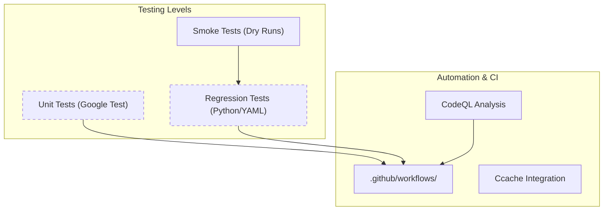
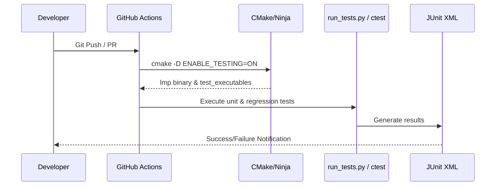

# Testing and CI/CD Infrastructure

Relevant source files

The following files were used as context for generating this wiki page:

- [.github/workflows/check-cpp23.yml](.github/workflows/check-cpp23.yml)
- [.github/workflows/check-examples.yml](.github/workflows/check-examples.yml)
- [.github/workflows/check-gnu-make.yml](.github/workflows/check-gnu-make.yml)
- [.github/workflows/check-vla.yml](.github/workflows/check-vla.yml)
- [.github/workflows/codeql-analysis.yml](.github/workflows/codeql-analysis.yml)
- [.github/workflows/compile-msvc.yml](.github/workflows/compile-msvc.yml)
- [.github/workflows/kokkos-regression.yaml](.github/workflows/kokkos-regression.yaml)
- [.github/workflows/lammps-gui-flatpak.yml](.github/workflows/lammps-gui-flatpak.yml)
- [.github/workflows/style-check.yml](.github/workflows/style-check.yml)
- [.github/workflows/unittest-arm64.yml](.github/workflows/unittest-arm64.yml)
- [.github/workflows/unittest-fftw.yaml](.github/workflows/unittest-fftw.yaml)
- [.github/workflows/unittest-kokkos.yml](.github/workflows/unittest-kokkos.yml)
- [.github/workflows/unittest-linux.yml](.github/workflows/unittest-linux.yml)
- [.github/workflows/unittest-macos.yml](.github/workflows/unittest-macos.yml)
- [.github/workflows/unittest-single.yml](.github/workflows/unittest-single.yml)
- [cmake/presets/kokkos-packages.cmake](cmake/presets/kokkos-packages.cmake)
- [doc/src/Developer_unittest.rst](doc/src/Developer_unittest.rst)
- [tools/regression-tests/README](tools/regression-tests/README)
- [tools/regression-tests/REPORTING.md](tools/regression-tests/REPORTING.md)
- [tools/regression-tests/config.yaml](tools/regression-tests/config.yaml)
- [tools/regression-tests/config_gpu.yaml](tools/regression-tests/config_gpu.yaml)
- [tools/regression-tests/config_kokkos.yaml](tools/regression-tests/config_kokkos.yaml)
- [tools/regression-tests/config_kokkos_openmp.yaml](tools/regression-tests/config_kokkos_openmp.yaml)
- [tools/regression-tests/config_openmp.yaml](tools/regression-tests/config_openmp.yaml)
- [tools/regression-tests/config_quick.yaml](tools/regression-tests/config_quick.yaml)
- [tools/regression-tests/config_serial.yaml](tools/regression-tests/config_serial.yaml)
- [tools/regression-tests/config_skiprun.yaml](tools/regression-tests/config_skiprun.yaml)
- [tools/regression-tests/config_valgrind.yaml](tools/regression-tests/config_valgrind.yaml)
- [tools/regression-tests/get_kokkos_input.py](tools/regression-tests/get_kokkos_input.py)
- [tools/regression-tests/get_quick_list.py](tools/regression-tests/get_quick_list.py)
- [tools/regression-tests/merge_results.py](tools/regression-tests/merge_results.py)
- [tools/regression-tests/run_tests.py](tools/regression-tests/run_tests.py)
- [unittest/force-styles/test_min_style.cpp](unittest/force-styles/test_min_style.cpp)
- [unittest/force-styles/tests/fix-timestep-ilves_angle.yaml](unittest/force-styles/tests/fix-timestep-ilves_angle.yaml)
- [unittest/force-styles/tests/fix-timestep-ilves_bond.yaml](unittest/force-styles/tests/fix-timestep-ilves_bond.yaml)
- [unittest/granular/README.md](unittest/granular/README.md)
- [unittest/granular/dem_audit.py](unittest/granular/dem_audit.py)
- [unittest/granular/tests/dem01-hertz-tsuji-3d-si.yaml](unittest/granular/tests/dem01-hertz-tsuji-3d-si.yaml)
- [unittest/granular/tests/dem01-hertz-twosphere-3d-si.yaml](unittest/granular/tests/dem01-hertz-twosphere-3d-si.yaml)
- [unittest/granular/tests/dem01-hooke-massvel-3d-si.yaml](unittest/granular/tests/dem01-hooke-massvel-3d-si.yaml)
- [unittest/granular/tests/dem01-hooke-twosphere-3d-si.yaml](unittest/granular/tests/dem01-hooke-twosphere-3d-si.yaml)
- [unittest/granular/tests/dem01-hookehistory-twosphere-3d-si.yaml](unittest/granular/tests/dem01-hookehistory-twosphere-3d-si.yaml)
- [unittest/granular/tests/dem02-hertz-twosphere-3d-si.yaml](unittest/granular/tests/dem02-hertz-twosphere-3d-si.yaml)
- [unittest/granular/tests/dem02-hertzmaterial-twosphere-3d-si.yaml](unittest/granular/tests/dem02-hertzmaterial-twosphere-3d-si.yaml)
- [unittest/granular/tests/dem03-hertz-tsuji-wall-3d-si.yaml](unittest/granular/tests/dem03-hertz-tsuji-wall-3d-si.yaml)
- [unittest/granular/tests/dem03-hertz-wall-3d-si.yaml](unittest/granular/tests/dem03-hertz-wall-3d-si.yaml)
- [unittest/granular/tests/dem03-hertzmaterial-wall-3d-si.yaml](unittest/granular/tests/dem03-hertzmaterial-wall-3d-si.yaml)
- [unittest/granular/tests/dem04-hertz-oblique-3d-si.yaml](unittest/granular/tests/dem04-hertz-oblique-3d-si.yaml)
- [unittest/granular/tests/dem04-hookehistory-oblique-3d-si.yaml](unittest/granular/tests/dem04-hookehistory-oblique-3d-si.yaml)
- [unittest/granular/tests/dem04-mindlinforce-oblique-3d-si.yaml](unittest/granular/tests/dem04-mindlinforce-oblique-3d-si.yaml)
- [unittest/granular/tests/dem04-mindlinrescaleforce-oblique-3d-si.yaml](unittest/granular/tests/dem04-mindlinrescaleforce-oblique-3d-si.yaml)
- [unittest/granular/tests/dem15-hertz-oblique-3d-si.yaml](unittest/granular/tests/dem15-hertz-oblique-3d-si.yaml)
- [unittest/granular/tests/dem15-hooke-oblique-3d-si.yaml](unittest/granular/tests/dem15-hooke-oblique-3d-si.yaml)
- [unittest/utils/fft_test_helpers.h](unittest/utils/fft_test_helpers.h)
- [unittest/utils/test_fft3d.cpp](unittest/utils/test_fft3d.cpp)
- [unittest/utils/test_fft3d_kokkos.cpp](unittest/utils/test_fft3d_kokkos.cpp)
- [unittest/utils/test_math_extra.cpp](unittest/utils/test_math_extra.cpp)
- [unittest/utils/test_math_special.cpp](unittest/utils/test_math_special.cpp)
- [unittest/utils/test_random.cpp](unittest/utils/test_random.cpp)
- [unittest/utils/test_tabular_function.cpp](unittest/utils/test_tabular_function.cpp)

The LAMMPS testing infrastructure is designed to ensure the stability and correctness of the simulator across a vast array of physical models, hardware architectures, and operating systems. The system is divided into two primary levels: **Unit Testing**, which focuses on individual functions and classes using the Google Test framework, and **Regression Testing**, which validates simulation results against known reference logs using the full LAMMPS binary.

### Infrastructure Overview

The testing environment is integrated into the build system and automated via GitHub Actions. Developers can trigger tests locally using `ctest` after building with the `ENABLE_TESTING=ON` flag [doc/src/Developer_unittest.rst:87-97]().

#### Testing Hierarchy

**Sources:** [doc/src/Developer_unittest.rst:11-26](), [.github/workflows/unittest-linux.yml:4-18](), [tools/regression-tests/run_tests.py:16-25]()

---

### Unit Testing Framework
Unit tests in LAMMPS are implemented using **Google Test (GTest)** and **Google Mock**. These tests are located in the `unittest/` directory and are categorized by the subsystem they exercise, such as `utils`, `force-styles`, `c-library`, and `python` [doc/src/Developer_unittest.rst:39-47]().

Key characteristics:
*   **Fast Execution:** Designed to test "local" behavior of code segments quickly [doc/src/Developer_unittest.rst:11-13]().
*   **Polymorphic Testing:** Generic test programs drive tests for classes sharing interfaces (e.g., pair styles) using YAML-based input data [doc/src/Developer_unittest.rst:22-26]().
*   **Coverage Reporting:** Infrastructure supports monitoring which lines of code are executed during tests to ensure high feature coverage [doc/src/Developer_unittest.rst:28-32]().

For details, see [Unit Testing Framework](#11.1).

**Sources:** [doc/src/Developer_unittest.rst:1-37](), [unittest/utils/test_tokenizer.cpp:107-126]()

---

### Regression Testing and CI Workflows
Regression testing ensures that changes to the codebase do not alter simulation results beyond acceptable numerical tolerances. This is managed by the `run_tests.py` script, which executes the LAMMPS binary on standard examples and compares thermodynamic output against reference logs [tools/regression-tests/run_tests.py:2-8]().

#### CI/CD Pipeline Flow

**Sources:** [.github/workflows/unittest-linux.yml:53-87](), [tools/regression-tests/run_tests.py:44-54]()

Key components:
*   **Configuration:** YAML files (e.g., `config_serial.yaml`, `config_kokkos.yaml`) define MPI settings, timeouts, and numerical tolerances for specific hardware targets [tools/regression-tests/config.yaml:1-22]().
*   **Multi-Platform CI:** Workflows exist for Linux (BigBig, ARM64), macOS, and Windows (MSVC) [.github/workflows/unittest-linux.yml:21-23](), [.github/workflows/unittest-macos.yml:21-23](), [.github/workflows/compile-msvc.yml:20-23]().
*   **Accelerator Testing:** Dedicated pipelines for **Kokkos** (OpenMP/CUDA) and **GPU** packages ensure performance portability [tools/regression-tests/config_kokkos_openmp.yaml:1-6](), [.github/workflows/kokkos-regression.yaml:48-68]().
*   **Static Analysis:** **CodeQL** scans are integrated to detect security vulnerabilities and logic errors in C++ and Python code [.github/workflows/codeql-analysis.yml:21-24]().

For details, see [Regression Testing and CI Workflows](#11.2).

**Sources:** [tools/regression-tests/README:1-18](), [.github/workflows/kokkos-regression.yaml:1-10](), [.github/workflows/codeql-analysis.yml:1-9]()

---