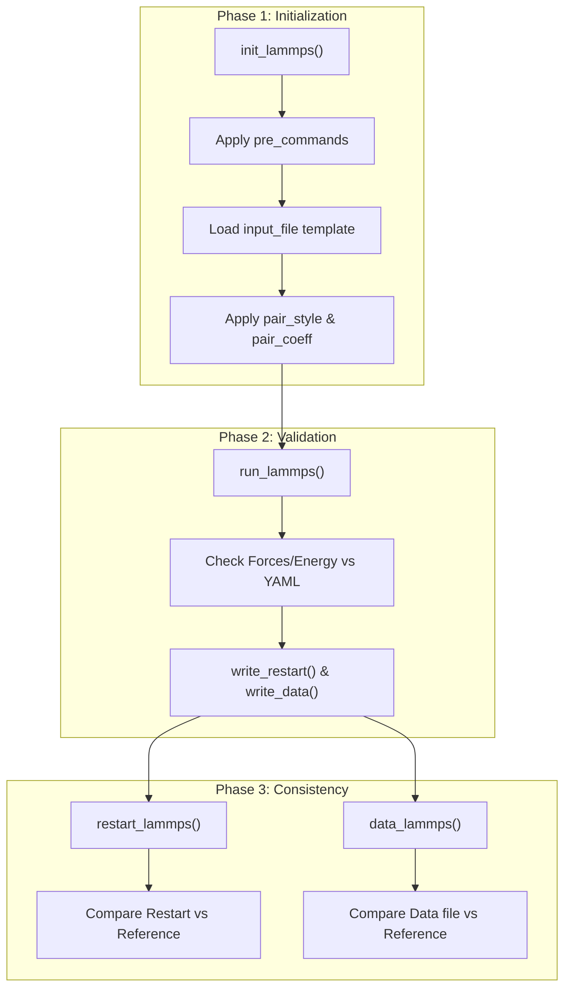
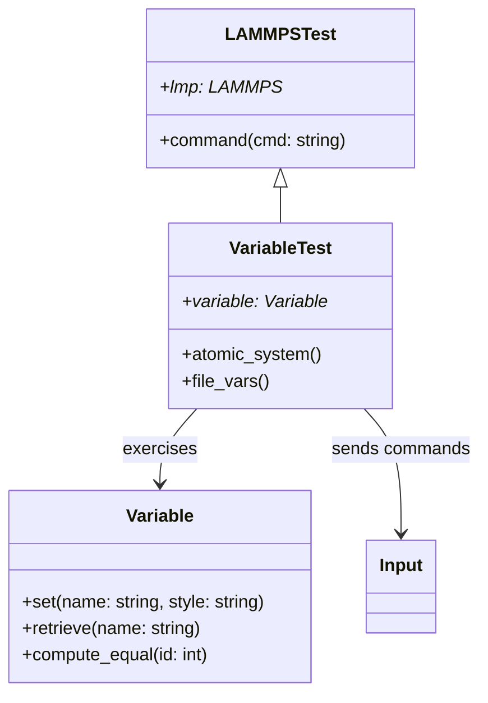

# Unit Testing Framework

<details>
<summary>Relevant source files</summary>

The following files were used as context for generating this wiki page:

- [cmake/Modules/generate_lmpgitversion.cmake](cmake/Modules/generate_lmpgitversion.cmake)
- [doc/src/Developer_unittest.rst](doc/src/Developer_unittest.rst)
- [doc/src/fix_print.rst](doc/src/fix_print.rst)
- [doc/src/geturl.rst](doc/src/geturl.rst)
- [doc/src/print.rst](doc/src/print.rst)
- [doc/src/python.rst](doc/src/python.rst)
- [doc/src/variable.rst](doc/src/variable.rst)
- [examples/python/dump.1May25.python.wrap.g++.1](examples/python/dump.1May25.python.wrap.g++.1)
- [examples/python/dump.1May25.python.wrap.g++.4](examples/python/dump.1May25.python.wrap.g++.4)
- [examples/python/in.python.wrap](examples/python/in.python.wrap)
- [examples/python/log.1May25.python.wrap.g++.1](examples/python/log.1May25.python.wrap.g++.1)
- [examples/python/log.1May25.python.wrap.g++.4](examples/python/log.1May25.python.wrap.g++.4)
- [src/EXTRA-COMMAND/geturl.cpp](src/EXTRA-COMMAND/geturl.cpp)
- [src/EXTRA-COMMAND/geturl.h](src/EXTRA-COMMAND/geturl.h)
- [src/variable.cpp](src/variable.cpp)
- [src/variable.h](src/variable.h)
- [unittest/CMakeLists.txt](unittest/CMakeLists.txt)
- [unittest/c-library/CMakeLists.txt](unittest/c-library/CMakeLists.txt)
- [unittest/c-library/test_library_config.cpp](unittest/c-library/test_library_config.cpp)
- [unittest/commands/CMakeLists.txt](unittest/commands/CMakeLists.txt)
- [unittest/commands/test_compute_global.cpp](unittest/commands/test_compute_global.cpp)
- [unittest/commands/test_delete_atoms.cpp](unittest/commands/test_delete_atoms.cpp)
- [unittest/commands/test_groups.cpp](unittest/commands/test_groups.cpp)
- [unittest/commands/test_info.cpp](unittest/commands/test_info.cpp)
- [unittest/commands/test_kim_commands.cpp](unittest/commands/test_kim_commands.cpp)
- [unittest/commands/test_lattice_region.cpp](unittest/commands/test_lattice_region.cpp)
- [unittest/commands/test_regions.cpp](unittest/commands/test_regions.cpp)
- [unittest/commands/test_simple_commands.cpp](unittest/commands/test_simple_commands.cpp)
- [unittest/commands/test_thermo.cpp](unittest/commands/test_thermo.cpp)
- [unittest/commands/test_variables.cpp](unittest/commands/test_variables.cpp)
- [unittest/cplusplus/CMakeLists.txt](unittest/cplusplus/CMakeLists.txt)
- [unittest/cplusplus/test_advanced_utils.cpp](unittest/cplusplus/test_advanced_utils.cpp)
- [unittest/cplusplus/test_error_class.cpp](unittest/cplusplus/test_error_class.cpp)
- [unittest/cplusplus/test_lammps_class.cpp](unittest/cplusplus/test_lammps_class.cpp)
- [unittest/cplusplus/test_neighbor_class.cpp](unittest/cplusplus/test_neighbor_class.cpp)
- [unittest/force-styles/CMakeLists.txt](unittest/force-styles/CMakeLists.txt)
- [unittest/force-styles/test_angle_style.cpp](unittest/force-styles/test_angle_style.cpp)
- [unittest/force-styles/test_bond_style.cpp](unittest/force-styles/test_bond_style.cpp)
- [unittest/force-styles/test_config.h](unittest/force-styles/test_config.h)
- [unittest/force-styles/test_config_reader.cpp](unittest/force-styles/test_config_reader.cpp)
- [unittest/force-styles/test_config_reader.h](unittest/force-styles/test_config_reader.h)
- [unittest/force-styles/test_dihedral_style.cpp](unittest/force-styles/test_dihedral_style.cpp)
- [unittest/force-styles/test_error_stats.cpp](unittest/force-styles/test_error_stats.cpp)
- [unittest/force-styles/test_fix_timestep.cpp](unittest/force-styles/test_fix_timestep.cpp)
- [unittest/force-styles/test_improper_style.cpp](unittest/force-styles/test_improper_style.cpp)
- [unittest/force-styles/test_main.cpp](unittest/force-styles/test_main.cpp)
- [unittest/force-styles/test_main.h](unittest/force-styles/test_main.h)
- [unittest/force-styles/test_min_style.cpp](unittest/force-styles/test_min_style.cpp)
- [unittest/force-styles/test_pair_style.cpp](unittest/force-styles/test_pair_style.cpp)
- [unittest/force-styles/tests/fix-timestep-ilves_angle.yaml](unittest/force-styles/tests/fix-timestep-ilves_angle.yaml)
- [unittest/force-styles/tests/fix-timestep-ilves_bond.yaml](unittest/force-styles/tests/fix-timestep-ilves_bond.yaml)
- [unittest/formats/CMakeLists.txt](unittest/formats/CMakeLists.txt)
- [unittest/formats/compressed_dump_test.h](unittest/formats/compressed_dump_test.h)
- [unittest/formats/compressed_dump_test_main.cpp](unittest/formats/compressed_dump_test_main.cpp)
- [unittest/formats/test_atom_styles.cpp](unittest/formats/test_atom_styles.cpp)
- [unittest/formats/test_dump_atom.cpp](unittest/formats/test_dump_atom.cpp)
- [unittest/formats/test_dump_atom_compressed.cpp](unittest/formats/test_dump_atom_compressed.cpp)
- [unittest/formats/test_dump_cfg.cpp](unittest/formats/test_dump_cfg.cpp)
- [unittest/formats/test_dump_cfg_compressed.cpp](unittest/formats/test_dump_cfg_compressed.cpp)
- [unittest/formats/test_dump_custom.cpp](unittest/formats/test_dump_custom.cpp)
- [unittest/formats/test_dump_custom_compressed.cpp](unittest/formats/test_dump_custom_compressed.cpp)
- [unittest/formats/test_dump_local.cpp](unittest/formats/test_dump_local.cpp)
- [unittest/formats/test_dump_local_compressed.cpp](unittest/formats/test_dump_local_compressed.cpp)
- [unittest/formats/test_dump_netcdf.cpp](unittest/formats/test_dump_netcdf.cpp)
- [unittest/formats/test_dump_xyz_compressed.cpp](unittest/formats/test_dump_xyz_compressed.cpp)
- [unittest/formats/test_eim_potential_file_reader.cpp](unittest/formats/test_eim_potential_file_reader.cpp)
- [unittest/formats/test_file_operations.cpp](unittest/formats/test_file_operations.cpp)
- [unittest/formats/test_molecule_file.cpp](unittest/formats/test_molecule_file.cpp)
- [unittest/formats/test_potential_file_reader.cpp](unittest/formats/test_potential_file_reader.cpp)
- [unittest/formats/test_text_file_reader.cpp](unittest/formats/test_text_file_reader.cpp)
- [unittest/granular/README.md](unittest/granular/README.md)
- [unittest/granular/dem_audit.py](unittest/granular/dem_audit.py)
- [unittest/granular/tests/dem01-hertz-tsuji-3d-si.yaml](unittest/granular/tests/dem01-hertz-tsuji-3d-si.yaml)
- [unittest/granular/tests/dem01-hertz-twosphere-3d-si.yaml](unittest/granular/tests/dem01-hertz-twosphere-3d-si.yaml)
- [unittest/granular/tests/dem01-hooke-massvel-3d-si.yaml](unittest/granular/tests/dem01-hooke-massvel-3d-si.yaml)
- [unittest/granular/tests/dem01-hooke-twosphere-3d-si.yaml](unittest/granular/tests/dem01-hooke-twosphere-3d-si.yaml)
- [unittest/granular/tests/dem01-hookehistory-twosphere-3d-si.yaml](unittest/granular/tests/dem01-hookehistory-twosphere-3d-si.yaml)
- [unittest/granular/tests/dem02-hertz-twosphere-3d-si.yaml](unittest/granular/tests/dem02-hertz-twosphere-3d-si.yaml)
- [unittest/granular/tests/dem02-hertzmaterial-twosphere-3d-si.yaml](unittest/granular/tests/dem02-hertzmaterial-twosphere-3d-si.yaml)
- [unittest/granular/tests/dem03-hertz-tsuji-wall-3d-si.yaml](unittest/granular/tests/dem03-hertz-tsuji-wall-3d-si.yaml)
- [unittest/granular/tests/dem03-hertz-wall-3d-si.yaml](unittest/granular/tests/dem03-hertz-wall-3d-si.yaml)
- [unittest/granular/tests/dem03-hertzmaterial-wall-3d-si.yaml](unittest/granular/tests/dem03-hertzmaterial-wall-3d-si.yaml)
- [unittest/granular/tests/dem04-hertz-oblique-3d-si.yaml](unittest/granular/tests/dem04-hertz-oblique-3d-si.yaml)
- [unittest/granular/tests/dem04-hookehistory-oblique-3d-si.yaml](unittest/granular/tests/dem04-hookehistory-oblique-3d-si.yaml)
- [unittest/granular/tests/dem04-mindlinforce-oblique-3d-si.yaml](unittest/granular/tests/dem04-mindlinforce-oblique-3d-si.yaml)
- [unittest/granular/tests/dem04-mindlinrescaleforce-oblique-3d-si.yaml](unittest/granular/tests/dem04-mindlinrescaleforce-oblique-3d-si.yaml)
- [unittest/granular/tests/dem15-hertz-oblique-3d-si.yaml](unittest/granular/tests/dem15-hertz-oblique-3d-si.yaml)
- [unittest/granular/tests/dem15-hooke-oblique-3d-si.yaml](unittest/granular/tests/dem15-hooke-oblique-3d-si.yaml)
- [unittest/python/CMakeLists.txt](unittest/python/CMakeLists.txt)
- [unittest/python/func.py](unittest/python/func.py)
- [unittest/python/run.py](unittest/python/run.py)
- [unittest/python/test_python_package.cpp](unittest/python/test_python_package.cpp)
- [unittest/testing/core.h](unittest/testing/core.h)
- [unittest/testing/systems/melt.h](unittest/testing/systems/melt.h)
- [unittest/testing/utils.h](unittest/testing/utils.h)
- [unittest/utils/CMakeLists.txt](unittest/utils/CMakeLists.txt)
- [unittest/utils/fft_test_helpers.h](unittest/utils/fft_test_helpers.h)
- [unittest/utils/test_fft3d.cpp](unittest/utils/test_fft3d.cpp)
- [unittest/utils/test_fft3d_kokkos.cpp](unittest/utils/test_fft3d_kokkos.cpp)
- [unittest/utils/test_fmtlib.cpp](unittest/utils/test_fmtlib.cpp)

</details>


The LAMMPS unit testing framework is built upon the **Google Test** (gtest) and **Google Mock** (gmock) libraries. It is designed to validate the "local" behavior of individual features, ensuring that internal data structures, command parsing, and force calculations remain correct across code changes [doc/src/Developer_unittest.rst:9-15]().

## Infrastructure Overview

The framework is integrated into the CMake build system. When `ENABLE_TESTING=ON` is specified during configuration, the build system downloads and compiles the Google Test framework and registers test executables with `ctest` [unittest/CMakeLists.txt:6-25]().

### Test Categories
Tests are organized into directories based on the subsystem they target:

| Category | Directory | Description |
| :--- | :--- | :--- |
| **Utils** | `unittest/utils` | Pure unit tests for utility classes like `Tokenizer`, `ArgInfo`, and math libraries [doc/src/Developer_unittest.rst:42-81](). |
| **Commands** | `unittest/commands` | Tests for LAMMPS input script commands (e.g., `variable`, `group`, `region`) [unittest/commands/CMakeLists.txt:1-147](). |
| **Formats** | `unittest/formats` | Validation of file I/O, including `atom_style` data files and `molecule` files [unittest/formats/test_atom_styles.cpp:91-121](). |
| **Force Styles** | `unittest/force-styles` | Hybrid unit/regression tests for pair, bond, angle, dihedral, and improper styles using YAML data [unittest/force-styles/test_pair_style.cpp:1-47](). |
| **Language Bindings** | `unittest/c-library`, `/python`, `/fortran` | Tests for the LAMMPS library API and external language wrappers [unittest/CMakeLists.txt:115-118](). |

**Sources:** [unittest/CMakeLists.txt:112-128](), [doc/src/Developer_unittest.rst:34-37]()

---

## Force-Style Testing (YAML-Driven)

Force styles (pair, bond, etc.) use a specialized infrastructure that compares LAMMPS calculations against reference values stored in YAML files. This allows testing multiple styles using a single generic test driver [doc/src/Developer_unittest.rst:20-26]().

### Data Flow for Force Style Tests

The `test_pair_style` driver follows a specific lifecycle to ensure consistency across restarts and different Newton settings.

Title: Force Style Test Lifecycle

**Sources:** [unittest/force-styles/test_pair_style.cpp:57-134](), [unittest/force-styles/test_pair_style.cpp:163-192]()

### YAML Test Data Format
Reference data is stored in `unittest/force-styles/tests/`. A typical YAML file includes:
* **prerequisites**: Required LAMMPS packages or styles [unittest/force-styles/test_pair_style.cpp:66-79]().
* **pair_style / pair_coeff**: The command strings to execute [unittest/force-styles/test_pair_style.cpp:110-114]().
* **natoms / energy / virial**: Reference values for validation [unittest/force-styles/test_fix_timestep.cpp:192-205]().

---

## Command and Variable Testing

Tests for the `Variable` class and associated commands verify the expression parser and the handling of different variable styles (e.g., `equal`, `atom`, `vector`).

Title: Variable Subsystem Testing Architecture

**Sources:** [unittest/commands/test_variables.cpp:44-58](), [src/variable.h:23-57]()

### Key Test Functions
* `atomic_system()`: Sets up a basic simulation box and atoms to test atom-style variables [unittest/commands/test_variables.cpp:67-82]().
* `file_vars()`: Generates temporary files to test `file` and `atomfile` variable styles [unittest/commands/test_variables.cpp:100-117]().
* `TEST_F(VariableTest, CreateDelete)`: Verifies variable creation, deletion, and ID recycling [unittest/commands/test_variables.cpp:120-171]().

---

## Adding New Tests

### 1. Utility Tests
To add a test for a new utility function:
1. Create `test_new_feature.cpp` in `unittest/utils/`.
2. Define tests using the `TEST()` macro [doc/src/Developer_unittest.rst:107-111]().
3. Register the executable in `unittest/utils/CMakeLists.txt` using `add_executable` and `add_test` [doc/src/Developer_unittest.rst:87-91]().

### 2. Force Style Tests
To add a test for a new pair style:
1. Create a YAML file in `unittest/force-styles/tests/` (e.g., `atomic-pair-newstyle.yaml`).
2. Use the `generate_yaml_file` utility (part of the test driver) to populate reference values from a known-good version of the code [unittest/force-styles/test_fix_timestep.cpp:166-190]().

### 3. Execution
Tests are executed via `ctest`. Labels can be used to run specific subsets:
```bash
ctest -R Tokenizer        # Run specific test by name
ctest -L mpi              # Run all MPI-enabled tests
ctest -V                  # Verbose output (shows Google Test logs)
```
**Sources:** [unittest/CMakeLists.txt:101](), [doc/src/Developer_unittest.rst:130-132]()

---

## Technical Implementation Details

### MPI Support
The framework provides a `add_mpi_test` CMake function to handle tests requiring parallel execution. It prevents oversubscription by checking `MPIEXEC_MAX_NUMPROCS` before registering the test [unittest/CMakeLists.txt:85-102]().

### Output Capture
Tests often use `BEGIN_HIDE_OUTPUT()` and `END_HIDE_OUTPUT()` to suppress standard LAMMPS screen output during setup, and `BEGIN_CAPTURE_OUTPUT()` to verify that commands print the expected strings [unittest/commands/test_simple_commands.cpp:168-177]().

**Sources:** [unittest/testing/core.h](), [unittest/commands/test_simple_commands.cpp:59-61]()

---