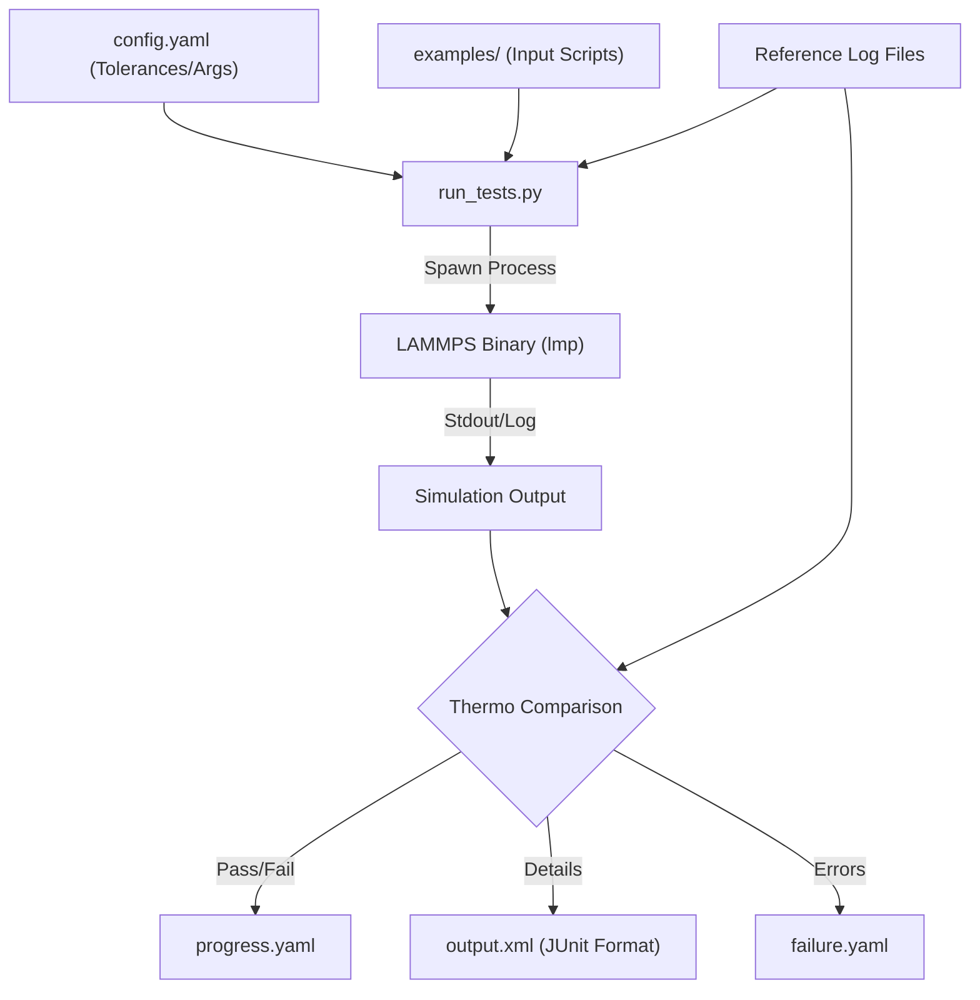
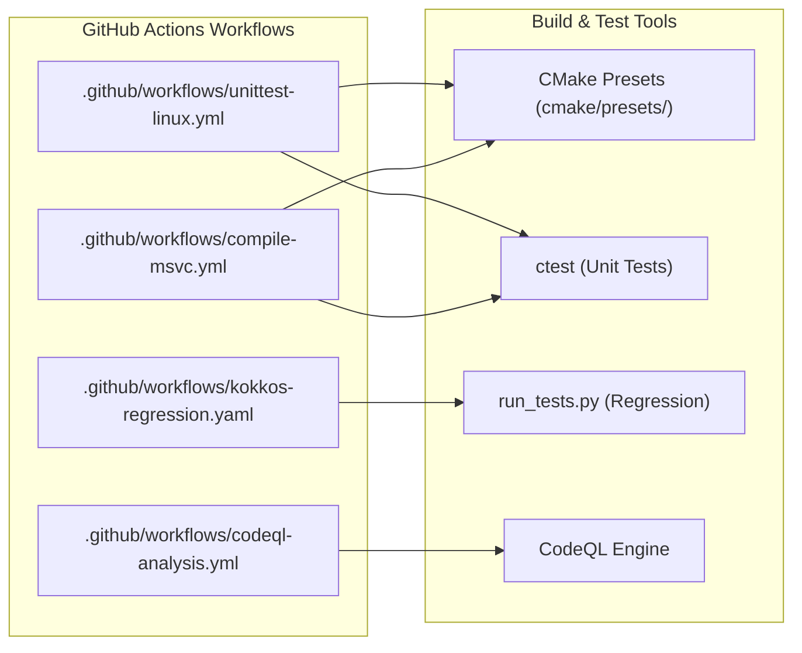

# Regression Testing and CI Workflows

Relevant source files

The following files were used as context for generating this wiki page:

- [.github/workflows/check-cpp23.yml](.github/workflows/check-cpp23.yml)
- [.github/workflows/check-examples.yml](.github/workflows/check-examples.yml)
- [.github/workflows/check-gnu-make.yml](.github/workflows/check-gnu-make.yml)
- [.github/workflows/check-vla.yml](.github/workflows/check-vla.yml)
- [.github/workflows/codeql-analysis.yml](.github/workflows/codeql-analysis.yml)
- [.github/workflows/compile-msvc.yml](.github/workflows/compile-msvc.yml)
- [.github/workflows/kokkos-regression.yaml](.github/workflows/kokkos-regression.yaml)
- [.github/workflows/lammps-gui-flatpak.yml](.github/workflows/lammps-gui-flatpak.yml)
- [.github/workflows/style-check.yml](.github/workflows/style-check.yml)
- [.github/workflows/unittest-arm64.yml](.github/workflows/unittest-arm64.yml)
- [.github/workflows/unittest-fftw.yaml](.github/workflows/unittest-fftw.yaml)
- [.github/workflows/unittest-kokkos.yml](.github/workflows/unittest-kokkos.yml)
- [.github/workflows/unittest-linux.yml](.github/workflows/unittest-linux.yml)
- [.github/workflows/unittest-macos.yml](.github/workflows/unittest-macos.yml)
- [.github/workflows/unittest-single.yml](.github/workflows/unittest-single.yml)
- [cmake/presets/kokkos-packages.cmake](cmake/presets/kokkos-packages.cmake)
- [tools/regression-tests/README](tools/regression-tests/README)
- [tools/regression-tests/REPORTING.md](tools/regression-tests/REPORTING.md)
- [tools/regression-tests/config.yaml](tools/regression-tests/config.yaml)
- [tools/regression-tests/config_gpu.yaml](tools/regression-tests/config_gpu.yaml)
- [tools/regression-tests/config_kokkos.yaml](tools/regression-tests/config_kokkos.yaml)
- [tools/regression-tests/config_kokkos_openmp.yaml](tools/regression-tests/config_kokkos_openmp.yaml)
- [tools/regression-tests/config_openmp.yaml](tools/regression-tests/config_openmp.yaml)
- [tools/regression-tests/config_quick.yaml](tools/regression-tests/config_quick.yaml)
- [tools/regression-tests/config_serial.yaml](tools/regression-tests/config_serial.yaml)
- [tools/regression-tests/config_skiprun.yaml](tools/regression-tests/config_skiprun.yaml)
- [tools/regression-tests/config_valgrind.yaml](tools/regression-tests/config_valgrind.yaml)
- [tools/regression-tests/get_kokkos_input.py](tools/regression-tests/get_kokkos_input.py)
- [tools/regression-tests/get_quick_list.py](tools/regression-tests/get_quick_list.py)
- [tools/regression-tests/merge_results.py](tools/regression-tests/merge_results.py)
- [tools/regression-tests/run_tests.py](tools/regression-tests/run_tests.py)
- [tools/singularity/centos7.def](tools/singularity/centos7.def)
- [tools/singularity/centos8.def](tools/singularity/centos8.def)
- [tools/singularity/fedora35_mingw.def](tools/singularity/fedora35_mingw.def)
- [tools/singularity/fedora36_mingw.def](tools/singularity/fedora36_mingw.def)
- [tools/singularity/ubuntu16.04.def](tools/singularity/ubuntu16.04.def)
- [tools/singularity/ubuntu18.04.def](tools/singularity/ubuntu18.04.def)
- [tools/singularity/ubuntu18.04_amd_rocm.def](tools/singularity/ubuntu18.04_amd_rocm.def)
- [tools/singularity/ubuntu18.04_gpu.def](tools/singularity/ubuntu18.04_gpu.def)
- [tools/singularity/ubuntu18.04_intel_opencl.def](tools/singularity/ubuntu18.04_intel_opencl.def)
- [tools/singularity/ubuntu18.04_nvidia.def](tools/singularity/ubuntu18.04_nvidia.def)
- [tools/singularity/ubuntu20.04.def](tools/singularity/ubuntu20.04.def)
- [tools/singularity/ubuntu20.04_amd_rocm.def](tools/singularity/ubuntu20.04_amd_rocm.def)
- [tools/singularity/ubuntu20.04_gpu.def](tools/singularity/ubuntu20.04_gpu.def)
- [tools/singularity/ubuntu20.04_intel_opencl.def](tools/singularity/ubuntu20.04_intel_opencl.def)
- [tools/singularity/ubuntu20.04_nvidia.def](tools/singularity/ubuntu20.04_nvidia.def)
- [tools/singularity/ubuntu20.04_oneapi.def](tools/singularity/ubuntu20.04_oneapi.def)
- [tools/singularity/ubuntu22.04.def](tools/singularity/ubuntu22.04.def)
- [unittest/utils/test_math_extra.cpp](unittest/utils/test_math_extra.cpp)
- [unittest/utils/test_math_special.cpp](unittest/utils/test_math_special.cpp)
- [unittest/utils/test_random.cpp](unittest/utils/test_random.cpp)
- [unittest/utils/test_tabular_function.cpp](unittest/utils/test_tabular_function.cpp)

LAMMPS utilizes a multi-layered testing strategy to ensure code stability across a wide array of hardware architectures and software configurations. This infrastructure includes a specialized regression testing framework that validates physical results against reference data, extensive GitHub Actions workflows for continuous integration (CI) across major operating systems, and Singularity container definitions to provide reproducible environments for developers and automated systems.

## Regression Testing Framework

The regression test suite is designed to verify that changes to the codebase do not alter simulation results beyond acceptable numerical tolerances. Unlike unit tests which focus on individual functions, regression tests run complete simulation scripts from the `examples/` directory and compare thermodynamic output against reference logs [tools/regression-tests/run_tests.py:1-14]().

### Key Component: `run_tests.py`

The primary driver for regression testing is `tools/regression-tests/run_tests.py`. It automates the process of launching LAMMPS, parsing output, and performing statistical comparisons [tools/regression-tests/run_tests.py:38-54]().

| Feature | Description |
| :--- | :--- |
| **Binary Analysis** | Detects supported styles/commands in the binary via `-help` to skip incompatible tests [tools/regression-tests/run_tests.py:16-19](). |
| **Numerical Validation** | Compares thermodynamic quantities (Temp, Press, PotEng, etc.) against reference logs using configurable tolerances [tools/regression-tests/run_tests.py:5-13](). |
| **Parallel Execution** | Supports `mpirun` with custom partition settings and accelerator suffixes (e.g., `-sf omp`) [tools/regression-tests/run_tests.py:14-15](). |
| **Load Balancing** | Analyzes estimated run costs to distribute input scripts across multiple worker processes evenly [tools/regression-tests/run_tests.py:32-34](). |
| **Incremental Progress** | Writes `progress.yaml` and `failure.yaml` incrementally to allow resuming interrupted test runs [tools/regression-tests/run_tests.py:44-54](). |

### Configuration and Hardware Targets

The framework uses YAML configuration files to define execution parameters for different hardware and software environments.

*   **`config.yaml`**: The base configuration defining global tolerances (e.g., `PotEng` abs: 1e-4, rel: 1e-7) and global skip patterns for scripts that require specialized external libraries [tools/regression-tests/config.yaml:7-43]().
*   **Hardware-Specific Configs**: Specialized files like `config_kokkos_openmp.yaml`, `config_gpu.yaml`, and `config_valgrind.yaml` allow testing of accelerator packages and memory safety [tools/regression-tests/run_tests.py:59-60]().
*   **Overrides**: Specific input scripts can have tighter or looser tolerances defined in the `overrides` section of the YAML to account for chaotic divergence in certain integration methods [tools/regression-tests/config.yaml:23-30]().

### Data Flow for Regression Testing

The following diagram illustrates how `run_tests.py` interacts with the LAMMPS binary and configuration data.

**Title: Regression Test Execution Flow**

Sources: [tools/regression-tests/run_tests.py:37-54](), [tools/regression-tests/config.yaml:1-62]()

## Continuous Integration (CI) Workflows

LAMMPS employs GitHub Actions to perform automated builds and testing on every push to the `develop` and `maintenance` branches, as well as for all pull requests.

### Multi-Platform Validation
*   **Linux**: Standard unit tests are run using `gcc` and `LAMMPS_SIZES=bigbig` to ensure 64-bit integer support for large-scale simulations [.github/workflows/unittest-linux.yml:21-67]().
*   **macOS**: Builds are validated on macOS runners using the `clang` and `most` presets [.github/workflows/unittest-macos.yml:21-64]().
*   **Windows**: Compilation and unit tests are performed using the Microsoft Visual C++ (MSVC) compiler via `ninja` [.github/workflows/compile-msvc.yml:20-69]().
*   **ARM64**: Specific workflows target ARM architecture to ensure portability beyond x86_64.

### Specialized CI Workflows
*   **Kokkos Regression**: A dedicated workflow for Kokkos OpenMP that filters examples to focus on pair and fix styles compatible with the Kokkos abstraction layer [.github/workflows/kokkos-regression.yaml:13-85]().
*   **CodeQL Analysis**: Performs static analysis for both C++ and Python code to identify potential security vulnerabilities and logic errors [.github/workflows/codeql-analysis.yml:11-58]().
*   **Check Examples**: A "smoke test" workflow that runs a large number of examples with `-skiprun` (using `--preflight-only`) to verify that input scripts parse correctly without executing full simulations [tools/regression-tests/run_tests.py:20-23]().

### Workflow Entity Mapping

This diagram maps CI workflow files to the specific build/test tools they orchestrate.

**Title: CI Workflow and Tooling Map**

Sources: [.github/workflows/unittest-linux.yml:53-87](), [.github/workflows/compile-msvc.yml:53-69](), [.github/workflows/kokkos-regression.yaml:48-85](), [.github/workflows/codeql-analysis.yml:37-58]()

## Reproducible Environments (Singularity)

To mitigate "it works on my machine" issues, LAMMPS provides Singularity/Apptainer definition files in `tools/singularity/`. These files define complete software stacks, including MPI, compilers, and external libraries (e.g., KIM API, Plumed, Eigen).

### Container Categories
*   **Standard OS**: Definitions for `ubuntu18.04.def`, `centos7.def`, and `centos8.def` provide baseline environments for standard builds [tools/singularity/ubuntu18.04.def:1-3](), [tools/singularity/centos7.def:1-2]().
*   **GPU/Accelerated**:
    *   `ubuntu18.04_nvidia.def`: Includes CUDA Toolkit and NVIDIA drivers [tools/singularity/ubuntu18.04_gpu.def:120-140]().
    *   `ubuntu18.04_amd_rocm.def`: Configured with the ROCm stack for AMD GPU acceleration [tools/singularity/ubuntu18.04_amd_rocm.def:25-43]().
    *   `ubuntu18.04_intel_opencl.def`: Supports Intel's OpenCL and oneAPI runtimes.

### Environment Standardization
The containers enforce specific environment variables to ensure consistent testing results, such as `LC_ALL=C` for locale-independent string processing and `OMPI_MCA_btl="^openib"` to prevent OpenMPI from attempting to use non-existent InfiniBand hardware in containerized environments [tools/singularity/ubuntu18.04.def:158-166](), [tools/singularity/centos8.def:101-107]().

Sources: [tools/singularity/ubuntu18.04.def:1-169](), [tools/singularity/ubuntu18.04_gpu.def:1-143](), [tools/singularity/centos8.def:1-110](), [tools/singularity/ubuntu18.04_amd_rocm.def:1-197]()

---