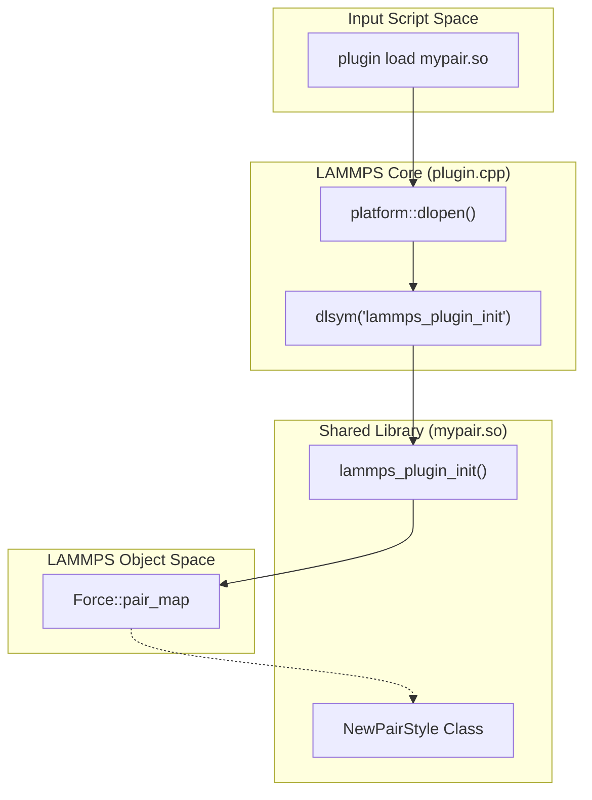
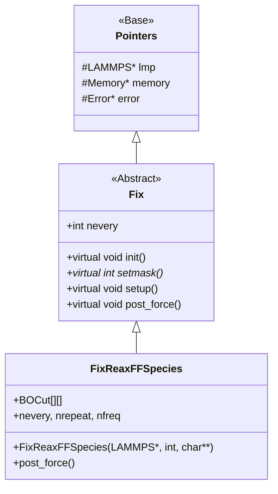

# Adding New Styles and Plugins

<details>
<summary>Relevant source files</summary>

The following files were used as context for generating this wiki page:

- [cmake/CMakeLists.txt](cmake/CMakeLists.txt)
- [cmake/LAMMPSConfig.cmake.in](cmake/LAMMPSConfig.cmake.in)
- [cmake/Modules/Documentation.cmake](cmake/Modules/Documentation.cmake)
- [cmake/Modules/FindCythonize.cmake](cmake/Modules/FindCythonize.cmake)
- [cmake/Modules/FindVORO.cmake](cmake/Modules/FindVORO.cmake)
- [cmake/Modules/LAMMPSInterfacePlugin.cmake](cmake/Modules/LAMMPSInterfacePlugin.cmake)
- [cmake/Modules/LAMMPSUtils.cmake](cmake/Modules/LAMMPSUtils.cmake)
- [cmake/Modules/MPI4WIN.cmake](cmake/Modules/MPI4WIN.cmake)
- [cmake/Modules/Packages/COLVARS.cmake](cmake/Modules/Packages/COLVARS.cmake)
- [cmake/Modules/Packages/GPU.cmake](cmake/Modules/Packages/GPU.cmake)
- [cmake/Modules/Packages/KIM.cmake](cmake/Modules/Packages/KIM.cmake)
- [cmake/Modules/Packages/KOKKOS.cmake](cmake/Modules/Packages/KOKKOS.cmake)
- [cmake/Modules/Packages/LEPTON.cmake](cmake/Modules/Packages/LEPTON.cmake)
- [cmake/Modules/Packages/PYTHON.cmake](cmake/Modules/Packages/PYTHON.cmake)
- [cmake/Modules/Packages/VORONOI.cmake](cmake/Modules/Packages/VORONOI.cmake)
- [cmake/Modules/StyleHeaderUtils.cmake](cmake/Modules/StyleHeaderUtils.cmake)
- [cmake/Modules/Testing.cmake](cmake/Modules/Testing.cmake)
- [cmake/pkgconfig/liblammps.pc.in](cmake/pkgconfig/liblammps.pc.in)
- [cmake/presets/all_off.cmake](cmake/presets/all_off.cmake)
- [cmake/presets/all_on.cmake](cmake/presets/all_on.cmake)
- [cmake/presets/mingw-cross.cmake](cmake/presets/mingw-cross.cmake)
- [cmake/presets/most.cmake](cmake/presets/most.cmake)
- [cmake/presets/nolib.cmake](cmake/presets/nolib.cmake)
- [cmake/presets/windows.cmake](cmake/presets/windows.cmake)
- [doc/src/Build_windows.rst](doc/src/Build_windows.rst)
- [doc/src/Developer.rst](doc/src/Developer.rst)
- [doc/src/Developer_code_design.rst](doc/src/Developer_code_design.rst)
- [doc/src/Developer_notes.rst](doc/src/Developer_notes.rst)
- [doc/src/Developer_platform.rst](doc/src/Developer_platform.rst)
- [doc/src/Developer_plugins.rst](doc/src/Developer_plugins.rst)
- [doc/src/Developer_updating.rst](doc/src/Developer_updating.rst)
- [doc/src/Errors_bugs.rst](doc/src/Errors_bugs.rst)
- [doc/src/Intro_website.rst](doc/src/Intro_website.rst)
- [doc/src/Modify.rst](doc/src/Modify.rst)
- [doc/src/Modify_atom.rst](doc/src/Modify_atom.rst)
- [doc/src/Modify_contribute.rst](doc/src/Modify_contribute.rst)
- [doc/src/Modify_overview.rst](doc/src/Modify_overview.rst)
- [doc/src/Modify_requirements.rst](doc/src/Modify_requirements.rst)
- [doc/src/Modify_style.rst](doc/src/Modify_style.rst)
- [doc/src/Modify_thermo.rst](doc/src/Modify_thermo.rst)
- [doc/src/Modify_variable.rst](doc/src/Modify_variable.rst)
- [doc/src/fix_modify.rst](doc/src/fix_modify.rst)
- [doc/src/fix_reaxff_bonds.rst](doc/src/fix_reaxff_bonds.rst)
- [doc/src/fix_reaxff_species.rst](doc/src/fix_reaxff_species.rst)
- [doc/src/plugin.rst](doc/src/plugin.rst)
- [examples/plugins/LAMMPSInterfaceCXX.cmake](examples/plugins/LAMMPSInterfaceCXX.cmake)
- [src/.gitignore](src/.gitignore)
- [src/Depend.sh](src/Depend.sh)
- [src/KOKKOS/Install.sh](src/KOKKOS/Install.sh)
- [src/Make.sh](src/Make.sh)
- [src/Makefile](src/Makefile)
- [src/PLUGIN/plugin.cpp](src/PLUGIN/plugin.cpp)
- [src/PLUGIN/plugin.h](src/PLUGIN/plugin.h)
- [src/Purge.list](src/Purge.list)
- [src/REAXFF/compute_spec_atom.h](src/REAXFF/compute_spec_atom.h)
- [src/REAXFF/fix_qeq_reaxff.h](src/REAXFF/fix_qeq_reaxff.h)
- [src/REAXFF/fix_reaxff_bonds.cpp](src/REAXFF/fix_reaxff_bonds.cpp)
- [src/REAXFF/fix_reaxff_bonds.h](src/REAXFF/fix_reaxff_bonds.h)
- [src/REAXFF/fix_reaxff_species.cpp](src/REAXFF/fix_reaxff_species.cpp)
- [src/REAXFF/fix_reaxff_species.h](src/REAXFF/fix_reaxff_species.h)
- [src/REAXFF/pair_reaxff.h](src/REAXFF/pair_reaxff.h)
- [src/creator_registry.cpp](src/creator_registry.cpp)
- [src/fix_store_atom.cpp](src/fix_store_atom.cpp)
- [src/fix_store_global.cpp](src/fix_store_global.cpp)
- [src/platform.cpp](src/platform.cpp)
- [src/platform.h](src/platform.h)
- [tools/json/README.md](tools/json/README.md)
- [tools/json/color-schema.json](tools/json/color-schema.json)
- [tools/json/dump-molecules-schema.json](tools/json/dump-molecules-schema.json)
- [tools/json/reformat-json.cpp](tools/json/reformat-json.cpp)
- [unittest/utils/test_platform.cpp](unittest/utils/test_platform.cpp)

</details>


LAMMPS is designed to be highly extensible. The core architecture uses a modular approach where specific simulation functionalities (force fields, integrators, diagnostics) are implemented as "styles". Developers can extend LAMMPS by adding new C++ classes that inherit from base classes like `Pair`, `Fix`, or `Compute`.

## Style Architecture and Registration

LAMMPS uses a **CreatorRegistry** pattern to map string keywords in an input script to C++ class constructors. This allows the code to remain flexible; the main executable does not need to know about every specific style at compile time.

### The Style Macro Pattern
Each style is defined in a pair of `.cpp` and `.h` files. To be recognized by the build system, the header file must contain a `Style` macro. For example, a new pair style would include:

```cpp
#ifdef PAIR_CLASS
PairStyle(new_style_name, NewStyleClass)
#else
// ... normal header content ...
#endif
```

During the build process, the `Make.sh` script (for Make) or CMake utility functions (for CMake) scan the `src` directory for these macros to generate `style_*.h` files, which are then included by the `Force` or `Modify` classes [src/Makefile:23-32](), [src/Purge.list:1-25]().

### Base Classes for New Styles
When adding a new style, you must inherit from the appropriate base class:

| Style Type | Base Class | Purpose |
| :--- | :--- | :--- |
| **Pair** | `Pair` | Short-range interatomic potentials. |
| **Fix** | `Fix` | Operations applied during the time integration loop (constraints, thermostats). |
| **Compute** | `Compute` | Diagnostics and per-atom/global property calculations. |
| **Bond/Angle** | `Bond` / `Angle` | Bonded interactions within molecular topologies. |
| **Dump** | `Dump` | Custom file output formats. |

## The Dynamic Plugin System

LAMMPS supports loading styles at runtime without recompiling the main executable through the `PLUGIN` package. This is particularly useful for distributing proprietary potentials or testing new styles without modifying the core source tree.

### Plugin Mechanism
Plugins are compiled as Dynamic Shared Objects (DSOs) or DLLs. The loading process is managed by `src/PLUGIN/plugin.cpp`.

1. **Initialization**: The `plugin` command in a LAMMPS input script triggers the `plugin.cpp` logic.
2. **DSO Loading**: LAMMPS uses `dlopen` (on Linux/macOS) or `LoadLibrary` (on Windows) to load the shared library [src/platform.cpp:59-68]().
3. **Registration**: The plugin must export a specific initialization function that registers the new style with the internal `Force` or `Modify` pointers.

### Data Flow for Plugin Registration
The following diagram illustrates how a plugin style is integrated into the LAMMPS instance at runtime.

**Diagram: Runtime Plugin Registration Flow**

**Sources:** [src/PLUGIN/plugin.cpp](), [src/platform.cpp:59-68](), [doc/src/Developer_plugins.rst]()

## Coding Standards and Requirements

New contributions must adhere to the LAMMPS development guidelines to ensure portability and maintainability.

### Whitespace and Formatting
*   **Indentation**: Use spaces, not tabs.
*   **Encoding**: All files must be UTF-8 encoded.
*   **Clang-Format**: The project provides a `.clang-format` file to standardize code appearance.

### Mandatory Metadata and Checks
*   **Homepage**: Every file should include the standard LAMMPS header with the URL `https://www.lammps.org` [src/REAXFF/fix_reaxff_species.cpp:1-12]().
*   **Error Handling**: Use the `Error` class for all terminal output and exceptions. Use `utils::missing_cmd_args` to validate input script arguments [src/REAXFF/fix_reaxff_species.cpp:75]().
*   **Permissions**: Styles that perform file I/O (like `FixReaxFFSpecies`) must check for file open success and handle compressed files via `platform::compressed_write` [src/REAXFF/fix_reaxff_species.cpp:136-147]().

### API Stability and Updating
The `Developer_updating` guide documents significant API changes. When implementing a new style, developers should consult this guide to ensure they are using the current interfaces for:
*   `Atom` class data access (e.g., `x`, `v`, `f`).
*   `Neighbor` list requests and iteration.
*   Communication buffers for parallel execution.

## Implementation Example: Fix Style

Adding a `Fix` style requires implementing a constructor that parses arguments and a `setmask()` function that defines when the fix is called during the timestep.

**Diagram: Fix Style Class Relationship**

**Sources:** [src/REAXFF/fix_reaxff_species.h](), [src/REAXFF/fix_reaxff_species.cpp:69-108](), [doc/src/Modify_style.rst]()

### Key Data Flow in Fix Styles
1.  **Constructor**: Parses `nevery`, `nrepeat`, and `nfreq` from the `fix` command [src/REAXFF/fix_reaxff_species.cpp:96-98]().
2.  **setmask()**: Determines if the fix runs at `PRE_FORCE`, `POST_FORCE`, `END_OF_STEP`, etc.
3.  **post_force()**: Where the actual physics logic (e.g., calculating species based on bond orders) is typically executed [src/REAXFF/fix_reaxff_species.cpp:204-208]().

## Build System Integration

### CMake
CMake automatically detects new styles if the files are placed in `src` or an enabled package directory. The `cmake/Modules/StyleHeaderUtils.cmake` script handles the generation of the necessary registry headers during the configuration phase [cmake/CMakeLists.txt:85-98]().

### Legacy Make
If using the traditional Make system, the `src/Make.sh` script must be run (or is run automatically by `make machine`) to update the `style_*.h` files [src/Makefile:23-32]().

**Sources:**
*   **Style Registration:** [src/Makefile:23-32](), [src/Purge.list:1-25]()
*   **Plugin System:** [src/PLUGIN/plugin.cpp](), [doc/src/Developer_plugins.rst]()
*   **Platform Abstraction:** [src/platform.cpp:13-68](), [src/platform.h]()
*   **Fix Implementation:** [src/REAXFF/fix_reaxff_species.cpp:69-208](), [src/REAXFF/fix_reaxff_species.h]()
*   **Build Integration:** [cmake/CMakeLists.txt:85-98](), [src/Depend.sh]()

---