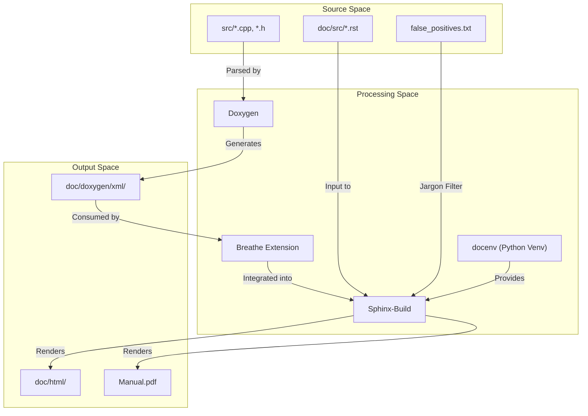

# Documentation System

Relevant source files

The following files were used as context for generating this wiki page:

- [cmake/Modules/OpenCLLoader.cmake](cmake/Modules/OpenCLLoader.cmake)
- [cmake/Modules/Packages/MACHDYN.cmake](cmake/Modules/Packages/MACHDYN.cmake)
- [doc/.gitignore](doc/.gitignore)
- [doc/Makefile](doc/Makefile)
- [doc/README](doc/README)
- [doc/documentation_conventions.md](doc/documentation_conventions.md)
- [doc/src/404.rst](doc/src/404.rst)
- [doc/src/Bibliography.rst](doc/src/Bibliography.rst)
- [doc/src/Build.rst](doc/src/Build.rst)
- [doc/src/Build_basics.rst](doc/src/Build_basics.rst)
- [doc/src/Build_cmake.rst](doc/src/Build_cmake.rst)
- [doc/src/Build_development.rst](doc/src/Build_development.rst)
- [doc/src/Build_extras.rst](doc/src/Build_extras.rst)
- [doc/src/Build_link.rst](doc/src/Build_link.rst)
- [doc/src/Build_make.rst](doc/src/Build_make.rst)
- [doc/src/Build_manual.rst](doc/src/Build_manual.rst)
- [doc/src/Build_package.rst](doc/src/Build_package.rst)
- [doc/src/Build_prerequisites.rst](doc/src/Build_prerequisites.rst)
- [doc/src/Build_settings.rst](doc/src/Build_settings.rst)
- [doc/src/Commands_all.rst](doc/src/Commands_all.rst)
- [doc/src/Commands_bond.rst](doc/src/Commands_bond.rst)
- [doc/src/Commands_compute.rst](doc/src/Commands_compute.rst)
- [doc/src/Commands_dump.rst](doc/src/Commands_dump.rst)
- [doc/src/Commands_fix.rst](doc/src/Commands_fix.rst)
- [doc/src/Commands_kspace.rst](doc/src/Commands_kspace.rst)
- [doc/src/Commands_pair.rst](doc/src/Commands_pair.rst)
- [doc/src/Howto_cmake.rst](doc/src/Howto_cmake.rst)
- [doc/src/JPG/lammps-lost-logo-library.jpg](doc/src/JPG/lammps-lost-logo-library.jpg)
- [doc/src/Manual.rst](doc/src/Manual.rst)
- [doc/src/Packages.rst](doc/src/Packages.rst)
- [doc/src/Packages_details.rst](doc/src/Packages_details.rst)
- [doc/src/bond_style.rst](doc/src/bond_style.rst)
- [doc/src/commands_list.rst](doc/src/commands_list.rst)
- [doc/src/compute.rst](doc/src/compute.rst)
- [doc/src/compute_pod_atom.rst](doc/src/compute_pod_atom.rst)
- [doc/src/dumps.rst](doc/src/dumps.rst)
- [doc/src/fitpod_command.rst](doc/src/fitpod_command.rst)
- [doc/src/fix.rst](doc/src/fix.rst)
- [doc/src/fix_nve.rst](doc/src/fix_nve.rst)
- [doc/src/kspace_style.rst](doc/src/kspace_style.rst)
- [doc/src/pair_pod.rst](doc/src/pair_pod.rst)
- [doc/src/pair_style.rst](doc/src/pair_style.rst)
- [doc/src/run_style.rst](doc/src/run_style.rst)
- [doc/src/units.rst](doc/src/units.rst)
- [doc/utils/pandoc.css](doc/utils/pandoc.css)
- [doc/utils/pandoc.html](doc/utils/pandoc.html)
- [doc/utils/requirements.txt](doc/utils/requirements.txt)
- [doc/utils/sphinx-config/_extra/Packages_list.html](doc/utils/sphinx-config/_extra/Packages_list.html)
- [doc/utils/sphinx-config/_extra/robots.txt](doc/utils/sphinx-config/_extra/robots.txt)
- [doc/utils/sphinx-config/_static/css/lammps.css](doc/utils/sphinx-config/_static/css/lammps.css)
- [doc/utils/sphinx-config/_themes/lammps_theme/__init__.py](doc/utils/sphinx-config/_themes/lammps_theme/__init__.py)
- [doc/utils/sphinx-config/_themes/lammps_theme/breadcrumbs.html](doc/utils/sphinx-config/_themes/lammps_theme/breadcrumbs.html)
- [doc/utils/sphinx-config/_themes/lammps_theme/footer.html](doc/utils/sphinx-config/_themes/lammps_theme/footer.html)
- [doc/utils/sphinx-config/_themes/lammps_theme/google_search.html](doc/utils/sphinx-config/_themes/lammps_theme/google_search.html)
- [doc/utils/sphinx-config/_themes/lammps_theme/layout.html](doc/utils/sphinx-config/_themes/lammps_theme/layout.html)
- [doc/utils/sphinx-config/_themes/lammps_theme/local_search.html](doc/utils/sphinx-config/_themes/lammps_theme/local_search.html)
- [doc/utils/sphinx-config/_themes/lammps_theme/locale/en/LC_MESSAGES/sphinx.mo](doc/utils/sphinx-config/_themes/lammps_theme/locale/en/LC_MESSAGES/sphinx.mo)
- [doc/utils/sphinx-config/_themes/lammps_theme/locale/en/LC_MESSAGES/sphinx.po](doc/utils/sphinx-config/_themes/lammps_theme/locale/en/LC_MESSAGES/sphinx.po)
- [doc/utils/sphinx-config/_themes/lammps_theme/static/css/badge_only.css](doc/utils/sphinx-config/_themes/lammps_theme/static/css/badge_only.css)
- [doc/utils/sphinx-config/_themes/lammps_theme/static/css/theme.css](doc/utils/sphinx-config/_themes/lammps_theme/static/css/theme.css)
- [doc/utils/sphinx-config/_themes/lammps_theme/theme.conf](doc/utils/sphinx-config/_themes/lammps_theme/theme.conf)
- [doc/utils/sphinx-config/_themes/lammps_theme/versions.html](doc/utils/sphinx-config/_themes/lammps_theme/versions.html)
- [doc/utils/sphinx-config/conf.py.in](doc/utils/sphinx-config/conf.py.in)
- [doc/utils/sphinx-config/false_positives.txt](doc/utils/sphinx-config/false_positives.txt)
- [examples/PACKAGES/pod/Ta/in.pod.compute](examples/PACKAGES/pod/Ta/in.pod.compute)
- [tools/offline/README.md](tools/offline/README.md)
- [tools/offline/init_caches.sh](tools/offline/init_caches.sh)
- [tools/offline/scripts/init_git_cache.sh](tools/offline/scripts/init_git_cache.sh)
- [tools/offline/scripts/init_http_cache.sh](tools/offline/scripts/init_http_cache.sh)
- [tools/offline/scripts/init_pip_cache.sh](tools/offline/scripts/init_pip_cache.sh)
- [tools/offline/scripts/use_git_cache.sh](tools/offline/scripts/use_git_cache.sh)
- [tools/offline/scripts/use_http_cache.sh](tools/offline/scripts/use_http_cache.sh)
- [tools/offline/scripts/use_pip_cache.sh](tools/offline/scripts/use_pip_cache.sh)
- [tools/offline/use_caches.sh](tools/offline/use_caches.sh)
- [tools/singularity/README.md](tools/singularity/README.md)

The LAMMPS documentation system is a sophisticated multi-stage pipeline built primarily on the **Sphinx** documentation generator. It transforms ReStructuredText (RST) source files, Doxygen-generated XML for C++ APIs, and dynamically generated command lists into various output formats including HTML, PDF (via LaTeX), and ePUB.

## Build Infrastructure

The documentation build is managed by `doc/Makefile`, which orchestrates the environment setup, dependency management via a Python virtual environment, and the execution of Sphinx and Doxygen.

### doc/Makefile Targets
The Makefile defines several critical targets for manual generation and maintenance:
*   `html`: The primary target. It generates XML from Doxygen, builds globbed Tables of Contents (TOCs), and runs `sphinx-build` [doc/Makefile:105-140]().
*   `xmlgen`: Triggers Doxygen to parse the C++ source code in `src/` to generate XML files required by the **Breathe** extension [doc/Makefile:184-189]().
*   `spelling`: Runs the Sphinx spelling extension using `doc/utils/sphinx-config/false_positives.txt` to ignore technical jargon [doc/Makefile:160-165]().
*   `check`: A meta-target that runs various validation scripts including `anchor_check`, `style_check`, and `package_check` [doc/Makefile:72-80]().
*   `fasthtml`: A development target that uses `pandoc` for rapid conversion of individual RST files to HTML without the full Sphinx overhead [doc/Makefile:142-157]().

### Data Flow and Code Entities
The following diagram illustrates how source files are processed into the final manual.

**Documentation Data Flow**

Sources: [doc/Makefile:10-15](), [doc/Makefile:105-133](), [doc/utils/sphinx-config/conf.py.in:49-63]()

## Configuration and Extensions

The system is configured via `doc/utils/sphinx-config/conf.py.in`, which is processed into `conf.py` during the build to inject absolute paths for the source and documentation directories [doc/Makefile:96-100]().

### Key Extensions
LAMMPS uses several custom and standard Sphinx extensions:
*   `lammps_theme`: A custom theme located in `doc/utils/sphinx-config/_themes/lammps_theme` [doc/utils/sphinx-config/conf.py.in:53]().
*   `breathe`: Bridges Doxygen XML output into Sphinx, allowing C++ API documentation to be embedded in RST [doc/utils/sphinx-config/conf.py.in:59]().
*   `table_from_list`: A custom extension used to generate the large grid-like command lists seen in pages like `Commands_pair.rst` [doc/utils/sphinx-config/conf.py.in:57](), [doc/src/Commands_pair.rst:10-21]().
*   `sphinx-tabs`: Used for displaying build instructions for different systems (e.g., CMake vs. Make) in a tabbed interface [doc/utils/sphinx-config/conf.py.in:56](), [doc/src/Build_extras.rst:87-113]().

### Versioning Logic
The `conf.py.in` file contains logic to determine the LAMMPS version string based on the current Git branch. If the branch is `stable` or `release`, it reads the date from `src/version.h`. Otherwise, it labels the build as "Development" or "Maintenance" [doc/utils/sphinx-config/conf.py.in:99-111]().

Sources: [doc/utils/sphinx-config/conf.py.in:27-63](), [doc/utils/sphinx-config/conf.py.in:99-122]()

## RST Conventions and Validation

The documentation adheres to specific ReStructuredText conventions to maintain consistency across hundreds of command pages.

### Command Lists and Styles
Commands are organized into categories (Fixes, Computes, Pair Styles) and are often annotated with acceleration support:
*   **g**: GPU
*   **i**: INTEL
*   **k**: KOKKOS
*   **o**: OPENMP
*   **t**: OPT
[doc/src/Commands_pair.rst:6-8](), [doc/src/Commands_fix.rst:6-8]()

### Validation Tools
The build system includes Python scripts to ensure the manual stays in sync with the C++ source code:
*   `check-packages.py`: Verifies that every package defined in `src/` is documented in `doc/src/Packages_details.rst` [doc/Makefile:122]().
*   `check-styles.py`: Ensures that all styles (pair, fix, compute, etc.) implemented in the source code have corresponding documentation files [doc/Makefile:128]().
*   `rst_anchor_check`: Scans for duplicate internal labels that would cause broken cross-references [doc/Makefile:121]().

Sources: [doc/Makefile:120-131](), [doc/src/Commands_pair.rst:1-21]()

## Spell-Checking System

The `spelling` target uses `sphinxcontrib-spelling` to maintain high-quality text. Because LAMMPS contains significant domain-specific nomenclature (e.g., "airebo", "atomistic", "berendsen"), a large `false_positives.txt` file is maintained to whitelist these terms.

### false_positives.txt
This file contains over 50,000 characters of technical terms, author names, and abbreviations that are not in standard English dictionaries but are valid in the context of molecular dynamics.
*   **Examples of entries:** `airebo`, `barostat`, `centro`, `dcd`, `eam`, `kokkos` [doc/utils/sphinx-config/false_positives.txt:66, 265, 509, 100]()

Sources: [doc/utils/sphinx-config/false_positives.txt:1-620](), [doc/Makefile:160-165]()

## Building the Manual

### Requirements
The build requires a modern Python 3 environment with dependencies listed in `doc/utils/requirements.txt`, including:
*   Sphinx >= 6.0
*   Breathe
*   Doxygen (for API docs)
*   LaTeX (for PDF generation)
[doc/utils/requirements.txt:1-16](), [doc/Makefile:18-24]()

### Execution
To build the standard HTML manual:
1.  Navigate to the `doc` directory.
2.  Run `make html`.
3.  The results are generated in `doc/html`, with the main entry point at `doc/html/index.html` [doc/Makefile:105-141]().

To build the PDF manual:
1.  Run `make pdf`.
2.  This requires `pdflatex` and `latexmk` to be installed on the system [doc/Makefile:35-39]().

Sources: [doc/Makefile:60-80](), [doc/utils/requirements.txt:1-16]()

---