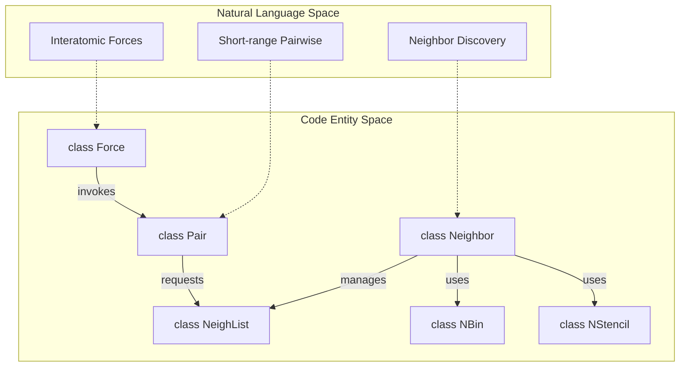
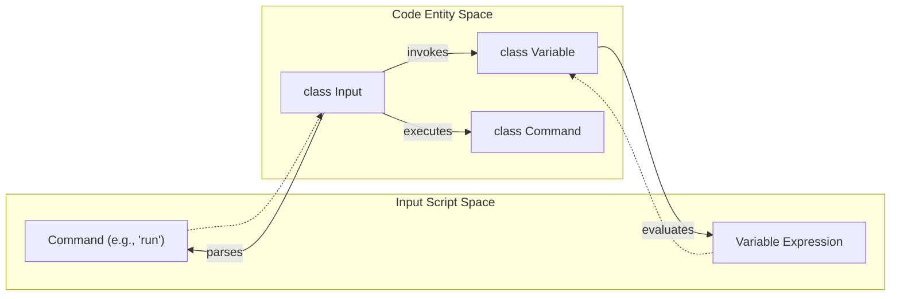

# Glossary

Relevant source files

The following files were used as context for generating this wiki page:

- [doc/src/Bibliography.rst](doc/src/Bibliography.rst)
- [doc/src/Build.rst](doc/src/Build.rst)
- [doc/src/Build_basics.rst](doc/src/Build_basics.rst)
- [doc/src/Build_cmake.rst](doc/src/Build_cmake.rst)
- [doc/src/Build_development.rst](doc/src/Build_development.rst)
- [doc/src/Build_extras.rst](doc/src/Build_extras.rst)
- [doc/src/Build_link.rst](doc/src/Build_link.rst)
- [doc/src/Build_make.rst](doc/src/Build_make.rst)
- [doc/src/Build_package.rst](doc/src/Build_package.rst)
- [doc/src/Build_prerequisites.rst](doc/src/Build_prerequisites.rst)
- [doc/src/Build_settings.rst](doc/src/Build_settings.rst)
- [doc/src/Commands_all.rst](doc/src/Commands_all.rst)
- [doc/src/Commands_bond.rst](doc/src/Commands_bond.rst)
- [doc/src/Commands_compute.rst](doc/src/Commands_compute.rst)
- [doc/src/Commands_dump.rst](doc/src/Commands_dump.rst)
- [doc/src/Commands_fix.rst](doc/src/Commands_fix.rst)
- [doc/src/Commands_kspace.rst](doc/src/Commands_kspace.rst)
- [doc/src/Commands_pair.rst](doc/src/Commands_pair.rst)
- [doc/src/Howto_cmake.rst](doc/src/Howto_cmake.rst)
- [doc/src/Packages.rst](doc/src/Packages.rst)
- [doc/src/Packages_details.rst](doc/src/Packages_details.rst)
- [doc/src/bond_style.rst](doc/src/bond_style.rst)
- [doc/src/commands_list.rst](doc/src/commands_list.rst)
- [doc/src/compute.rst](doc/src/compute.rst)
- [doc/src/compute_pod_atom.rst](doc/src/compute_pod_atom.rst)
- [doc/src/create_atoms.rst](doc/src/create_atoms.rst)
- [doc/src/fitpod_command.rst](doc/src/fitpod_command.rst)
- [doc/src/fix.rst](doc/src/fix.rst)
- [doc/src/fix_nve.rst](doc/src/fix_nve.rst)
- [doc/src/fix_print.rst](doc/src/fix_print.rst)
- [doc/src/fix_rigid.rst](doc/src/fix_rigid.rst)
- [doc/src/fix_wall_gran.rst](doc/src/fix_wall_gran.rst)
- [doc/src/fix_wall_gran_region.rst](doc/src/fix_wall_gran_region.rst)
- [doc/src/geturl.rst](doc/src/geturl.rst)
- [doc/src/kspace_style.rst](doc/src/kspace_style.rst)
- [doc/src/pair_pod.rst](doc/src/pair_pod.rst)
- [doc/src/pair_style.rst](doc/src/pair_style.rst)
- [doc/src/print.rst](doc/src/print.rst)
- [doc/src/run_style.rst](doc/src/run_style.rst)
- [doc/src/units.rst](doc/src/units.rst)
- [doc/src/variable.rst](doc/src/variable.rst)
- [doc/utils/sphinx-config/false_positives.txt](doc/utils/sphinx-config/false_positives.txt)
- [examples/PACKAGES/pod/Ta/in.pod.compute](examples/PACKAGES/pod/Ta/in.pod.compute)
- [src/DIELECTRIC/atom_vec_dielectric.cpp](src/DIELECTRIC/atom_vec_dielectric.cpp)
- [src/DIELECTRIC/atom_vec_dielectric.h](src/DIELECTRIC/atom_vec_dielectric.h)
- [src/DIPOLE/atom_vec_dipole.h](src/DIPOLE/atom_vec_dipole.h)
- [src/EFF/fix_langevin_eff.cpp](src/EFF/fix_langevin_eff.cpp)
- [src/EXTRA-COMMAND/geturl.cpp](src/EXTRA-COMMAND/geturl.cpp)
- [src/EXTRA-COMMAND/geturl.h](src/EXTRA-COMMAND/geturl.h)
- [src/EXTRA-FIX/fix_tmd.cpp](src/EXTRA-FIX/fix_tmd.cpp)
- [src/GPU/pppm_gpu.cpp](src/GPU/pppm_gpu.cpp)
- [src/GPU/pppm_gpu.h](src/GPU/pppm_gpu.h)
- [src/GRANULAR/fix_pour.cpp](src/GRANULAR/fix_pour.cpp)
- [src/GRANULAR/fix_pour.h](src/GRANULAR/fix_pour.h)
- [src/GRANULAR/fix_wall_gran.cpp](src/GRANULAR/fix_wall_gran.cpp)
- [src/GRANULAR/fix_wall_gran.h](src/GRANULAR/fix_wall_gran.h)
- [src/GRANULAR/fix_wall_gran_region.cpp](src/GRANULAR/fix_wall_gran_region.cpp)
- [src/GRANULAR/fix_wall_gran_region.h](src/GRANULAR/fix_wall_gran_region.h)
- [src/GRANULAR/pair_gran_hertz_history.cpp](src/GRANULAR/pair_gran_hertz_history.cpp)
- [src/GRANULAR/pair_gran_hertz_history.h](src/GRANULAR/pair_gran_hertz_history.h)
- [src/GRANULAR/pair_gran_hooke.cpp](src/GRANULAR/pair_gran_hooke.cpp)
- [src/GRANULAR/pair_gran_hooke.h](src/GRANULAR/pair_gran_hooke.h)
- [src/GRANULAR/pair_gran_hooke_history.cpp](src/GRANULAR/pair_gran_hooke_history.cpp)
- [src/GRANULAR/pair_gran_hooke_history.h](src/GRANULAR/pair_gran_hooke_history.h)
- [src/GRANULAR/pair_granular.cpp](src/GRANULAR/pair_granular.cpp)
- [src/GRANULAR/pair_granular.h](src/GRANULAR/pair_granular.h)
- [src/KOKKOS/atom_kokkos.cpp](src/KOKKOS/atom_kokkos.cpp)
- [src/KOKKOS/atom_kokkos.h](src/KOKKOS/atom_kokkos.h)
- [src/KOKKOS/atom_map_kokkos.cpp](src/KOKKOS/atom_map_kokkos.cpp)
- [src/KOKKOS/domain_kokkos.cpp](src/KOKKOS/domain_kokkos.cpp)
- [src/KOKKOS/domain_kokkos.h](src/KOKKOS/domain_kokkos.h)
- [src/KOKKOS/fix_deform_kokkos.cpp](src/KOKKOS/fix_deform_kokkos.cpp)
- [src/KOKKOS/fix_deform_kokkos.h](src/KOKKOS/fix_deform_kokkos.h)
- [src/KOKKOS/fix_property_atom_kokkos.cpp](src/KOKKOS/fix_property_atom_kokkos.cpp)
- [src/KOKKOS/fix_property_atom_kokkos.h](src/KOKKOS/fix_property_atom_kokkos.h)
- [src/KOKKOS/fix_reaxff_species_kokkos.cpp](src/KOKKOS/fix_reaxff_species_kokkos.cpp)
- [src/KOKKOS/fix_rigid_nh_small_kokkos.cpp](src/KOKKOS/fix_rigid_nh_small_kokkos.cpp)
- [src/KOKKOS/fix_rigid_nph_small_kokkos.cpp](src/KOKKOS/fix_rigid_nph_small_kokkos.cpp)
- [src/KOKKOS/fix_rigid_npt_small_kokkos.cpp](src/KOKKOS/fix_rigid_npt_small_kokkos.cpp)
- [src/KOKKOS/fix_rigid_small_kokkos.cpp](src/KOKKOS/fix_rigid_small_kokkos.cpp)
- [src/KOKKOS/fix_rigid_small_kokkos.h](src/KOKKOS/fix_rigid_small_kokkos.h)
- [src/KOKKOS/fix_wall_gran_old.cpp](src/KOKKOS/fix_wall_gran_old.cpp)
- [src/KOKKOS/kokkos.cpp](src/KOKKOS/kokkos.cpp)
- [src/KOKKOS/kokkos.h](src/KOKKOS/kokkos.h)
- [src/KOKKOS/kokkos_base.h](src/KOKKOS/kokkos_base.h)
- [src/KOKKOS/kokkos_type.h](src/KOKKOS/kokkos_type.h)
- [src/KOKKOS/neigh_list_kokkos.cpp](src/KOKKOS/neigh_list_kokkos.cpp)
- [src/KOKKOS/neigh_list_kokkos.h](src/KOKKOS/neigh_list_kokkos.h)
- [src/KOKKOS/pair_kokkos.h](src/KOKKOS/pair_kokkos.h)
- [src/KSPACE/ewald.cpp](src/KSPACE/ewald.cpp)
- [src/KSPACE/ewald.h](src/KSPACE/ewald.h)
- [src/KSPACE/ewald_dipole.cpp](src/KSPACE/ewald_dipole.cpp)
- [src/KSPACE/ewald_dipole.h](src/KSPACE/ewald_dipole.h)
- [src/KSPACE/ewald_dipole_spin.cpp](src/KSPACE/ewald_dipole_spin.cpp)
- [src/KSPACE/ewald_dipole_spin.h](src/KSPACE/ewald_dipole_spin.h)
- [src/KSPACE/ewald_disp.cpp](src/KSPACE/ewald_disp.cpp)
- [src/KSPACE/ewald_disp.h](src/KSPACE/ewald_disp.h)
- [src/KSPACE/fix_tune_kspace.cpp](src/KSPACE/fix_tune_kspace.cpp)
- [src/KSPACE/fix_tune_kspace.h](src/KSPACE/fix_tune_kspace.h)
- [src/KSPACE/kissfft.h](src/KSPACE/kissfft.h)
- [src/KSPACE/msm.cpp](src/KSPACE/msm.cpp)
- [src/KSPACE/msm.h](src/KSPACE/msm.h)
- [src/KSPACE/msm_cg.cpp](src/KSPACE/msm_cg.cpp)
- [src/KSPACE/pppm.cpp](src/KSPACE/pppm.cpp)
- [src/KSPACE/pppm.h](src/KSPACE/pppm.h)
- [src/KSPACE/pppm_cg.cpp](src/KSPACE/pppm_cg.cpp)
- [src/KSPACE/pppm_cg.h](src/KSPACE/pppm_cg.h)
- [src/KSPACE/pppm_dipole.cpp](src/KSPACE/pppm_dipole.cpp)
- [src/KSPACE/pppm_dipole.h](src/KSPACE/pppm_dipole.h)
- [src/KSPACE/pppm_dipole_spin.cpp](src/KSPACE/pppm_dipole_spin.cpp)
- [src/KSPACE/pppm_dipole_spin.h](src/KSPACE/pppm_dipole_spin.h)
- [src/KSPACE/pppm_disp.cpp](src/KSPACE/pppm_disp.cpp)
- [src/KSPACE/pppm_disp.h](src/KSPACE/pppm_disp.h)
- [src/KSPACE/pppm_disp_tip4p.cpp](src/KSPACE/pppm_disp_tip4p.cpp)
- [src/KSPACE/pppm_disp_tip4p.h](src/KSPACE/pppm_disp_tip4p.h)
- [src/KSPACE/pppm_stagger.cpp](src/KSPACE/pppm_stagger.cpp)
- [src/KSPACE/pppm_stagger.h](src/KSPACE/pppm_stagger.h)
- [src/KSPACE/pppm_tip4p.cpp](src/KSPACE/pppm_tip4p.cpp)
- [src/KSPACE/pppm_tip4p.h](src/KSPACE/pppm_tip4p.h)
- [src/MACHDYN/atom_vec_smd.cpp](src/MACHDYN/atom_vec_smd.cpp)
- [src/MACHDYN/atom_vec_smd.h](src/MACHDYN/atom_vec_smd.h)
- [src/MACHDYN/fix_smd_adjust_dt.cpp](src/MACHDYN/fix_smd_adjust_dt.cpp)
- [src/MACHDYN/smd_material_models.cpp](src/MACHDYN/smd_material_models.cpp)
- [src/PERI/atom_vec_peri.h](src/PERI/atom_vec_peri.h)
- [src/REPLICA/bosonic_exchange.cpp](src/REPLICA/bosonic_exchange.cpp)
- [src/REPLICA/bosonic_exchange.h](src/REPLICA/bosonic_exchange.h)
- [src/REPLICA/fix_pimd_langevin.cpp](src/REPLICA/fix_pimd_langevin.cpp)
- [src/REPLICA/fix_pimd_langevin.h](src/REPLICA/fix_pimd_langevin.h)
- [src/REPLICA/fix_pimd_nvt.cpp](src/REPLICA/fix_pimd_nvt.cpp)
- [src/REPLICA/fix_pimd_nvt.h](src/REPLICA/fix_pimd_nvt.h)
- [src/SPIN/atom_vec_spin.cpp](src/SPIN/atom_vec_spin.cpp)
- [src/SPIN/atom_vec_spin.h](src/SPIN/atom_vec_spin.h)
- [src/SPIN/compute_spin.cpp](src/SPIN/compute_spin.cpp)
- [src/SPIN/compute_spin.h](src/SPIN/compute_spin.h)
- [src/SPIN/fix_langevin_spin.cpp](src/SPIN/fix_langevin_spin.cpp)
- [src/SPIN/fix_langevin_spin.h](src/SPIN/fix_langevin_spin.h)
- [src/SPIN/fix_nve_spin.cpp](src/SPIN/fix_nve_spin.cpp)
- [src/SPIN/fix_nve_spin.h](src/SPIN/fix_nve_spin.h)
- [src/SPIN/fix_precession_spin.cpp](src/SPIN/fix_precession_spin.cpp)
- [src/SPIN/fix_precession_spin.h](src/SPIN/fix_precession_spin.h)
- [src/SPIN/pair_spin.cpp](src/SPIN/pair_spin.cpp)
- [src/SPIN/pair_spin.h](src/SPIN/pair_spin.h)
- [src/SPIN/pair_spin_dipole_cut.cpp](src/SPIN/pair_spin_dipole_cut.cpp)
- [src/SPIN/pair_spin_dipole_long.cpp](src/SPIN/pair_spin_dipole_long.cpp)
- [src/SPIN/pair_spin_dmi.cpp](src/SPIN/pair_spin_dmi.cpp)
- [src/SPIN/pair_spin_dmi.h](src/SPIN/pair_spin_dmi.h)
- [src/SPIN/pair_spin_exchange.cpp](src/SPIN/pair_spin_exchange.cpp)
- [src/SPIN/pair_spin_exchange.h](src/SPIN/pair_spin_exchange.h)
- [src/SPIN/pair_spin_magelec.cpp](src/SPIN/pair_spin_magelec.cpp)
- [src/SPIN/pair_spin_magelec.h](src/SPIN/pair_spin_magelec.h)
- [src/SPIN/pair_spin_neel.cpp](src/SPIN/pair_spin_neel.cpp)
- [src/SPIN/pair_spin_neel.h](src/SPIN/pair_spin_neel.h)
- [src/accelerator_kokkos.h](src/accelerator_kokkos.h)
- [src/angle.cpp](src/angle.cpp)
- [src/angle.h](src/angle.h)
- [src/atom.cpp](src/atom.cpp)
- [src/atom.h](src/atom.h)
- [src/atom_masks.h](src/atom_masks.h)
- [src/bond.cpp](src/bond.cpp)
- [src/bond.h](src/bond.h)
- [src/comm.cpp](src/comm.cpp)
- [src/comm.h](src/comm.h)
- [src/comm_brick.cpp](src/comm_brick.cpp)
- [src/comm_brick.h](src/comm_brick.h)
- [src/comm_tiled.cpp](src/comm_tiled.cpp)
- [src/comm_tiled.h](src/comm_tiled.h)
- [src/create_atoms.cpp](src/create_atoms.cpp)
- [src/create_atoms.h](src/create_atoms.h)
- [src/dihedral.cpp](src/dihedral.cpp)
- [src/dihedral.h](src/dihedral.h)
- [src/fix.cpp](src/fix.cpp)
- [src/fix.h](src/fix.h)
- [src/fix_deposit.cpp](src/fix_deposit.cpp)
- [src/fix_deposit.h](src/fix_deposit.h)
- [src/fix_evaporate.cpp](src/fix_evaporate.cpp)
- [src/fix_evaporate.h](src/fix_evaporate.h)
- [src/fix_property_atom.cpp](src/fix_property_atom.cpp)
- [src/fix_property_atom.h](src/fix_property_atom.h)
- [src/fix_thermal_conductivity.cpp](src/fix_thermal_conductivity.cpp)
- [src/fix_thermal_conductivity.h](src/fix_thermal_conductivity.h)
- [src/force.cpp](src/force.cpp)
- [src/force.h](src/force.h)
- [src/improper.cpp](src/improper.cpp)
- [src/improper.h](src/improper.h)
- [src/info.cpp](src/info.cpp)
- [src/info.h](src/info.h)
- [src/input.cpp](src/input.cpp)
- [src/input.h](src/input.h)
- [src/irregular.cpp](src/irregular.cpp)
- [src/irregular.h](src/irregular.h)
- [src/kspace.cpp](src/kspace.cpp)
- [src/kspace.h](src/kspace.h)
- [src/label_map.cpp](src/label_map.cpp)
- [src/label_map.h](src/label_map.h)
- [src/lammps.cpp](src/lammps.cpp)
- [src/lammps.h](src/lammps.h)
- [src/lmprestart.h](src/lmprestart.h)
- [src/main.cpp](src/main.cpp)
- [src/modify.cpp](src/modify.cpp)
- [src/modify.h](src/modify.h)
- [src/neigh_list.cpp](src/neigh_list.cpp)
- [src/neigh_list.h](src/neigh_list.h)
- [src/neigh_request.cpp](src/neigh_request.cpp)
- [src/neigh_request.h](src/neigh_request.h)
- [src/neighbor.cpp](src/neighbor.cpp)
- [src/neighbor.h](src/neighbor.h)
- [src/nstencil.cpp](src/nstencil.cpp)
- [src/nstencil.h](src/nstencil.h)
- [src/output.cpp](src/output.cpp)
- [src/output.h](src/output.h)
- [src/pair.cpp](src/pair.cpp)
- [src/pair.h](src/pair.h)
- [src/procmap.cpp](src/procmap.cpp)
- [src/procmap.h](src/procmap.h)
- [src/rcb.cpp](src/rcb.cpp)
- [src/rcb.h](src/rcb.h)
- [src/read_data.cpp](src/read_data.cpp)
- [src/read_data.h](src/read_data.h)
- [src/read_restart.cpp](src/read_restart.cpp)
- [src/read_restart.h](src/read_restart.h)
- [src/replicate.cpp](src/replicate.cpp)
- [src/special.cpp](src/special.cpp)
- [src/special.h](src/special.h)
- [src/universe.cpp](src/universe.cpp)
- [src/universe.h](src/universe.h)
- [src/update.cpp](src/update.cpp)
- [src/update.h](src/update.h)
- [src/variable.cpp](src/variable.cpp)
- [src/variable.h](src/variable.h)
- [src/write_coeff.cpp](src/write_coeff.cpp)
- [src/write_data.cpp](src/write_data.cpp)
- [src/write_data.h](src/write_data.h)
- [src/write_dump.cpp](src/write_dump.cpp)
- [src/write_restart.cpp](src/write_restart.cpp)
- [src/write_restart.h](src/write_restart.h)
- [unittest/commands/CMakeLists.txt](unittest/commands/CMakeLists.txt)
- [unittest/commands/test_compute_global.cpp](unittest/commands/test_compute_global.cpp)
- [unittest/commands/test_delete_atoms.cpp](unittest/commands/test_delete_atoms.cpp)
- [unittest/commands/test_groups.cpp](unittest/commands/test_groups.cpp)
- [unittest/commands/test_info.cpp](unittest/commands/test_info.cpp)
- [unittest/commands/test_kim_commands.cpp](unittest/commands/test_kim_commands.cpp)
- [unittest/commands/test_labelmap.cpp](unittest/commands/test_labelmap.cpp)
- [unittest/commands/test_lattice_region.cpp](unittest/commands/test_lattice_region.cpp)
- [unittest/commands/test_regions.cpp](unittest/commands/test_regions.cpp)
- [unittest/commands/test_simple_commands.cpp](unittest/commands/test_simple_commands.cpp)
- [unittest/commands/test_thermo.cpp](unittest/commands/test_thermo.cpp)
- [unittest/commands/test_variables.cpp](unittest/commands/test_variables.cpp)
- [unittest/cplusplus/test_advanced_utils.cpp](unittest/cplusplus/test_advanced_utils.cpp)
- [unittest/cplusplus/test_error_class.cpp](unittest/cplusplus/test_error_class.cpp)
- [unittest/formats/test_atom_styles.cpp](unittest/formats/test_atom_styles.cpp)
- [unittest/formats/test_eim_potential_file_reader.cpp](unittest/formats/test_eim_potential_file_reader.cpp)
- [unittest/formats/test_file_operations.cpp](unittest/formats/test_file_operations.cpp)
- [unittest/formats/test_molecule_file.cpp](unittest/formats/test_molecule_file.cpp)
- [unittest/formats/test_potential_file_reader.cpp](unittest/formats/test_potential_file_reader.cpp)
- [unittest/formats/test_text_file_reader.cpp](unittest/formats/test_text_file_reader.cpp)
- [unittest/utils/test_fmtlib.cpp](unittest/utils/test_fmtlib.cpp)

This glossary defines codebase-specific terms, jargon, and domain concepts used within the LAMMPS repository. It serves as a technical reference for engineers to understand the internal nomenclature and the specific C++ classes or functions that implement these concepts.

## Core Simulation Entities

### Atom
The fundamental unit of simulation. Per-atom data (coordinates, velocities, forces) is managed by the `Atom` class [src/atom.cpp:71-86](). The specific set of properties associated with an atom (e.g., charge, dipole, molecular topology) is defined by an `AtomVec` style [src/atom.cpp:88-98]().

### AtomVec
A strategy pattern implementation that defines what data is stored per atom and how that data is communicated between processors. `AtomVec` classes (e.g., `AtomVecBody`, `AtomVecEllipsoid`) allocate the actual per-atom arrays that the `Atom` class points to [src/atom.cpp:81-84]().
*   **Source:** [src/atom.cpp:16-20](), [src/atom.cpp:63-67]()

### Fix
A class that modifies the simulation at specific points in the timestep. Fixes are used for time integration (e.g., NVE, NVT), applying external forces, or maintaining constraints (e.g., SHAKE). All fixes derive from the `Fix` base class [src/modify.cpp]().
*   **Source:** [src/modify.cpp](), [src/lammps.cpp:120-123]()

### Compute
A class that performs a calculation on simulation data (atoms, groups, or the whole system) and returns a result (scalar, vector, or array). Computes are typically used for diagnostic output or as input to variables.
*   **Source:** [src/info.cpp:78-106](), [src/lammps.cpp:120-123]()

---

## Domain and Architecture Jargon

### Pointers Base Class
A design pattern used throughout LAMMPS where almost every major class inherits from `Pointers`. This provides a class instance with direct access to all other core LAMMPS components (e.g., `atom`, `force`, `neighbor`) via pointer references initialized in the `LAMMPS` main class [src/lammps.cpp:120-123]().
*   **Source:** [src/lammps.cpp:120-123](), [src/variable.cpp:229-230]()

### Style
A plugin-like mechanism for providing different implementations of a specific functionality. Examples include `pair_style`, `fix_style`, and `atom_style`. Styles are registered in a `CreatorRegistry` and instantiated at runtime based on input script commands [src/atom.cpp:63-67](), [src/input.cpp:71-75]().
*   **Source:** [src/lammps.cpp:68-82](), [src/info.cpp:108-113]()

### Neighbor List
A data structure that stores lists of nearby atoms for each atom to avoid $O(N^2)$ force calculations. The `Neighbor` class manages these lists, utilizing `NBin`, `NStencil`, and `NPair` classes to build them efficiently [src/neighbor.cpp:110-178]().
*   **Source:** [src/neighbor.cpp:37-41](), [src/neighbor.cpp:140-159]()

---

## Mapping Concepts to Code

The following diagrams illustrate the relationship between high-level simulation concepts and the specific C++ entities that implement them.

### Force Calculation Data Flow
This diagram shows how the `Force` subsystem interacts with `Pair` and `Neighbor` entities to compute interactions.

**Sources:** [src/force.cpp](), [src/pair.cpp:59-69](), [src/neighbor.cpp:140-159]()

### Input Processing and Variable Execution
This diagram bridges the input command syntax to the underlying execution engine.

**Sources:** [src/input.cpp:79-90](), [src/variable.cpp:229-238](), [src/input.cpp:135-139]()

---

## Technical Terms Table

| Term | Definition | Relevant Files/Classes |
| :--- | :--- | :--- |
| **BigInt** | A 64-bit integer type used for atom counts and timesteps to support large-scale simulations. | `src/lmptype.h`, `src/variable.cpp:63-67` |
| **Ghost Atoms** | Atoms that belong to a neighboring processor but are stored locally to allow for force calculations across domain boundaries. | `src/atom.cpp:101`, `src/comm.cpp` |
| **LabelMap** | A system for using string labels instead of numeric IDs for atom, bond, and other types. | `src/label_map.cpp`, `src/read_data.cpp:69-70` |
| **Newton Flag** | A setting that determines if pairwise forces are calculated once per pair (on) or twice (off) to balance communication vs computation. | `src/force.cpp`, `src/atom.cpp:74-79` |
| **Triclinic** | Support for non-orthogonal simulation boxes (parallelepipeds). | `src/domain.cpp`, `src/neighbor.cpp:16-19` |
| **Virial** | A tensor used to calculate the pressure/stress of the system based on interatomic forces. | `src/pair.cpp:60`, `src/force.cpp` |

---

## Domain Concepts

### KSpace
Methods for calculating long-range interactions (e.g., electrostatics) in reciprocal space. Key implementations include `PPPM` (Particle-Particle Particle-Mesh) and `Ewald`.
*   **Source:** [src/kspace.cpp](), [src/KSPACE/pppm.cpp](), [src/KSPACE/msm.cpp]()

### Domain Decomposition
The parallelization strategy where the simulation volume is divided into sub-domains, each assigned to an MPI rank. Managed by the `Domain` and `Comm` classes [src/comm.cpp](), [src/comm_tiled.cpp]().
*   **Source:** [src/lammps.cpp:181-194](), [src/info.cpp:119-120]()

### Packages
Optional modules that extend LAMMPS functionality (e.g., `KOKKOS` for GPU acceleration, `GRANULAR` for granular materials). Packages are enabled at build time [doc/src/Build_extras.rst:36-72]().
*   **Source:** [doc/src/Packages_details.rst:26-122](), [src/lammps.cpp:36]()

**Sources:**
*   `src/lammps.cpp` [1-220]()
*   `src/atom.cpp` [1-260]()
*   `src/variable.cpp` [1-250]()
*   `src/input.cpp` [1-200]()
*   `src/neighbor.cpp` [1-260]()
*   `src/pair.cpp` [1-200]()
*   `src/info.cpp` [70-130]()
*   `doc/src/Packages_details.rst` [1-125]()
*   `doc/src/Build_extras.rst` [1-210]()