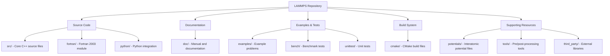

Welcome to the LAMMPS (Large-scale Atomic/Molecular Massively Parallel Simulator) documentation. This page provides a high-level introduction to LAMMPS, its purpose, and the structure of the codebase, designed specifically for developers new to the project.

Sources: [README](README#L1-L18), [CITATION.cff](CITATION.cff#L1-L15)

## What is LAMMPS?

LAMMPS is a classical molecular dynamics simulation code designed to run efficiently on parallel computers. Developed at Sandia National Laboratories with funding from the U.S. Department of Energy, it is an open-source code distributed under the GNU General Public License (GPL) version 2. LAMMPS provides a powerful platform for simulating atomic, molecular, and coarse-grained systems across a wide range of scientific applications including materials science, chemistry, physics, and engineering.

The software excels at large-scale simulations, capable of handling systems from a few atoms to millions, making it ideal for researchers investigating complex phenomena at the atomic scale. Its modular architecture allows users to extend functionality through packages, and it supports multiple parallel computing paradigms including MPI, OpenMP, and GPU acceleration.

Sources: [README](README#L1-L18), [CITATION.cff](CITATION.cff#L1-L15)

## Repository Architecture

The LAMMPS repository is organized into logical directories that serve distinct purposes in the development workflow. Understanding this structure is essential for navigating the codebase effectively.

Sources: [README](README#L19-L35), [Get repo structure: top level](.)

## Directory Structure Overview

### Core Components

The **src/** directory contains the core C++ source code that implements LAMMPS functionality. This is where the simulation engine, particle interaction calculations, and fundamental algorithms reside. The code is organized into classes that handle different aspects of molecular dynamics simulations.

The **doc/** directory houses the comprehensive LAMMPS documentation, including the manual, tutorials, and reference materials. Documentation can be generated locally in HTML or PDF formats.

Sources: [README](README#L19-L35), [doc/README](doc/README#L1-L10)

### Build and Development

The **cmake/** directory contains CMake build files for modern cross-platform compilation. CMake is the recommended build system for LAMMPS, providing flexibility and ease of configuration.

The **unittest/** directory contains test programs used with CTest for automated testing, ensuring code stability across different platforms and configurations.

Sources: [README](README#L19-L25), [bench/README](bench/README#L1-L10)

### Examples and Benchmarks

The **examples/** directory is a valuable learning resource containing three categories of sample problems:

| Category | Description | Purpose |
|----------|-------------|---------|
| Lowercase directories | Simple test problems (e.g., `melting`, `crack`) | Quick demonstrations of LAMMPS features |
| Uppercase directories | Complex multi-file examples | Real-world simulation scenarios |
| PACKAGES subdirectory | Style-specific package tests | Validation of individual package functionality |

The **bench/** directory contains standardized benchmark problems used to evaluate LAMMPS performance across different hardware configurations and parallel implementations. These benchmarks are essential for performance optimization and scaling studies.

Sources: [examples/README](examples/README#L1-L50), [bench/README](bench/README#L1-L25)

### Supporting Resources

The **potentials/** directory provides a comprehensive collection of interatomic potential files including EAM, MEAM, SNAP, ReaxFF, and many other potentials. These files are ready-to-use resources for various materials systems.

The **tools/** directory contains utilities for pre-processing (creating input files) and post-processing (analyzing output data), including conversion scripts, visualization helpers, and analysis tools.

The **python/** directory contains the LAMMPS Python module that enables Python scripting workflows and integration with scientific Python ecosystems like NumPy and Jupyter.

Sources: [README](README#L26-L35), [tools/README](tools/README#L1-L25), [python/README](python/README#L1-L10), [potentials/](potentials/)

> [!TIP]
> The `potentials/` directory contains hundreds of potential files covering elements from Al to Zn and various compound systems. These are production-ready files that can be used directly in simulations without modification.

## Key Features and Capabilities

LAMMPS provides an extensive set of features that make it suitable for diverse simulation scenarios:

### Simulation Models

| Feature Category | Examples |
|-----------------|----------|
| **Pair Potentials** | Lennard-Jones, EAM, MEAM, ReaxFF, Tersoff, SNAP |
| **Bonded Interactions** | Bonds, angles, dihedrals, impropers, CHARMM force fields |
| **Long-Range Electrostatics** | PPPM, Ewald, Reaction Field |
| **Advanced Methods** | NEB, free energy calculations, replica exchange, MC/MD hybrid |

### Parallel Computing

LAMMPS supports multiple parallel computing strategies to maximize performance on modern hardware architectures:

- **MPI parallelization** for distributed memory systems
- **OpenMP threading** for shared memory parallelism
- **GPU acceleration** through CUDA, HIP, and OpenCL backends
- **Kokkos performance portability** for portable code across different architectures

These parallel capabilities allow LAMMPS to scale efficiently from laptops to supercomputers with millions of processors.

Sources: [README](README#L10-L18), [examples/README](examples/README#L80-L120)

## Getting Started with LAMMPS

### Quick Access Paths

The repository provides clear entry points for different needs:

- **Learn LAMMPS**: Start with examples in the `examples/` directory
- **Performance Testing**: Use benchmarks in `bench/` to evaluate your system
- **Development Work**: Explore `src/` and contribute through the standard workflow
- **Integration**: Leverage `python/` module for scientific computing workflows

### Example Workflow

A typical workflow for learning LAMMPS involves:

1. **Exploring Examples**: Browse simple examples like `melting` or `crack` to understand input script structure
2. **Running Benchmarks**: Execute benchmark problems to verify installation and assess performance
3. **Modifying Scripts**: Adapt examples to your specific research needs
4. **Consulting Documentation**: Refer to the manual for detailed command syntax and physics explanations

Sources: [examples/README](examples/README#L120-L140), [bench/README](bench/README#L70-L100)

## Community and Support

LAMMPS is maintained by an active development team and benefits from contributions from researchers worldwide. The official website (www.lammps.org) provides extensive documentation, tutorials, and community forums.

For developers interested in contributing, the project follows established GitHub workflow practices with clear guidelines for code submissions and testing procedures.

Sources: [README](README#L28-L32), [CITATION.cff](CITATION.cff#L1-L20)

## Next Steps

Now that you have an understanding of LAMMPS architecture and capabilities, we recommend the following learning path:

1. **[Quick Start](2-quick-start)** - Get LAMMPS running on your system with minimal setup
2. **[Installation and Build System](3-installation-and-build-system)** - Detailed build configuration for your platform
3. **[Running Your First Simulation](4-running-your-first-simulation)** - Execute your initial LAMMPS simulation

For deeper understanding of core concepts, proceed to the **Deep Dive** section starting with **[Molecular Dynamics Fundamentals](8-molecular-dynamics-fundamentals)** to understand the theoretical foundations of the simulations you'll be performing.
