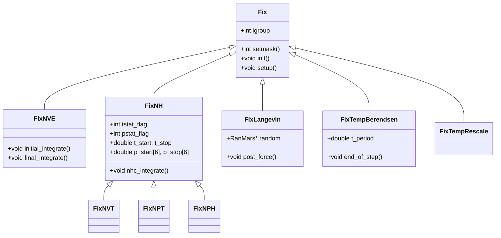

This page provides a comprehensive guide to simulation ensembles and thermostat implementations in LAMMPS. Understanding these concepts is fundamental for controlling the thermodynamic conditions of molecular dynamics simulations, ensuring that systems evolve according to the desired statistical mechanical ensemble while maintaining physical realism.

## Statistical Mechanics Foundations

Molecular dynamics simulations operate within statistical mechanical frameworks defined by ensembles—collections of system configurations sharing specific macroscopic properties. LAMMPS implements the most common ensembles through **fix** classes that modify integration schemes to maintain constraints on temperature, pressure, volume, and particle number.

The canonical (NVT) ensemble maintains constant particle number (N), volume (V), and temperature (T) by coupling the system to a thermal reservoir. This requires thermostat algorithms that remove or add energy to maintain the target temperature while preserving the proper phase space distribution. The isothermal-isobaric (NPT) ensemble additionally controls pressure (P) through barostats that rescale the simulation box dimensions. The microcanonical (NVE) ensemble conserves energy with no coupling to external reservoirs, representing an isolated system.

Sources: [fix_nh.cpp](src/fix_nh.cpp#L36-L38), [fix_nve.cpp](src/fix_nve.cpp#L1-L80)

## Ensemble Architecture Overview

LAMMPS implements ensembles through a modular class hierarchy centered on the `Fix` base class. The architecture separates integration logic from thermostat and barostat control, enabling flexible combinations and reuse across different ensemble implementations.



The `FixNH` class serves as the base for Nose-Hoover chain thermostats and barostats, implementing equations of motion that couple system variables to fictitious thermostat and barostat degrees of freedom. This implementation handles both temperature control (`tstat_flag`) and pressure control (`pstat_flag`) through unified integration schemes, with derived classes (`FixNVT`, `FixNPT`, `FixNPH`) enforcing appropriate constraints.

Sources: [fix_nh.cpp](src/fix_nh.cpp#L36-L130), [fix_nvt.cpp](src/fix_nvt.cpp#L1-L37), [fix_npt.cpp](src/fix_npt.cpp#L1-L46), [fix_nph.cpp](src/fix_nph.cpp#L1-L46)

## NVE Microcanonical Ensemble

The NVE ensemble represents the fundamental integration scheme without external coupling, conserving total energy throughout the simulation. Implemented by `FixNVE`, this ensemble uses the velocity Verlet algorithm that provides symplectic integration with good energy stability properties.

The implementation performs two half-step velocity updates and one full-step position update per timestep:

```cpp
void FixNVE::initial_integrate(int /*vflag*/)
{
  double dtfm;
  double **x = atom->x;
  double **v = atom->v;
  double **f = atom->f;
  // Update velocities by half timestep
  // Update positions by full timestep
}
```

Sources: [fix_nve.cpp](src/fix_nve.cpp#L47-L80)

The `setmask()` method defines when the fix operates, with `INITIAL_INTEGRATE` and `FINAL_INTEGRATE` hooks called at appropriate points in the timestep integration cycle. This pattern allows fixes to intervene at precise stages of the velocity Verlet algorithm. The NVE ensemble serves as the foundation for more complex ensembles, providing the baseline dynamics that thermostat and barostat modifications then adjust.

> [!TIP]
> NVE simulations require initial velocities scaled to the desired temperature but do not include active temperature control. Any energy drift indicates integration errors or forces that don't conserve energy (e.g., incomplete neighbor lists).

## NVT Canonical Ensemble

The NVT ensemble maintains constant temperature through thermostat coupling. LAMMPS provides several thermostat algorithms, with Nose-Hoover chains being the most rigorous for generating canonical distributions.

### Nose-Hoover Thermostats

The `FixNH` class implements Nose-Hoover chain thermostats that couple the system to a series of fictitious thermostat variables connected in a chain. This multi-chain approach improves ergodicity compared to single thermostats, particularly for systems with stiff modes or complex potential energy surfaces.

The thermostat parameters configured in `FixNH` include:

| Parameter | Description | Default |
|-----------|-------------|---------|
| `t_start`, `t_stop` | Initial and target temperatures | Required |
| `t_period` | Oscillation period (in time units) | Required |
| `mtchain` | Number of thermostat chains | 3 |
| `nc_tchain` | Number of chains per degree of freedom | 1 |
| `drag` | Damping factor for thermostat oscillations | 0.0 |

The `FixNVT` constructor enforces that temperature control is enabled and pressure control is disabled, automatically creating a compute object for temperature calculation [fix_nvt.cpp](src/fix_nvt.cpp#L20-L32). This compute tracks kinetic energy and calculates instantaneous temperature using:

```
T = (2/3k_B) * (KE / degrees_of_freedom)
```

Sources: [fix_nh.cpp](src/fix_nh.cpp#L103-L127), [fix_nvt.cpp](src/fix_nvt.cpp#L20-L32), [compute_temp.cpp](src/compute_temp.cpp#L55-L96)

### Alternative Thermostats

LAMMPS implements several alternative thermostats for specific use cases:

**Berendsen Thermostat** (`FixTempBerendsen`): Provides weak coupling to an external heat bath by exponentially scaling velocities toward the target temperature. This method is particularly useful for equilibration phases as it provides smooth temperature control without the oscillations characteristic of Nose-Hoover thermostats.

The scaling factor λ is calculated as:

```
λ = sqrt(1 + (T_target/T_current - 1) * dt/τ)
```

where τ is the coupling time constant (`t_period`). This thermostat is applied every timestep through the `end_of_step()` method.

Sources: [fix_temp_berendsen.cpp](src/fix_temp_berendsen.cpp#L1-L100)

**Langevin Thermostat** (`FixLangevin`): Implements stochastic dynamics by adding friction and random forces to each atom, simulating coupling to a heat bath through Brownian motion. This method is particularly useful for coarse-grained models and implicit solvent simulations.

The Langevin equation for each atom i is:

```
m_i * dv_i/dt = F_i - γ * v_i + R_i(t)
```

where γ is the friction coefficient and R_i(t) is a random force with appropriate variance to satisfy the fluctuation-dissipation theorem. The implementation uses Marsaglia random number generators with processor-unique seeds for reproducibility.

Sources: [fix_langevin.cpp](src/fix_langevin.cpp#L1-L100)

**Velocity Rescaling** (`FixTempRescale`): Periodically rescales velocities when the temperature deviates beyond a specified window. This simple method directly scales velocities by √(T_target/T_current) but does not generate correct canonical distributions, making it suitable primarily for initial equilibration.

The `nevery` parameter controls rescaling frequency, `t_window` specifies the temperature deviation tolerance, and `fraction` determines the extent of rescaling when triggered.

Sources: [fix_temp_rescale.cpp](src/fix_temp_rescale.cpp#L1-L100)

## NPT Isothermal-Isobaric Ensemble

The NPT ensemble controls both temperature and pressure, requiring coupling to both a thermostat and a barostat. The `FixNPT` class extends `FixNH` to enforce simultaneous temperature and pressure control, with the barostat rescaling the simulation box dimensions and atomic coordinates to maintain the target pressure.

Pressure control involves specifying target pressures and relaxation times for different tensor components:

| Pressure Option | Description | Parameters |
|-----------------|-------------|------------|
| `iso` | Isotropic pressure control | P_start, P_stop, P_period |
| `aniso` | Anisotropic control | Same for x, y, z |
| `xy`, `xz`, `yz` | Shear components | Individual control |

The implementation couples the barostat to the thermostat using the Martyna-Tobias-Klein (MTK) equations of motion, which correctly handle the coupling between thermostat and barostat degrees of freedom for both isotropic and anisotropic cell fluctuations.

> [!TIP]
> NPT simulations require careful pressure coupling timescales. Too fast coupling leads to unrealistic box oscillations, while too slow coupling prevents proper equilibration. Typical values range from 100-1000 timesteps for condensed phases.

Sources: [fix_npt.cpp](src/fix_npt.cpp#L1-L46), [fix_nh.cpp](src/fix_nh.cpp#L128-L150)

## NPH Isenthalpic Ensemble

The NPH ensemble maintains constant enthalpy (H = E + PV) by controlling pressure while allowing temperature to fluctuate according to the system's internal dynamics. Implemented by `FixNPH`, this ensemble is less commonly used than NPT but is valuable for studying systems under adiabatic conditions where pressure is mechanically controlled rather than thermally coupled.

The implementation is analogous to NPT but with `tstat_flag = 0` and `pstat_flag = 1`, enabling pressure coupling without thermostat intervention. The system temperature evolves naturally from the work done by pressure changes on the volume.

Sources: [fix_nph.cpp](src/fix_nph.cpp#L1-L46)

## Ensemble Selection and Configuration

Choosing the appropriate ensemble depends on the physical system and simulation objectives:

| Ensemble | Use Case | Thermostat | Barostat |
|----------|----------|------------|----------|
| NVE | Energy conservation tests, short production runs | None | None |
| NVT | Constant temperature processes | Nose-Hoover, Langevin | None |
| NPT | Phase transitions, property calculations | Nose-Hoover | Yes |
| NPH | Mechanical deformation, constant enthalpy | None | Yes |

**Configuration Example**:

For a typical liquid simulation in the NPT ensemble:

```
fix 1 all npt temp 300.0 300.0 100.0 iso 1.0 1.0 1000.0
```

This applies Nose-Hoover chains with a 100-timestep thermostat period and 1000-timestep barostat period, controlling temperature at 300K and pressure at 1.0 atm isotropically.

The temperature calculation relies on the `ComputeTemp` class which computes kinetic energy and temperature with proper degrees of freedom accounting. The `dof_compute()` method adjusts for constraints, removed degrees of freedom from other fixes, and subtracts momentum conservation constraints.

Sources: [compute_temp.cpp](src/compute_temp.cpp#L36-L65)

## Advanced Features

### Temperature Computation

Temperature in LAMMPS is computed from kinetic energy using the equipartition theorem. The `ComputeTemp` class handles both per-atom and per-type masses, supporting systems with mixed particle types:

```cpp
if (rmass) {
  for (int i = 0; i < nlocal; i++)
    if (mask[i] & groupbit)
      t += (v[i][0]*v[i][0] + v[i][1]*v[i][1] + v[i][2]*v[i][2]) * rmass[i];
} else {
  for (int i = 0; i < nlocal; i++)
    if (mask[i] & groupbit)
      t += (v[i][0]*v[i][0] + v[i][1]*v[i][1] + v[i][2]*v[i][2]) * mass[type[i]];
}
```

The temperature conversion factor `tfactor` incorporates Boltzmann's constant, unit conversion factors, and the degrees of freedom.

Sources: [compute_temp.cpp](src/compute_temp.cpp#L67-L96)

### Thermostat Integration Points

Fixes intervene at specific points in the timestep integration cycle, controlled by the `setmask()` method which returns flags indicating which callbacks the fix responds to:

| Flag | Callback Timing |
|------|-----------------|
| `INITIAL_INTEGRATE` | First velocity half-step + position update |
| `FINAL_INTEGRATE` | Second velocity half-step |
| `POST_FORCE` | After force computation |
| `END_OF_STEP` | End of timestep (for rescaling thermostats) |

Nose-Hoover thermostats typically modify integration directly, while Berendsen and rescaling thermostats operate at `END_OF_STEP` after the standard integration is complete.

Sources: [fix_nve.cpp](src/fix_nve.cpp#L31-L38)

## Best Practices

**Equilibration Strategy**: Begin with energy minimization using NVE or NVT with strong thermostating, then switch to production ensembles with appropriate coupling timescales. Berendsen thermostats provide smooth equilibration but should be replaced with Nose-Hoover for production to generate proper ensemble statistics.

**Timescale Selection**: Thermostat periods should be at least 10-100 times the characteristic vibrational timescale of the system. Barostat periods should typically be 5-10 times longer than thermostat periods to allow the system volume to respond to temperature fluctuations.

**Temperature Drift**: Monitor temperature in NVE simulations to detect energy conservation issues. Systematic drift indicates integration problems or missing long-range corrections. Random fluctuations should scale as 1/√N for an N-atom system.

**Pressure Fluctuations**: NPT simulations naturally exhibit larger statistical uncertainty than NVT due to volume fluctuations. Extend simulation times or use larger systems when precise pressure control is required.

## Next Steps

For deeper understanding of simulation methodology, continue with:

- **[Molecular Dynamics Fundamentals](8-molecular-dynamics-fundamentals)** - Mathematical foundations of MD algorithms
- **[Units and Dimensions](9-units-and-dimensions)** - LAMMPS unit systems and unit conversion
- **[Boundary Conditions and Periodic Systems](11-boundary-conditions-and-periodic-systems)** - Boundary handling for different ensemble simulations

To explore practical implementation:

- **[Running Your First Simulation](4-running-your-first-simulation)** - Hands-on examples with ensemble specifications
- **[Command Syntax and Structure](12-command-syntax-and-structure)** - Detailed syntax for fix commands

For advanced techniques:

- **[Energy Minimization Algorithms](20-energy-minimization-algorithms)** - Pre-equilibration strategies
- **[Free Energy Calculations](22-free-energy-calculations)** - Ensemble-based thermodynamic integration methods