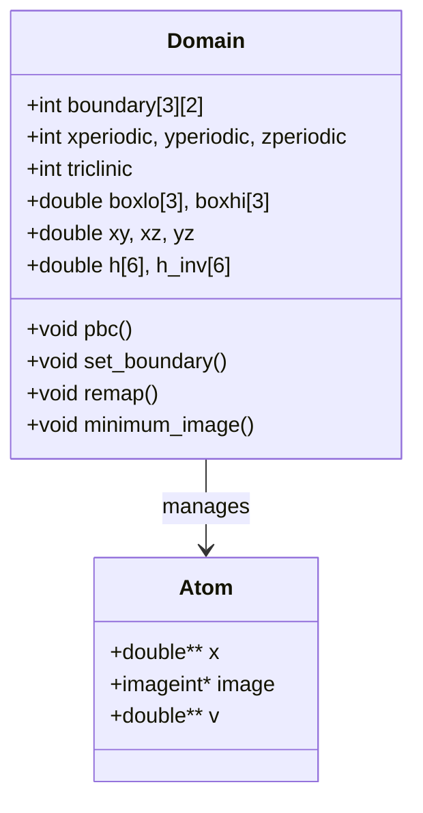
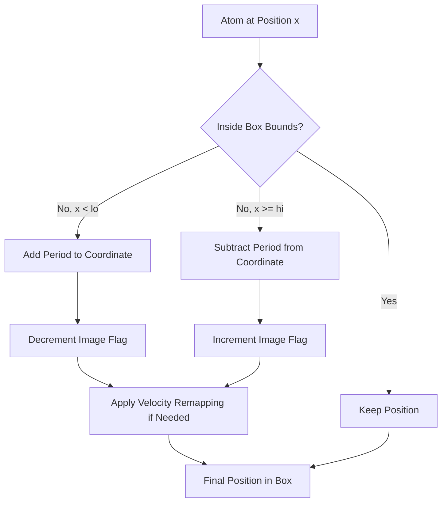

This page comprehensively documents LAMMPS's sophisticated boundary condition and periodic system architecture. Understanding these concepts is fundamental to molecular dynamics simulations, as boundary conditions define how simulation boxes interact with their surroundings and how atoms interact across periodic boundaries.

## Boundary Condition Architecture

LAMMPS implements boundary conditions through the **Domain** class, which serves as the central manager for all simulation box geometries and boundary specifications. The architecture provides flexible support for periodic, fixed, and shrink-wrap boundaries across all three dimensions.

The boundary system is built around a `boundary[3][2]` array that stores boundary settings for each dimension (x, y, z) and each side (low, high). Each boundary can be configured with one of four modes:

| Boundary Type | Code | Description | Use Case |
|---------------|------|-------------|----------|
| Periodic | 0 | Atoms wrap across boundary | Bulk materials, periodic crystals |
| Fixed | 1 | Reflective/inert wall | Surfaces, isolated systems |
| Shrink-wrap | 2 | Box shrinks to fit atoms | Droplets, clusters |
| Shrink-wrap with minimum | 3 | Shrinks with minimum size constraint | Flexible volume calculations |



The boundary configuration is initialized with periodic boundaries by default, as shown in the Domain constructor where all six boundary faces are set to periodic (0) [src/domain.cpp#L77-L79](src/domain.cpp#L77-L79). The `set_boundary()` method processes boundary specifications from input scripts, ensuring consistency and validating that both sides of a dimension must be periodic if either is periodic [src/domain.cpp#L2090-L2163](src/domain.cpp#L2090-L2163).

Sources: [src/domain.h#L36-L40](src/domain.h#L36-L40), [src/domain.cpp#L64-L120](src/domain.cpp#L64-L120)

## Periodic Boundary Conditions

Periodic boundary conditions (PBC) are the cornerstone of bulk material simulations, creating an infinite system from a finite simulation cell. LAMMPS implements PBC through a sophisticated combination of coordinate wrapping, image flag management, and minimum image conventions.

### PBC Application Algorithm

The core PBC algorithm operates in `Domain::pbc()` [src/domain.cpp#L769-L887](src/domain.cpp#L769-L887), which processes each owned atom to ensure it remains within the simulation box. For atoms crossing boundaries, the algorithm performs three critical operations:

1. **Coordinate Wrapping**: Atoms leaving the box are repositioned on the opposite side by adding or subtracting the box period
2. **Image Flag Update**: Encoded image flags track how many times each atom has crossed periodic boundaries
3. **Velocity Remapping**: When box deformation occurs, velocities are adjusted to maintain physical consistency



The image flag system uses a compact bit-packed encoding where each dimension uses 10 bits to store image counts [src/domain.h#L188-L200](src/domain.h#L188-L200). This allows tracking of boundary crossings up to 512 times in either direction per dimension, which is essential for accurate bond calculations and topology maintenance.

> [!TIP]
> When atoms cross periodic boundaries during dynamics, their image flags are updated to track the cumulative number of crossings. This is critical for maintaining molecular topology when bonded molecules span multiple periodic images.

### Minimum Image Convention

LAMMPS implements the minimum image convention to ensure atoms interact with their nearest periodic images. The `minimum_image()` method [src/domain.cpp#L1222-L1297](src/domain.cpp#L1222-L1297) adjusts distance vectors by adding or subtracting box periods until the distance is within half the box size in each dimension.

For orthogonal boxes, this is straightforward:
```
if (fabs(dx) > xprd_half) {
    if (dx < 0.0) dx += xprd;
    else dx -= xprd;
}
```

For triclinic boxes, the algorithm becomes more complex because changing one dimension's periodic image affects coordinates in other dimensions due to tilt factors [src/domain.cpp#L1258-L1296](src/domain.cpp#L1258-L1296). This ensures proper handling of interactions in sheared systems.

> [!TIP]
> The minimum image convention assumes the simulation box is large enough that no atom interacts with more than its nearest periodic image. Violations of this assumption can lead to unphysical interactions and should be detected by careful analysis of potential cutoffs relative to box dimensions.

Sources: [src/domain.cpp#L769-L887](src/domain.cpp#L769-L887), [src/domain.cpp#L1222-L1297](src/domain.cpp#L1222-L1297)

## Triclinic Box Systems

LAMMPS supports two types of triclinic boxes: restricted and general triclinic. These allow simulation of sheared systems, crystals with low-symmetry unit cells, and systems undergoing deformation.

### Restricted Triclinic Boxes

Restricted triclinic boxes are characterized by three tilt factors (xy, xz, yz) that define the skew of the simulation box. The shape matrix H in Voigt notation [src/domain.h#L87-L88](src/domain.h#L87-L88) describes the transformation:

```
H = [xx   xy   xz]
    [0    yy   yz]
    [0    0    zz]
```

This restricted form ensures the box can be continuously deformed from an orthogonal box without topological changes. The domain stores both the tilt factors and the complete shape matrix H and its inverse H_inv for efficient coordinate transformations [src/domain.h#L86-L88](src/domain.h#L86-L88).

### General Triclinic Boxes

General triclinic boxes support arbitrary edge vectors defined by three vectors: a, b, and c. This is useful for directly specifying complex crystal structures without intermediate transformations. The `define_general_triclinic()` method [src/domain.cpp#L553-L598](src/domain.cpp#L553-L598) accepts arbitrary edge vectors and computes a rotation to convert to restricted triclinic representation.

The conversion involves quaternion-based rotation calculations that transform the general triclinic box to the restricted form [src/domain.cpp#L607-L676](src/domain.cpp#L607-L676). This enables LAMMPS to use its optimized restricted triclinic algorithms while accepting general box specifications.

### Lambda Coordinate System

For efficient computation in triclinic boxes, LAMMPS uses a fractional (lambda) coordinate system where coordinates range from 0 to 1 in each dimension. Coordinate transformations between Cartesian and lambda coordinates use the shape matrix:

```
x = H * lamda + boxlo
lamda = H^(-1) * (x - boxlo)
```

The `lamda2x()` [src/domain.cpp#L2212-L2221](src/domain.cpp#L2212-L2221) and `x2lamda()` [src/domain.cpp#L2241-L2255](src/domain.cpp#L2241-L2255) methods implement these transformations for all atoms, while overloaded versions handle individual atoms [src/domain.cpp#L2282-L2305](src/domain.cpp#L2282-L2305). Using lambda coordinates simplifies periodic boundary checks and improves computational efficiency for many operations.

Sources: [src/domain.cpp#L553-L676](src/domain.cpp#L553-L676), [src/domain.cpp#L2212-L2320](src/domain.cpp#L2212-L2320)

## Coordinate Remapping and Unmapping

Coordinate remapping ensures atoms remain within the simulation box during and after operations that might move them outside. LAMMPS provides several remapping methods for different use cases:

### Remap Methods

- **remap(double *x, imageint &image)** [src/domain.cpp#L1550-L1630](src/domain.cpp#L1550-L1630): Remaps a single coordinate while updating image flags
- **remap(double *x)** [src/domain.cpp#L1640-L1677](src/domain.cpp#L1640-L1677): Remaps without image flag calculation (useful for post-processing)
- **remap_all()** [src/domain.cpp#L1689-L1696](src/domain.cpp#L1689-L1696): Remaps all atoms in the system
- **remap_near()** [src/domain.cpp#L1704-L1776](src/domain.cpp#L1704-L1776): Remaps to within half box length of a reference position

The remapping algorithm iteratively adds or subtracts box periods until coordinates are within the box bounds [src/domain.cpp#L1570-L1627](src/domain.cpp#L1570-L1627). For triclinic boxes, coordinates are first converted to lambda space, remapped, then converted back to Cartesian coordinates.

### Unmapping Operations

Unmapping performs the inverse operation, reconstructing the original absolute position from a boxed coordinate and its image flags. The `unmap()` methods [src/domain.cpp#L1801-L1825](src/domain.cpp#L1801-L1825) apply image flag offsets to recover the unwrapped position, which is essential for calculating mean-squared displacement and other diffusive properties.

Sources: [src/domain.cpp#L1550-L1825](src/domain.cpp#L1550-L1825)

## Box Boundary Management

The boundary system provides comprehensive management of simulation box evolution through several key mechanisms.

### Boundary String Representation

The `boundary_string()` method [src/domain.cpp#L2192-L2200](src/domain.cpp#L2192-L2200) generates a human-readable string representation of the boundary settings. For example, "p p p" represents fully periodic boundaries, while "p f f" represents periodic in x but fixed in y and z.

### Box Change Tracking

LAMMPS tracks three types of box changes through flags [src/domain.h#L100-L103](src/domain.h#L100-L103):

- **box_change_size**: Box dimensions change
- **box_change_shape**: Box tilt factors change  
- **box_change_domain**: Processor sub-domains change

These flags are set by fixes and other operations that modify the box, triggering necessary communication and data structure updates. The `init()` method [src/domain.cpp#L136-L150](src/domain.cpp#L136-L150) queries all fixes to determine if any will cause box changes.

### Shrink-wrap Boundaries

Shrink-wrap boundaries automatically adjust box dimensions to contain atoms. The domain stores minimum box sizes `minxlo`, `minxhi`, etc. [src/domain.h#L71-L73](src/domain.h#L71-L73) that constrain how small the box can become. The `box_too_small_check()` [src/domain.cpp#L1071-L1183](src/domain.cpp#L1071-L1183) and `subbox_too_small_check()` [src/domain.cpp#L1184-L1220](src/domain.cpp#L1184-L1220) methods validate that boxes remain large enough for communication and neighbor calculations.

Sources: [src/domain.h#L71-L103](src/domain.h#L71-L103), [src/domain.cpp#L136-L150](src/domain.cpp#L136-L150)

## Practical Implementation Examples

The LAMMPS examples directory provides practical demonstrations of boundary condition usage in various scenarios.

### Orthogonal FCC Lattice

The orthogonal box example [examples/triclinic/in.fcc.orthog](examples/triclinic/in.fcc.orthog) demonstrates a simple periodic system:

```
lattice       fcc 1.1
region        mybox block 0 1 0 1 0 1
create_box    1 mybox
create_atoms  1 box
```

This creates a face-centered cubic lattice with fully periodic boundaries, suitable for bulk crystal simulations.

### General Triclinic Box

The general triclinic example [examples/triclinic/in.data.general](examples/triclinic/in.data.general) shows how to read and work with complex box geometries:

```
read_data     data.general
pair_style    lj/cut 1.2
thermo_style  custom step pe avecx avecy avecz bvecx bvecy bvecz &
                cvecx cvecy cvecz pxx pyy pzz vol
thermo_modify triclinic/general yes
```

The `thermo_modify triclinic/general yes` directive ensures thermo output uses the general triclinic representation.

Sources: [examples/triclinic/in.fcc.orthog](examples/triclinic/in.fcc.orthog), [examples/triclinic/in.data.general](examples/triclinic/in.data.general)

## Integration with Simulation Components

The boundary condition system integrates deeply with LAMMPS's other core components:

### Communication System

The parallel communication system relies on boundary information to determine which atoms to exchange between processors. Sub-domain boundaries are stored in `sublo` and `subhi` arrays [src/domain.h#L77-L77](src/domain.h#L77-L77) and are updated when the global box changes.

### Neighbor Lists

Neighbor list construction uses the minimum image convention to ensure proper interaction detection across periodic boundaries. The `minimum_image_check()` inline method [src/domain.h#L194-L200](src/domain.h#L194-L200) provides fast checking for potential image flag violations.

### Data Input/Output

The domain system supports writing boundary and box information to data files. The `print_box()` method [src/domain.cpp#L2169-L2185](src/domain.cpp#L2169-L2185) generates formatted output showing either orthogonal or triclinic box specifications.

## Advanced Topics

### Deformation and Velocity Remapping

When using box deformation (e.g., through `fix deform`), the domain tracks deformation flags `deform_flag`, `deform_vremap`, and `deform_groupbit` [src/domain.h#L105-L107](src/domain.h#L105-L107). During PBC application, velocities are remapped according to the box deformation rate tensor `h_rate` [src/domain.cpp#L810-L826](src/domain.cpp#L810-L826), ensuring atoms acquire the appropriate velocity due to box motion.

### Image Flag Consistency

When boundary conditions change from periodic to non-periodic, the domain automatically resets image flags for the affected dimensions [src/domain.cpp#L2145-L2162](src/domain.cpp#L2145-L2162). A warning is issued if any atoms had non-zero image flags in dimensions that become non-periodic, alerting users to potential topology issues.

Sources: [src/domain.cpp#L2145-L2162](src/domain.cpp#L2145-L2162)

## Summary and Best Practices

LAMMPS's boundary condition and periodic system architecture provides a robust foundation for diverse simulation scenarios. Key best practices include:

1. **Box Size Planning**: Ensure box dimensions are at least twice the potential cutoff in each periodic dimension to satisfy minimum image requirements
2. **Triclinic Considerations**: When using triclinic boxes, be aware that tilt factors affect effective box dimensions in other directions
3. **Image Flag Tracking**: Monitor image flags for molecules that span periodic boundaries, especially during topology changes
4. **Boundary Consistency**: Use shrink-wrap boundaries judiciously as they can cause box fluctuations that affect thermodynamic properties

For more details on related topics, see [Command Syntax and Structure](12-command-syntax-and-structure) for how to specify boundaries in input scripts, [Neighbor Lists](19-long-range-electrostatics-and-k-space-methods) for how periodic boundaries affect neighbor construction, and [Replica Exchange Methods](23-replica-exchange-methods) for advanced boundary condition applications.