This page explains the fundamental syntax and structure of LAMMPS input scripts, providing the foundation for writing effective molecular dynamics simulations. Understanding command structure is essential before progressing to more advanced topics like [Variables and Control Flow](13-variables-and-control-flow) and simulation techniques.

## Input Script Fundamentals

LAMMPS input scripts are plain text files read line by line during simulation execution. Each line contains a command that instructs LAMMPS to perform a specific operation. The script serves as a complete recipe for your simulation, from system setup through data output. Commands are processed sequentially, building your simulation one component at a time.


A typical input script follows a logical progression: define units → specify atom style → create simulation box → populate with atoms → define interactions → set integration method → configure output → run simulation. This structure is evident in the basic melt example [examples/melt/in.melt](examples/melt/in.melt#L1-L34), which demonstrates a complete 3D Lennard-Jones simulation setup.

## Command Syntax Basics

### Command Format

Every LAMMPS command follows this general pattern:

```
command_name keyword arguments...
```

Commands consist of a required command identifier followed by optional keywords and arguments. The command name is always first and specifies what operation to perform. Keywords modify command behavior, while arguments provide numerical or string values needed for the operation.

Sources: [examples/melt/in.melt](examples/melt/in.melt#L3-L4), [examples/peptide/in.peptide](examples/peptide/in.peptide#L3-L4)

### Comments

Comments begin with the `#` character and continue to the end of the line. Comments are ignored during execution and are essential for documenting your script logic. Most example scripts include descriptive headers explaining the simulation purpose:

```
# 3d Lennard-Jones melt
# Solvated 5-mer peptide
# 2d indenter simulation
```

Sources: [examples/melt/in.melt](examples/melt/in.melt#L1), [examples/peptide/in.peptide](examples/peptide/in.peptide#L1), [examples/indent/in.indent](examples/indent/in.indent#L1)

### Line Continuation

Long commands can span multiple lines using the `&` character at the end of a line. This is particularly common for complex `fix` or `dump` commands with many parameters:

```
dump 2 all image 25 image.*.jpg type type &
      axes yes 0.8 0.02 view 60 -30
```

Sources: [examples/melt/in.melt](examples/melt/in.melt#L20-L21), [examples/peptide/in.peptide](examples/peptide/in.peptide#L25-L26)

## Command Categories

Based on the examination of example scripts, LAMMPS commands can be organized into several functional categories:

### Simulation Setup Commands

These commands establish the fundamental simulation framework:

| Command | Purpose | Example |
|---------|---------|---------|
| `units` | Define unit system | `units lj`, `units real` |
| `atom_style` | Specify atom attributes | `atom_style atomic`, `atom_style full` |
| `dimension` | Set spatial dimensions | `dimension 2`, `dimension 3` |
| `boundary` | Define boundary conditions | `boundary p p p`, `boundary f f p` |

Sources: [examples/melt/in.melt](examples/melt/in.melt#L3-L4), [examples/min/in.min](examples/min/in.min#L2-L3), [examples/indent/in.indent](examples/indent/in.indent#L1-L2), [examples/balance/in.balance](examples/balance/in.balance#L7-L8)

### System Creation Commands

Commands for building the atomic system:

| Command | Purpose | Example |
|---------|---------|---------|
| `lattice` | Define lattice structure | `lattice fcc 0.8442`, `lattice hex 0.9` |
| `region` | Define geometric regions | `region box block 0 10 0 10 0 10` |
| `create_box` | Create simulation box | `create_box 1 box` |
| `create_atoms` | Generate atoms | `create_atoms 1 box`, `create_atoms 0 box mol cychex 734594` |
| `read_data` | Load system from data file | `read_data data.peptide` |
| `mass` | Set atomic masses | `mass 1 1.0`, `mass 1 14.027` |

Sources: [examples/melt/in.melt](examples/melt/in.melt#L5-L7), [examples/peptide/in.peptide](examples/peptide/in.peptide#L8), [examples/template/in.template-mix](examples/template/in.template-mix#L8-L13), [examples/indent/in.indent](examples/indent/in.indent#L9-L10)

### Force Field Commands

Commands defining interatomic interactions:

| Command | Purpose | Example |
|---------|---------|---------|
| `pair_style` | Pair interaction method | `pair_style lj/cut 2.5`, `pair_style lj/charmm/coul/long 8.0 10.0 10.0` |
| `pair_coeff` | Pair interaction parameters | `pair_coeff 1 1 1.0 1.0 2.5` |
| `pair_modify` | Modify pair settings | `pair_modify shift yes`, `pair_modify mix geometric tail yes` |
| `bond_style` | Bond interaction method | `bond_style harmonic` |
| `angle_style` | Angle interaction method | `angle_style charmm`, `angle_style harmonic` |
| `dihedral_style` | Dihedral interaction method | `dihedral_style charmm`, `dihedral_style harmonic` |
| `improper_style` | Improper interaction method | `improper_style harmonic` |
| `kspace_style` | Long-range solver | `kspace_style pppm 0.0001` |

Sources: [examples/melt/in.melt](examples/melt/in.melt#L12-L13), [examples/peptide/in.peptide](examples/peptide/in.peptide#L4-L7), [examples/template/in.template-mix](examples/template/in.template-mix#L5-L8), [examples/indent/in.indent](examples/indent/in.indent#L21-L22)

### Group and Selection Commands

Commands for organizing atoms into groups:

| Command | Purpose | Example |
|---------|---------|---------|
| `group` | Define atom groups | `group peptide type <= 12`, `group mobile subtract all lower` |
| `set` | Set atom properties | `set group lower type 2` |
| `region` | Define spatial regions | `region circle sphere $(v_d/2+1) $(v_d/2/sqrt(3.0)+1) 0.0 $(v_d/2)` |

Sources: [examples/peptide/in.peptide](examples/peptide/in.peptide#L17), [examples/indent/in.indent](examples/indent/in.indent#L26-L27), [examples/rigid/in.rigid](examples/rigid/in.rigid#L11-L19), [examples/balance/in.balance](examples/balance/in.balance#L13)

### Integration and Dynamics Commands

Commands controlling time evolution:

| Command | Purpose | Example |
|---------|---------|---------|
| `velocity` | Set initial velocities | `velocity all create 3.0 87287 loop geom` |
| `fix` | Apply operations during run | `fix 1 all nve`, `fix 1 all nvt temp 275.0 275.0 100.0` |
| `unfix` | Remove a fix | `unfix 4` |
| `timestep` | Set integration timestep | `timestep 0.003`, `timestep 2.0` |
| `run` | Execute dynamics | `run 250`, `run 10000` |
| `minimize` | Perform energy minimization | `minimize 1.0e-6 0.001 1000 10000` |

Sources: [examples/melt/in.melt](examples/melt/in.melt#L10-L11-L32), [examples/peptide/in.peptide](examples/peptide/in.peptide#L14-L18-L43), [examples/min/in.min](examples/min/in.min#L14-L17-L41), [examples/indent/in.indent](examples/indent/in.indent#L30-L43-L69)

### Output Commands

Commands for monitoring and storing simulation data:

| Command | Purpose | Example |
|---------|---------|---------|
| `thermo` | Set thermo output frequency | `thermo 50`, `thermo 100` |
| `thermo_style` | Define thermo output format | `thermo_style multi`, `thermo_style custom step temp epair press` |
| `thermo_modify` | Modify thermo settings | `thermo_modify temp new` |
| `dump` | Write atom coordinates | `dump 1 all atom 50 dump.melt` |
| `dump_modify` | Modify dump settings | `dump_modify 2 pad 3` |

Sources: [examples/melt/in.melt](examples/melt/in.melt#L31), [examples/peptide/in.peptide](examples/peptide/in.peptide#L15-L16), [examples/balance/in.balance](examples/balance/in.balance#L48-L50)

### Neighbor List Commands

Commands controlling neighbor list construction:

| Command | Purpose | Example |
|---------|---------|---------|
| `neighbor` | Set neighbor list parameters | `neighbor 0.3 bin`, `neighbor 2.0 bin` |
| `neigh_modify` | Modify neighbor list settings | `neigh_modify every 20 delay 0 check no`, `neigh_modify exclude group clump1 clump1` |

Sources: [examples/melt/in.melt](examples/melt/in.melt#L15-L16), [examples/peptide/in.peptide](examples/peptide/in.peptide#L10-L11), [examples/rigid/in.rigid](examples/rigid/in.rigid#L22-L30)

## Variable System

LAMMPS supports variables that enhance script flexibility and enable parameter sweeps. Variables are defined using the `variable` command and referenced using `$name` or `${name}` syntax.

### Variable Definition

```
variable x index 50
variable k equal 1000.0/xlat
variable y equal "13.0*ylat - step*dt*0.02*ylat"
variable boxlen index 4.0
```

Sources: [examples/balance/in.balance](examples/balance/in.balance#L4-L8), [examples/indent/in.indent](examples/indent/in.indent#L44-L45), [examples/template/in.template-mix](examples/template/in.template-mix#L10)

### Variable Usage

Variables can be used in commands by preceding the variable name with `$`:

```
region box block -${boxlen} ${boxlen} -${boxlen} ${boxlen} -${boxlen} ${boxlen} units lattice
fix 4 all indent $k sphere 10 v_y 0 5.0
```

Sources: [examples/template/in.template-mix](examples/template/in.template-mix#L11), [examples/indent/in.indent](examples/indent/in.indent#L46)

> [!TIP]
> Variables enable powerful parameter sweeps and automated analysis. Use `index` style variables for lists of values and `equal` style variables for computed expressions that update during simulation.

## Script Architecture and Execution Flow

Understanding how LAMMPS processes input scripts is crucial for writing efficient simulations. The following diagram illustrates the typical command flow and execution model:

```mermaid
flowchart TB
    Start([LAMMPS Start]) --> ReadScript[Read Input Script]
    ReadScript --> Parse[Parse Commands Sequentially]
    
    Parse --> SetupPhase{Setup Phase}
    
    SetupPhase --> Units[units - Define Unit System]
    Units --> AtomStyle[atom_style - Specify Atom Attributes]
    AtomStyle --> Lattice[lattice - Define Crystal Structure]
    Lattice --> Region[region - Define Simulation Box]
    Region --> CreateBox[create_box - Create Simulation Box]
    CreateBox --> CreateAtoms["create_atoms/read_data - Populate System"]
    CreateAtoms --> Mass[mass - Set Atomic Masses]
    
    Mass --> ForceField{Force Field Setup}
    ForceField --> PairStyle[pair_style - Pair Interactions]
    PairStyle --> BondAngle["bond_style, angle_style, dihedral_style"]
    BondAngle --> PairCoeff[pair_coeff - Interaction Parameters]
    PairCoeff --> KSpace[kspace_style - Long-range Solver]
    
    KSpace --> Dynamics{Dynamics Setup}
    Dynamics --> Velocity[velocity - Initial Velocities]
    Velocity --> Fix[fix - Integrator and Constraints]
    Fix --> Neighbor[neighbor - Neighbor Lists]
    Neighbor --> Timestep[timestep - Integration Step]
    
    Timestep --> Output{Output Configuration}
    Output --> Thermo[thermo - Thermodynamic Output]
    Thermo --> Dump[dump - Trajectory Output]
    
    Dump --> RunPhase{Run Phase}
    RunPhase --> Execute["run/minimize - Execute Simulation"]
    Execute --> Update[Update System State]
    Update --> CheckConvergence{Converged/Complete?}
    CheckConvergence -->|No| Execute
    CheckConvergence -->|Yes| Cleanup
    
    Cleanup[Final Output and Cleanup] --> End([Simulation Complete])
    
    style SetupPhase fill:#e1f5fe
    style ForceField fill:#f3e5f5
    style Dynamics fill:#e8f5e9
    style Output fill:#fff3e0
    style RunPhase fill:#fce4ec
    style Cleanup fill:#e0e0e0
```



This architecture shows how LAMMPS builds simulations incrementally. Each command type operates on the simulation state created by previous commands. The setup phase establishes the physical framework, the force field phase defines interactions, the dynamics phase configures integration, and the run phase performs the actual simulation.

## Common Script Patterns

### Basic Molecular Dynamics Simulation

The simplest complete script structure follows this pattern:

```
# 1. Define units and atom style
units lj
atom_style atomic

# 2. Create system
lattice fcc 0.8442
region box block 0 10 0 10 0 10
create_box 1 box
create_atoms 1 box

# 3. Define interactions
pair_style lj/cut 2.5
pair_coeff 1 1 1.0 1.0 2.5

# 4. Set up dynamics
velocity all create 3.0 87287 loop geom
fix 1 all nve

# 5. Configure output
thermo 50

# 6. Run simulation
run 250
```

Sources: [examples/melt/in.melt](examples/melt/in.melt#L1-L34)

### Energy Minimization

For finding stable configurations, scripts include a minimization phase:

```
# Setup system...

# Minimization
minimize 1.0e-6 0.001 1000 10000
```

Sources: [examples/min/in.min](examples/min/in.min#L41)

### Multi-stage Simulations

Complex simulations often have multiple run phases with different conditions:

```
# Phase 1: with indenter
fix 4 all indent $k sphere 10 v_y 0 5.0
run 30000

# Phase 2: without indenter
unfix 4
run 30000
```

Sources: [examples/indent/in.indent](examples/indent/in.indent#L46-L69)

### Complex Systems with Constraints

More advanced systems use groups and specialized fixes:

```
# Define constrained regions
region 1 block INF INF INF 1.25 INF INF
group lower region 1
group mobile subtract all lower
set group lower type 2

# Apply constraints
fix 2 lower setforce 0.0 0.0 0.0
fix 3 all temp/rescale 100 0.1 0.1 0.01 1.0
```

Sources: [examples/indent/in.indent](examples/indent/in.indent#L18-L19-L26-L34-L35)

## Script Organization Best Practices

Based on the example scripts examined, effective LAMMPS scripts follow these organizational principles:

### Logical Sectioning

Organize commands into logical blocks with descriptive comments:

```
# 1. Simulation setup
units real
atom_style full

# 2. Force field definition
pair_style lj/charmm/coul/long 8.0 10.0 10.0
bond_style harmonic

# 3. System creation
read_data data.peptide

# 4. Dynamics setup
fix 1 all nvt temp 275.0 275.0 100.0

# 5. Output configuration
thermo 50
```

Sources: [examples/peptide/in.peptide](examples/peptide/in.peptide#L1-L18-L20)

### Parameter Organization

Group related parameters together for readability:

```
# LJ potentials
pair_style lj/cut 2.5
pair_coeff * * 1.0 1.0 2.5

# define groups
region 1 block INF INF INF 1.25 INF INF
group lower region 1
group mobile subtract all lower
```

Sources: [examples/indent/in.indent](examples/indent/in.indent#L20-L27)

### Conditional Execution

Use comments to control optional features:

```
#dump 1 all atom 100 dump.min
#dump 2 all image 50 image.*.jpg type type &
#      zoom 1.6 adiam 1.5
```

Sources: [examples/min/in.min](examples/min/in.min#L19-L21)

## Advanced Syntax Features

### Compute References

Commands can reference computed values:

```
compute new mobile temp
velocity mobile create 0.2 482748 temp new
thermo_modify temp new
```

Sources: [examples/indent/in.indent](examples/indent/in.indent#L28-L29-L50)

### Molecule Templates

Complex molecules can be defined as templates:

```
molecule cychex cyclohexane.mol
atom_style template cychex
create_atoms 0 box mol cychex 734594
```

Sources: [examples/template/in.template-mix](examples/template/in.template-mix#L4-L5-L14)

### Hybrid Atom Styles

Multiple atom styles can be combined:

```
molecule twomols h2o.mol co2.mol offset 2 1 1 0 0
atom_style hybrid template twomols charge
```

Sources: [examples/template/in.hybrid](examples/template/in.hybrid#L2-L3)

## Command Precedence and Dependencies

The order of commands is critical because many commands depend on state established by previous commands. Understanding these dependencies prevents common errors:

1. **Units must be defined first** - All physical quantities use the specified units
2. **Atom style must precede atom creation** - Determines what atom attributes are available
3. **System creation before interactions** - Pair styles need atoms to exist
4. **Groups before group operations** - Groups must be defined before use
5. **Fixes before run** - Integration methods must be active during dynamics

Sources: All examples demonstrate this ordering consistently: [examples/melt/in.melt](examples/melt/in.melt), [examples/peptide/in.peptide](examples/peptide/in.peptide), [examples/indent/in.indent](examples/indent/in.indent)

> [!TIP]
> The LAMMPS manual provides detailed command-specific ordering requirements. Always verify dependencies for new commands before inserting them into existing scripts.

## Error Prevention and Debugging

Common syntax errors can be avoided by following these patterns:

### Verify Command Syntax

Each command has a specific syntax. Incorrect argument counts or types will cause errors:

```
# Correct
pair_style lj/cut 2.5

# Incorrect - wrong number of arguments
pair_style lj/cut
```

### Check Group Definitions

Ensure groups are defined before use:

```
# Correct sequence
group mobile type 1
velocity mobile create 1.0 12345

# Incorrect - undefined group
velocity mobile create 1.0 12345
group mobile type 1
```

Sources: [examples/indent/in.indent](examples/indent/in.indent#L26-L28)

### Validate Parameter Ranges

Many commands have parameter constraints. Use appropriate cutoff values and ensure physical parameters are reasonable:

```
neighbor 0.3 bin
pair_style lj/cut 2.5  # Cutoff must be > neighbor distance + skin
```

Sources: [examples/melt/in.melt](examples/melt/in.melt#L15-L12)

## Next Steps

With command syntax fundamentals established, you can explore more advanced topics:

- [Variables and Control Flow](13-variables-and-control-flow) - Learn about loops, conditionals, and advanced variable usage
- [Reading and Writing Data Files](14-reading-and-writing-data-files) - Understand data file formats and I/O operations
- [Energy Minimization Algorithms](20-energy-minimization-algorithms) - Explore minimization techniques in depth
- [Pair Styles Overview](16-pair-styles-overview) - Comprehensive guide to interatomic potentials

For practical examples, explore the extensive [examples/](examples/) directory which contains working scripts for diverse simulation scenarios including molecular systems [examples/peptide/](examples/peptide/), rigid bodies [examples/rigid/](examples/rigid/), and specialized techniques [examples/indent/](examples/indent/).