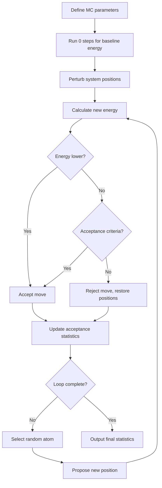

LAMMPS provides a powerful scripting language for managing simulation parameters and controlling execution flow through variables and control structures. This document covers the fundamentals of variable definition, substitution patterns, and control flow constructs that enable flexible and dynamic simulation scripts.

## Variable Types and Definition

LAMMPS supports multiple variable types that serve different purposes in simulation scripts. The basic syntax for defining variables follows the pattern `variable name style value`, where the style determines the variable's behavior and usage context.

**Index Variables** are the simplest form, storing a single value that can be substituted directly:

```
variable boxlen index 4.0
region box block -${boxlen} ${boxlen} -${boxlen} ${boxlen} -${boxlen} ${boxlen} units lattice
```
Sources: [examples/template/in.template-mix](examples/template/in.template-mix#L10-L11)

**Equal Variables** store computed expressions and are evaluated each time they're referenced. They can contain mathematical formulas and reference other variables:

```
variable density equal 1.0
variable kT equal 0.05
variable deltamove equal 0.1
```
Sources: [examples/MC-LOOP/in.mc](examples/MC-LOOP/in.mc#L3-L5)

**Loop Variables** work with the `next` and `jump` commands to implement iteration:

```
variable iter loop 3000
```
Sources: [examples/MC-LOOP/in.mc](examples/MC-LOOP/in.mc#L2)

**Atom Variables** allow per-atom property calculations and manipulations:

```
variable xnew equal x[v_i]+v_deltamove*random(-1.0,1.0,${seed})
variable ynew equal y[v_i]+v_deltamove*random(-1.0,1.0,${seed})
```
Sources: [examples/MC-LOOP/in.mc](examples/MC-LOOP/in.mc#L53-L54)

**Internal Variables** store fixed values for use with fixes and computes:

```
variable tcontrol internal 0.5
fix tstat all langevin v_tcontrol 0.5 0.5 2938940
```
Sources: [examples/controller/in.controller.temp](examples/controller/in.controller.temp#L19-L20)

## Variable Substitution Syntax

LAMMPS uses `${variable_name}` syntax for variable substitution. When LAMMPS encounters this pattern in an input script, it replaces it with the variable's current value before executing the command.

**Direct substitution** replaces variables with their literal values:

```
lattice hex ${density}
region box block 0 10 0 5 -0.5 0.5
```
Sources: [examples/MC-LOOP/in.mc](examples/MC-LOOP/in.mc#L13-L14)

**Chained substitutions** allow variables to reference other variables:

```
variable x atom x+v_deltaperturb*random(-1.0,1.0,${seed})
set group all x v_x
```
Sources: [examples/MC-LOOP/in.mc](examples/MC-LOOP/in.mc#L32-L33)

**Variable references in formulas** use the `$` prefix without braces for equal-style variables:

```
variable e equal pe
variable emin equal $e
```
Sources: [examples/MC-LOOP/in.mc](examples/MC-LOOP/in.mc#L26-L29)

## Mathematical Expressions and Functions

Variables can contain complex mathematical expressions and built-in functions for calculations.

**Random number generation** uses the `random(min, max, seed)` function:

```
variable rn equal random(0.0,1.0,${seed})
variable irandom equal floor(atoms*random(0.0,1.0,${seed})+1)
```
Sources: [examples/MC-LOOP/in.mc](examples/MC-LOOP/in.mc#L51-L52)

**Mathematical functions** include exponential, trigonometric, and other operations:

```
variable boltzfactor equal "exp(atoms*(v_elast - v_e) / v_kT)"
```
Sources: [examples/MC-LOOP/in.mc](examples/MC-LOOP/in.mc#L55)

**Atom property access** uses array indexing notation with `x[id]`, `y[id]`, `z[id]`:

```
variable xi equal x[v_i]
variable yi equal y[v_i]
variable xnew equal x[v_i]+v_deltamove*random(-1.0,1.0,${seed})
```
Sources: [examples/MC-LOOP/in.mc](examples/MC-LOOP/in.mc#L56-L58)

## Control Flow Structures

LAMMPS provides several constructs for controlling script execution flow, enabling loops, conditional logic, and jumps.

### Labels and Jumps

The `label` command marks a location in the script that can be jumped to, enabling loops:

```
label loop
# ... commands to be repeated ...
next iter
jump SELF loop
```
Sources: [examples/MC-LOOP/in.mc](examples/MC-LOOP/in.mc#L61-L107-L108)

The `next` command advances a loop variable, and `jump SELF label` creates an unconditional jump to the specified label, forming the basic structure of a loop.

### Conditional Execution

The `if` command provides conditional logic with optional `elif` and `else` clauses:

```
if "$e <= ${elast}" then &
  "variable elast equal $e" &
  "variable naccept equal ${increment}" &
elif "${rn} <= ${boltzfactor}" &
  "variable elast equal $e" &
  "variable naccept equal ${increment}" &
else &
  "set atom $i x ${x0}" &
  "set atom $i y ${y0}"
```
Sources: [examples/MC-LOOP/in.mc](examples/MC-LOOP/in.mc#L102-L108)

Conditional expressions can use comparison operators (`<=`, `>=`, `<`, `>`, `==`, `!=`) and logical operators to evaluate variable values or computed expressions.

## Variable Categories Summary

| Variable Type | Style Keyword | Purpose | Example Use Case |
|--------------|---------------|---------|------------------|
| Index | `index` | Single value from list | `variable temp index 300 400 500` |
| Equal | `equal` | Computed expression | `variable press equal press` |
| Loop | `loop` | Loop counter | `variable i loop 100` |
| Atom | `atom` | Per-atom calculations | `variable vx atom vx` |
| Internal | `internal` | Fixed value for fixes | `variable cv internal 0.5` |
| World | `world` | Partition-specific values | `variable seed world 123 456 789` |
| Universe | `universe` | Multiple independent runs | `variable T universe 200 300 400` |
| Uloop | `uloop` | Universe loop counter | `variable i uloop 100` |

## Practical Usage Patterns

### Monte Carlo Algorithm Implementation

The Monte Carlo example demonstrates advanced variable usage for implementing a Metropolis algorithm:



Sources: [examples/MC-LOOP/in.mc](examples/MC-LOOP/in.mc#L2-L108)

> [!TIP]
> Loop variables must be paired with `next` commands to advance iteration, and `jump SELF label` to create the actual loop structure. Without both components, the loop will not execute correctly.

### Dynamic Load Balancing with Variables

Variables enable adaptive load balancing during simulation by tracking and updating processor weights:

```
fix 0 all balance 50 1.0 shift x 10 1.0 &
  weight var lastweight weight time 0.5 weight store WEIGHT
variable maximb equal f_0[1]
variable iter equal f_0[2]
```
Sources: [examples/balance/in.balance.var.dynamic](examples/balance/in.balance.var.dynamic#L27-L30)

### Atom-Level Property Manipulation

Variables can manipulate individual atom properties for complex algorithmic operations:

```
variable xnew equal x[v_i]+v_deltamove*random(-1.0,1.0,${seed})
set atom $i x ${xnew}
```
Sources: [examples/MC-LOOP/in.mc](examples/MC-LOOP/in.mc#L53-L68)

> [!TIP]
> When using atom variables in `set` commands, ensure the atom ID exists. Out-of-range atom IDs will cause errors, so validate atom counts before accessing specific atoms.

## Integration with LAMMPS Commands

Variables integrate seamlessly with LAMMPS commands across multiple categories:

**Fix commands** can use variable parameters for adaptive control:
```
fix tstat all langevin v_tcontrol 0.5 0.5 2938940
```
Sources: [examples/controller/in.controller.temp](examples/controller/in.controller.temp#L20)

**Set commands** apply variable values to atoms and groups:
```
set atom $i x ${xnew}
set group all x v_x
```
Sources: [examples/MC-LOOP/in.mc](examples/MC-LOOP/in.mc#L68-L33)

**Compute commands** create new variables from simulation properties:
```
variable e equal pe
compute p all property/atom d_WEIGHT
```
Sources: [examples/MC-LOOP/in.mc](examples/MC-LOOP/in.mc#L25-L28), [examples/balance/in.balance.var.dynamic](examples/balance/in.balance.var.dynamic#L16-L17)

## Best Practices

1. **Use descriptive variable names** that clearly indicate their purpose and type
2. **Initialize variables early** in the script before they're referenced
3. **Test conditional logic** with simple cases before complex algorithms
4. **Validate loop bounds** to prevent infinite loops in `jump` constructs
5. **Document variable units** and expected value ranges in comments
6. **Use internal variables** for fix parameters that should remain constant
7. **Leverage atom variables** for per-atom calculations rather than multiple compute commands

## Common Variable Operations

| Operation | Syntax | Example |
|-----------|--------|---------|
| Define variable | `variable name style value` | `variable T equal 300` |
| Reference variable | `${name}` or `$name` | `region box 0 ${L} 0 ${L}` |
| Compute expression | `math functions` | `variable e equal pe+ke` |
| Access atom property | `property[id]` | `variable xi equal x[v_i]` |
| Generate random | `random(min,max,seed)` | `variable rn equal random(0,1,12345)` |
| Increment loop variable | `next varname` | `next iter` |

## Next Steps

With variables and control flow mastered, explore how these concepts integrate with other LAMMPS features:

- **Reading and Writing Data Files** - Learn how variables can parameterize data file operations [Reading and Writing Data Files](14-reading-and-writing-data-files)
- **Advanced Scripting Techniques** - Discover sophisticated scripting patterns combining multiple control structures [Advanced Scripting Techniques](15-advanced-scripting-techniques)
- **Energy Minimization Algorithms** - See how variables control optimization parameters [Energy Minimization Algorithms](20-energy-minimization-algorithms)
- **Python Integration** - Learn about interfacing variables with Python workflows [LAMMPS Python Module Basics](28-lammps-python-module-basics)

Variables and control flow form the foundation of flexible, reusable LAMMPS scripts. Mastering these concepts enables you to create simulation workflows that adapt to different conditions, parameter studies, and complex algorithmic requirements.