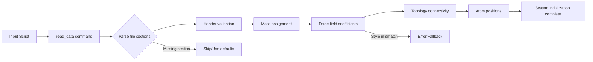

This page covers the essential aspects of data file management in LAMMPS, focusing on the structure of LAMMPS data files, how to read and write them programmatically, and the available conversion tools for interoperability with other molecular dynamics packages. Data files serve as the primary mechanism for initializing complex molecular systems, storing atom positions, topology information, and interaction parameters that define your simulation model.

## Data File Architecture

The LAMMPS data file format follows a structured, section-based organization that encodes all essential system information in a human-readable ASCII format. Each data file begins with a descriptive header containing global system counts, followed by sequential sections defining box geometry, atomic properties, interaction coefficients, and topological connectivity.

```mermaid
graph TD
    A[Data File] --> B[Header Section]
    A --> C[Box Dimensions]
    A --> D[Masses Section]
    A --> E[Force Field Coefficients]
    A --> F[Topology Sections]
    A --> G[Atoms Section]
    
    B --> B1[Atom count]
    B --> B2[Bond/Angle/Dihedral counts]
    B --> B3[Type counts]
    
    C --> C1[xlo xhi]
    C --> C2[ylo yhi]
    C --> C3[zlo zhi]
    
    E --> E1[Pair Coeffs]
    E --> E2[Bond Coeffs]
    E --> E3[Angle Coeffs]
    E --> E4[Dihedral Coeffs]
    E --> E5[Improper Coeffs]
    
    F --> F1[Bonds]
    F --> F2[Angles]
    F --> F3[Dihedrals]
    F --> F4[Impropers]
    
    G --> G1[Atom ID]
    G --> G2[Molecule ID]
    G --> G3[Atom type]
    G --> G4[Charge]
    G --> G5[Coordinates]
    G --> G6[Image flags]
```

The header section establishes the system scope by declaring the total number of structural elements: atoms, bonds, angles, dihedrals, and impropers, along with the corresponding type counts for each category. This information enables LAMMPS to allocate appropriate memory structures and validate consistency across different sections [data.peptide](examples/peptide/data.peptide#L1-L15). Following the header, the box dimensions define the simulation cell boundaries using the standard LAMMPS convention with low and high bounds for each dimension [data.peptide](examples/peptide/data.peptide#L16-L18).

**Section Order Requirements**: The sequence of sections in a data file is significant and must follow a specific order to ensure proper parsing. While some sections are optional depending on the system complexity, their relative positioning cannot be arbitrarily rearranged. The masses section must precede the atoms section, and force field coefficient sections must appear before their corresponding topological sections. This ordering requirement reflects LAMMPS's sequential parsing algorithm which reads sections linearly and builds data structures progressively.

> [!TIP]
> When creating custom data files, ensure consistency between declared counts in the header and actual entries in each section. Mismatches between declared and actual bond counts are a common source of errors and can lead to undefined behavior or crashes during simulation initialization.

## Reading Data Files

Reading data files into LAMMPS is accomplished through the `read_data` command, which serves as the primary interface for loading pre-configured molecular systems. This command accepts the data file path and provides numerous optional flags for controlling which sections to read and how to handle various file format variations.

The basic syntax for reading a data file is straightforward: `read_data file.data`, but production scripts typically include additional parameters to handle specific simulation requirements. These parameters allow selective section reading, coordinate transformations, and compatibility with different data file versions [data.peptide](examples/peptide/data.peptide#L1-L6532). When reading molecular systems with bonded interactions, LAMMPS automatically establishes the topological connectivity defined in the bonds, angles, dihedrals, and impropers sections, enabling subsequent force computations.

**Section Selection**: The `read_data` command provides granular control over which sections to process through the `extra/...` keywords. For systems that don't require certain topological elements (such as dihedrals or impropers), you can selectively exclude these sections to reduce memory overhead and initialization time. Conversely, for specialized simulations requiring additional bond types or angle definitions, the `extra/bond/types`, `extra/angle/types`, and related keywords allow reading beyond what's initially declared in the header.

**Coordinate Transformations**: LAMMPS supports automatic coordinate transformations during data file loading through parameters like `shift`, `scale`, and `wrap`. These transformations enable seamless integration of data files generated with different coordinate conventions or unit systems without requiring manual pre-processing. The shift parameter applies a uniform translation to all coordinates, while scale applies multiplicative scaling factors to each dimension independently.

## Writing Data Files

Writing data files from within LAMMPS simulations enables checkpointing, analysis, and data exchange workflows. The `write_data` command creates complete data files representing the current system state, including all atom positions, velocities (when supported), topological information, and force field parameters.

**Complete System Dump**: When `write_data` is executed without specifying sections, LAMMPS generates a comprehensive data file containing all system information. This includes the header with current atom and topology counts, box dimensions reflecting any deformation or changes during simulation, masses, force field coefficients, complete topological connectivity, and atom positions. For molecular systems, the molecule IDs are preserved, enabling subsequent analysis of molecular integrity and connectivity [data.peptide](examples/peptide/data.peptide#L1-L6532).

**Selective Writing**: The `write_data` command supports selective section writing through the `pair`, `bond`, `angle`, `dihedral`, `improper` keywords. These boolean flags control whether force field coefficient sections are included in the output file. When working with fixed force fields that don't change between simulations, excluding coefficient sections can significantly reduce file sizes and prevent inadvertent parameter modifications.

**Velocity Output**: While standard data files don't include velocity information, the `write_data` command can optionally write velocities when the system has been initialized with velocities and the appropriate flag is set. This capability enables full state checkpointing for restart workflows, though for production restart scenarios, LAMMPS's native restart file format typically offers superior efficiency and completeness.

> [!TIP]
> For large molecular systems, consider writing data files at strategic simulation milestones rather than at regular intervals. The I/O overhead for writing complete data files scales with system size and can significantly impact simulation performance, especially on parallel file systems with limited bandwidth.

## Force Field Coefficients Format

The coefficient sections in LAMMPS data files define the parameters for various interaction types, with specific formatting requirements that depend on the chosen interaction style. Each coefficient type follows a consistent pattern: an integer type identifier followed by style-dependent parameter values.

**Pair Coefficients**: Pair coefficient sections define non-bonded interaction parameters between atom types. The exact format depends on the pair style specified in the input script. For Lennard-Jones style interactions, the typical format includes epsilon and sigma parameters, possibly with optional cutoff values [data.peptide](examples/peptide/data.peptide#L33-L46). More complex pair styles like EAM (Embedded Atom Method) require tabulated data or additional parameters for the embedding function and electron density contributions.

**Bond Coefficients**: Bond coefficients define parameters for covalent bond interactions, typically following the format `type K r0` where K represents the force constant and r0 is the equilibrium bond length for harmonic bond styles [data.peptide](examples/peptide/data.peptide#L47-L64). Different bond styles (Morse, FENE, quartic, etc.) require different parameter sets, and the data file format must match the expectations of the specified bond style in the input script.

**Angle, Dihedral, and Improper Coefficients**: These sections define parameters for bonded interactions involving three, four, and four atoms respectively. Angle coefficients typically include force constants and equilibrium angles [data.peptide](examples/peptide/data.peptide#L65-L95). Dihedral coefficients follow style-dependent formats, with harmonic styles requiring force constants, periodicity, phase shifts, and optionally multiplicity parameters [data.peptide](examples/peptide/data.peptide#L96-L116). Improper coefficients maintain planarity constraints in molecular systems and follow similar conventions [data.peptide](examples/peptide/data.peptide#L117-L120).

## Topology Sections

The topological sections (Atoms, Bonds, Angles, Dihedrals, Impropers) define the connectivity information that enables bonded force computations. Each entry follows a specific format that varies depending on the atom style and interaction type.

**Atoms Section**: The atoms section format depends on the specified atom style. For molecular systems with full atom information (typically `atom_style full`), each atom entry includes: atom ID, molecule ID, atom type, charge, and three coordinates [data.peptide](examples/peptide/data.peptide#L121-L200). For simpler atomic systems, the format may exclude molecule ID and charge fields. The image flags at the end of each line track which periodic images atoms belong to, enabling proper computation of periodic boundary conditions.

**Bonds, Angles, Dihedrals, Impropers**: These sections define the connectivity information for bonded interactions. Each entry typically includes: interaction ID, type identifier, and the list of atom indices participating in the interaction [data.peptide](examples/peptide/data.peptide#L121-L200). For bonds, this is two atom indices; for angles, three; for dihedrals and impropers, four. The interaction IDs are typically sequential but can be arbitrary as long as they're unique within each section.

## Conversion Tools

LAMMPS provides several utility scripts for converting between different molecular simulation file formats, facilitating interoperability with other packages and preprocessing workflows. These tools are located in the `tools/` directory and cover common molecular simulation formats.

**AMBER to LAMMPS**: The `amber2lmp/` directory contains Python scripts for converting AMBER coordinate and topology files to LAMMPS data file format [amber2lammps.py](tools/amber2lmp/amber2lammps.py#L1-L821). The primary script handles both `.crd` coordinate files and `.top` topology files, extracting molecular topology, atom types, charges, and force field parameters. Conversion includes proper handling of periodic boundary conditions, mass assignments, and parameter mapping between AMBER's force field conventions and LAMMPS's parameter formats [amber2lmp/README](tools/amber2lmp/README#L1-L104).

**CHARMM to LAMMPS**: The `ch2lmp/` directory provides Perl scripts for converting CHARMM coordinate and parameter files to LAMMPS format. These scripts handle CHARMM's parameter file format and map CHARMM atom types and force field parameters to LAMMPS conventions. The conversion supports CHARMM's comprehensive force field including bonded terms, non-bonded interactions, and special handling for CHARMM's specific conventions like 1-4 scaling factors [ch2lmp/README](tools/ch2lmp/README).

**TINKER to LAMMPS**: The `tinker/` directory contains Python scripts for converting TINKER XYZ and parameter files to LAMMPS format. This conversion is particularly useful for accessing TINKER's extensive parameter library and its support for polarizable force fields. The scripts handle TINKER's coordinate conventions and parameter file formats [tinker/data.py](tools/tinker/data.py).

| Conversion Tool | Source Format | Target Format | Language |
|----------------|---------------|---------------|----------|
| amber2lammps | AMBER .crd/.top | LAMMPS data | Python |
| charmm2lammps | CHARMM .psf/.prm | LAMMPS data | Perl |
| tinker2lmp | TINKER .xyz/.prm | LAMMPS data | Python |
| lmp2cfg | LAMMPS dump | CFG format | Fortran |
| dump2xyz | LAMMPS dump | XYZ format | Python |

**Utility Scripts**: Beyond format conversion, the `tools/` directory contains numerous utility scripts for data manipulation and analysis. The `lmp2cfg/` tool converts LAMMPS dump files to CFG format for visualization in Atomeye [lmp2cfg/lmp2cfg.f](tools/lmp2cfg/lmp2cfg.f). Python scripts in `tools/python/` provide dump file conversion to various formats including PDB and XYZ, plus utilities for sorting and analyzing dump files [tools/python/dump2xyz.py](tools/python/dump2xyz.py), [tools/python/dump2pdb.py](tools/python/dump2pdb.py).

> [!TIP]
> When using conversion tools, always validate the converted system by checking mass sums, charge neutrality, and bond connectivity before proceeding with production simulations. Conversion scripts may occasionally fail to map complex force field features, particularly for specialized atom types or non-standard interaction parameters.

## Best Practices and Common Patterns

**File Organization**: Organize data files with descriptive naming conventions that indicate system type, force field, and creation date. For molecular systems, include information about the molecular composition in the filename or a separate README file. Maintain separate directories for different molecular systems or force field variants to avoid confusion between similar data files.

**Validation Workflow**: Establish a systematic validation workflow when creating or modifying data files. Begin by verifying that section counts match actual entries, check that all atom types have corresponding mass definitions, ensure charge neutrality (for systems requiring electrostatic calculations), and validate that all bonded interactions reference valid atom IDs. Many validation steps can be automated through simple Python scripts that parse the data file format and check consistency conditions.

**Incremental Building**: For complex molecular systems, consider building data files incrementally using a hierarchy of smaller, validated components. Start with basic atomic positions, add molecular topology gradually, and incorporate force field parameters systematically. This approach isolates errors to specific stages and makes debugging significantly easier than attempting to create complete data files in a single step.

**Version Control**: Track data files in version control systems alongside input scripts and analysis tools. While binary restart files are typically too large for efficient version control, data files for initialization are often of manageable size and benefit from tracking to maintain reproducibility. Document any modifications to data files in commit messages, including the rationale for parameter changes.

## Integration with Simulation Workflows

Data files serve as the bridge between system preparation, simulation execution, and analysis phases of molecular dynamics workflows. Understanding their role in each phase enables efficient workflow design and reproducible research practices.

**System Preparation**: Data files are typically the output of system preparation workflows that may involve molecular building tools, conversion utilities, or custom preprocessing scripts. The preparation phase focuses on generating physically reasonable initial configurations with appropriate topology and force field parameters. For complex molecular systems, tools like moltemplate (available in `tools/moltemplate/`) provide templating systems for generating data files with molecular hierarchies [moltemplate/README.txt](tools/moltemplate/README.txt).

**Simulation Execution**: During simulation execution, data files are loaded once at initialization through the `read_data` command. The information contained in data files establishes the complete system state before simulation begins, including positions, connectivity, and interaction parameters. Subsequent modifications to the system (such as adding or deleting atoms, changing interactions, or applying deformations) typically occur through LAMMPS commands rather than data file manipulation.

**Analysis and Restart**: Data files written during or after simulation provide snapshots for analysis and can serve as starting points for subsequent simulations. For analysis workflows, data files enable extraction of topological information, connectivity analysis, and force field parameter inspection. For restart workflows, while LAMMPS restart files provide more complete state information, data files can serve as simplified restart points when only atomic positions and topology are needed.

## Advanced Data File Features

**Triclinic Systems**: LAMMPS data files support triclinic simulation boxes through the inclusion of three tilt factors (xy, xz, yz) following the box dimension specifications. These tilt factors define the off-diagonal elements of the box matrix and enable simulation of systems with non-orthogonal periodic boundaries. The conversion between triclinic and orthogonal representations requires careful attention to coordinate transformations.

**Multiple Time Step Parameters**: Some advanced force field implementations require multiple parameter sets for different interaction cutoffs or time step schemes. Data files can accommodate these requirements through multiple coefficient sections or specialized formatting conventions. When using such advanced features, consult the specific documentation for the relevant pair, bond, or angle styles to understand the expected data file format.

**Molecule Templates**: For systems with repeated molecular units, data files can be combined with molecule templates defined through the `molecule` command. This approach enables efficient specification of complex molecular topologies by defining molecules once and instantiating them multiple times with different positions and orientations. While molecule templates are typically defined in separate molecule files rather than data files, understanding their integration with data files is important for advanced molecular system construction.

## Troubleshooting Common Issues

**Missing or Extra Atoms**: Errors indicating mismatched atom counts typically result from discrepancies between the header declaration and actual atom entries. Verify that the atom count in the header matches the number of lines in the Atoms section, and check for blank lines or commented entries that might confuse the parser. For systems created programmatically, ensure that atom ID assignment is contiguous starting from 1.

**Undefined Atom Types**: When LAMMPS encounters atom types without corresponding mass definitions or force field coefficients, it will generate errors during initialization. Verify that all atom types appearing in the Atoms section have entries in the Masses section, and that all referenced types in bonded interactions have corresponding coefficient definitions. Pay particular attention to off-by-one errors in type numbering.

**Bond Connectivity Errors**: Errors in bond, angle, dihedral, or improper sections often reference atoms that don't exist or fall outside valid ID ranges. Check that all atom indices in topological sections correspond to valid atom IDs from the Atoms section. For molecules, verify that the molecule IDs are consistent and that bonded interactions don't cross molecule boundaries unless intentionally designed.

**Force Field Parameter Mismatches**: When using converted data files, ensure that the force field parameters in the coefficient sections are appropriate for the specified pair, bond, and angle styles in the input script. Different packages may use different parameter conventions (epsilon/sigma vs. A/B for Lennard-Jones, for example), and conversion scripts must map these correctly. Test simple systems with known properties to validate parameter assignments.

For further guidance on LAMMPS commands and simulation techniques, continue with [Advanced Scripting Techniques](15-advanced-scripting-techniques) or explore [Dump Files and Trajectory Output](32-dump-files-and-trajectory-output) for alternative data storage and visualization options.