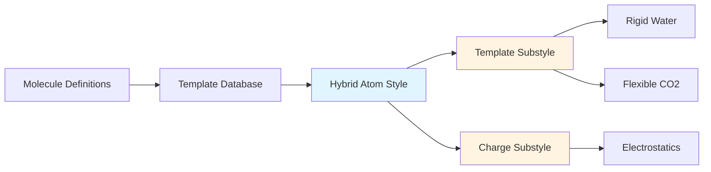
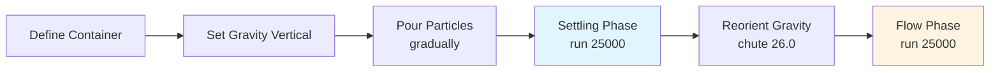

This page explores sophisticated scripting capabilities that extend beyond basic LAMMPS input scripts. These techniques enable complex simulation protocols, Python-LAMMPS integration, and advanced workflow orchestration for researchers pushing the boundaries of molecular dynamics simulations.

## Variable Reference Systems

LAMMPS provides a powerful variable expansion system that allows dynamic parameter substitution and runtime configuration. The variable system supports multiple types with distinct behaviors and use cases.

### Variable Types and Syntax

The variable system in LAMMPS enables script parameterization and mathematical operations through several categories:

```lammps
# Index variables - defined in scripts, expandable at command line
variable mu index -1.25
variable temp index 2.0
variable disp index 1.0
variable lbox index 5.0

# Equal variables - compute thermodynamic quantities
variable rho equal density
variable p equal press
variable muex equal ${mu}-${temp}*ln(density*${lambda}+${nugget})

# Atom variables - per-atom properties
variable fx atom fx
variable vy atom vy
```

Sources: [examples/mc/in.gcmc.lj](examples/mc/in.gcmc.lj#L8-L10), [examples/mc/in.gcmc.lj](examples/mc/in.gcmc.lj#L29-L31), [python/examples/in.simple](python/examples/in.simple#L23)

> [!TIP]
> Variables can be overridden from the command line using `-var name value` switches, enabling flexible parameter sweeps without script modification. This is particularly useful for high-throughput simulations and optimization workflows.

### Dynamic Group Composition

Advanced scripts leverage dynamic groups that update based on variable conditions:

```lammps
# Dynamic group based on atom property
variable type1 atom "type==1"
group type1 dynamic gcmcgroup var type1
variable n1 equal count(type1)
```

Sources: [examples/mc/in.gcmc.lj](examples/mc/in.gcmc.lj#L22-L24)

This pattern enables real-time tracking of particle populations during grand canonical Monte Carlo simulations, where atom counts fluctuate dynamically.

## Python-LAMMPS Integration

The Python module provides programmatic control over LAMMPS, enabling hybrid workflows that combine LAMMPS simulation power with Python's scientific ecosystem.

### Core Integration Patterns

Python scripts can execute LAMMPS commands, extract simulation data, modify atomic configurations, and run simulations iteratively:

```python
# Initialize LAMMPS instance
lmp = lammps()

# Execute commands
lmp.command("run 10")

# Extract per-atom data
x = lmp.gather_atoms("x", 1, 3)
v = lmp.gather_atoms("v", 1, 3)

# Modify positions programmatically
epsilon = 0.1
x[0] += epsilon
lmp.scatter_atoms("x", 1, 3, x)

# Continue simulation
lmp.command("run 1")
```

Sources: [python/examples/simple.py](python/examples/simple.py#L35-L54)

### Data Extraction and Manipulation

The Python API offers multiple methods for accessing LAMMPS data, each optimized for different use cases:

| Method | Use Case | Performance Characteristics |
|--------|----------|----------------------------|
| `gather_atoms()` | Extract all atoms of a property | High overhead for large systems |
| `gather_atoms_concat()` | Concatenated global array | More memory efficient |
| `gather_atoms_subset()` | Specific atom IDs | Best for sparse access |

```python
# Full array extraction
x = lmp.gather_atoms("x", 1, 3)
f = lmp.gather_atoms("f", 1, 3)

# Subset extraction (IDs 2 and 4)
ids = (2*ctypes.c_int)()
ids[0] = 2
ids[1] = 4
x_subset = lmp.gather_atoms_subset("x", 1, 3, 2, ids)
f_subset = lmp.gather_atoms_subset("f", 1, 3, 2, ids)

# Selective updates
lmp.scatter_atoms_subset("x", 1, 3, 2, ids, x)
```

Sources: [python/examples/simple.py](python/examples/simple.py#L94-L116)

### Command Batching

Multiple command submission strategies optimize different workflow patterns:

```python
# String-based batch (multi-line)
strtwo = "run 10\nrun 20"
lmp.commands_string(strtwo)

# List-based batch
cmds = ["run 10", "run 20"]
lmp.commands_list(cmds)
```

Sources: [python/examples/simple.py](python/examples/simple.py#L66-L70)

> [!TIP]
> List-based batching through `commands_list()` is generally more efficient for generating commands programmatically, as it avoids string concatenation overhead and provides better error handling.

### Advanced Python Features

The Python wrapper enables complex simulation control including atom creation, box manipulation, and compute management:

```python
# Extract and modify simulation box
boxlo, boxhi, xy, yz, xz, periodicity, box_change = lmp.extract_box()
print("Box info", boxlo, boxhi, xy, yz, xz, periodicity, box_change)

# Reset box dimensions
lmp.reset_box([0, 0, 0], [10, 10, 8], 0, 0, 0)

# Create new atoms programmatically
natoms = lmp.get_natoms()
atype = natoms * [1]
lmp.create_atoms(natoms, None, atype, x, v)
```

Sources: [python/examples/simple.py](python/examples/simple.py#L76-L81), [python/examples/simple.py](python/examples/simple.py#L122-L128)

## Multi-System and Hybrid Atom Styles

Advanced simulations often require combining multiple atom types or simulation styles within a single run. LAMMPS supports hybrid and template atom styles for these scenarios.

### Template Atom Style

The template atom style enables molecular template definitions with parameterized insertion:

```lammps
# Define molecular template
molecule cychex cyclohexane.mol
atom_style template cychex

# Create system with template molecules
lattice sc 6.0
variable boxlen index 4.0
region box block -${boxlen} ${boxlen} -${boxlen} ${boxlen} -${boxlen} ${boxlen} units lattice
create_box 2 box bond/types 1 angle/types 1 dihedral/types 1

# Insert template molecules randomly
create_atoms 0 box mol cychex 734594

# Add other atom types
create_atoms 2 random 800 495437 box
```

Sources: [examples/template/in.template-mix](examples/template/in.template-mix#L4-L17)

### Hybrid Atom Styles

The hybrid atom style enables combining multiple atom representations:

```lammps
# Define multiple molecular templates
molecule twomols h2o.mol co2.mol offset 2 1 1 0 0

# Combine template and charge styles
atom_style hybrid template twomols charge
```

Sources: [examples/template/in.hybrid](examples/template/in.hybrid#L3-L5)

This architecture allows simulating complex mixtures where different molecules require different internal representations, such as combining rigid water molecules with flexible CO₂ molecules in a single simulation.



## Multi-Neighbor List Optimization

For systems with widely varying particle sizes or interaction radii, multi-neighbor lists provide significant performance improvements.

### Configuration Pattern

```lammps
# Configure multi-level neighbor lists
neighbor 1 multi
neigh_modify delay 0 collection/type 2 1*4 5
comm_modify mode multi reduce/multi
```

Sources: [examples/multi/in.colloid](examples/multi/in.colloid#L23-L25), [examples/multi/in.powerlaw](examples/multi/in.powerlaw#L10-L12)

The `collection/type` syntax defines how to group atom types for neighbor list construction, while `collection/interval` groups by interaction distance.

| Parameter | Type | Description |
|-----------|------|-------------|
| `collection/type` | type-based | Groups atoms by type for separate neighbor lists |
| `collection/interval` | distance-based | Groups by interaction radius intervals |
| `reduce/multi` | communication optimization | Reduces communication overhead for heterogeneous systems |

### Granular Systems with Multi-Lists

Power-law distributed granular systems particularly benefit from multi-neighbor lists:

```lammps
# Power-law size distribution
neighbor 1 multi
neigh_modify delay 0 collection/interval 6 1.5 3 10 30 100 200
comm_modify mode multi vel yes reduce/multi

# Granular interactions
pair_style granular
pair_coeff * * hooke 20.0 0.5 tangential linear_history 1.0 0.5 0.1 damping mass_velocity
```

Sources: [examples/multi/in.powerlaw](examples/multi/in.powerlaw#L10-L13)

This configuration creates six separate neighbor list levels based on particle radii, optimizing for the extreme size variation in power-law distributions.

## Advanced Simulation Protocols

### Grand Canonical Monte Carlo Integration

GCMC simulations require careful scripting to balance molecular dynamics with Monte Carlo insertion/deletion moves:

```lammps
# Define tunable parameters
variable mu index -1.25
variable temp index 2.0
variable disp index 1.0

# GCMC fix with displacement moves
fix mygcmc gcmcgroup gcmc 1 100 100 1 29494 ${temp} ${mu} ${disp}

# Compute chemical potential
variable nugget equal 1.0e-8
variable lambda equal 1.0
variable muex equal ${mu}-${temp}*ln(density*${lambda}+${nugget})

# Track acceptance rates
variable tacc equal f_mygcmc[2]/(f_mygcmc[1]+${nugget})
variable iacc equal f_mygcmc[4]/(f_mygcmc[3]+${nugget})
variable dacc equal f_mygcmc[6]/(f_mygcmc[5]+${nugget})
```

Sources: [examples/mc/in.gcmc.lj](examples/mc/in.gcmc.lj#L8-L40)

The fix syntax `gcmc 1 100 100 1` defines move attempts (1 translation, 100 insertion, 100 deletion moves) per GCMC cycle.

### Widom Insertion Method

For chemical potential calculations without modifying the system composition:

```lammps
# Widom insertion test particles
fix mywidom all widom 10 100000 2 29494 0.75

# Track insertion statistics
thermo_style custom step temp pe etotal press vol density f_mywidom[1] f_mywidom[2] f_mywidom[3]
```

Sources: [examples/mc/in.widom.lj](examples/mc/in.widom.lj#L16-L18)

The Widom method provides accurate excess chemical potential estimates through ghost particle insertions, preserving system equilibrium.

## Granular Flow Simulation Patterns

Granular materials require specialized scripting for particle insertion and flow initialization.

### Pour Operations

The pour fix enables gradual particle insertion for realistic settling:

```lammps
# Define insertion region
region slab block -9.0 9.0 -9.0 9.0 10.0 15.0 units box

# Pour particles with controlled volume fraction
fix ins all pour 3000 1 300719 vol 0.13 50 region slab

# Two-stage simulation: settling then flow
run 25000
unfix ins
fix 2 all gravity 1.0 chute 26.0
run 25000
```

Sources: [examples/pour/in.pour](examples/pour/in.pour#L28-L52)

This pattern creates realistic initial conditions for granular flow simulations by allowing particles to settle under gravity before initiating flow by reorienting the gravity vector.



## Performance Optimization Techniques

### Dynamic Group Management

Advanced scripts minimize computational overhead through selective group operations:

```lammps
# Dedicated group for expensive operations
group gcmcgroup type 1

# Apply fixes only to relevant atoms
fix mygcmc gcmcgroup gcmc 1 100 100 1 29494 ${temp} ${mu} ${disp}
```

Sources: [examples/mc/in.gcmc.lj](examples/mc/in.gcmc.lj#L19-L22)

This pattern is crucial for hybrid simulations where only a subset of atoms requires special treatment (e.g., GCMC moves on solvent while solute remains fixed).

### Thermodynamic Output Control

Custom thermo configurations extract precisely needed information:

```lammps
# Monitor acceptance rates and derived quantities
thermo_style custom step temp press pe ke density atoms v_iacc v_dacc v_tacc v_rhoav v_pav v_muexav v_n1av
thermo 1000

# Average over windows
fix ave all ave/time 10 100 1000 v_rho v_p v_muex v_n1 ave one file rho_vs_p.dat
variable rhoav equal f_ave[1]
variable pav equal f_ave[2]
```

Sources: [examples/mc/in.gcmc.lj](examples/mc/in.gcmc.lj#L33-L43)

The averaging fix reduces output volume while providing statistically meaningful quantities through sliding window analysis.

## Next Steps

Having mastered advanced scripting techniques, you can explore:

- **[Energy Minimization Algorithms](20-energy-minimization-algorithms)** - Understand the optimization algorithms used in simulation preparation
- **[LAMMPS Python Module Basics](28-lammps-python-module-basics)** - Deeper dive into the Python API architecture and capabilities
- **[Free Energy Calculations](22-free-energy-calculations)** - Advanced thermodynamic analysis techniques building on these scripting foundations
- **[NEB and Transition State Calculations](21-neb-and-transition-state-calculations)** - Complex reaction path simulations requiring sophisticated scripting control