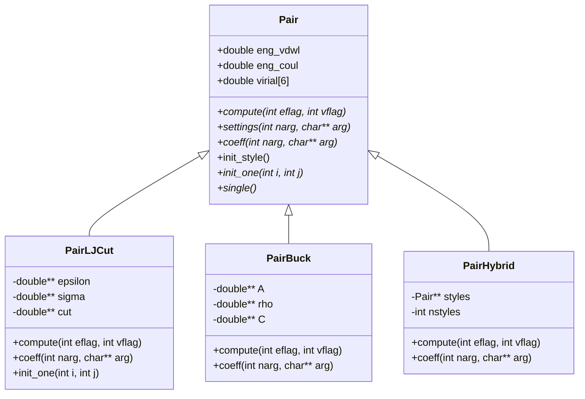
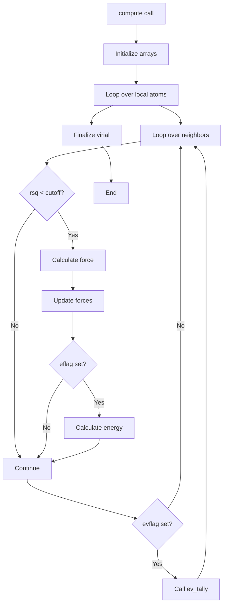

This page introduces LAMMPS pair styles—the fundamental mechanism for defining non-bonded interactions between atoms. Pair styles calculate forces and energies between pairs of atoms based on their interatomic distances, enabling simulation of materials from noble gases to complex biomolecules. Understanding pair styles is essential for accurate molecular dynamics simulations.


Sources: [pair.h](src/pair.h#L1-L150), [pair_lj_cut.cpp](src/pair_lj_cut.cpp#L1-L50)

## Pair Style Architecture

LAMMPS implements pair styles through an object-oriented hierarchy centered on the abstract `Pair` base class. Each concrete pair style inherits from this base class and implements virtual methods for force/energy computation, parameter management, and initialization. This design enables LAMMPS to support over 200 different pair styles while maintaining a consistent interface.



The `Pair` base class stores fundamental properties including van der Waals energy (`eng_vdwl`), Coulomb energy (`eng_coul`), and the six-component virial tensor [pair.h](src/pair.h#L58-L64). Each derived class must override the pure virtual `compute()` method, which performs the actual force and energy calculations, along with `settings()` and `coeff()` methods for parameter setup.

Sources: [pair.h](src/pair.h#L56-L135), [pair_lj_cut.h](src/pair_lj_cut.h#L30-L64)

## Force Computation Mechanics

The core of every pair style is the `compute()` method, which loops over atom pairs within a specified cutoff distance and calculates forces based on the interaction potential. This method receives energy and virial flags that control whether these quantities are accumulated during computation.



In `PairLJCut`, the implementation demonstrates the typical pattern: iterate through the neighbor list, calculate the squared distance (`rsq`), and if within the cutoff, compute the Lennard-Jones force and energy [pair_lj_cut.cpp](src/pair_lj_cut.cpp#L69-L143). The force is derived from the potential derivative and applied equally and oppositely to both atoms following Newton's third law.

Sources: [pair_lj_cut.cpp](src/pair_lj_cut.cpp#L69-L143), [pair.h](src/pair.h#L155-L162)

## Parameter Management and Mixing

Pair style parameters are organized into type-dependent arrays that specify interactions between each combination of atom types. The `allocate()` method creates these arrays sized according to the number of atom types in the system [pair_lj_cut.cpp](src/pair_lj_cut.cpp#L397-L422). For example, `PairLJCut` allocates arrays for `epsilon`, `sigma`, `cut` (cutoff distance), and precomputed coefficients (`lj1` through `lj4`) that accelerate force calculations.

> [!TIP]
> When setting coefficients for mixed atom types (i≠j), LAMMPS can automatically compute parameters using mixing rules if you don't explicitly specify them. The `init_one()` method checks for unset coefficients and applies the selected mixing rule (geometric, arithmetic, or sixthpower) to derive cross-type parameters from like-type values.

The `coeff()` method accepts flexible type specifications using wildcards, allowing you to set parameters for multiple type pairs with a single command. For instance, `* * 0.01 3.4` sets the same epsilon and sigma for all type combinations [pair_lj_cut.cpp](src/pair_lj_cut.cpp#L442-L475).

Sources: [pair_lj_cut.cpp](src/pair_lj_cut.cpp#L397-L475), [pair.cpp](src/pair.cpp#L720-L740)

## Common Pair Style Categories

LAMMPS provides pair styles organized by physical model and computational method. Selecting the appropriate style depends on your material system and required accuracy.

| Category | Representative Styles | Physical Model | Typical Use Cases |
|----------|----------------------|----------------|------------------|
| Simple Two-Body | `lj/cut`, `lj/expand`, `buck` | Analytical potentials with cutoffs | Noble gases, simple fluids |
| Truncated Shifted | `lj/cut/coul/long`, `lj/smooth` | Potentials shifted to zero at cutoff | Electrostatic systems, smooth truncation |
| Tabulated | `table`, `table/rx` | User-provided interpolation tables | Custom potentials, complex interactions |
| Many-Body | `eam`, `tersoff`, `reaxff` | Bond-order dependent, reactive potentials | Metals, covalent materials |
| Polarizable | `lj/cut/thole/long`, `dpd` | Include induced dipoles or coarse-graining | Polymers, biomolecules |
| Long-Range | `coul/long`, `ewald/n` | Coulomb interactions with Ewald/PPPM | Ionic systems, aqueous solutions |
| Hybrid | `hybrid`, `hybrid/scaled` | Combine multiple pair styles | Mixed materials, multi-physics |

The `PairLJCut` style implements the classic Lennard-Jones 12-6 potential with a simple radial cutoff. It's computationally efficient and suitable for noble gases and simple organic molecules. For metals requiring many-body effects, `eam` (Embedded Atom Method) captures the dependence of bond strength on local atomic coordination.

Sources: [pair.cpp](src/pair.cpp#L1-L2032), [pair_lj_cut.h](src/pair_lj_cut.h#L1-L64)

## Hybrid Pair Styles

When simulating systems requiring multiple interaction types simultaneously, `pair_style hybrid` combines two or more pair styles, each applied to specific atom type pairs. This enables, for example, modeling a metal-polymer interface with EAM for metal atoms and Lennard-Jones for polymer interactions [pair_hybrid.cpp](src/pair_hybrid.cpp#L37-L1194).

The hybrid style manages an array of sub-styles, delegating compute calls to each relevant sub-style based on type mappings. Its `init_one()` method returns the maximum cutoff among all sub-styles to ensure neighbor lists encompass all interactions.

Sources: [pair_hybrid.cpp](src/pair_hybrid.cpp#L91-L98), [pair_hybrid.cpp](src/pair_hybrid.cpp#L714-L780)

## Energy and Virial Accounting

LAMMPS provides mechanisms for accurate energy and virial (stress tensor) computation through the `ev_tally()` family of methods. These methods accumulate contributions on a per-atom or global basis depending on compute flags [pair.cpp](src/pair.cpp#L1030-L1182).

The `ev_tally()` method handles the most common case of two-body interactions, adding the pair's energy contribution to both atoms and computing the virial from the force components and separation vector. This ensures thermodynamic quantities like pressure are computed correctly regardless of the specific pair style implementation.

> [!TIP]
> Enable virial computation by setting the appropriate flags in your input script (`compute_style pressure all pressure` or `thermo_style custom pressure`). The virial is accumulated during force calculation only when requested, avoiding unnecessary computation overhead.

Sources: [pair.cpp](src/pair.cpp#L911-L1010), [pair.cpp](src/pair.cpp#L1030-L1132)

## Performance Optimization Features

LAMMPS includes several mechanisms to optimize pair style performance. Many pair styles support r-RESPA (multiple time step integration) through separate `compute_inner()`, `compute_middle()`, and `compute_outer()` methods that handle interactions at different distance ranges with different time steps [pair_lj_cut.cpp](src/pair_lj_cut.cpp#L143-L298).

The base class provides table-based computation for long-range Coulomb interactions, storing precomputed values to avoid expensive transcendental function calls. The `init_tables()` method builds these interpolation tables based on the Coulomb cutoff and accuracy requirements [pair.cpp](src/pair.cpp#L372-L686).

Modern LAMMPS also supports acceleration packages including GPU, Kokkos, and Intel variants of pair styles. These maintain the same interface but leverage hardware acceleration through specialized implementations (e.g., `pair_style lj/cut/gpu` or `pair_style lj/cut/kk`).

Sources: [pair_lj_cut.cpp](src/pair_lj_cut.cpp#L143-L298), [pair.cpp](src/pair.cpp#L372-L686)

## Using Pair Styles in Input Scripts

Pair styles are specified in LAMMPS input scripts using the `pair_style` and `pair_coeff` commands. The style command selects the potential and its global parameters:

```text
pair_style lj/cut 10.0
pair_coeff * * 0.01 3.4 10.0
```

This selects the Lennard-Jones style with a 10.0 Å global cutoff and applies epsilon=0.01, sigma=3.4 Å to all type pairs. The `pair_coeff` command follows with type specifications and parameters specific to the chosen style.

For more complex systems requiring multiple interaction types, use hybrid styles:

```text
pair_style hybrid/overlay lj/cut 10.0 eam
pair_coeff * * lj/cut 0.01 3.4 10.0
pair_coeff * * eam Cu.eam
```

This combines Lennard-Jones and EAM potentials, with both contributing to the total interaction energy.

Sources: [pair_lj_cut.cpp](src/pair_lj_cut.cpp#L422-L441), [pair_hybrid.cpp](src/pair_hybrid.cpp#L273-L393)

## Key Implementation Methods for Developers

For developers creating custom pair styles, several methods form the essential implementation contract:

| Method | Purpose | Required Override |
|--------|---------|-------------------|
| `compute(int eflag, int vflag)` | Calculate forces and energies | Yes (pure virtual) |
| `settings(int narg, char** arg)` | Parse global style parameters | Yes (pure virtual) |
| `coeff(int narg, char** arg)` | Parse type-specific parameters | Yes (pure virtual) |
| `allocate()` | Allocate parameter arrays | Usually |
| `init_style()` | Request neighbor lists, set options | Often |
| `init_one(int i, int j)` | Initialize parameters for type pair | Often |
| `single()` | Compute single pair interaction | Optional |
| `write_data()` / `read_restart()` | I/O operations | Optional |

The `PairLJCut` implementation provides a clear template for creating new pair styles, demonstrating proper allocation, coefficient parsing, mixing rule application, and force computation patterns [pair_lj_cut.cpp](src/pair_lj_cut.cpp#L1-L705).

Sources: [pair.h](src/pair.h#L155-L220), [pair_lj_cut.cpp](src/pair_lj_cut.cpp#L1-L705)

## Next Steps

Pair styles are one component of LAMMPS's comprehensive force field system. To build complete models, you'll typically combine them with other interaction types:

- For bonded interactions (bonds, angles, dihedrals), see [Bond, Angle, and Dihedral Interactions](17-bond-angle-and-dihedral-interactions)
- For materials requiring reactive or many-body effects, explore [Many-Body and Reactive Potentials](18-many-body-and-reactive-potentials)
- For ionic or polar systems with long-range electrostatics, read about [Long-Range Electrostatics and K-space Methods](19-long-range-electrostatics-and-k-space-methods)

Understanding pair styles provides the foundation for accurately modeling non-bonded interactions, which combined with the other interaction types, enables realistic simulation of virtually any material system.
