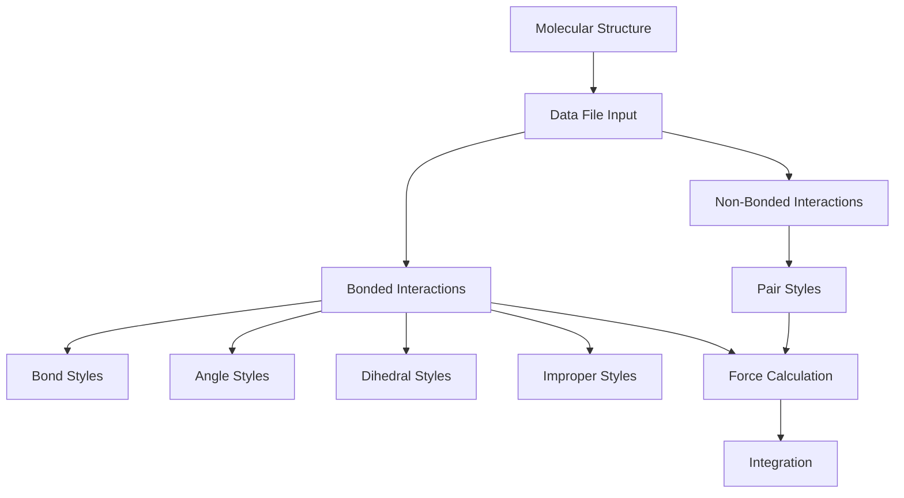

Bond, angle, and dihedral interactions form the foundation of molecular mechanics simulations in LAMMPS, enabling accurate modeling of covalent bonded systems including polymers, proteins, and small molecules. These interactions calculate forces arising from the stretching of chemical bonds, bending of bond angles, and rotation around dihedral angles. Unlike pair-wise interactions that operate between all atoms based on distance criteria, bonded interactions are topology-based—applied only to atoms explicitly connected in the molecular structure. This approach dramatically reduces computational cost while preserving chemical accuracy for systems where covalent bonding dominates the energy landscape.

Sources: [in.peptide](examples/peptide/in.peptide#L6-L9), [in.dreiding](examples/dreiding/in.dreiding#L7-L10)

## The Molecular Topology Architecture

Bonded interactions require a molecular topology definition that explicitly connects atoms through bonds, angles, and dihedrals. This topology is typically read from data files that list all bonded interactions along with their corresponding force field parameters. The topology information tells LAMMPS which atoms interact through bonded potentials, separating these specific interactions from the general non-bonded pair interactions. This architectural choice is fundamental to molecular mechanics simulation efficiency, as bonded interactions are O(N) in complexity rather than O(N²) for general pair interactions.

The data file contains sections for each type of bonded interaction, specifying the atoms involved and parameters for the chosen potential style. For example, the peptide example demonstrates a complete molecular setup with multiple bond types using the CHARMM force field parameters.

Sources: [in.peptide](examples/peptide/in.peptide#L14), [data.peptide](examples/peptide/data.peptide)

## Bond Interaction Styles

Bond styles calculate the potential energy and forces associated with stretching chemical bonds between pairs of directly connected atoms. LAMMPS provides numerous bond styles optimized for different force fields and application scenarios. The **harmonic** bond style represents the most fundamental implementation, modeling bonds as harmonic springs with potential energy E = K(r - r₀)² where K is the force constant and r₀ is the equilibrium bond length. This style is widely used in classical force fields including CHARMM, AMBER, and DREIDING, providing computational efficiency and reasonable accuracy for small to moderate bond deformations.

| Bond Style | Force Field | Equation Type | Typical Applications |
|------------|-------------|---------------|---------------------|
| harmonic | CHARMM, AMBER, DREIDING | E = K(r - r₀)² | General organic molecules |
| fene | Polymer models | FENE potential | Coarse-grained polymers |
| morse | Reactive potentials | E = D[1-exp(-a(r-r₀))]² | Metal bonding, dissociation |
| class2 | COMPASS | Polynomial series | Polymers, materials |

Sources: [in.peptide](examples/peptide/in.peptide#L6), [in.dreiding](examples/dreiding/in.dreiding#L8), [in.cmap](examples/cmap/in.cmap#L7)

The harmonic bond style appears consistently across multiple examples, demonstrating its versatility. In the peptide simulation, harmonic bonds model the backbone and side-chain connectivity of a solvated peptide. The Dreiding example uses harmonic bonds for a methanol box system, showing applicability across different molecular types. The key advantage of harmonic bonds is their computational efficiency and well-understood parameterization, making them the default choice for most molecular mechanics simulations.

Sources: [in.peptide](examples/peptide/in.peptide#L6), [in.dreiding](examples/dreiding/in.dreiding#L8)

> [!TIP]
> When setting up harmonic bonds, ensure force constants and equilibrium lengths are consistent with the chosen force field. Parameter mixing between different force fields can lead to unphysical behavior. Always verify that bond parameters match the atom types defined in your pair style parameters.

## Angle Interaction Styles

Angle styles calculate forces arising from bond angle deformations, involving triplets of connected atoms where the middle atom is the vertex. The potential energy penalizes deviation from preferred equilibrium angles. Like bonds, angles are essential for maintaining molecular geometry and determining conformational flexibility. The **harmonic** angle style uses E = K(θ - θ₀)², while the **CHARMM** angle style adds cross-terms with Urey-Bradley corrections for improved accuracy in protein and nucleic acid simulations.

| Angle Style | Force Field | Key Features | Typical Applications |
|------------|-------------|--------------|---------------------|
| harmonic | General | Simple harmonic | Most organic molecules |
| charmm | CHARMM | Urey-Bradley terms | Proteins, nucleic acids |
| cosine | DREIDING | Cosine-based | Generic organic systems |
| class2 | COMPASS | Cross-coupling terms | Materials, polymers |

Sources: [in.peptide](examples/peptide/in.peptide#L7), [in.dreiding](examples/dreiding/in.dreiding#L9), [in.cmap](examples/cmap/in.cmap#L8)

The peptide example demonstrates the CHARMM angle style, which is particularly well-suited for biomolecular simulations. This style includes additional terms that couple angle bending with bond stretching (Urey-Bradley terms), capturing correlated motions important for protein dynamics. In contrast, the Dreiding example uses the harmonic angle style, which is more general purpose and computationally simpler. The choice between styles depends on the required accuracy and the force field being implemented.

Sources: [in.peptide](examples/peptide/in.peptide#L7), [in.dreiding](examples/dreiding/in.dreiding#L9)

## Dihedral and Torsional Potentials

Dihedral styles model rotations around central bonds, involving quartets of atoms and determining the energy barriers between different conformations. These interactions are crucial for describing stereochemistry, conformational preferences, and rotational dynamics. The complexity of dihedral potentials reflects the rich conformational landscape of organic molecules, where rotation around single bonds can create multiple energy minima corresponding to different staggered conformations.

LAMMPS implements several sophisticated dihedral styles:

- **charmm**: Fourier series with Urey-Bradley cross-terms, optimized for biomolecular force fields
- **harmonic**: Simple harmonic approximation around equilibrium dihedral angle
- **charmmfsw**: CHARMM force switch variant with modified switching functions
- **opls**: Optimized potentials for liquid simulations

Sources: [in.peptide](examples/peptide/in.peptide#L8), [in.cmap](examples/cmap/in.cmap#L9)

The CMAP example showcases the advanced **charmmfsw** dihedral style, which incorporates force switch functions for smooth energy transitions at interaction cutoffs. This is particularly important for maintaining energy conservation in molecular dynamics simulations of large biomolecules. The peptide example uses the standard CHARMM dihedral style, demonstrating the default approach for protein simulations. These dihedral implementations calculate multiple Fourier terms to accurately reproduce the rotational barriers derived from quantum mechanical calculations or experimental data.

Sources: [in.peptide](examples/peptide/in.peptide#L8), [in.cmap](examples/cmap/in.cmap#L9)

## CMAP Corrections and Advanced Dihedrals

The Correction Map (CMAP) potential represents an advanced dihedral correction method developed for the CHARMM force field to improve backbone conformational accuracy in proteins. CMAP adds a two-dimensional correction term that depends on both the φ (phi) and ψ (psi) backbone dihedral angles, capturing correlations between successive torsional rotations that traditional dihedral potentials cannot represent. This correction is essential for accurate protein folding simulations and reproducing experimental Ramachandran plots.

Sources: [in.cmap](examples/cmap/in.cmap#L11-L12), [in.cmap](examples/cmap/in.cmap#L13)

The CMAP example demonstrates the implementation through a specialized fix command: `fix cmap all cmap charmm22.cmap` reads the correction map parameters from a dedicated file. The CMAP data file contains a grid of energy values across the φ-ψ space, interpolated during simulation to apply corrections based on instantaneous backbone dihedral values. This approach provides significantly improved accuracy for protein secondary structure prediction compared to traditional single-dihedral potentials alone.

Sources: [in.cmap](examples/cmap/in.cmap#L11-L12), [charmm22.cmap](examples/cmap/charmm22.cmap)

> [!TIP]
> CMAP corrections are computationally expensive compared to standard dihedrals. For large protein systems, consider using CMAP selectively on the most important backbone regions or test whether the accuracy improvement justifies the computational cost for your specific application.

## Improper Interactions

Improper dihedrals maintain planarity or chirality in molecular structures, applying out-of-plane bending forces to quartets of atoms that shouldn't all lie in the same plane. These interactions are essential for maintaining the geometry of aromatic rings, tetrahedral carbon centers, and other stereochemically constrained environments. Improper potentials are distinct from proper dihedrals: they define a preferred angle between a central atom and the plane formed by three other atoms, rather than a rotational barrier.

The peptide example uses `improper_style harmonic` to maintain planarity of peptide bonds and other constrained geometries. The Dreiding example sets `improper_style none`, indicating that improper terms are not needed for that particular force field application. The choice depends on the chemical system's requirements: biomolecular force fields typically require impropers to maintain proper chirality and planarity, while simpler coarse-grained models may omit them.

Sources: [in.peptide](examples/peptide/in.peptide#L9), [in.dreiding](examples/dreiding/in.dreiding#L10)

## Integration with Pair Interactions

Bonded and non-bonded interactions must work together coherently through proper settings of the `special_bonds` command, which modifies how pair forces are computed between atoms connected through bonds, angles, or dihedrals. This is crucial for avoiding double-counting of interactions and implementing force field-specific scaling factors. The CHARMM force field, for example, uses specific scaling factors for 1-2 (bonded), 1-3 (angle-connected), and 1-4 (dihedral-connected) atom pairs.

Sources: [in.peptide](examples/peptide/in.peptide#L27), [in.cmap](examples/cmap/in.cmap#L16)

The peptide example uses the convenient `special_bonds charmm` shorthand, which automatically applies the standard CHARMM scaling factors. The CMAP example demonstrates this same approach, showing consistency across CHARMM-based simulations. These settings ensure that electrostatic and van der Waals interactions between bonded atoms are properly scaled according to the force field's parameterization, preventing overcounting that would arise from applying both bonded and non-bonded potentials to the same atom pairs.

Sources: [in.peptide](examples/peptide/in.peptide#L27), [in.cmap](examples/cmap/in.cmap#L16)

## Thermostat Integration with Constraint Algorithms

Bonded interactions often integrate with constraint algorithms like SHAKE, which freezes bond lengths to allow larger timesteps in molecular dynamics simulations. The peptide example demonstrates this with: `fix 2 all shake 0.0001 10 100 b 4 6 8 10 12 14 18 a 31`. This command constrains bonds with types 4, 6, 8, 10, 12, 14, 18 and angle type 31, effectively treating these bonds as rigid during integration.

Sources: [in.peptide](examples/peptide/in.peptide#L27)

SHAKE is particularly valuable for hydrogen-containing systems where fast X-H bond vibrations would otherwise force very small timesteps (on the order of 0.5 fs). By constraining these bonds, LAMMPS can use larger timesteps (typically 2.0 fs as shown in the examples) while maintaining numerical stability. The trade-off is that constrained bonds cannot participate in bond stretching energy calculations, which is acceptable for hydrogen bonds where the stretching dynamics are not of primary interest.

Sources: [in.peptide](examples/peptide/in.peptide#L26), [in.cmap](examples/cmap/in.cmap#L35)

## Three-Body Potentials and Beyond

While this page focuses on bonded interactions, it's worth noting that LAMMPS also supports three-body potentials that can serve similar purposes in specialized systems. The **Stillinger-Weber** potential, demonstrated in the threebody example, explicitly includes three-body angular terms for silicon and other semiconductors. Similarly, **Tersoff** and **Vashishta** potentials include angular dependencies that conceptually resemble angle interactions, though they're implemented through pair styles rather than dedicated angle styles.

Sources: [in.threebody](examples/threebody/in.threebody#L50), [in.threebody](examples/threebody/in.threebody#L76)

These many-body potentials are essential for accurately modeling covalent materials where bond directionality and local coordination geometry determine properties. Unlike molecular force fields with explicit bond topology, many-body potentials determine bonding implicitly based on atomic distances and local coordination, making them suitable for modeling bond-breaking and formation events during reactive simulations.

Sources: [in.threebody](examples/threebody/in.threebody#L50), [in.threebody](examples/threebody/in.threebody#L83)

## Implementation Workflow

Setting up bonded interactions in LAMMPS follows a systematic workflow that ensures all components are properly configured:

This workflow, demonstrated across all examples, ensures that bonded interactions are properly integrated with the rest of the simulation setup. The data file must contain sections matching the defined styles (Bonds, Angles, Dihedrals, Impropers) with parameters consistent with the chosen force field. The CMAP example shows an additional step where the CMAP fix must be specified before reading the data file so that the crossterm section can be properly processed.

Sources: [in.peptide](examples/peptide/in.peptide#L6-L14), [in.cmap](examples/cmap/in.cmap#L7-L16)

## Energy Monitoring and Analysis

LAMMPS provides detailed energy output for bonded interactions through thermo output customization. All examples demonstrate thermo styles that include bonded energy terms (`ebond`, `eangle`, `edihed`, `eimp`) alongside kinetic, potential, and other energy components. This detailed output allows users to monitor the contribution of each bonded interaction type to the total energy, essential for debugging and validating simulation setups.

Sources: [in.dreiding](examples/dreiding/in.dreiding#L30), [in.cmap](examples/cmap/in.cmap#L32)

The Dreiding example shows particularly comprehensive monitoring: `thermo_style custom etotal ke temp pe ebond eangle edihed eimp evdwl ecoul elong v_E_hbond v_C_hbond press vol` tracks all bonded energies plus hydrogen bond contributions, providing complete energy accounting for complex molecular systems. This level of detail is invaluable for understanding how different force components contribute to system behavior and for identifying potential problems in force field parameterization.

Sources: [in.dreiding](examples/dreiding/in.dreiding#L30)

## Hybrid and Specialized Applications

LAMMPS supports advanced bonded interaction scenarios through hybrid styles and specialized fixes. The Dreiding example demonstrates `pair_style hybrid/overlay hbond/dreiding/lj 2 6 6.5 90 lj/cut/coul/long 8.5 11.5`, combining explicit hydrogen bonding potentials with standard Lennard-Jones and Coulomb interactions. This hybrid approach allows force field designers to implement complex interaction schemes that combine multiple physical effects.

Sources: [in.dreiding](examples/dreiding/in.dreiding#L6)

The ability to layer different interaction types through hybrid styles provides flexibility for implementing custom force fields or studying systems where standard models are inadequate. Users should carefully consider the physical justification for each interaction component and ensure parameters are mutually consistent when building hybrid interaction schemes.

Sources: [in.dreiding](examples/dreiding/in.dreiding#L6)

## Best Practices and Common Pitfalls

Successful implementation of bonded interactions requires attention to several critical details:

1. **Consistency**: Ensure all interaction styles (bond, angle, dihedral, improper, pair) belong to the same force field family. Mixing styles from different force fields can lead to unphysical behavior unless carefully validated.

2. **Parameter completeness**: Verify that all required parameters (force constants, equilibrium values, cross-terms) are provided in the data file for each bond, angle, and dihedral type. Missing or incorrect parameters are common sources of simulation failures.

3. **Special bonds**: Always set appropriate special bonds settings to avoid double-counting interactions. The `special_bonds charmm` command is frequently used but ensure it matches your force field's requirements.

4. **Timestep selection**: Choose timesteps appropriate for your system's fastest vibrational modes. Consider SHAKE or RATTLE constraints for hydrogen bonds to enable larger timesteps.

Sources: [in.peptide](examples/peptide/in.peptide#L6-L27), [in.dreiding](examples/dreiding/in.dreiding#L6-L16)

## Next Steps

After mastering basic bonded interactions, explore these advanced topics in the documentation catalog:

- [Pair Styles Overview](16-pair-styles-overview) to understand how bonded and non-bonded interactions work together
- [Many-Body and Reactive Potentials](18-many-body-and-reactive-potentials) for systems where bonds can break and form
- [Energy Minimization Algorithms](20-energy-minimization-algorithms) for optimizing molecular structures with bonded interactions
- [Reading and Writing Data Files](14-reading-and-writing-data-files) for creating custom molecular topologies

Bond, angle, and dihedral interactions provide the foundation for accurate molecular mechanics simulations. Through proper understanding and implementation of these interactions, you can model the rich conformational dynamics of molecular systems across chemistry, biology, and materials science.