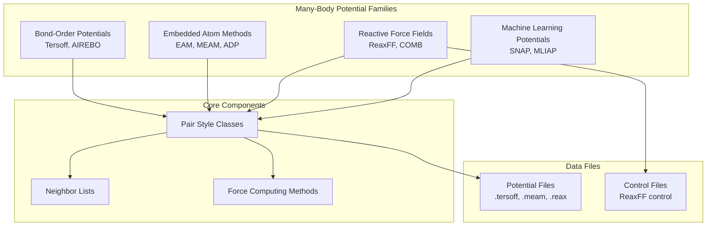
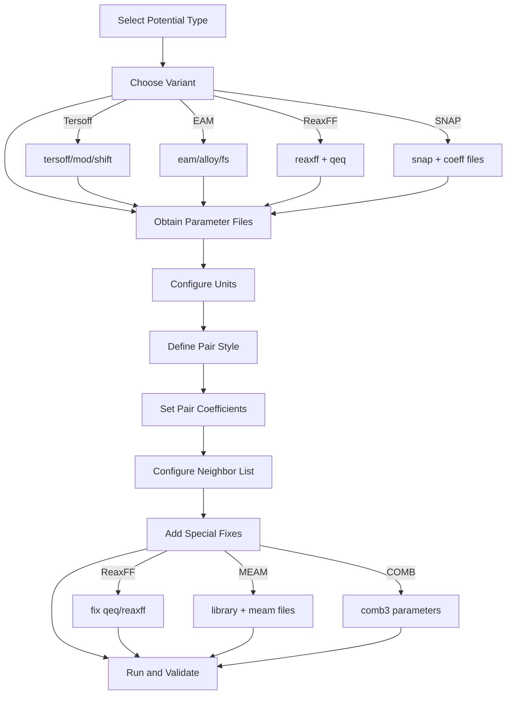
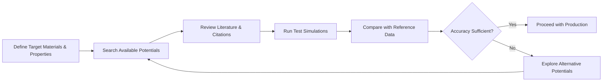

Many-body and reactive potentials represent advanced interatomic interaction models that go beyond simple pairwise interactions. These potentials capture complex bonding behavior including bond-order effects, charge transfer, and chemical reactions, making them essential for simulating covalent materials, metallic systems, and chemical processes. Unlike simple pair potentials, these models incorporate many-body effects where the interaction between two atoms depends on the local atomic environment, enabling realistic description of bond breaking and formation, coordination-dependent bonding, and charge redistribution.

Sources: [potentials/README](potentials/README#L1-L20)

## Architectural Overview of Many-Body Potentials

LAMMPS implements a hierarchical architecture for many-body and reactive potentials that separates mathematical models from computational infrastructure. The architecture supports multiple potential families through unified interfaces while allowing optimization for specific physics models.



The modular design enables efficient neighbor list management, parallel force computation, and integration with various analysis and output commands. Each potential family inherits from base pair style classes while implementing specialized force and energy calculations.

Sources: [examples/tersoff/in.tersoff](examples/tersoff/in.tersoff#L53-L54), [examples/meam/in.meam](examples/meam/in.meam#L10-L11), [examples/reaxff/in.reaxff.rdx](examples/reaxff/in.reaxff.rdx#L8-L9)

## Bond-Order Potentials

Bond-order potentials derive from the Tersoff formalism, which models covalent bonding through bond-order functions that depend on the local coordination environment. These potentials capture the essential physics of covalent materials including silicon, carbon, and compound semiconductors, where bond strength varies with coordination number and local geometry.

The Tersoff potential energy follows the form:

E = ½ Σi Σj≠i f_C(r_ij) [f_R(r_ij) + b_ij f_A(r_ij)]

where f_R and f_A are repulsive and attractive terms, f_C is a cutoff function, and b_ij is the bond-order parameter that depends on the local environment through angle-dependent terms:

b_ij = (1 + βⁿ ζ_ijⁿ)^(-1/2n)

ζ_ij = Σk≠i,j f_C(r_ik) g(θ_ijk) exp[α³(r_ij - r_ik)³]

This formulation automatically reduces bond strength as coordination increases, explaining the behavior of defects, surfaces, and amorphous materials.

Sources: [potentials/Si.tersoff](potentials/Si.tersoff#L1-L20), [examples/tersoff/in.tersoff](examples/tersoff/in.tersoff#L51-L54)

### Tersoff Variants and Implementation

LAMMPS provides multiple Tersoff implementations optimized for different applications and computational platforms:

| Potential Style | Features | Use Cases | Example |
|----------------|----------|-----------|---------|
| **tersoff** | Standard Tersoff | Si, Ge, C, compound semiconductors | [Si.tersoff](potentials/Si.tersoff) |
| **tersoff/mod** | Modified parametrization | Improved accuracy for specific materials | Si.tersoff.mod |
| **tersoff/mod/c** | C-optimized version | Enhanced performance on CPUs | Si.tersoff.modc |
| **tersoff/shift** | Shifted potential | Avoid energy discontinuities at cutoff | BNC.tersoff with shift |

The implementation demonstrates progressive testing from basic to modified variants within the same simulation framework:

```lammps
# Standard Tersoff
pair_style tersoff
pair_coeff * * Si.tersoff Si Si Si Si Si Si Si Si

# Modified Tersoff
pair_style tersoff/mod
pair_coeff * * Si.tersoff.mod Si Si Si Si Si Si Si Si
```

Sources: [examples/tersoff/in.tersoff](examples/tersoff/in.tersoff#L66-L72), [examples/tersoff/in.tersoff](examples/tersoff/in.tersoff#L98-L107)

### AIREBO and Adaptive Intermolecular Potentials

The AIREBO (Adaptive Intermolecular Reactive Empirical Bond Order) potential extends the Tersoff formalism to include non-bonded interactions and torsional terms, enabling simulations of hydrocarbon systems with accurate treatment of both covalent bonding and van der Waals interactions. This makes AIREBO particularly suitable for polymers, graphene, and hydrocarbon phases.

AIREBO combines three components:

E_total = E_REBO + E_LJ + E_torsion

- **E_REBO**: Reactive empirical bond-order terms (similar to Brenner potential)
- **E_LJ**: Lennard-Jones non-bonded interactions with adaptive switching
- **E_torsion**: Dihedral angle terms for hydrocarbon torsion

The potential automatically switches between bonded and non-bonded descriptions based on interatomic distance, enabling simulation of chemical reactions and bond breaking/formation events.

Sources: [potentials/CH.airebo](potentials/CH.airebo#L1-L15)

## Embedded Atom Method (EAM) Potentials

Embedded Atom Method potentials represent the cornerstone of metallic system simulation, modeling metallic bonding through an energy functional formalism where each atom's energy depends on the local electron density contributed by neighboring atoms. This approach naturally captures many-body effects essential for metals, including surface energies, defect formation, and elastic properties.

The EAM energy expression takes the form:

E_total = Σi F_i(ρ_i) + ½ Σi Σj≠i φ_ij(r_ij)

where F_i is the embedding energy as a function of the local electron density ρ_i = Σj≠i f_j(r_ij), and φ_ij is a pairwise potential function. The embedding function F captures many-body effects through its non-linear dependence on the local electron density.

Sources: [potentials/Cu_u3.eam](potentials/Cu_u3.eam#L1-L30), [potentials/README](potentials/README#L10-L15)

### EAM Variants and File Formats

LAMMPS supports multiple EAM implementations optimized for different material classes and computational requirements:

| Variant | File Format | Materials | Key Features |
|---------|-------------|-----------|--------------|
| **eam** | .eam | Pure metals | Simple single-element format |
| **eam/alloy** | .eam.alloy | Binary/multi-component | Multiple species support |
| **eam/fs** | .eam.fs | Alloys, compounds | Finnis-Sinclair formalism |
| **eam/cd** | .eam | Metals + charge transfer | Charge-dependent embedding |

The alloy format enables simulation of complex multi-component systems:

```lammps
# Multi-component EAM/alloy for Cu-Zr alloy
pair_style eam/alloy
pair_coeff * * CuZr_mm.eam.fs Cu Zr
```

Sources: [potentials/CuZr_mm.eam.fs](potentials/CuZr_mm.eam.fs#L1-L20), [potentials/CuNi.eam.alloy](potentials/CuNi.eam.alloy#L1-L20)

### Modified Embedded Atom Method (MEAM)

MEAM extends EAM by including angular-dependent contributions to the electron density, enabling more accurate description of directional bonding in alloys, semiconductors, and metals with covalent character. MEAM computes a background electron density that depends on bond angles through partial electron densities:

ρ_i^(a) = Σj≠i f(r_ij) G_a(θ_ijk)

where a indexes different electron density components (s, p, d) and G_a are angular functions. The total electron density is a non-linear combination of these partial densities:

ρ_i = (ρ_i^(0))^(2/3) + (ρ_i^(1))^(2/3) + (ρ_i^(2))^(2/3) + ... ^(3/2)

MEAM requires two input files: a library file with element-specific parameters and a potential file defining element-element interactions.

Sources: [examples/meam/in.meam](examples/meam/in.meam#L10-L11), [potentials/library.meam](potentials/library.meam#L1-L30)

```lammps
# MEAM for SiC compound
pair_style meam
pair_coeff * * library.meam Si C SiC.meam Si C
```

The MEAM implementation demonstrates the multi-file approach common to complex potentials, separating element parameters (library.meam) from specific interaction parameters (SiC.meam).

Sources: [examples/meam/in.meam](examples/meam/in.meam#L10-L11)

## Reactive Force Fields

Reactive force fields represent the most sophisticated class of potentials in LAMMPS, capable of simulating chemical reactions, bond breaking and formation, and charge transfer with near-quantum mechanical accuracy at a fraction of the computational cost. These potentials employ sophisticated functional forms and self-consistent charge equilibration to capture dynamic changes in chemical bonding.

Sources: [examples/reaxff/in.reaxff.rdx](examples/reaxff/in.reaxff.rdx#L1-L10)

### ReaxFF (Reactive Force Field)

ReaxFF provides a comprehensive force field for hydrocarbons and organic molecules, implementing bond-order based energy terms that smoothly transition between bonded and non-bonded interactions. The total ReaxFF energy includes 14 distinct contributions:

E_total = E_bond + E_over + E_under + E_val + E_pen + E_coa + E_tors + E_conj + E_vdWaals + E_Coulomb + E_Hbond + E_4-body + E_field + E_charge

ReaxFF uses distance-dependent bond orders that continuously approach zero and unity, enabling smooth bond breaking and formation:

BO'_ij = exp[ p_be1 * ((r_ij/p_be2)^p_be3 + (r_ij/p_be4)^p_be4) ]

BO_ij = BO'_ij^(1/(1 + exp(p_bf1 * (r_ij - p_bf2))))

> [!TIP]
> ReaxFF requires QEq (Charge Equilibration) fixes for self-consistent charge calculation. The fix qeq/reaxff command must be specified to enable dynamic charge redistribution during simulation, which is critical for modeling polarizable systems and reactions involving charge transfer.

Sources: [examples/reaxff/in.reaxff.rdx](examples/reaxff/in.reaxff.rdx#L8-L9), [examples/reaxff/in.reaxff.rdx](examples/reaxff/in.reaxff.rdx#L11-L26)

The ReaxFF implementation provides detailed energy decomposition for analysis:

```lammps
pair_style reaxff control.reax_c.rdx
pair_coeff * * ffield.reax C H O N

compute reax all pair reaxff
variable eb equal c_reax[1]  # Bond energy
variable ea equal c_reax[2]  # Over-coordination energy
variable elp equal c_reax[3]  # Under-coordination energy
variable emol equal c_reax[4]  # Valence angle energy
variable ev equal c_reax[5]  # Penalty energy
variable epen equal c_reax[6]  # Coordination angle energy
variable ecoa equal c_reax[7]  # Torsion angle energy
variable ehb equal c_reax[8]  # Conjugation energy
variable et equal c_reax[9]  # Van der Waals energy
variable eco equal c_reax[10]  # Coulomb energy

fix 2 all qeq/reaxff 1 0.0 10.0 1.0e-6 reaxff
```

Sources: [examples/reaxff/in.reaxff.rdx](examples/reaxff/in.reaxff.rdx#L11-L26), [examples/reaxff/in.reaxff.rdx](examples/reaxff/in.reaxff.rdx#L32-L33)

### COMB (Charge Optimized Many-Body)

COMB potentials extend the EAM/MEAM framework with self-consistent charge equilibration, enabling reactive simulations of metal-oxide systems, semiconductor-oxide interfaces, and complex ceramics. COMB combines EAM/MEAM formalism with variable charge schemes similar to ReaxFF but with different functional forms optimized for inorganic materials.

COMB3 represents the latest generation with improved accuracy and stability for multi-component systems. The potential requires comprehensive parameter files containing element properties, pair parameters, and charge transfer parameters.

Sources: [potentials/ffield.comb3](potentials/ffield.comb3#L1-L30)

## Machine Learning Potentials

Machine learning potentials represent the frontier of interatomic potential development in LAMMPS, combining physically-informed descriptors with machine learning regression to achieve near-DFT accuracy at MD computational cost. These potentials learn energy landscapes from reference quantum mechanical calculations while maintaining computational efficiency through local atomic environment descriptors.

Sources: [examples/snap/README.md](examples/snap/README.md#L1-L20)

### SNAP (Spectral Neighbor Analysis Potential)

SNAP computes bispectrum components of the local atomic environment, providing a complete rotationally invariant descriptor of local atomic structure. The total energy is expressed as a linear combination of bispectrum components:

E_total = Σi [β_0 + Σk Σl Σm β_klm B_klm(i)]

where B_klm(i) are bispectrum components computed from neighbor positions and β_klm are linear coefficients fitted to reference data. The bispectrum components provide a unique fingerprint of local atomic structure that captures bond angles, coordination numbers, and higher-order correlations.

> [!TIP]
> SNAP requires both parameter files (.snapparam) defining descriptor computation and coefficient files (.snapcoeff) containing fitted linear parameters. The two-file structure separates computational parameters (cutoff radius, weighting functions) from physics-specific fitting parameters, enabling reuse of descriptor infrastructure across different materials.

Sources: [examples/snap/in.snap.Ta06A](examples/snap/in.snap.Ta06A#L27), [potentials/Ta06A.snapparam](potentials/Ta06A.snapparam#L1-L20)

SNAP implementation in LAMMPS demonstrates clean separation of descriptor setup and potential parameters:

```lammps
# SNAP potential for Tantalum
include Ta06A.snap  # Sets pair_style and pair_coeff
```

The included file contains:
```lammps
pair_style snap
pair_coeff * * Ta06A.snapcoeff Ta
```

Sources: [examples/snap/in.snap.Ta06A](examples/snap/in.snap.Ta06A#L27)

### Quadratic SNAP and MLIAP Framework

Quadratic SNAP extends the linear SNAP model by including pairwise terms, enabling more accurate description of interactions across a wide range of chemical environments. The energy expression becomes:

E = Σi β_0 + Σi Σk β_k B_k(i) + Σi Σj Σk Σl β_kl B_k(i) B_l(j)

The MLIAP (Machine Learning Interatomic Potential) framework provides a unified interface for machine learning potentials, supporting multiple descriptor types (SNAP, ACE, neural networks) and various regression methods. This architecture enables rapid experimentation with different ML potential formulations.

Sources: [potentials/Cu_Zuo_JPCA2020.quadratic.snapcoeff](potentials/Cu_Zuo_JPCA2020.quadratic.snapcoeff#L1-L20), [examples/snap/in.snap.compute.quadratic](examples/snap/in.snap.compute.quadratic#L1-L30)

## Comparison of Potential Families

Selecting the appropriate many-body or reactive potential requires understanding trade-offs between accuracy, computational efficiency, and applicability to specific materials and phenomena.

| Potential Family | Accuracy | Computational Cost | Applicable Materials | Key Strengths |
|------------------|----------|-------------------|---------------------|---------------|
| **Tersoff/AIREBO** | High for covalent systems | Medium | Si, C, semiconductors, hydrocarbons | Defects, surfaces, amorphous phases |
| **EAM/MEAM** | High for metals | Low-Medium | Pure metals, alloys, intermetallics | Elastic properties, grain boundaries |
| **ReaxFF** | Near-DFT for reactions | High | Organic molecules, metal oxides, energetic materials | Chemical reactions, bond breaking |
| **COMB** | High for ceramics | Medium-High | Oxides, carbides, interfaces | Metal-oxide systems |
| **SNAP/MLIAP** | Near-DFT for fitted systems | Medium | Broad (depends on training data) | High accuracy across diverse environments |
| **ILP (Interlayer Potential)** | High for layered materials | Medium | Graphene, MoS2, h-BN | Intercalation, tribology |

Sources: [potentials/SiC.tersoff](potentials/SiC.tersoff#L1-L10), [potentials/FeCH_BOP_I.poly](potentials/FeCH_BOP_I.poly#L1-L10)

## Advanced Features and Optimizations

Many-body potentials in LAMMPS support advanced computational techniques for handling large-scale simulations and complex material systems.

### Neighbor List Management

Reactive potentials with short-ranged interactions and bond-order calculations require careful neighbor list configuration to balance accuracy and efficiency:

```lammps
neighbor 2.5 bin
neigh_modify every 10 delay 0 check no
```

The `check no` option is particularly important for reactive potentials where bond formation can create new interactions within the cutoff during a timestep.

Sources: [examples/reaxff/in.reaxff.rdx](examples/reaxff/in.reaxff.rdx#L28-L29)

### Hybrid Potential Schemes

LAMMPS enables combining multiple potentials through hybrid pair styles, allowing different interaction types to be modeled with appropriate potentials:

```lammps
# Combine SNAP for metal-metal interactions with pair potential for metal-gas
pair_style hybrid/overlay snap table
pair_coeff * * W_2940_2017_2_He_JW2013.snapcoeff W
pair_coeff * 2 W_He_JW2013.table He
```

This capability is essential for modeling interfaces, surfaces, and multi-component systems where different physics govern different interaction types.

Sources: [examples/snap/in.snap.hybrid.WSNAP.HePair](examples/snap/in.snap.hybrid.WSNAP.HePair#L1-L20)

### Grid and Parallel Implementation

Machine learning potentials support efficient grid-based computation and parallel scaling through optimized descriptor calculations. The SNAP implementation demonstrates advanced parallelization strategies:

```lammps
# Grid-based SNAP for large systems
pair_style snap 0.8 1.0
pair_coeff * * W_2940_2017_2.snapcoeff W
```

The parameters (0.8 cutoff, 1.0 processing radius) control the trade-off between accuracy and computational cost.

Sources: [examples/snap/in.snap.grid](examples/snap/in.snap.grid#L1-L30), [examples/snap/in.snap.Ta06A](examples/snap/in.snap.Ta06A#L36-L38)

## Practical Implementation Guide

Implementing many-body and reactive potentials in LAMMPS requires attention to input script structure, file organization, and computational parameters.

### Essential Setup Steps



Sources: [examples/tersoff/in.tersoff](examples/tersoff/in.tersoff#L5-L9), [examples/reaxff/in.reaxff.rdx](examples/reaxff/in.reaxff.rdx#L3-L6)

### File Organization Best Practices

LAMMPS potential files follow standardized conventions with metadata headers:

```
# DATE: 2021-02-09
# UNITS: metal
# CONTRIBUTOR: Jane Doe (janedoe@university.edu)
# CITATION: J. Smith et al., Phys. Rev. B 123, 456 (2021)
# ... parameter data ...
```

The UNITS field enables automatic validation that potential parameters match simulation units, preventing unit conversion errors.

Sources: [potentials/README](potentials/README#L40-L60)

### Performance Optimization Strategies

Many-body potential performance depends heavily on neighbor list configuration and computational hardware:

| Optimization | Effect | Applicable Potentials |
|-------------|--------|----------------------|
| **Increased neighbor skin** | Fewer list rebuilds | All potentials |
| **Reduced neighbor checks** | Faster neighbor list building | Reactive potentials |
| **GPU acceleration** | 3-10x speedup | SNAP, ReaxFF variants |
| **Kokkos portability** | Multi-platform optimization | SNAP, MLIAP |
| **Neighbor stencil optimization** | Efficient neighbor search | Tersoff, EAM |

> [!TIP]
> For reactive potentials like ReaxFF with bond breaking/formation, use larger neighbor skin (0.8-1.0× cutoff) with reduced rebuild frequency, but disable neighbor checking (`check no`) to prevent spurious force discontinuities when new bonds form within the cutoff.

Sources: [examples/reaxff/in.reaxff.rdx](examples/reaxff/in.reaxff.rdx#L28-L29), [examples/snap/in.snap.Ta06A](examples/snap/in.snap.Ta06A#L37-L38)

## Potential Selection and Validation

Choosing the appropriate many-body or reactive potential requires systematic evaluation of material properties and simulation requirements.

### Validation Workflow



Critical validation properties include lattice constants, elastic constants, defect formation energies, surface energies, and, for reactive potentials, reaction barriers and product energies.

Sources: [potentials/README](potentials/README#L20-L35)

### Reference Databases and Community Resources

LAMMPS potential files serve as demonstrations and starting points rather than validated implementations. For production simulations, consult authoritative databases:

- **NIST Interatomic Potentials Repository**: Verified potentials with citation tracking
- **KIM (Knowledgebase of Interatomic Models)**: Standardized potential library with automatic property testing
- **IPR (Interatomic Potentials Repository)**: Community-curated potential collection

Always verify potential accuracy by comparing LAMMPS results with published reference data for the specific properties and conditions relevant to your application.

Sources: [potentials/README](potentials/README#L20-L35)

### Advanced Applications

Many-body and reactive potentials enable sophisticated simulations across multiple domains:

- **Materials discovery**: High-throughput screening of alloy compositions using EAM/MEAM
- **Catalysis**: Surface reactions and adsorption processes using ReaxFF or COMB
- **Nanomaterials**: Graphene, nanotubes, and 2D materials using AIREBO or ILP
- **Defect engineering**: Vacancy migration, dislocation dynamics using SNAP-trained potentials
- **Radiation damage**: Cascades in metals using high-fidelity ML potentials
- **Polymer chemistry**: Cross-linking, degradation using AIREBO or ReaxFF

These applications leverage the unique capabilities of reactive potentials to capture bond rearrangement and many-body effects to describe complex material behavior.

Sources: [potentials/MoS.rebomos](potentials/MoS.rebomos#L1-L10), [potentials/Cu_Zuo_JPCA2020.snapcoeff](potentials/Cu_Zuo_JPCA2020.snapcoeff#L1-L20)

## Next Steps

Mastering many-body and reactive potentials provides the foundation for advanced LAMMPS simulations. Continue your exploration with related topics:

- **[Pair Styles Overview](16-pair-styles-overview)**: Comprehensive catalog of all LAMMPS pair potentials including simple pair styles
- **[Long-Range Electrostatics and K-space Methods](19-long-range-electrostatics-and-k-space-methods)**: Essential for ionic systems and charged interactions
- **[Energy Minimization Algorithms](20-energy-minimization-algorithms)**: Optimizing structures with reactive potentials
- **[Python Integration](29-embedding-lammps-in-python-workflows)**: Automating reactive potential workflows and parameter fitting
- **[GPU Acceleration](26-gpu-acceleration)**: Performance optimization for large-scale many-body simulations
