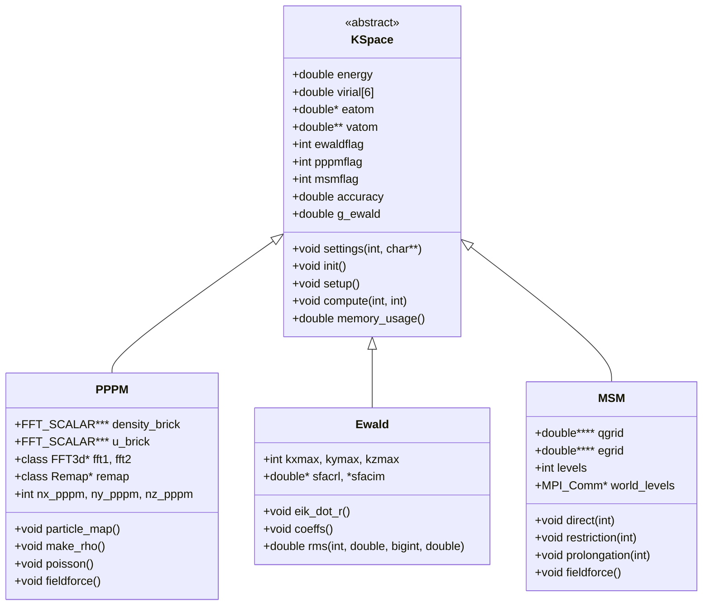

Long-range electrostatic interactions present a fundamental computational challenge in molecular dynamics simulations. This page documents LAMMPS's comprehensive K-space architecture, which provides multiple sophisticated methods for efficiently computing Coulombic forces that decay as 1/r across periodic boundaries. These methods bridge the gap between physical accuracy and computational efficiency through sophisticated mathematical transformations and parallel grid-based algorithms.

## Architectural Overview

The K-space subsystem in LAMMPS is built around a modular object-oriented architecture centered on the abstract `KSpace` base class, which defines a unified interface for all long-range electrostatic solvers. This design enables seamless switching between different algorithms while maintaining consistent integration with pair styles, thermostatting, and output systems. The architecture supports three primary computational approaches: classical Ewald summation, Particle-Particle Particle-Mesh (PPPM), and Multilevel Summation Method (MSM), each optimized for different system characteristics and computational resources.

The `KSpace` base class [src/kspace.h#L21-L258](src/kspace.h#L21-L258) provides the foundational infrastructure including energy accumulation, virial computation, per-atom quantity storage, and accuracy control mechanisms. It defines key flags identifying the solver type (`ewaldflag`, `pppmflag`, `msmflag`) and configurable parameters like `accuracy`, `g_ewald`, and grid dimensions. Virtual methods ensure polymorphic behavior for initialization, setup, computation, and memory management.

## Computational Methods

### Particle-Particle Particle-Mesh (PPPM)

PPPM represents the workhorse method for most LAMMPS electrostatic simulations, achieving O(N log N) scaling through clever decomposition of the Coulomb sum into real-space and reciprocal-space components. The method discretizes continuous charge distributions onto a regular grid, applies FFTs to solve Poisson's equation efficiently, and interpolates forces back to particle positions using smooth assignment functions.

The PPPM implementation [src/KSPACE/pppm.h#L28-L196](src/KSPACE/pppm.h#L28-L196) supports multiple differentiation schemes (ik and ad variants) and can handle triclinic simulation boxes. Key data structures include `density_brick` for charge density on the real-space grid, `u_brick` for the electrostatic potential, and various FFT work arrays. The algorithm proceeds through four distinct phases:

**Charge Assignment**: The `particle_map()` and `make_rho()` methods [src/KSPACE/pppm.cpp#L1788-L1885](src/KSPACE/pppm.cpp#L1788-L1885) map atomic charges to grid points using order-weighted assignment functions, computing 1D interpolation coefficients `rho1d` and `rho_coeff` that distribute partial charges to neighboring grid cells.

**Poisson Solution**: The `poisson()` method [src/KSPACE/pppm.cpp#L1906-L2118](src/KSPACE/pppm.cpp#L1906-L2118) applies forward FFTs to transform the charge density to reciprocal space, multiplies by the Hockney-Eastwood Green's function computed in `compute_gf_ik()` or `compute_gf_ad()`, and applies inverse FFTs to obtain the potential.

**Force Computation**: The `fieldforce()` methods [src/KSPACE/pppm.cpp#L2329-L2484](src/KSPACE/pppm.cpp#L2329-L2484) interpolate electric fields from grid values using the same assignment functions, with separate implementations for ik (analytic differentiation in k-space) and ad (analytic differentiation in real space) approaches.

**Real-Space Contribution**: A complementary real-space summation handles short-range interactions using the same cutoff as pair styles, ensuring complete force accuracy.

The grid dimensions are automatically optimized in `set_grid_global()` [src/KSPACE/pppm.cpp#L969-L1103](src/KSPACE/pppm.cpp#L969-L1103) based on user-specified accuracy and system properties. The algorithm iteratively adjusts grid spacing until the estimated error meets the target, ensuring factorable grid dimensions for efficient parallel FFT decomposition.

### Ewald Summation

The Ewald method [src/KSPACE/ewald.h#L27-L78](src/KSPACE/ewald.h#L27-L78) provides the reference implementation with exact (up to truncation) computation of Coulomb sums through convergence-accelerated sums in both real and reciprocal space. While scaling as O(N^(3/2)), Ewald remains valuable for validation, small systems, and cases requiring extremely high precision.

Key implementation components include the complex exponential precomputation `eik_dot_r()` [src/KSPACE/ewald.cpp#L497-L677](src/KSPACE/ewald.cpp#L497-L677) that computes structure factors for all reciprocal lattice vectors, and the `coeffs()` method [src/KSPACE/ewald.cpp#L756-L1023](src/KSPACE/ewald.cpp#L756-L1023) that calculates energy and virial contributions by iterating over k-vectors up to user-specified cutoffs. The method automatically determines optimal k-space cutoffs in `setup()` [src/KSPACE/ewald.cpp#L209-L340](src/KSPACE/ewald.cpp#L209-L340) based on target accuracy using an RMS error estimate function.

### Multilevel Summation Method (MSM)

MSM [src/KSPACE/msm.h#L27-L141](src/KSPACE/msm.h#L27-L141) offers an alternative approach particularly suited for parallel architectures and systems with non-periodic or mixed boundary conditions. The algorithm constructs a hierarchy of grids from fine to coarse resolution, applying direct real-space calculations on the finest level and using restriction and prolongation operators to propagate information between levels.

The hierarchical nature is evident in the data structures: `qgrid` and `egrid` are 4D arrays storing charge density and electric field across multiple levels [src/KSPACE/msm.h#L67-L70](src/KSPACE/msm.h#L67-L70). The computation proceeds through several stages:

**Direct Summation**: The `direct()` method [src/KSPACE/msm.cpp#L1529-L1760](src/KSPACE/msm.cpp#L1529-L1760) computes interactions using convolution with a truncated 1/r kernel on each grid level, with `direct_top()` handling the coarsest level analytically.

**Restriction**: The `restriction()` method [src/KSPACE/msm.cpp#L2245-L2316](src/KSPACE/msm.cpp#L2245-L2316) coarsens grid quantities by averaging finer grid values onto coarser grids, transferring information upward in the hierarchy.

**Prolongation**: The `prolongation()` method [src/KSPACE/msm.cpp#L2317-L2418](src/KSPACE/msm.cpp#L2317-L2418) interpolates coarse grid corrections back to finer levels, typically using linear or higher-order interpolation.

MSM's key advantage is its natural decomposition onto distributed memory systems without requiring all-to-all communication patterns typical of FFT-based methods. The implementation supports up to `MAX_LEVELS` (10) hierarchical levels and includes sophisticated grid communication via the `Grid3d` classes.

## Accuracy Control and Parameter Selection

All K-space methods provide automatic parameter optimization based on user-specified accuracy targets. The `KSpace` base class stores both relative (`accuracy_relative`) and absolute (`accuracy_absolute`) accuracy parameters [src/kspace.h#L101-L103](src/kspace.h#L101-L103), with the actual working accuracy computed as the maximum of user-specified absolute accuracy and relative accuracy scaled by a reference force estimate.

PPPM uses sophisticated error estimation formulas derived from truncation analysis of the charge assignment and differentiation operators. The `estimate_ik_error()` function [src/KSPACE/pppm.cpp#L1246-L1262](src/KSPACE/pppm.cpp#L1246-L1262) estimates force errors based on grid spacing, system size, and particle count, while `compute_df_kspace()` [src/KSPACE/pppm.cpp#L1131-L1154](src/KSPACE/pppm.cpp#L1131-L1154) provides error estimates for analytic differentiation schemes.

MSM employs similar automatic grid sizing in `estimate_1d_error()` and `estimate_3d_error()` [src/KSPACE/msm.cpp#L195-L261](src/KSPACE/msm.cpp#L195-L261), which analyze truncation errors based on the number of hierarchical levels and grid resolution. The `gamma()` and `dgamma()` functions [src/kspace.h#L183-L218](src/kspace.h#L183-L218) implement piecewise polynomial approximations of the influence function used in MSM calculations.

> [!TIP]
> The automatic parameter optimization can be overridden using explicit grid specification commands. For production runs, it's recommended to first run with `kspace_modify` options to allow LAMMPS to tune parameters, then verify the achieved accuracy against your simulation requirements before locking in specific grid dimensions for large-scale production runs.

## Specialized Variants and Extensions

The K-space framework includes numerous specialized implementations for particular physical models and computational scenarios:

**TIP4P Water Models**: `pppm_tip4p` [src/KSPACE/pppm_tip4p.h](src/KSPACE/pppm_tip4p.h) and `ewald_tip4p` variants implement virtual charge sites for TIP4P water geometry, where the negative charge is displaced from the oxygen atom along the molecular bisector. This requires specialized charge mapping and grid interpolation to handle the off-site charge position.

**Dipole Interactions**: `pppm_dipole` and `ewald_dipole` [src/KSPACE/ewald_dipole.h](src/KSPACE/ewald_dipole.h) extend the methods to handle polarizable point dipoles rather than fixed charges, computing both dipole-dipole interactions and the mutual induction self-consistently.

**Spin Systems**: `ewald_dipole_spin` [src/KSPACE/ewald_dipole_spin.h](src/KSPACE/ewald_dipole_spin.h) adds support for magnetic dipole interactions in spin dynamics simulations, incorporating the anisotropic nature of dipole-dipole coupling for magnetic moments.

**Dispersion Forces**: `pppm_disp` [src/KSPACE/pppm_disp.h](src/KSPACE/pppm_disp.h) and `ewald_disp` variants compute long-range van der Waals interactions (typically r^(-6) terms) using similar techniques, with separate grid parameters (`nx_pppm_6`, `g_ewald_6`) for the 1/r^6 kernel.

**Staggered Grids**: `pppm_stagger` [src/KSPACE/pppm_stagger.h](src/KSPACE/pppm_stagger.h) implements a staggered grid approach that can improve accuracy for certain differentiation schemes by offsetting grid positions.

## Parallelization and Performance

The K-space methods are designed for efficient parallel execution across both distributed memory (MPI) and shared memory (thread) architectures. PPPM and MSM use sophisticated domain decomposition of the computational grid, with each processor responsible for a subdomain including ghost regions for communication.

The `Remap` class [src/KSPACE/remap.h](src/KSPACE/remap.h) handles the complex data redistribution required for FFT transposes, efficiently redistributing grid data between different processor arrangements optimized for each FFT dimension. The FFT3D wrapper provides access to multiple FFT libraries (FFTW, Intel MKL, etc.) through a unified interface.

Communication patterns are controlled by flags like `collective_flag` and `nonblocking_flag` [src/kspace.h#L132-L134](src/kspace.h#L132-L134), allowing optimization for specific network architectures. The grid communication methods (`pack_forward_grid`, `unpack_forward_grid`, `pack_reverse_grid`, `unpack_reverse_grid`) [src/KSPACE/pppm.h#L145-L148](src/KSPACE/pppm.h#L145-L148) handle the exchange of ghost cell information between neighboring processors.

For hybrid MPI+OpenMP execution, the K-space classes support threaded computation of particle-to-grid interpolation and force interpolation, with careful attention to thread safety and load balancing.

## Integration with Pair Styles

The K-space subsystem integrates seamlessly with LAMMPS pair styles through the Coulomb splitting paradigm. Long-range Coulomb styles like `coul/long`, `lj/cut/coul/long`, and `buck/coul/long` [src/KSPACE/pair_coul_long.h](src/KSPACE/pair_coul_long.h) implement the real-space portion of the Ewald/PPPM splitting, while the K-space solver computes the complementary reciprocal-space contribution.

This splitting requires careful coordination of parameters: the real-space cutoff used by pair styles must match the value employed by the K-space solver to avoid double-counting or gaps in the force calculation. The `g_ewald` parameter controls the balance between real and reciprocal space work, with larger values increasing real-space computation and reducing K-space grid requirements.

The `two_charge()` method [src/kspace.h#L141](src/kspace.h#L141) computes a reference force between two unit charges at 1 Å separation, used for accuracy normalization and parameter scaling across different unit systems.

## Advanced Features

**Slab and Wire Geometries**: Specialized correction terms handle systems with mixed periodic/non-periodic boundaries. The `slabcorr()` method [src/KSPACE/pppm.cpp#L2851-L2911](src/KSPACE/pppm.cpp#L2851-L2911) adds a 2D Ewald correction for slab geometries where the simulation cell is periodic in x-y but finite in z, accounting for the missing periodic images in the confined dimension.

**Group-Group Interactions**: Both PPPM and Ewald support efficient computation of electrostatic interactions between atom groups via the `compute_group_group()` method [src/KSPACE/pppm.cpp#L3012-L3368](src/KSPACE/pppm.cpp#L3012-L3368). This is useful for computing interaction energies between solutes, surfaces, or other subsystems without storing the full pairwise force matrix.

**Per-Atom Quantities**: When enabled via compute flags, the K-space methods accumulate per-atom energy and virial contributions in `eatom` and `vatom` arrays [src/kspace.h#L72](src/kspace.h#L72), supporting energy decomposition and stress analysis at the atomic level.

**Triclinic Box Support**: Most K-space variants handle triclinic (skewed) simulation boxes through coordinate transformation functions `x2lamdaT()` and `lamda2xT()` [src/kspace.h#L149-L151](src/kspace.h#L149-L151) that map between fractional and Cartesian coordinates, with specialized Green's function computation in `compute_gf_ik_triclinic()` [src/KSPACE/pppm.cpp#L1514-L1604](src/KSPACE/pppm.cpp#L1514-L1604).

## Performance Tuning Guidelines

**Choosing the Right Method**: For most bulk periodic systems, PPPM offers the best combination of accuracy and performance. Ewald may be preferred for small systems or validation. MSM excels for non-periodic systems, slab geometries, or on architectures with limited all-to-all communication performance.

**Parameter Selection**: Start with automatic parameter selection using relative accuracy (e.g., `kspace_style pppm 1.0e-4`), then examine the output to verify achieved accuracy. For production runs, consider fixing grid parameters using `kspace_modify grid nx ny nz` to ensure consistent performance across runs of varying system size.

**Balancing Real/Reciprocal Work**: Adjust the Ewald splitting parameter using `kspace_modify gewald value` to optimize load balance between pair style computation (real space) and K-space computation. Larger values increase real-space work and reduce grid requirements.

**FFT Library Selection**: LAMMPS can use different FFT backends (FFTW, Intel MKL, KissFFT). The choice can significantly impact performance on specific hardware. Test multiple options using compilation flags to find the optimal configuration for your system.

**Communication Optimization**: For large-scale parallel runs, experiment with the `collective` and `diff` (differentiation method) flags to optimize communication patterns. The `diff ad` (analytic differentiation) option may reduce communication volume at the cost of additional computation.

> [!TIP]
> The `fix tune/kspace` command automatically performs parameter optimization by running short benchmark calculations with different grid sizes and differentiation methods, then selecting the configuration that minimizes estimated execution time while meeting accuracy targets. This is invaluable for large production simulations where parameter tuning is otherwise time-consuming.

## Table: K-space Method Comparison

| **Method** | **Scaling** | **Best For** | **Parallelization** | **Memory Usage** | **Special Features** |
|------------|------------|--------------|---------------------|-----------------|---------------------|
| **PPPM** | O(N log N) | Bulk periodic systems | Excellent (FFT-based) | Moderate | Multiple differentiation schemes, highly optimized |
| **Ewald** | O(N^(3/2)) | Small systems, validation | Good | Low | Simple implementation, high accuracy |
| **MSM** | O(N log N) | Non-periodic, slabs, heterogeneous systems | Excellent (hierarchical) | High | Natural domain decomposition, slab corrections |
| **PPPM/Dipole** | O(N log N) | Polarizable systems | Good | Moderate | Mutual induction, dipole-dipole interactions |
| **PPPM/Disp** | O(N log N) | Long-range dispersion | Good | High | r^(-6) van der Waals, combined with electrostatics |

## Table: Key Accuracy Parameters

| **Parameter** | **Description** | **Default** | **Typical Range** |
|---------------|-----------------|-------------|-------------------|
| `accuracy` | Target relative force accuracy | 1.0e-4 | 1.0e-2 to 1.0e-6 |
| `accuracy_absolute` | Target absolute force accuracy | Computed from relative | User-specified if needed |
| `g_ewald` | Ewald splitting parameter | Auto-optimized | 0.01 to 1.0 (1/length) |
| `order` | Charge assignment order | Auto-optimized | 4 to 7 (even numbers) |
| `nx_pppm, ny_pppm, nz_pppm` | FFT grid dimensions | Auto-optimized | Determined by accuracy |
| `ewald/disp` | Dispersion accuracy | 1.0e-4 | Matches Coulomb accuracy |

## Conclusion

LAMMPS's K-space architecture provides a comprehensive toolkit for computing long-range electrostatic interactions with high accuracy and efficiency. The modular design, automatic parameter optimization, and extensive parallelization support enable simulations ranging from small validation systems to large-scale production runs across diverse physical scenarios. Understanding the trade-offs between different methods and tuning their parameters appropriately is essential for achieving optimal performance while maintaining scientific rigor in electrostatic force calculations.

For further exploration of simulation techniques, see [Energy Minimization Algorithms](20-energy-minimization-algorithms), which discusses methods that work with K-space forces for system relaxation. The [MPI Parallelization Strategy](24-mpi-parallelization-strategy) documentation provides deeper insights into how K-space methods scale in distributed computing environments.
